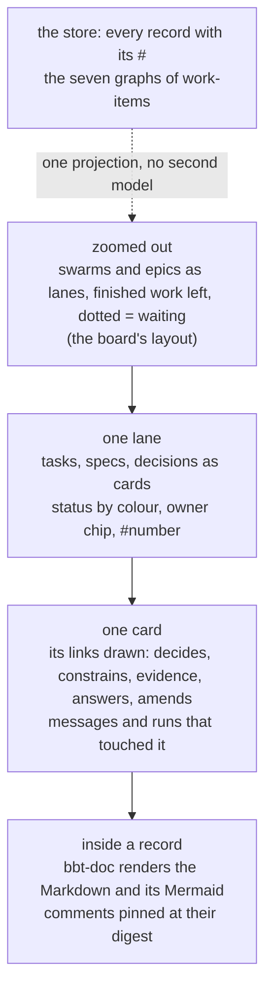

# Decision 49: the swarm canvas

Direction from the operator, 2026-10-23, shown the Oracle's live board at `http://127.0.0.1:8765` (`~/mydev/bboxy450-board`: `workgraph.mmd`, `board.json`, one page): lanes per area, finished work left, running and waiting coloured, dotted arrows for "waiting on", owner on the card. **Logged for later, nothing briefed**, the same standing as [[d41-plugins]]: the cockpit comes first.

**Alternatives.** (a) A force-directed node cloud over every record and message. (b) The board as it is, hand-fed from `.mmd` files, grown to a swarm. (c) A structured, endlessly zoomable canvas inside the app, laid out like the board, drawn from the store, with semantic zoom from swarms down to the inside of a record.

**Choice.** (c).

**Reason.** The operator's words: structured, not "bobbly three js style pointless", actually useful. The board already proves the layout that reads: lanes, left-to-right order, status by colour, dotted waits. What it lacks is scale and depth, and both come from what landed tonight: every record is a file with a `#` ([[d47-decision-nodes]], [[d48-every-record-has-a-number]]) and the seven graphs of [[work-items]] (markdown, artifact, task, execution, code, channel, messaging) are built from the same index. The canvas is one projection of that store, never a second model to maintain; (b) is hand-maintained and stops at one project; (a) is the thing the operator named and rejected.

**What it is.** One canvas, zoom without end. Zoomed out, swarms and epics as lanes with the board's grammar. One lane: tasks, specs, decisions, research, comments as cards with status, owner chip and `#`. One card: its edges drawn with their relation names (`decides`, `constrains`, `evidence`, `answers`, `amends`, `on`), the messages and runs that touched it from the messaging and execution graphs. Inside a record: `bbt-doc` renders the Markdown and its Mermaid in place, comments pinned at their digest beside the text. Layout is `bbt-mermaid`'s rank engine over the task and markdown graphs (lanes are ranks, rows are areas), so the canvas and the diagrams in the documents share one layout truth. The Graph tab of [[ux-flow]] (⌘G: agents, work tree, provenance card, listens-to) is the first zoom level of this canvas, not a different thing.

**What it builds on, in order.** The `#47`/`#48` sweep (nodes and numbers); `bbt-doc` and `bbt-mermaid` as they are; the index and graphs of [[work-items]] once the indexer exists; the GPU draw list of [[gui-components]] for a canvas with thousands of cards (the same culling the sidebar got at 1000 rows). A kit, not app code: the canvas is a `bbt-ui` module any suite app can host (decision #39).

**Not decided.** When. What the board's `.mmd` becomes once the canvas reads the store directly (the board stays until then). Whether a swarm's canvas is shared live between operators (cloud phase).

Owner: Corvin Duskmantle <ARCHITECT>.
