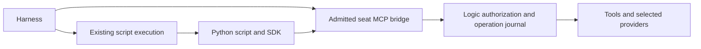

Historical evidence retained from the earlier authoring step. The current operator-approved contract is [[programmatic-tool-access]]; paths and design statements below describe that earlier step.

# Programmatic tool access for harness scripts

Status: proposed design, based on observed tool traces. This numbered KB spec defines a proposed implementation; it does not claim the runtime exists or change current permissions. Related worker provisioning contract: [[workspace-provisioning]].

## 1. Decision

Build a small Python client for the existing bboxy MCP interface. Run ordinary Python files or quoted heredocs through the harness's existing execution tool. Keep Codex's existing JavaScript Code Mode path. Both use the same tool schemas, current-seat authority and operation journal.

**First delivery: synchronous Python SDK and its launch integration.** No new Python interpreter inside the supervisor, no bboxy JavaScript VM, no new `code_execute` MCP endpoint, no general-purpose shell/process tool added to bboxy. Async Python and a JavaScript client are follow-ups only when a demonstrated caller needs them. The default connection is serial; do not advertise parallel execution over it.

The practical gain is less CLI glue, correct authority, structured results and recoverable writes. Existing Python heredocs already batch local work in one tool invocation. Replacing those heredocs with an SDK does not by itself reduce model round trips.

## 2. What was inspected

Frozen event window: **2026-10-29T20:23:41Z through 2026-11-05T20:23:41Z**. Native `~/.codex/sessions` and `~/.claude/projects` JSONL traces; 40 recent files per provider, stratified toward main and child traces (target 24/16, with unused slots filled from remaining recent files), at most the last 4 MiB of complete rows per file. Included subagent files: Codex 16, Claude 20. They are **80 trace files, not 80 independent users or sessions**.

Only recorded tool inputs/results were analyzed. User conversations, reasoning blocks and private prompts were excluded from the analysis. Scripts were parsed, never executed. Source manifests retain file/line/call identifiers and snapshot hashes privately. Three files from the researcher's prior task history or direct children were excluded after matching the actual trace; the ATC-reported current provider id alone did not identify that history.

Launch-directory bias: all 40 selected Codex files launch in Harmony; Claude includes 34 Harmony and 6 bboxy files. A launch directory is not necessarily the target repository of every command. The newest selected Claude native logs are Nov 3; this sample does not establish behavior of later Claude ACP profiles or other homes. Tails, dynamic JS arguments, branches and loops limit coverage. These are descriptive counts, not population estimates or runtime benchmarks.

| Observable | Codex | Claude |
|---|---:|---:|
| Top-level logged tool requests | 1,031 | 3,272 |
| Code Mode `exec` cells | 969 | 0 |
| Statically reconstructed `cmd`/`command` strings | 911 | 2,375 |
| Commands containing Python heredocs | 202 | 146 |
| Python heredoc bodies | 203 | 146 |
| Bodies parsed successfully as Python AST | 203 | 146 |
| Files containing a Python heredoc | 18 | 18 |
| Quoted heredoc delimiters | 203 | 143 |
| Median heredoc lines | 8 | 18 |
| Bodies with JSON processing | 132 | 20 |
| Bodies with file-mutation syntax | 76 | 128 |
| Bodies with subprocess orchestration | 62 | 9 |
| Bodies with validation/inspection syntax | 56 | 87 |
| Logged result rows over 16 KiB | 305 / 1,036 | 37 / 3,274 |

Categories overlap. Mutation includes generated reports and fixture files, not only source edits; static syntax does not prove every branch ran or succeeded. Result encodings differ between providers, so their byte counts are not comparable model-token counts. The three unquoted heredocs show why recipes should use files or `<<'PY'`, but do not establish that quoting caused a failure.

Codex JS contains static references to `exec_command` (869), `knowledge_fetch` (196), `knowledge_write` (92), `task_status` (42), `operation_status` (30), `knowledge_commit` (26), `knowledge_orient` (25) and `knowledge_search` (23). These count **source call sites in submitted cells**, not confirmed nested runtime calls. Claude directly logs Bash (2,350), Edit (443), `message_send` (54), ToolSearch (42), `knowledge_write` (29), `message_ack` (26), `knowledge_fetch` (21) and `task_delegate` (17). Direct requests and JS source references must not be combined into one invocation frequency.

### Actual MCP payloads and failures

A separate pass over the same Claude rows inspected MCP argument **key names and document types**, and paired error flags with their originating tool requests. All 29 `knowledge_write` requests supplied frontmatter/body: 24 tasks and 5 reports; 14 supplied `path`; `ref` and `etag` each appeared in 15 requests. Fourteen included an `authorship` field. `knowledge_fetch` used `locator` in all 21 requests, with `body_offset` in 2 and `etag` in 1.

Paired error objects include `invalid_report` (4), `task_field_protected` (2), `workspace_pending` (4), `provider_busy` (3), and `conflict` (1). These are historical requests/results, not a claim that those bugs remain in the installed version. The design consequence is concrete: preserve refs/etags and paging, distinguish editable frontmatter from returned custody metadata, and return the complete structured correction/recovery result. Do not claim that changing programming language fixes validation or provider admission. Audit: `mcp-shapes.json`.

### Observed work and design consequence

| Evidence | Recorded work | Consequence |
|---|---|---|
| H0102, Codex | Runs several code-intelligence CLI queries, parses JSON, compares indexed files to Git's tracked files, and writes coverage/stale reports. | Keep local Python/Git/rg workflows; provide structured tool data where available. Do not add a bboxy analytics wrapper or automatically retry empty analytics. |
| H0154, Codex | A helper wraps a CLI with stdin, cwd, environment, timeout, stdout/stderr and exit status; then prepares document-source writes with a generation precondition. | Preserve request arguments and preconditions exactly. Avoid parsing human CLI output. Diagnostics must not copy the full environment as this historical helper does. |
| H0098 and H0147, Codex | Reads verification JSON, checks exit codes/source hashes, gathers Git evidence, and writes a compact handoff. | Structured results, small final output and file artifacts matter. A tool response is evidence only for the operation it actually confirms. |
| H0009, Codex; H0251 and H0236, Claude | Rewrites source files; Claude examples assert a unique match before replacing text. | Ordinary Python remains useful for local editing. Do not build a second bboxy filesystem/edit API to replace Python or the harness's existing edit tools. |
| H0118, Codex | Starts a private preview, waits for HTTP readiness, collects responses, and terminates the exact child in cleanup. | Existing process/session handles, cancellation and cleanup remain the execution harness's responsibility. The SDK does not restart or kill unrelated processes. |
| H0209, Claude | Restores seats in a loop, calling a CLI, parsing the first stdout line as JSON and keeping an old-to-new id map. | Seat/role controls are useful to scripts, but must use current admitted tools and permissions. Do not reproduce historical operator-CLI access in an Executor SDK. |
| H0233, Claude | Loops through records, invokes GitKB operations and writes per-item outcomes. | Support ordinary loops over structured tool calls and individual receipts. No opaque batch success or implicit remote publication. |

Private evidence: `~/.local/state/bboxy450-term/programmatic-tools-study-20261105/{summary,manifest,python-evidence,reviewed-cases}.json`; reproducible analyzer: `analyze.py`. Sensitive examples, including credential-inspection scripts, are not published as recipes. Case pointers are listed in section 10.

## 3. User-visible behavior

A Codex, Claude or other harness running inside bboxy can import the client from a normal Python script, discover its currently permitted bboxy tools and invoke them with JSON arguments. It can combine tool results with stdlib processing and print a concise answer or save an artifact. It does not need to launch and parse the operator `ctl` command for each operation.

Python is the first binding because both sampled providers already submit Python, with predominantly synchronous code. JavaScript callers keep using their native MCP/Code Mode adapter; the host does not force every harness through JavaScript merely to reach Python. This is bboxy tool access, not an aggregator for arbitrary external MCP servers.



No model inference, filesystem operation, Python execution or subprocess wait is added to the supervisor/control thread. Each harness retains its normal script approval, working-directory, resource and cancellation behavior. Using the SDK does not grant new shell, plugin, network, role or root access.

## 4. Proposed Python API

Distribution name: `bboxy450-client`; Python import: `bboxy450`. Names below are proposed, not currently installed APIs.

```python
import json
from bboxy450 import Client, ToolError, TransportError

with Client.from_seat() as b:
    page = b.call("knowledge_search", {
        "query": "type:task status:open", "limit": 32
    })
    print(json.dumps({"matches": len(page.structured["items"]),
                      "next": page.structured.get("next"),
                      "hints": page.hints}, ensure_ascii=False))
```

| API | Contract |
|---|---|
| `Client.from_seat()` | Use only the current launch's configured seat MCP command and inherited admission. Validate missing launch context before any RPC. Never fall back to the operator door. |
| `client.instructions` | Expose the MCP initialize instructions unchanged; these are not silently considered model-read. |
| `client.catalogue(refresh=False)` | Return current role-filtered tool descriptions, input/output schemas and annotations. Cache only within this client/context; explicit refresh is available. |
| `client.describe(name)` | Select one entry from that catalogue. No separate per-tool schema registry. |
| `client.call(name, arguments, op_id=None)` | One normal MCP tool call; assign its request operation id before transmission. Return `ToolResult`, or raise a structured error. No automatic retry. |
| `client.status(op_id)` | Call the existing `operation_status` tool for that original operation using its actual advertised schema. A status query succeeding does not make the original write successful. |
| `client.close()` / context manager | Close/reap only its own bridge child and streams. Closing a client does not close a seat, supervisor or provider. |

`ToolResult` retains the original MCP result: full `structuredContent` via `.structured`, `content`, `isError`, and `_meta`. `.hints` is a convenience view of `structuredContent.hints`; the canonical result still contains them. `.request_op_id` is the request id assigned by the client, separate from any operation ids mentioned inside tool data. Signed provider documents and opaque refs, cursors, digests and etags are never normalized or reconstructed.

A domain `isError` raises `ToolError` carrying the complete result, request operation id, error code and hints. JSON-RPC failures and uncertain transport completion raise distinct errors with the operation id and known transport phase. Do not infer an error from arbitrary nested `status`/`error` fields in a successful document or status-query result. Exception formatting is bounded and includes corrective hints; it does not print credentials, whole documents or raw environment dumps.

No custom Python DSL or hand-written wrapper for every tool. Local validation checks the JSON envelope and advertised schemas where supported; host validation remains authoritative, including semantic document checks. Never claim local validation proves a tool call will succeed.

## 5. Transport and launch contract

Reuse the existing installed `bboxy450-term mcp` seat server command supplied by the launch writer. Obtain the exact existing command/argv from the launch descriptor; do not infer an executable from the working tree or shell-evaluate a command string. If an additional public descriptor is necessary, publish one JSON argv descriptor from that writer and test it as a process boundary. Its exact environment-key spelling is an implementation detail, not a second discovery mechanism.

The existing bridge reads `BBOXY_SOCK`, `BBOXY_SEAT_ID`, `BBOXY_GENERATION` and inherited capability custody. Credentials stay inherited in the process tree and never appear in command arguments, returned artifacts or client diagnostics. The SDK neither invents a seat identity nor accepts a role/author/operator override. Logic resolves current authority on every call; catalogue visibility alone is not permission.

Preserve the captured workspace/provider binding and source preconditions. A moved root, changed generation/grant/provider or stale etag is a structured refusal requiring the caller to re-read/replan. Do not reroute a pending write to a new root or replace an etag automatically.

The current bridge's stdio loop is synchronous; one client serializes its calls. Different clients/seats remain independent. Do not add a global Python interpreter or shared process mutex. Async support or bounded read fan-out requires separate measured transport work; accepting concurrent coroutines must never be advertised as actual concurrent provider execution without evidence.

Use current MCP framing and native bounds (64 KiB tool arguments, 512 KiB result payload, 1 MiB bridge frame at this source revision). Discover/retain versioned limits with the bridge contract rather than maintaining looser copies. Reject oversized requests explicitly. Use existing knowledge paging/body-offset and resource/artifact facilities; do not silently truncate a document, result or corrective hint. A larger Python timeout cannot extend the bridge's current 10-second seat-read deadline.

## 6. Operation identity, errors and interrupted runs

Reuse the existing `_meta["bboxy450/op_id"]` request metadata. For tools whose catalogue advertises/requires `arguments.op_id`, put the same id there. Conflicting explicit ids fail locally before send; the host's mismatch check remains. Do not add that argument to unrelated strict schemas or hide id allocation inside a provider subprocess.

Before a mutating request can be sent, its id must be recoverable by the caller after Python or its outer tool loses output. Use the existing private run/evidence facility for a bounded id index, or a caller-supplied durable operation id. Such an index contains only context, tool name, request id and completion reference; the native operation journal remains the sole authority for outcome. Never log full environments or payloads to create it.

| Observed boundary | Required interpretation |
|---|---|
| Local serialization/schema failure before send | Request not sent; no claim about other calls in the script. |
| Explicit native rejection | Preserve code, fields, hints and receipt; let the model correct the stated problem. |
| Accepted/pending operation | Not completion. Use the native status/recovery instructions. |
| Disconnect, timeout or cancellation after send | May have run. Preserve the id and ask `operation_status`; no automatic retry or new id. |
| Completed operation | Use its actual receipt/read-back requirements; process exit 0 alone is insufficient. |
| Outer harness hook rejects after execution | The nested operation may already have completed. Recover by id; do not re-run the whole script. |

A script is not a transaction. Earlier writes, local file edits or subprocess side effects can survive a later error. No blanket rerun, rollback or resume-all behavior. An annotation such as `idempotentHint` is not an override of the journal's `retry_allowed`/unknown rules.

Prefer a separate direct model-visible call for a final publication/commit decision after a script has assembled evidence. This is workflow guidance, not a claim that ordinary MCP metadata can force Codex to bypass its native Code Mode. SDK calls made inside Python do not automatically traverse Codex/Claude per-tool hooks; only bboxy's existing authorization and journal are guaranteed. Any finer harness-hook integration must be explicit and tested.

## 7. Knowledge workflow and human output

The model still calls `orient` and `knowledge_orient` for the current provider, reads its skills/types and prepares a valid payload. Executing orientation inside Python and discarding its output is not evidence that the model received the skill. Document this before write examples; surface new required guidance and corrective hints in the model-visible summary/error, rather than silently treating a script call as acknowledgement.

Write recipes construct only explicitly editable fields; they do not copy fetched `authorship`, owners, delegation, provenance, ids or counters back into a new mutation. Keep the returned source reference/etag separate, and use the permitted `task_*` lifecycle operations for task transitions. A generic client neither silently strips custody fields nor fabricates them; host refusal and current type guidance remain visible to the caller.

Writes remain drafts. `knowledge_commit` is a deliberate checkpoint for a substantial change, sharing preparation or final acceptance; it never implies remote push. Generic client code must not fill in author/timestamps, choose task statuses, switch providers, commit every edit or execute response hints as actions. Add type-specific helpers only against the live dictionary, with their behavior separately specified.

Scripts may produce JSON/CSV summaries, Markdown tables, Mermaid diagrams and local evidence files. Keep source arguments, full intermediate results and large artifacts out of the default model-visible output; retain bounded provenance/operation references and any guidance needed to act correctly. User-facing reports state exit status and receipt state separately, and never turn a rejected/unknown call into success by printing a successful loop summary.

## 8. Acceptance and verification for implementation

All tests use a private account/home/socket and fake providers; no paid model, operator click or credentials are needed. Integrate the following focused targets into Make; names are implementation proposals: `make test-python-client`, `make test-python-client-boundaries`, `make test-python-client-models`. Existing layer/license/package checks still apply. Do not run a full unrelated suite just to validate Python formatting or docs.

| Case | Required evidence |
|---|---|
| Codex and Claude recipes | The same ordinary `.py` file or quoted stdin recipe obtains permitted tools and structured results through each launch environment, with no new JS runtime. |
| Admission | Missing credentials, wrong/stale generation, revoked grant and cross-root writes fail; no fallback to operator `ctl`, global config or another seat. |
| Payload fidelity | Quotes, `$()`, backticks, Unicode, YAML/Markdown and Mermaid reach the tool as the exact JSON data; no shell interpolation. Opaque preconditions remain unchanged. |
| Results and hints | Full structured data, canonical hints, content/media blocks and domain/JSON-RPC/transport errors survive; a two-field invalid report exposes both corrections. |
| IDs and partial execution | Conflicting ids fail before send. A confirmed write followed by an unknown write and a local exception retains distinct recoverable ids; whole-script retry is never suggested. |
| Lost output | Simulate a tool completing before the outer execution result is suppressed. Status recovery confirms the original receipt without another side effect. |
| Lifecycle | Cancelling/killing Python, closing its client, duplicate/delayed replies and generation A→B→A never close the backend, revive a closed seat or apply a response to a new context. |
| Paging and limits | Opaque pages/body offsets work; oversized requests fail explicitly, large results use existing artifact/paging facilities, and hints are not lost by truncation. |
| Resource use | Multiple independent SDK clients leave control/GUI requests responsive; no shared interpreter/lock or increased provider admission serialization. Record actual timing/heap/process counts. |
| Workload comparison | Reproduce sanitized read/transform/verification/loop recipes inspired by H0102/H0098/H0147/H0233; compare direct MCP, today's CLI/heredoc and SDK paths. Measure underlying calls, model turns, result bytes, wall time and client startup separately. No invented token or speedup claim. |

Before implementation, model operation states `prepared → sent → known / unknown`, caller generation, closed/cancelled state and delayed/duplicate completion. Safety: no authority upgrade, no second side effect while an earlier outcome is unknown, and no stale-generation completion applied as current. A replay must never duplicate a side effect. Liveness: admitted reads/status checks terminate under stated fair scheduling and bounded transport assumptions. An external effect may remain unknown without an authoritative receipt. Add broken controls removing each guard; connect finite model witnesses to real Python/native process tests and update the existing formal coverage/contracts. Do not claim these models already exist.

## 9. Delivery and deferred work

1. Implement the small sync client, full result/error contract and private-account tests against the existing bridge. Package it through Make with the suite's license/notices; no global Python installation or configuration changes.
2. Provide the package through the existing trusted launch overlay/package mechanism so a seat's ordinary interpreter can import it. Test project virtualenvs and make isolated `python -I` behavior explicit. No interpreter-path guessing or hidden global `PYTHONPATH` mutation.
3. Ship concise Codex/Claude recipes: discover/describe, read/filter, explicit draft write, deliberate commit, and status recovery. Keep historical CLI commands and statuses out of the recipe API.
4. Benchmark the observed workflows. Add async transport/bounded fan-out or a thin JS client only for a measured gap. Codex's native JS tool callbacks remain supported throughout.

A bboxy-owned `code_execute` MCP tool is a separate proposal if a harness lacks a usable execution tool or shared execution custody is required. It would need process/resource/cancellation, nested-call visibility, recoverable output and formal lifecycle contracts of its own. The current corpus does not justify implementing it first. Do not turn raw GitKB commands, private SQLite files or credentials into a new shortcut around bboxy's current provider/workspace/role contracts.

## 10. Evidence and current code

The following are private local pointers, not transcript copies. Cases are requests visible in logs; their summaries describe code behavior without asserting all historical effects succeeded.

- **H0102 (codex)** — [rollout-2026-11-05T08-49-00-01a1ac9d-1eaf-7012-804a-771afa2eb8cb.jsonl:105](/Users/feral/.codex/sessions/2026/11/05/rollout-2026-11-05T08-49-00-01a1ac9d-1eaf-7012-804a-771afa2eb8cb.jsonl:105), call `call_a38ad968eac043418f69401f26ca8c09`; 20-line heredoc, logged-source SHA256 `e0de75fe791ea00b51a0a457879872dab5ae3ff6fa18e74e6e4f4e64aa970ef4`.
- **H0154 (codex)** — [rollout-2026-11-05T06-11-26-01a1ac0c-db47-75f1-a815-dd144a18ab4a.jsonl:143](/Users/feral/.codex/sessions/2026/11/05/rollout-2026-11-05T06-11-26-01a1ac0c-db47-75f1-a815-dd144a18ab4a.jsonl:143), call `call_842afe630e5f474494389381ead3de57`; 20-line heredoc, logged-source SHA256 `053c89079bb6f1322ea5651845d8d9a4261090460fb30a66ea9c4c7b384b6340`.
- **H0098 (codex)** — [rollout-2026-11-05T08-56-33-01a1aca4-07c9-7802-8969-450803eb74b1.jsonl:1076](/Users/feral/.codex/sessions/2026/11/05/rollout-2026-11-05T08-56-33-01a1aca4-07c9-7802-8969-450803eb74b1.jsonl:1076), call `call_9ae16a87d38e41b3a69dfa6b8bdec66d`; 20-line heredoc, logged-source SHA256 `43c2a4ce72608fb8c4180f1baa0af32d668e809648b4984a8370dee69e5063ad`.
- **H0147 (codex)** — [rollout-2026-11-05T07-30-17-01a1ac55-0d09-7450-977d-ac24d819eae9.jsonl:228](/Users/feral/.codex/sessions/2026/11/05/rollout-2026-11-05T07-30-17-01a1ac55-0d09-7450-977d-ac24d819eae9.jsonl:228), call `call_bf4496722a1944f193002ea69fd149a4`; 19-line heredoc, logged-source SHA256 `278de76d8d5f511600a883bf5c5ed3b60062fc8d680a1a806862d574708b8408`.
- **H0009 (codex)** — [rollout-2026-11-05T12-01-16-01a1ad4d-22f5-78a0-94b3-5274a0014cc9.jsonl:203](/Users/feral/.codex/sessions/2026/11/05/rollout-2026-11-05T12-01-16-01a1ad4d-22f5-78a0-94b3-5274a0014cc9.jsonl:203), call `call_6b0654456f3f4475affd212a264567cb`; 19-line heredoc, logged-source SHA256 `0b4c74a1d75336bcdb5cac1e22c965bbc337de1f7750772e8bbdd52c8b2015cf`.
- **H0251 (claude)** — [3dac58c8-f6a4-4fe6-9863-8c72a5216d5e.jsonl:14305](/Users/feral/.claude/projects/-Users-feral-work-gitkb-harmony/3dac58c8-f6a4-4fe6-9863-8c72a5216d5e.jsonl:14305), call `toolu_01RUttLR28VugX5QmoG3d758`; 20-line heredoc, logged-source SHA256 `df5acc4273313dc1d3ba26b8d361cce4cd1420146fb34c0e4bbd16298d7971e7`.
- **H0236 (claude)** — [01a19d77-a87b-4ddd-81a6-6989b3fca0a3.jsonl:1133](/Users/feral/.claude/projects/-Users-feral-mydev-bboxy450-term/01a19d77-a87b-4ddd-81a6-6989b3fca0a3.jsonl:1133), call `toolu_013Se2b4oKfhDK9a2FSkUdwj`; 19-line heredoc, logged-source SHA256 `91c57ea60533a05767359770c4cf590c26869d8329e3ba72f9449f684ea4d16d`.
- **H0118 (codex)** — [rollout-2026-11-05T07-30-28-01a1ac55-3666-7940-ba47-5a7ae779ba9b.jsonl:386](/Users/feral/.codex/sessions/2026/11/05/rollout-2026-11-05T07-30-28-01a1ac55-3666-7940-ba47-5a7ae779ba9b.jsonl:386), call `call_7e98fdda7aaa43afa6cd44719d0b6d31`; 27-line heredoc, logged-source SHA256 `1c5d15e2e2647e9e586b8dea2d5308c9499bf5f4047acb478ac8351e3fc3efed`.
- **H0209 (claude)** — [ca834125-1093-481d-9d44-564d73793874.jsonl:9199](/Users/feral/.claude/projects/-Users-feral-mydev-bboxy450-term/ca834125-1093-481d-9d44-564d73793874.jsonl:9199), call `toolu_012qS3JS65FAUZfRE9isG4bP`; 23-line heredoc, logged-source SHA256 `bfd2197797d0893a5ac30c9cb83e5f6f62f198ffd30ecf0af5cf953635105295`.
- **H0233 (claude)** — [01a19d74-755a-40e6-b96f-a2b06e3cfe22.jsonl:437](/Users/feral/.claude/projects/-Users-feral-work-gitkb-harmony/01a19d74-755a-40e6-b96f-a2b06e3cfe22.jsonl:437), call `toolu_01M4RHmm81VKVa6WVj5K4msM`; 15-line heredoc, logged-source SHA256 `b8329a8c728044a9087c545f6a9b68092b0d7aeae3e07302196ef529b94da738`.

- **M1 (knowledge_write, invalid_report)** — request [01a19d77-a87b-4ddd-81a6-6989b3fca0a3.jsonl:569](/Users/feral/.claude/projects/-Users-feral-mydev-bboxy450-term/01a19d77-a87b-4ddd-81a6-6989b3fca0a3.jsonl:569), paired error result at line 571, call `toolu_0139SH7tSRbbiBm3AX23ckXT`.
- **M2 (knowledge_write, task_field_protected)** — request [01a19e35-0e56-44b8-b80d-87384df9e387.jsonl:5396](/Users/feral/.claude/projects/-Users-feral-work-gitkb-harmony/01a19e35-0e56-44b8-b80d-87384df9e387.jsonl:5396), paired error result at line 5405, call `toolu_013UirE5kHXULUB6CvdgeC6A`.

Current implementation anchors:

- `crates/bbt-mux/src/mcp/bridge.rs:43` — admitted bridge configuration from the inherited seat context.
- `crates/bbt-mux/src/mcp/bridge.rs:182` — per-request native socket forwarding and transport deadlines.
- `crates/bbt-mux/src/mcp/bridge.rs:357` — structured tool arguments and explicit operation-id metadata/argument agreement.
- `crates/bbt-mux/src/mcp/bridge.rs:443` — synchronous stdio request loop.
- `crates/bbt-mux/src/mcp/mod.rs:64` — logic-resolved seat actor; `journal.rs:115` — operation status and existing outcome authority.
- `crates/bboxy450-term/src/ctl/records.rs:149` and `ctl.rs:920` — the operator CLI record writer is intentionally e2e-only, not a general seat SDK. Do not widen it for this design.
- `crates/bbt-mux/src/mcp/hints.rs` and `knowledge/types.rs:34` — current structured hint graph and the spec/knowledge workflow dictionary.

Protocol context checked earlier in this discussion: [OpenAI nested Code Mode hooks](https://learn.chatgpt.com/docs/hooks#tool-calls-from-code-mode), [Anthropic programmatic Python tool calling](https://platform.claude.com/docs/en/agents-and-tools/tool-use/programmatic-tool-calling), and [Cloudflare's MCP-to-TypeScript approach](https://blog.cloudflare.com/code-mode/). They establish the pattern and possible failure boundaries, not measured bboxy performance or a guarantee that native harness hooks cover this SDK.
