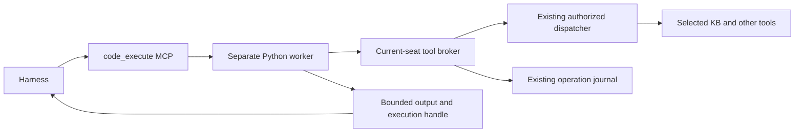

# Make MCP the programmatic execution interface

**A native Python execution MCP tool is a well-supported direction for bboxy.** Current implementations show that MCP can provide the public interface while a separate runtime executes code and calls existing tools through an authorized broker. The Python SDK can become internal plumbing or an optional binding, rather than something every harness must install. The original SDK-first spec minimized implementation work by reusing existing script runners; it did not establish a technical reason to exclude an endpoint. The distinction to preserve is between **tool orchestration** and arbitrary development scripts. The endpoint should compose admitted bboxy tools and reduce their results; ordinary CPython scripts that edit files, launch subprocesses or import packages can continue through the harness's existing execution tools. This recommendation is a design inference from the implementations below, not a claim that bboxy already provides it.

Research checked primary documentation on **2026-11-05**. No paid API calls, cloud deployment or runtime benchmark was performed.

## Current implementations separate execution from tool access

| Implementation | Execution and integration | Useful boundary for bboxy |
|---|---|---|
| OpenAI programmatic calling | Fresh isolated JavaScript/V8 runtime; application executes client-owned calls and supplies correlated outputs. MCP tools can participate and pause for approval. [Official guide](https://developers.openai.com/api/docs/guides/tools-programmatic-tool-calling). | Execution can be hosted separately from actual tool effects. |
| Anthropic programmatic calling | Python in a managed container; host tool results resume execution. Its managed feature currently excludes MCP connector tools. [Platform documentation](https://platform.claude.com/docs/en/agents-and-tools/tool-use/programmatic-tool-calling). | Python orchestration works, but managed PTC is not automatic MCP passthrough. |
| Cloudflare Code Mode | A simple MCP wrapper exposes JavaScript execution; a separate durable runtime adds stored calls, approvals and replay. [MCP wrapper](https://developers.cloudflare.com/agents/model-context-protocol/guides/build-codemode-mcp-server/), [durable runtime](https://developers.cloudflare.com/agents/tools/codemode/durable-runtime/). | A minimal execution interface and durable effect coordination are distinct layers. |
| FastMCP CodeMode | Experimental transform exposes `search`, `get_schema`, `execute`; Python calls existing tools through `await call_tool(...)` with current-request authorization. [Official source documentation](https://github.com/PrefectHQ/fastmcp/blob/main/docs/servers/transforms/code-mode.mdx). | A Python execution endpoint over existing MCP tools is already an implemented pattern. |

OpenAI's hosted programmatic runtime supports top-level `await` and selected output while excluding Node, packages, a general filesystem, subprocesses and direct networking. Client-owned callbacks remain application work; preserving caller correlation lets the program continue. Deferred tools must be discovered before execution. This is distinct from delegating arbitrary computation to Code Interpreter. The transferable idea is a constrained orchestration runtime over typed tools, with filtering before intermediate data enters model context. [OpenAI programmatic calling](https://developers.openai.com/api/docs/guides/tools-programmatic-tool-calling).

Anthropic separately describes a self-managed MCP integration: generate TypeScript interfaces backed by `callMCPTool`, discover relevant methods, and process results inside code. That engineering pattern and its managed Python PTC feature are different integrations. Bboxy need not wait for either model vendor to provide native Python-to-MCP passthrough; it can expose its own ordinary MCP tool. [Anthropic MCP engineering](https://www.anthropic.com/research/code-execution-with-mcp).

Cloudflare's simple wrapper generates method declarations from existing schemas and leaves effect authorization in upstream handlers. Its durable runtime records completed connector calls and uses those results during replay; rejecting a later approval does not undo earlier actions. Those mechanisms are useful references, but the wrapper alone does not provide durable recovery. [Wrapper guide](https://developers.cloudflare.com/agents/model-context-protocol/guides/build-codemode-mcp-server/), [durable execution](https://developers.cloudflare.com/agents/tools/codemode/durable-runtime/).

## Python orchestration does not require full CPython

The local study found 349 Python heredocs across 80 selected Codex/Claude trace files. Many contain file mutations or subprocess orchestration. Those descriptive observations support Python familiarity; they do not show that a restricted orchestration runtime can replace every observed script. They also do not prove that an endpoint would save tokens or time. [Local study](</Users/feral/mydev/bboxy450-term/.bboxy/specs/programmatic-tool-access.md>).

Monty is a candidate worth testing because it implements Python in Rust and exposes explicit host-call suspension. Its Rust integration recommends worker subprocesses for untrusted execution. It remains a Python subset, with documented language and library limitations; its security model distinguishes interpreter confinement from OS isolation. Host callbacks themselves run with host authority, so the broker must validate their inputs and scope. These facts support evaluating Monty, not selecting it without compatibility and process-lifecycle tests. [Rust quickstart](https://pydantic.dev/docs/monty/quickstart/rust/), [security model](https://pydantic.dev/docs/monty/concepts/security/), [limitations](https://pydantic.dev/docs/monty/limitations/).

Bboxy's first contract should therefore name the supported orchestration language subset and tool API. Requiring arbitrary filesystem, package and subprocess compatibility would turn this into a second development execution environment. An optional full-CPython adapter would need its own execution-policy contract; simply launching a subprocess does not supply filesystem/network isolation.

## Bboxy's endpoint should reuse the current dispatcher

The following interface is **proposed**, not installed:

```text
code_execute(op_id, language="python", source, inputs?)
    -> completed bounded output | execution_id and current state

code_get(execution_id, cursor?)
    -> state, output page, result, nested operation references

code_cancel(op_id, execution_id)
    -> cancellation requested | confirmed terminal outcome
```

Use existing operation-status, discovery and cancellation facilities wherever they meet these needs. Additional read/cancel tools are justified only for execution-specific output paging and exact-child custody. Keep ordinary direct MCP tools available for single actions, semantic decisions and native evidence inspection.



Inject one generic `call_tool(name, arguments)` and optional schema-generated helpers. Discover tools from the actual role-filtered catalogue instead of maintaining a second wrapper registry. Each nested call must recheck seat/generation, grant, workspace/KB/provider binding and arguments through the original dispatcher. Retain refs, etags and structured errors/hints unchanged. An internal call should never switch to the operator CLI or inherit broader provider credentials because that route is easier.

Execution must stay off the supervisor owner loop. The current bridge processes stdio requests serially and applies a ten-second native read timeout. A long outer request cannot depend on callbacks through that same occupied loop. Return a durable handle promptly and use an independently admitted callback path; hold no control-plane lock while waiting for Python or a provider. [Current bridge forwarding](</Users/feral/mydev/bboxy450-term/crates/bbt-mux/src/mcp/bridge.rs:179>), [serial loop](</Users/feral/mydev/bboxy450-term/crates/bbt-mux/src/mcp/bridge.rs:443>).

Model-visible output can contain a concise summary while bboxy retains the nested call trace and evidence. Resource references and output pages should handle large results without silently losing failure/recovery data. Orientation and schemas that the model must understand cannot merely be read and discarded inside Python.

## Recovery must track effects below the script

**A failed outer execution does not prove that its writes failed.** Codex explicitly documents post-tool hooks that reject a nested promise after the tool has run. A bboxy server-side script also cannot assume that its private nested calls automatically receive the host harness's hooks. Bboxy needs its own per-call enforcement and audit. [Codex nested-call hooks](https://learn.chatgpt.com/docs/hooks#tool-calls-from-code-mode).

Persist execution/source identity and each child operation ID before dispatch. Record parent-child correlation, then reconcile uncertain effects through the existing journal. Do not rerun a mutating script simply because stdout disappeared, a callback timed out, a cancellation raced completion or a post-hook rejected the result. Cloudflare's recorded-call replay is useful inspiration, but no reviewed integration establishes blanket exactly-once external effects. A crash between an external effect and saving its result still requires reconciliation. [Cloudflare execution mechanics](https://developers.cloudflare.com/agents/tools/codemode/how-it-works/).

Current MCP Tasks is a negotiated extension with durable handles. It should be an optional compatibility adapter, not a prerequisite or an unsupported protocol claim: bboxy's current bridge advertises protocol revisions only through `2025-11-25`. A custom execution handle in normal structured tool content can work first. Bboxy's assignment tasks and MCP asynchronous Tasks must remain distinct concepts. Cancellation acknowledges a request to stop; it does not roll back committed effects. [MCP Tasks overview](https://tasks.extensions.modelcontextprotocol.io/), [current task lifecycle](https://tasks.extensions.modelcontextprotocol.io/specification/2026-07-28/tasks).

Before adopting this design, test real clients for discovery, nested validation errors, delayed callbacks without deadlock, successful write followed by lost outer output, generation revocation, cancellation races, paging and process restart. Compare representative workflows against existing direct calls and SDK/heredocs for correctness, evidence retention, model turns and latency. Published vendor reductions are workload-specific evidence, not bboxy performance predictions.

The recommendation changes the **public interface**, while preserving the useful parts of the draft: Python first, current-seat authority, exact structured data, explicit operation identity and responsive supervisor ownership. No KB spec or implementation was changed by this research. FastMCP's rendered documentation route returned intermittent 404s during verification; its cited official repository documentation supplied the implementation details.
