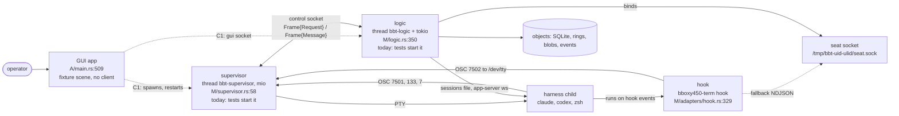
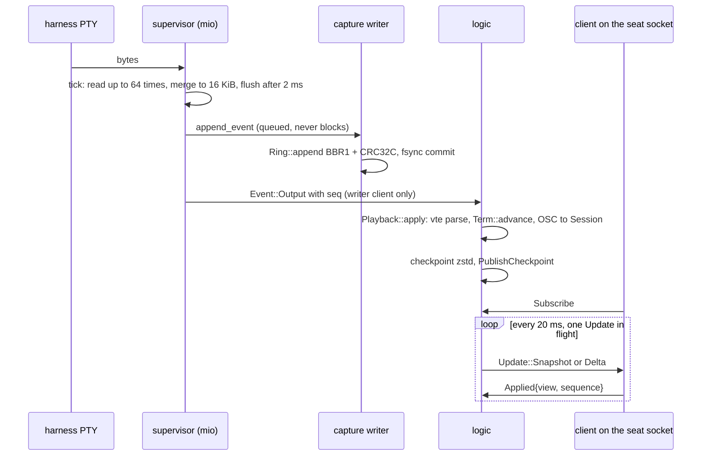
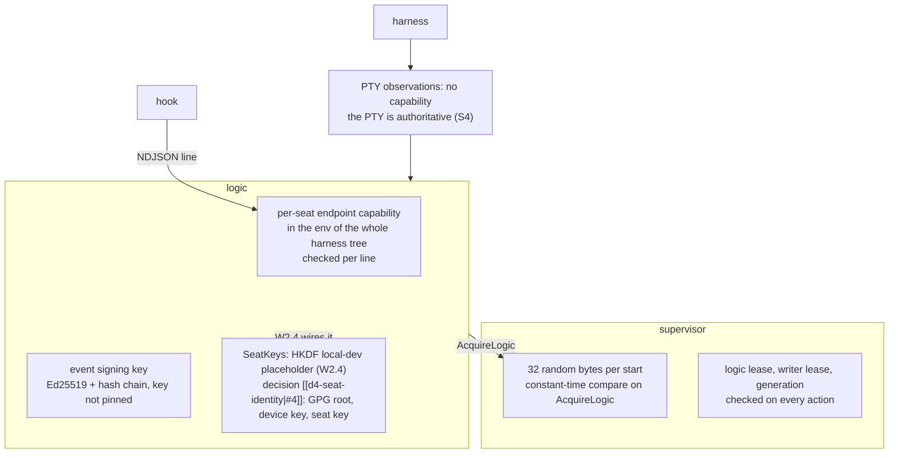
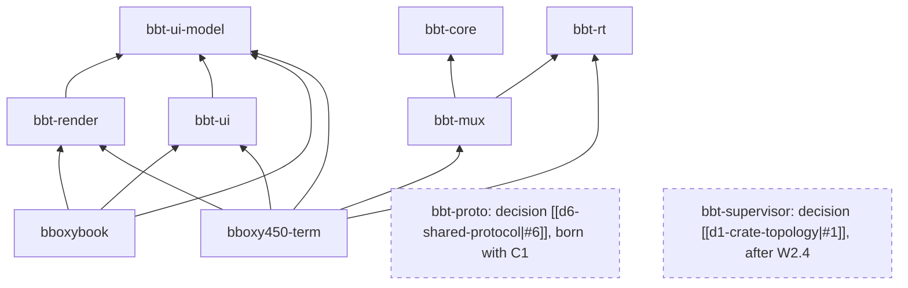

# Architecture — as built

Owner: Corvin Duskmantle <ARCHITECT>. Read from the code on 2026-10-22 (shared tree at 2565241; in flight and uncommitted at read time: Rook's W2.4 edits to `M/lib.rs`, `M/protocol.rs`, `M/supervisor.rs` and the untracked `M/messaging/`, and Nyx's 7.9 Settings in bbt-ui and bboxybook). Where a spec promises more than the code does, the gap is in §8, not assumed away. Paths: `M` = crates/bbt-mux/src, `C` = crates/bbt-core/src, `A` = crates/bboxy450-term/src, `R` = crates/bbt-rt/src.

## 1. Processes

| Process | Entry | Started by today | Owns |
|---|---|---|---|
| GUI app | `A/main.rs` | the operator | winit loop; bbt-rt runtime; **since C1a (1a0e106, 2026-10-22)** spawns and watches the supervisor and logic children (`A/cockpit.rs:227-306`) and binds live state through `gui.sock` (`A/live.rs`); the fixture scene renders only behind `--fake-source` or `--animate` (`A/main.rs:148-170`). |
| hook | `A/main.rs:510-514` → `M/adapters/hook.rs:329-411`, argv `hook --agent {claude\|codex\|codex-notify}` | the harness, via the per-launch overlay (`M/adapters/launch.rs:108-131`, `185-217`) | one event: OSC 7502 to /dev/tty (`hook.rs:77-85`), seat socket fallback (`hook.rs:386-410`), never reads a reply |
| supervisor | `bboxy450-term supervisor` → `A/cockpit.rs:108-128` → `bbt_supervisor::Supervisor::start` | the app (C1a); tests | its own process with its own bbt-rt runtime (`A/cockpit.rs:103`): mio poll, PTY masters, children, leases, the capture writer |
| logic | `bboxy450-term logic` → `A/cockpit.rs:153` → `Logic::start` | the app (C1a); tests | its own process with its own bbt-rt runtime: registry, index, file watch, per-seat view state, seat endpoints and the GUI endpoint `{root}/gui.sock` (`M/logic.rs:689-713`); the bus broker task |
| providers | `M/provider/` | logic | `LocalProvider` (D1a, f308e37) and `FakeProvider` with `FakeLink` from a fixture (D1b, 2750175): ssh hosts and cloud regions in the launcher, remote-labelled seats on real local PTYs, scripted connect, drop and reconnect; D1c (c8dba61, 2026-10-23) put `ListHosts` and `HostState` on the GUI wire (`crates/bbt-proto/src/gui.rs:35, 94`, `hosts.rs`) and `LinkState` on launcher rows and seat rows (`UI/modules/launcher.rs:21`, `seat_row.rs:180`), 96 parity cases; no network crate ([[d1-providers]], complete) |
| mcp bridge | `bboxy450-term mcp` → `bbt_mux::mcp::run_cli` (`A/main.rs:620`) | the harness, from the launch overlay (W2.5) | stdio MCP to the seat socket ([[w2-5-mcp-and-seat-wiring]]) |
| harness child | `M/supervisor.rs:990-1013` openpty + spawn | supervisor | its PTY slave; env adds TERM, BBOXY_SEAT_ID, BBOXY_PROCESS_GENERATION (`1003-1008`) |

The one shipped binary carries four private entry points: `hook`, `mcp`, `supervisor`, `logic`. Decisions [[d1-crate-topology|#1]], [[d3-mcp-server|#3]] and [[d11-supervisor-death-survivable|#11]] all landed on 2026-10-22: the supervisor is its own crate, the bridge exists, and the app starts and restarts both processes.

## 2. Threads and runtimes

| Thread | Where | Owns | Cadence |
|---|---|---|---|
| bbt-supervisor | `M/supervisor.rs:94-96`, loop `320-420` | mio Poll, listener, seats, clients, capability | 64 controls per pass; poll timeout 0, 2 ms output delay, or 20 ms tick |
| bbt-capture-writer | `M/ring/writer.rs:93-95` | rings per (seat, gen) behind Mutex+Condvar; caps 64 MiB/seat, 128 MiB total, 8192 jobs (`16-18`) | wakes the supervisor through the mio Waker (`233, 299`) |
| bbt-logic | `M/logic.rs:369-384`, loop `1133-1323` | connection, Registry, Index, FileWatch, ViewState per seat | 32 commands, receive(10 ms), adapters every 200 ms, index rescan 100 ms when dirty; publishes with `block_on` (`520-523`) |
| bus broker | `M/bus.rs:554-586` one `spawn_blocking` task | Broker and all its SQLite; channel 128 (`M/logic.rs:358`) | per message |
| seat endpoints | `M/seat_socket.rs:118-134` accept task per seat, sessions ≤ 32; reader task per connection + 20 ms tick (`187-207`) | | |
| codex poll | `M/logic.rs:1101-1110` one task per Codex seat | reconnects and re-handshakes every 200 ms; not a subscription | |
| bbt-io | `R/lib.rs:26-37` two tokio workers | created by the app (`A/main.rs:517`), never handed to Logic; tests build their own | |

## 3. Sockets and protocols

- **Supervisor control socket.** Bound by the supervisor (`M/transport.rs:141-172`: parent dir 0700 and euid-owned, socket 0600, never unlinks a stranger, unlinks on drop only if dev/ino match). ≤ 8 clients (`M/supervisor.rs:24, 855-881`). Framing: u32 BE length + JSON `Frame{version:1, body}`, 1 MiB max, 4 MiB outbound cap per peer (`transport.rs:19-20, 26-54, 87-110, 205-213`). Client→supervisor `Request{Action}` (`M/protocol.rs:129-206`); supervisor→client `Message::{Reply,Event,Failure}` (`protocol.rs:251-371`). Logic connects with std UnixStream, 5 s write timeout, first frame `AcquireLogic` (`M/logic.rs:58-74`). No peer credential check anywhere; file mode is the gate.
- **In-process transport.** `Control` over `sync_channel(128)` + Waker, events per client mpsc(128); `connect()` submits the capability itself (`M/supervisor.rs:110-139, 256-269`).
- **Seat socket, one per (seat, generation).** Root `/tmp/bbt-{euid}-{ulid}` 0700 (`M/logic.rs:486-497`), path `{root}/{seat}.sock` (`731`), bound by logic (`M/seat_socket.rs:88-136`). NDJSON lines ≤ 1 MiB, 2 s write timeout (`19, 139-175`). `Action::{Hook, Attach, Snapshot, Subscribe, Applied, GetHistory, BusSubscribe, PollEvents, Ack}` (`30-58`); **no input variant** (`1-2`: "unavailable until W2.3/W2.5"). Every line checks version, capability, seat, generation (`213`; plain `!=`), then revalidates the generation against the supervisor. Replies are JSON objects with a `kind` field (`218-229`); pushes are `streams::Update` (`M/streams.rs:83-93`). Bus filters on this socket: `seat/{seat}/` and `inbox/{seat}/` only, ephemeral, ≤ 8 (`224`).
- **In-band PTY channels.** OSC 7501 probe answered by writing `\x1b]7501;?\x07` back as `Action::Input` (`M/adapters/observe.rs:297-301`, `M/logic.rs:1033-1051`). OSC 7502 from the hook, ≤ 4096 bytes, no capability (`hook.rs:77-85, 138`).
- **Native harness channels, logic as client.** Claude: polls `$CLAUDE_CONFIG_DIR/sessions/{pid}.json` (`M/adapters/native.rs:79-100`), delivers one NDJSON `{"type":"user"}` line (`373-379`). Codex: WebSocket over `$CODEX_HOME/app-server-control/app-server-control.sock`, JSON-RPC initialize/thread.read, 64 KiB frames (`296-331`), delivers `turn/steer` or `thread/queue/add` (`381-401`).

## 4. Data flow: a PTY byte to a client screen

1. mio readable → `seat.read_ready` (`M/supervisor.rs:403-408`).
2. `Seat::tick`: up to 64 `read`s merged into one record ≤ 16 KiB (`1244-1302`, `M/protocol.rs:12`); pauses while `!ring.can_capture()`.
3. `flush_output` after 2 ms or a full chunk; `capture(Event::Output)` assigns `seq` (`1186-1207, 1303-1310`).
4. `CaptureHandle::append_event` queues without blocking (`M/ring/writer.rs:160-181`).
5. Writer thread → `Ring::append`: 56-byte BBR1 header + CRC32C into `data-{ulid}.log` (`writer.rs:260-269`, `M/ring.rs:770-843, 1155-1180`).
6. Commit = fsync + CRC'd `committed` marker, previous kept (`ring.rs:846-904`); on 1 MiB, 20 ms, or any non-output record (`writer.rs:104, 316-328`, `ring.rs:838-841`). At 4 MiB the hot file seals into a zstd blob (`ring.rs:55, 647-707`).
7. `publish_pending` sends one event to the active writer client; with a ring and no writer the event is dropped (`supervisor.rs:1172-1184, 823-840`).
8. `Worker::event`; a sequence gap triggers `catch_up` via `ReadRing` (`M/logic.rs:930-1032`).
9. `Playback::apply`: vte parse + bbt-core `Term::advance` with `history_size` 0; keeps only Title events, drops `PtyWrite` (`M/ring.rs:227-311`). Unknown OSC → `OscTap` → `Session::on_osc` (`C/lib.rs:137-172`, `M/adapters/observe.rs:418-430`, `M/logic.rs:952-959`).
10. Checkpoint: zstd JSON ≤ 128 KiB as `Action::PublishCheckpoint`, a kind-4 ring record + blob (`logic.rs:915-929, 986-991`, `ring.rs:161-172, 742-769`).
11. Each subscribed socket connection, every 20 ms: `LogicClient::snapshot` (`M/seat_socket.rs:231-236`, `M/logic.rs:869-891`); `Screen::from_term` copies the visible grid and serialises the whole checkpoint to read palette and cursor style (`M/streams.rs:30-60`).
12. `ViewStream`: full Snapshot, or a changed-rows Delta against the acked baseline, one in flight, acked by `Applied{view, sequence}` (`streams.rs:121-178`). `Replica` is the client-side applier and nothing in production uses it (`185-256`).

Input: deduplicated by id + SHA-256, one pending write per seat, non-blocking `write`; receipts Pending, PtyWritten, PartialUnknown (`M/supervisor.rs:1083-1170`).

Bus: `Broker::publish(stream, Draft)` (`M/bus.rs:462-501`); fanout subjects (`inbox/…`, `seat/*/output`) are never persisted (`53-58`); subjects ending in state, modified, title, cwd, presence coalesce (`59-64`); durable named consumers, poll, ack, pending redelivery, `Delivery::Gap` (`296-385, 440-461, 502-520`). Logic publishes `seat/{id}/{spawned,output,resized,exited,state}`, `mux/seat_spawned`, `swarm/{id}/joined`, index events to `index`, `task/{id}/status` (`M/logic.rs:524-540, 843-866, 992-1004, 1123-1132`).

Store: per object dir (0700) an `object.sqlite` with `version`, `kv`, `alarms`, WAL, synchronous FULL, one connection per operation (`M/store/sqlite.rs:15-46`, `store/mod.rs:34-49`); per stream `events.sqlite` append-only with a verified hash chain (`store/events.rs:101-127`); blobs `{obj}/blobs/{sha256}.zst`, zstd 3, ≤ 64 MiB, digest re-checked on read (`store/blobs.rs:13-66`). Objects today: `account` (seat records, `M/registry.rs:107-146`), `seat-{id}` (checkpoint, adapter record and overlay, `ring-{gen}/`), `bus` (consumer catalog; streams found by scanning `run_dir/*/events.sqlite`, `M/bus.rs:401-439`), `index`.

Index: `Index::open(repository, run_dir/index)` + FileWatch (`M/logic.rs:480-485`); scans `*.md` ≤ 2 MiB, frontmatter, wikilinks, relations (`M/index.rs:74-170, 506-526`); `kv doc/{path}` + `document_outbox` in one transaction, outbox drained to the bus (`199, 263-275, 313-319`); five petgraph projections in memory (`320-392`).

## 5. Harness adapters

- **Launch** `Worker::launch` → `launch::plan` → persist record and overlay → spawn (`M/logic.rs:785-821`). Overlay dir `launch-{ulid}` 0700 with env BBOXY_SEAT_ID, BBOXY_GENERATION, BBOXY_ROLE, BBOXY_SOCK, BBOXY_CAPABILITY (hex), TERM_PROGRAM (`M/adapters/launch.rs:66-100`). Claude: `--settings` overlay `{crossSessionInbound: accept, hooks}`, `--append-system-prompt`, `--name`, `--session-id` or `--resume`; rejects `--bare` (`104-175`). Codex: `-c developer_instructions`, `-c notify`, `-c hooks`, `resume <id>` (`176-226`). zsh: ZDOTDIR overlay sourcing the user's dotfiles, OSC 133 A/B/C/D and OSC 7 hooks, `-il` (`227-268`). Generic: no overlay (`240-242`). **Decision [[d3-mcp-server|#3]]'s wiring kit (MCP, skill) starts from this overlay; it already never touches user config.**
- **Observe** `Session::osc` handles 7501 (Reported), 7502 (Shim via `hook::parse`), 133 B (zsh ready proof), 7 (cwd), 21337 (Inferred) (`M/adapters/observe.rs:289-386`); precedence by grade, dialog, a 5 s window, off-PTY tie rule (`188-256`); cadence tick Active if output within 2 s (`278-288`). Native: Claude sessions file (`M/adapters/native.rs:102-153`), Codex events (`154-239`).
- **Guard** `check()` requires binding match, no dialog/turn/subagent, ready proof ≤ 2 s, no draft/tool/sync, `foreground_pid` == harness pid, zsh canonical+echo or 500 ms quiet (`M/adapters/guard.rs:36-78`); `submit_pty` journals `adapter_input/{id}` first (`80-136`); `prepare_input` rejects control chars, bracketed paste, appends CR (`139-181`).
- **Wake** `attach` = verify_process + preflight; `wake` outcomes recorded as Evidence; ambiguous → NativeUnknown, never retried (`M/adapters/mod.rs:223-280`, `native.rs:349-415`).

## 6. Trust boundaries

| Boundary | Mechanism | Note |
|---|---|---|
| supervisor ↔ logic | 32 random bytes per `Supervisor::start`, constant-time compare on `AcquireLogic`; newest holder takes the lease, writer leases cleared (`M/supervisor.rs:76-77, 527-547`); every action checks (client, lease), generation, writer lease (`441-448, 772-784, 1073-1081`) | socket file mode only; no peer uid check |
| logic ↔ seat (hook, MCP later) | per-endpoint random capability (`M/logic.rs:732-733`) exported as env to the whole harness process tree (`launch.rs:87-94`); checked per line (`seat_socket.rs:213`) | plain `!=`; any child of the harness holds it |
| PTY-sourced observations | OSC 7502 needs no capability; a SessionStart with a new session_id rebinds (`hook.rs:138, 162-175`) | the PTY is authoritative by design (specs/README S4) |
| native identity | binding = pid + `ps` lstart (`M/adapters/mod.rs:99-112`); `own_socket` uid check follows symlinks (`native.rs:50-58`); `Priority::Now` needs `allow_interrupt` (`363-365`) | |
| work items written by tools | every `.bboxy` write through the task and artifact tools is signed by the caller's seat leaf key (`M/logic.rs:1009` → `identity.keys().leaf(caller, generation)`): `M/index.rs:445-491` takes the key, `:547-574` builds a DSSEv1 PAE over the body and frontmatter digests and writes `metadata.provenance {digest, frontmatter_digest, signer: seat:<id>, sig}`, `:584` commits the signed intent first (W2.5d, eed082d) | the provenance leaf [[work-items]] describes: who, under which key, for which task |
| events | Ed25519 over `"bboxy/event/v1\0"` + len + JSON; verify trusts the key in the envelope, not pinned (`M/store/events.rs:59-90`); hash chain verified on open (`161-169, 225-252`) | signing key = the one passed to `Logic::start` (`M/logic.rs:357`) |
| messaging | `SeatKeys` trait; logic builds it through `identity::seat_keys(run_dir, key, handle)` (`M/logic.rs:500`), which yields `ChainSeatKeys` (`M/identity/chain.rs:39`: GPG root → device → seat, expired and stale grants refused by name) when the journaled issuer is `gpg-root`, else `LocalSeatKeys` (HKDF from the broker secret, `M/messaging/keys.rs`); grants, policy epoch, class rules in `service.rs` and `tree.rs` | wired by W2.4 and ID1a/b (2026-10-22); the one-way issuer transition is `M/identity/transition.rs` ([[id1-seat-chain]] §2b) |

See [[identity]] for the designed chain, [[messaging]] for grants and classes, [[events]] for the bus, [[storage]] for the object stores, [[harness-adapters]] and [[subagent-detection]] for the observation grades.

## 7. Frontend and runtime

Paths: `A` = crates/bboxy450-term/src, `R` = crates/bbt-rt/src, `RD` = crates/bbt-render/src, `UM` = crates/bbt-ui-model/src, `UI` = crates/bbt-ui/src, `BK` = crates/bboxybook.

- **Entry and modes.** `A/main.rs:509` main; `hook` is the only subcommand (`510-514`). GUI flags `--smoke --fake-source --meter --cadence-test --animate --pacing fifo|metal|cv --capture` (`520-537`). winit 0.30 `EventLoop<UiEvent>` (`515`), `ControlFlow::Wait` (`345`), borderless 1600×960 window (`88-98`), Metal-only wgpu, surface made on the UI thread then moved to IO (`99-105`). Only key binding: ⌘⌥F toggles the hitch overlay; no mouse or text input (`490-498`).
- **Frame pacing.** `A/display_link.rs`: Metal = CAMetalDisplayLink on the layer, 3 drawables, latency 2, rate range [80, max, max], paused when idle (`225-256`); Cv fallback (`258-282`); Fifo = no link (`219-224`). Surface `PresentMode::Fifo`, latency 2 (`A/gpu.rs:174-184`); the link's drawable is imported into wgpu (`281-325`), presented with a native command buffer (`42-59`). A frame without a tick is skipped (`A/main.rs:237-242`); the link re-pauses after every non-animated frame (`299-301`).
- **Runtime.** One process-wide tokio runtime, 2 workers `bbt-io` (`R/lib.rs:26-37`). `init_ui`: 1024-source DirtySet, 256-slot UiMsg queue, 256-slot output ViewRing, CommandRunner (`71-89`). Wakes coalesce on the 0→1 edge (`R/wake.rs:64-70`) into `EventLoopProxy::send_event(Wake)` (`A/main.rs:32-37`). `Latest` = 1-slot ArrayQueue with force_push (`R/queues.rs:77-83`); `ViewRing` drops oldest and counts (`110-115`). `spawn_command` streams a process group into the ring, cancel = flag + SIGKILL group (`R/commands.rs:103-264`); the app never calls it. No `std::thread::spawn` in these crates. Hitch = max(cpu, present wait) > 1.5× display interval (`R/meter.rs:56-68`).
- **State into the UI.** Live since C1a: `A/live.rs` owns the `gui.sock` session, applies updates through `Grids` (`A/grids.rs`), builds the model (`A/model.rs:66`) and publishes `Latest<Arc<Model>>` (`A/live.rs:47-62`); the UI takes the latest Arc per frame. The fixture path below remains behind `--fake-source` and `--animate`. Fixture: the model is `Scene{seats: Vec<SeatRow>, tree: SplitNode}` (`A/scene.rs:22-26`): 15 hard-coded seats (`96-116`) plus `include_str!` of the scene15 test fixture (`140-143`). The only mutation rewrites seat 1 from a `Latest<usize>` (`150-157`, `A/main.rs:199-202`). Drain runs under 1 ms, pops and drops UiMsg and output, ignores the dirty source list (`183-198`). Layout and paint are rebuilt every frame (`247-249, 263`, `A/scene.rs:176-301`); text measurement rasterises with CoreText on the UI thread into an unbounded cache (`52-77`); panes have no lines (`247`). `bbt_ui_model::Model`, `Event`, `Update`, `Model::apply` exist (`UM/model/window.rs:117, 247`, `UM/event.rs:13, 91`) and only bboxybook uses them (`BK/src/fixtures.rs:162-200`, `seat_rows.rs:408`). No double buffer; `Latest` is the only handoff.
- **Render.** One device shared through `ChromeRenderer::with_context` (`A/gpu.rs:188-195`); per frame: clear target, `encode_ops`, clear surface, composite, timing markers, submit, present (`349-411`). Flat instanced pass ≤ 65 536 instances; since R12-2 (2026-10-23) uniform and instance slices come from reusable arenas rewound by `begin_frame` at each submit owner (`RD/chrome/mod.rs:52-59`, `chrome/arena.rs`), 1704 of 1704 PNGs byte-identical; a Group allocates two full-size textures per group per frame (`A/gpu.rs:553-554`). Glyph atlas R8, bounded at 2048² with LRU repacking and eviction since R6 (29b2b7a, 2026-10-22; `RD/chrome/mod.rs:293, 998-1035`), overflow beyond that still errors (`RD/atlas.rs:54`); whole-line text cache keyed by text+style+scale+phase (`RD/chrome/mod.rs:402-416`). Icon atlas fixed 2048² from build-time SVGs and bboxy.png (`RD/chrome/icons.rs:16-61`, `A/build.rs:8-50`). Materials: 6 pipelines + 2 blur, frosted = intermediate + separable Gaussian (`RD/chrome/materials.rs:264-583`). Cell grid: 32-byte instances, bg and text passes (`RD/cells/mod.rs:8-17`, `RD/headless.rs:217-235`); live since C1i, and since T2 (e877187, 2026-10-23) the terminal path shapes CJK and emoji clusters (`RD/cells/terminal/gpu.rs:270, 537`), strict parity 1600 of 1600. The W3.1 text module still carries its printable-ASCII guard (`RD/text/macos.rs:87`): a legacy path, not the terminal's.
- **Tokens and theme.** `crates/bbt-ui-model/build.rs:134-154` reads `design/tokens.toml` and `design/style.json` at compile time into `pub const TOKENS / STYLE`; nothing reads tokens at runtime. `Context::new(Theme::Dark, Density::Cozy)` is hard-coded (`A/scene.rs:177, 271`; `A/gpu.rs:529`). Decision [[d5-theme-data|#5]] inverts this.
- **UI model and library.** Domain in bbt-ui-model: ids (`UM/model/ids.rs:69-72`), seat (`seat.rs:7-109`), split, swarm, tab, window (`window.rs:11-117`), sidebar layout (`layout/sidebar.rs:19-256`), StateGlyph/RoleMark/WhereMark (`draw/atoms.rs`). Generic: layout size and solve, draw prim, list, path, ctx. bbt-ui: style leaks domain words (`UI/style.rs:12-14, 78, 211-212, 566-567`); atoms L5 generic but Glyph; components, widgets, overlays L6 generic; modules L7 all domain (`UI/modules/mod.rs`). The app uses eight modules; launcher, settings, stream_dock, graph_tab, widgets and overlays are bboxybook-only today.
- **Parity.** `scripts/parity.sh`: build → manifest → `capture.mjs` (Chrome; without it, committed references and exit 0) → render → compare. Thresholds `RD/chrome/diff.rs:3-4`, `BK/src/parity.rs:171-174`. The review count is printed and the run returns Ok: a parity miss never fails CI (`parity.rs:585`). CI's path filter skips `crates/bbt-ui/` (`ci.yml:20`).
- **Invariant enforcement.** `clippy.toml:5-42` disallows fs, process, sleep, mpsc recv, Mutex/RwLock locks, block_on; `scripts/ui-lint.sh` applies it to ui-model, ui, render and the app, but **CI never runs it** and bbt-rt is out of scope. `assert_not_ui_thread` is a `debug_assert` (`R/lib.rs:56-59`); CoreText on the UI thread is unguarded (`A/scene.rs:58, 71`). Stall tests: `crates/bbt-rt/tests/runtime.rs` (1 M msg/s never waits, coalesced wakes, 100 MB bounded, cancel kills the group). `--smoke` idle probe and `--cadence-test` never run in CI; no test launches the binary. `UI/../tests/seat_rows.rs:42-71` forbids raw Prim and DrawList inside modules.

## 8. Gaps between the names and the code

Only those that change a decision or a brief ([[c1-live-seats]] consumes most of them):
- Closed by C1a (1a0e106): the app starts supervisor and logic as private entries, each on its own runtime, and binds live state over `gui.sock`; the sidebar is live and ⌘T opens a real zsh. C1i (2750175) added typing into a live pane: `UiMsg::Input` → `GuiAction::Input` → the PTY (`A/live.rs`), so the terminal is used, not only shown.
- The seat socket has no input action (`M/seat_socket.rs:30-58`). `Adapter::{launch, attach, wake, input_guard}`, `ArbiterView`, `submit_pty` have no production callers (`resume_command` too: resume goes through the launch planner since C1c-1, and the trait method is cleanup in C1c-2) (`M/adapters/mod.rs:171-193`, `guard.rs:9-21, 80`); `foreground_pid`, `canonical`, `echo` have no source. Closed by W2.5e (e49e4cb, 2026-10-23): `seat_input_text` builds an `ArbiterView` in production (`M/logic.rs:2794-2842`) and runs the guard before any injected text; the arbiter is reachable and tested through the MCP tools.
- Closed by C1b and C1a: `Replica` has its first production user in `A/grids.rs`; the model is built by `A/model.rs` and published as `Latest<Arc<Model>>` from `A/live.rs:47-62`. `Screen::from_term` serialises a whole checkpoint per snapshot every 20 ms per connection (`streams.rs:30-60`): a cost to measure in the 1000-seat gate before optimising.
- Closed 2026-10-22: messaging is wired into logic (W2.4) and signs with the chain when a root is pinned (ID1b); the seat socket carries `Action::Messaging`. Input over the seat socket is still C1a's.
- `PtyWrite` replies are dropped (`M/ring.rs:293-299`): programs that query the terminal get no answer except the 7501 probe. Unverified effect.
- Closed by C1a: logic and the supervisor are separate processes, each initialising its own process-wide runtime (`A/cockpit.rs:103-111`); the app's runtime serves the app alone.
- Risks not executed: an index path with whitespace or > 16 tokens fails subject validation and ends logic (`M/index.rs:259-262`, `M/bus.rs:21-27`, `M/logic.rs:536`); a resize beyond 512×256 passes the supervisor and ends the logic thread (`M/logic.rs:966-967`).
- Unused but harmless: `alarms` API, `stream` table, `Index::write`, `try_publish`, `Ring::replay`, `LaunchPlan::cleanup`.
- Frontend: the app binds nothing live; `Model`, `Event`, `Update` are unused by it; `DrawList.revision` is never read, so nothing is retained between frames (`UM/draw/list.rs:8`). Closed by R6 (2026-10-22): the glyph cache is bounded with LRU eviction after the W3.5 corpus run hit the old unbounded atlas, exactly as this line predicted. Buffers per draw call: closed by R12-2 (arenas); group textures per frame (`A/gpu.rs:553-554`) remain, to be measured under the meter before touching. `ui-lint.sh` is not in CI. `.expect` on pacer, animation and idle ordering (`A/main.rs:385, 390, 415`) is an unverified panic path. Closed for the terminal path by T2 (CJK and emoji, e877187) and R8 (shaping); the W3.1 module's ASCII guard at `RD/text/macos.rs:87` remains as a legacy path.

## 9. Crates and layering

Order `bboxy450-keychain-macos bboxy450-keychain-linux bboxy450-keychain-windows bboxy450-keychain-file bboxy450-keychain bboxy450-desktop-notifications-macos bboxy450-desktop-notifications-windows bboxy450-desktop-notifications-linux bboxy450-desktop-notifications bbt-yarn-macros bbt-yarn bbt-rt bbt-core bboxy450-harness-wake-up bbt-mermaid bboxy-firehose bbt-ui-model bbt-render bbt-ui bbt-doc bboxybook bbt-supervisor bbt-plugin bbt-proto bbt-mux bboxy450-term`, gated by [[layering]]. The four `bboxy450-desktop-notifications*` crates lead the order so they can depend on nothing of ours: an OS-agnostic facade and one crate per OS, the first of the cross-OS kits under decision [[d46-cross-os-facades|#46]] ([[desktop-notifications]], [[cross-os-facade]]). `bbt-yarn` and `bbt-yarn-macros` (Y1, Rook, 5c2ef84, 2026-10-23) sit first: no workspace dependencies, the reactor macro of [[yarn]], not yet used by any loop. Decision [[d1-crate-topology|#1]] landed on 2026-10-22 (S1, Rook): `bbt-supervisor` holds the mio supervisor, PTYs, leases and the ring writer; `bbt-mux` re-exports `SocketSupervisor` and `SupervisorConnection` from it (`M/logic.rs:29`). bbt-mux depends on bbt-core and bbt-rt only; the app depends on everything. Decision [[d6-shared-protocol|#6]] landed: `bbt-proto` (511 lines, depends on bbt-core and bbt-ui-model only) carries the GUI schema and the moved wire types; `bbt-mermaid` and `bbt-doc` (W3.5) sit below the app. C1b's grids and model modules build on it (`A/grids.rs`, `A/model.rs`), with no socket code in them, as [[c1-live-seats]] §2a requires. Public set and docs standard: [[open-source]]; renderer design: [[renderer]]; components: [[gui-components]]; the parity loop: [[runbook-web-to-native]].

## 10. Direction (operator, 2026-10-22 and 2026-10-23)

- **The suite is the product; the terminal is its first app** (decision [[d39-suite-is-the-product|#39]]). The app crate is glue and nothing else; reusable code moves down a layer; apps connect through `bbt-proto`, the bus and messaging under one identity chain. Advisory drift signal, read each round: the app's `src/` line count against the crates below it (2026-10-23: the app holds `main.rs`, `cockpit.rs`, `live.rs`, `grids.rs`, `model.rs`, `scene.rs`, `gpu.rs`, `display_link.rs`, `keyboard.rs` as the winit mapping, and the fixture; `grids.rs` and `model.rs` are the first candidates to move down when a second app needs live seats).

- **Audience.** Hackers and furries first. Cloud and ssh that never lock anyone in; then teams, clouds and enterprises want it. Opinionated, not locked. Developers.
- **Plugins: not yet, shape recorded.** A binary dropped in a folder; the terminal runs `binary --shape`, which says how to integrate; the plugin runs as a subprocess of our runtime and may expose sockets, a CLI or a daemon; we talk to it. First kind: cloud and ssh providers, so decision [[d7-provider-supervisor-link|#7]]'s Provider trait is the in-process form of this seam, and an out-of-process provider is a plugin that yields a supervisor link. Nothing is built for it now.
