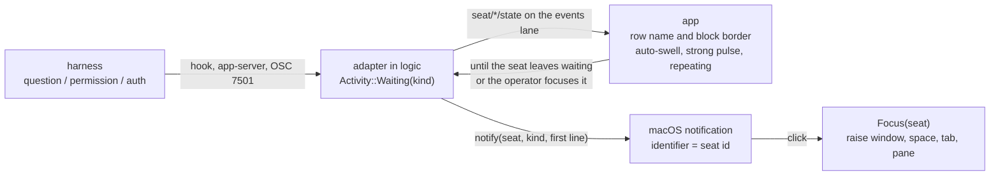

# Attention

Owner: Corvin Duskmantle <ARCHITECT>. Decided 2026-10-23 (decision [[d44-waiting-attention|#44]]). Operator, verbatim, via Wren: "and then if harness has a question for the user - its name in the tab left bar and its borde should autoswell and pulsate a lot, and user should get desktop notification that this harness needs attention - and clicking on that notification would focus the harness terminal, communicate this to oracle as a direction and functionality we want built in!"

Lens: the operator runs many seats and is not watching the one that stopped. Assumes `UNUserNotificationCenter` needs a bundle identifier, so a bare binary cannot post a clickable notification. Breaks when Apple changes that; nothing else here depends on it.

## 1. Trigger

The seat state the adapters already produce: `Activity::Waiting(kind)` with `kind ∈ permission | question | auth` (`crates/bbt-proto/src/seat_state.rs:185-205`, [[harness-adapters]] vocabulary: Claude hooks `PermissionRequest` and `Notification`, Codex `PermissionRequest` over the app-server, OSC 7501 `blocked`). No new detection; the attention flow consumes the state bit on the events lane (`seat/*/state`, [[l9-messaging-tasks]] §3). `Activity::Waiting(Auth)` is attention too (a login prompt is a question).

## 2. In the window

- The seat's **sidebar row** and its **pane block** auto-swell and pulse **strongly**: the [[rim-glow]] §7 swell on a loop (reach 40 px, period 0.9 s) with the waiting amber at full amplitude, the row's name pulsing with it (reference df6d58e: envelope `|sin(πt/900 ms)|`, hue rotation held at ×0.15, the rim pulsing `.55 + .45·env` in step across the seat's blocks), **repeating until handled**: the seat leaves `waiting`, or the operator focuses it. Focusing it ends the loop and plays the single focus swell.
- Paint only. Nothing moves and nothing steals focus: the swell never changes layout or focus (decision [[d29-explicit-seat-placement|#29]]'s rule for every push), only the operator's click or the notification does.
- A **muted** seat (⌘M, [[ux-flow]]) swells quietly (the ordinary waiting rim) and does not notify.

## 3. The desktop notification

- One notification per waiting episode: title the seat's name and harness, body the first line of the question or the permission being asked, **identifier = the seat id** so a repeat replaces rather than stacks, removed when the seat leaves `waiting`.
- **Click → `Focus(seat)`**: raise the window, switch space and tab as needed, focus the pane; the same path as a sidebar click, including the landing rule (the swell fires after the switch).
- **Mechanism.** `UNUserNotificationCenter` with the app as its own delegate, which requires a **bundle**: the build produces `bboxy450-term.app` (Info.plist with `CFBundleIdentifier`, the binary inside) for dev and release runs alike, ad-hoc signed; Developer ID signing stays deferred (decision [[d24-defer-code-signing|#24]]). Without a bundle (a bare `cargo run`), the in-window swell still runs and **no notification is posted**; the app says so once in the log. No `osascript` fallback: `AGENTS.md` bans desktop scripting (Oracle, 2026-10-23).
- Settings: notifications on by default; per-harness off; "only when the window is not frontmost" as the one option.

## 4. Order

G3 (the centred rim, Seraph) → G5 (the kit capability, Seraph) → attention, assigned after W2.6b lands because it rides the events lane (Oracle, 2026-10-23).

## 5. Acceptance, the spec signs off

1. A fixture seat entering `Waiting(Question)` shows the row and block loop within one event-lane delivery; leaving `waiting` stops it; focusing it stops it and plays one swell.
2. Layout and focus unchanged by the loop: [[glow-never-moves-layout]] and [[rim-size-is-layout]] pass; a focus-model test shows focus unchanged until a click or a notification response.
3. A notification is posted with identifier = seat id and replaced on repeat; its click focuses the seat's pane with the window raised and the right tab shown (driven test through the delegate).
4. Muted seats post nothing.

Owner: Corvin Duskmantle <ARCHITECT>.
