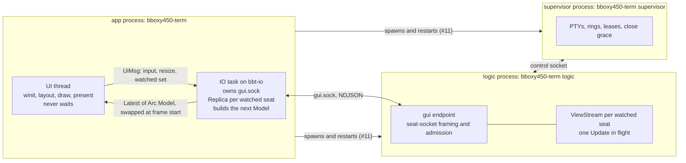
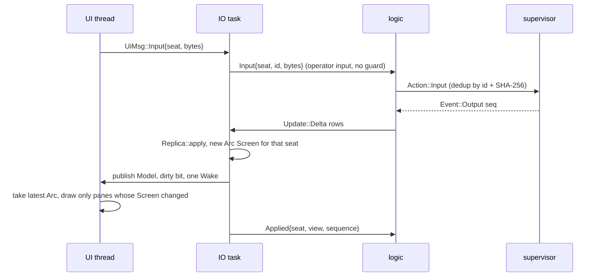
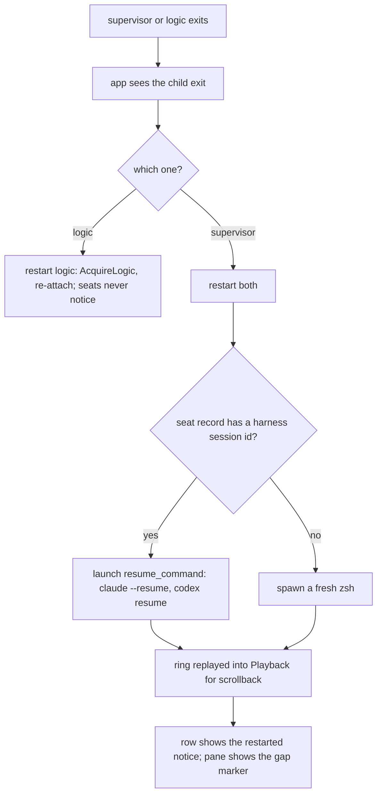

# C1 — live seats

Owner: Corvin Duskmantle <ARCHITECT>. Decided 2026-10-22. Binds decisions #1, #2, #6, #10, #11 of [[2026-10-22-architecture-round-1]]. Built on what [[architecture]] §1–4 shows exists: supervisor, logic, rings, snapshot and delta streams, close grace, launch overlays, all of it reachable only from tests today. **Done means** the seat half of the cockpit sentence in [[2026-10-22-c-cockpit]]: open the app, ⌘T a zsh, Claude or Codex seat, type, see live cells, see state in the sidebar, resize, scroll back, close and undo, kill the supervisor and watch every seat come back.

Lens: three processes on one Mac. Assumes macOS 14+, one account, local seats. Breaks when a seat lives on another host; [[2026-10-22-c-cockpit]] D1 adds the link, not the shape. LESS IS MORE: every piece below already exists or is the smallest thing that joins two existing pieces.

## 1. Shape



- **Processes.** The app spawns `bboxy450-term supervisor` and `bboxy450-term logic` as private entry points of the one binary, like `hook` (specs/README S5). The control socket lives at `default_socket_path()` (`M/transport.rs:118-131`, its first caller); the run dir under Application Support. Each process owns its own bbt-rt runtime, which closes the two-runtimes gap in [[architecture]] §8 by never sharing a process. Decision #1 moves the supervisor into `bbt-supervisor` after W2.4; C1 does not wait for that split.
- **One GUI endpoint on logic**, `{root}/gui.sock`, with the seat socket's framing and admission (`M/seat_socket.rs:19, 139-175, 213`: NDJSON ≤ 1 MiB, version, capability) and a GUI action set: `ListSeats`, `Watch{seat, view}`, `Unwatch{seat}`, `Applied{seat, view, sequence}`, `Input{seat, id, bytes}`, `Resize{seat, cols, rows}`, `Spawn{spec}`, `ScheduleClose{seat}`, `UndoClose{seat, close_id}`, `GetHistory{seat, from, to}`. One connection multiplexes every seat, so 1000 seats cost one fd. Unwatched seats push only `seat/{id}/state` events over the same connection (the endpoint's bus filter, `seat_socket.rs:224`, widened to `seat/*/state` for the GUI); no grids.
- **`bbt-proto` is born here** (decision #6): `View`, `Screen`, `Snapshot`, `Delta`, `Update` from `M/streams.rs`, `SeatRecord` from `M/registry.rs`, the GUI action and reply enums. It depends on bbt-ui-model for ids until O2 moves ids down. Order becomes `… bboxybook bbt-proto bbt-mux bboxy450-term` in the same commit ([[layering]]).

## 2. Binding (decision #2)



- The IO task holds a `Replica` per watched seat (`M/streams.rs:187`, first production use) and the back `Model` (`UM/model/window.rs:117`, first production use). An applied Update yields a new `Arc<Screen>` for that seat only; the Model holds Arcs, so publishing a new Model is cheap: `Latest<Arc<Model>>` (`R/queues.rs:63-84`, force_push) plus a dirty bit. The UI thread takes the latest Arc at frame start; the previous Arc stays valid while the IO task builds the next. No lock, no wait, no grid clone. That is the double buffer.
- **Backpressure is the ack.** Logic sends one Update per (seat, view) and waits for `Applied` (`M/streams.rs:121-178`, exists). The IO task acks after it has published, never before; a slow app gets fewer, larger deltas and logic coalesces to the latest state. The UI's pane set decides `Watch` and `Unwatch`; the IO task sends them when the set changes.
- **UI to IO** goes through the existing bounded `UiMsg` queue (`R/lib.rs:71-89`); producers never block. A full queue hands the message back (`R/queues.rs:44-48`) and the UI retries next frame; input is never dropped.
- **Operator keystrokes bypass the input guard.** The guard (`M/adapters/guard.rs:36-78`) is for injected text (S3, [[harness-adapters]]); a human typing into a focused pane goes straight to the PTY. Retries are safe through the supervisor's id and SHA-256 dedup (`M/supervisor.rs:1083-1170`).
- **Resize** clamps in logic to 512×256 instead of ending the logic thread ([[architecture]] §8, `M/logic.rs:966-967`).
- **Drawing.** A pane draws `Screen` rows through the cells pipeline (`RD/cells`). Glyph coverage beyond ASCII, shaping and fonts are T3 in [[2026-10-22-t-terminal-fidelity]], not C1. Damage: redraw only panes whose `Arc<Screen>` pointer changed.

## 2a. The seam between C1a and C1b (2026-10-22, unblock)

Two Executors build in parallel against these signatures; neither waits for the other. **C1a never reads or writes `Screen` contents; C1b never touches the socket.**

| Owner | Owns | Delivers |
|---|---|---|
| C1a (Sable) | process spawn and restart supervision; the `gui.sock` client (framing, admission, reconnect); the IO task loop; the `UiMsg` additions (`Input`, `Resize`, `Watched`); the `bbt-proto` crate with the moved wire types and the GUI schema; publishing `Latest<Arc<Model>>` | `bbt-proto::{GuiAction, GuiReply}` and the loop below |
| C1b (Aster) | `crates/bboxy450-term/src/grids.rs` and `model.rs`: Replica map, watched-set diff, the back Model assembly, the pane draw through the cells pipeline | the `Grids` API below |

```rust
// bbt-proto (C1a). Update, Screen, View, SeatRecord move here from bbt-mux unchanged.
pub enum GuiAction { ListSeats, Watch { seat: SeatId, view: View }, Unwatch { seat: SeatId },
    Applied { seat: SeatId, view: View, sequence: u64 }, Input { seat: SeatId, id: Ulid, bytes: Vec<u8> },
    Resize { seat: SeatId, cols: u16, rows: u16 }, Spawn { spec: SpawnSpec }, ScheduleClose { seat: SeatId },
    UndoClose { seat: SeatId, close_id: Ulid }, GetHistory { seat: SeatId, from: u64, to: u64 } }
pub enum GuiReply { Seats(Vec<GuiSeat>), Update { seat: SeatId, update: Update }, Seat(GuiSeat),
    Ok { op: Ulid }, Error { op: Ulid, reason: String }, History { seat: SeatId, rows: Vec<(u64, Row)> } }

// Portable seat state (2026-10-22, from C1a). bbt-proto depends on bbt-ui-model (ids and these enums)
// and bbt-core (Cell), both below it in the layering order; the mux types never cross the socket.
pub use bbt_ui_model::model::{Activity, Grade, WaitKind, Where, Lifecycle, Role, RoleClass, SeatId, SwarmId};
pub type Row = Vec<bbt_core::Cell>;
pub struct GuiSeat { pub record: SeatRecord, pub state: SeatState }
pub struct SeatState {
    pub generation: u64,
    pub process: ProcessStatus,
    pub activity: Activity,            // from adapters::observe::State + WaitingKind
    pub grade: Grade,                  // from adapters::observe::Grade, same three names
    pub title: String,                 // Screen.title, else Status.detail, else the harness name
    pub detail: Option<String>,        // Status.detail verbatim
    pub turn_open: bool,
    pub observed_ms: u64,
    pub subagents: Vec<SubagentRow>,   // running ones only (specs/README S8)
}
pub struct SubagentRow { pub id: String, pub title: String, pub activity: Activity, pub grade: Grade }
pub enum ProcessStatus { Running { pid: u32 }, Exited { status: i32 }, ClosedGrace { until_ms: u64 }, Retained }
pub struct SpawnSpec {
    pub swarm: SwarmId, pub harness_kind: String, pub name: Option<String>, pub role: Option<String>,
    pub cwd: String, pub location: Where, pub resume: Option<String>,   // harness session id to resume
}

// crates/bboxy450-term/src/grids.rs (C1b)
pub struct Grids { /* Replica per watched seat, Arc<Screen> per seat */ }
impl Grids {
    pub fn new() -> Self;
    /// Some(screen) when the seat's visible screen changed; the caller publishes, then acks.
    pub fn apply(&mut self, seat: SeatId, update: &Update) -> Result<Option<Arc<Screen>>>;
    /// Diff against the current watched set; the caller sends the resulting actions.
    pub fn set_watched(&mut self, panes: &[(SeatId, View)]) -> Vec<GuiAction>;
    pub fn screen(&self, seat: SeatId) -> Option<Arc<Screen>>;
    pub fn forget(&mut self, seat: SeatId);   // on exit or after Unwatch
}
// crates/bboxy450-term/src/model.rs (C1b)
pub fn build(seats: &[SeatRecord], grids: &Grids, previous: &Model) -> Model;   // reuses Arcs that did not change
pub fn draw_pane(screen: &Screen, rect: Rect, ctx: &mut DrawCtx);              // cells pipeline, ASCII today
```

Mapping, in logic and nowhere else: `observe::State` to `Activity` by name, with `Waiting` carrying the `WaitingKind` (`Permission`, `Question`; `Auth` when the 7501 `kind=auth` report lands in observe); `observe::Grade` by name; a subagent becomes a `SubagentRow` only while its state is `Active` or `Waiting`; `ProcessStatus` comes from the registry's lifecycle and the supervisor's exit report, never from the adapter. `GuiReply::Seat` replaces the earlier `State` reply and carries the whole `GuiSeat`, so the sidebar never needs a second fetch.

The IO loop (C1a), per `GuiReply`:
1. `Update{seat, update}` → `grids.apply` → if `Some`, `model = build(..)`, `latest.publish(Arc::new(model))`, mark dirty → then send `Applied{seat, view, sequence}` with the update's own view and sequence. Never ack before publishing.
2. `Seats` and `Seat` → `build` and publish; no ack.
3. On `UiMsg::Watched(panes)` → `grids.set_watched` → send each action.
4. On `UiMsg::Input` and `UiMsg::Resize` → send; replies `Ok`/`Error` are logged, never block.

Until `bbt-proto` compiles, C1b builds against `bbt_mux::streams::{Update, Screen, View}` and `bbt_mux::registry::SeatRecord` through a `pub use` shim in the app; the swap to `bbt_proto` is one import change.

## 3. Restart and resume (decision #11)



- The app owns both children and watches their exit. Logic death is already proven in tests (`M/supervisor.rs:527-547` lease re-acquire); C1 makes the app do it. Supervisor death: every seat record with a harness session id resumes through `resume_command` (`M/adapters/mod.rs:192`, first production caller); plain zsh respawns; the ring replays for scrollback; the row carries the `restarted` signal ([[ux-prototype]]). Unflushed bytes are lost and that is accepted; `Screen.gap` already carries the marker.
- The GUI endpoint root changes per logic instance (`M/logic.rs:486-497`); the app learns it from one JSON line logic prints at startup, never from a fixed path.

## 4. Scrollback, close, undo

- `GetHistory{from, to}` pages (`M/seat_socket.rs:30-58`) render lazily when a pane scrolls above its viewport; never prefetched.
- `ScheduleClose` and `UndoClose` are the supervisor's (`M/protocol.rs` Action, `M/supervisor.rs:758-795`); the GUI endpoint forwards them; 60 s default ([[vision]] undo close).

## 5. Gates before C1 is accepted (decision #10)

| Gate | Fixture | Measure | Budget |
|---|---|---|---|
| memory per seat | 1000 headless seats under the T1 firehose, none watched | RSS of supervisor + logic | set by the first run, recorded here |
| bus fan-out | 1000 seats, an Oracle burst of 30 messages at 10/s | p99 delivery with the weighted fair queue | set by the first run |
| supervisor fds and poller | 1000 PTYs under the firehose, open-file limit raised at start | p99 record write latency | set by the first run |
| sidebar and minimap | 1000 rows, 50 watched panes | frame time under the hitch meter, zero hitches idle | 8.33 ms at 120 Hz |

A budget is a number written into this table by the first measurement ([[runtime]]), then it binds. Measured, not guessed.

**The PTY ceiling (C1d finding, decision #19).** macOS limits pseudo-terminals per machine by `kern.tty.ptmx_max`, 511 by default on this Mac, raisable only by an admin `sysctl` that does not survive reboot and that the kernel caps (999 in the sources; unverified on this build). So one Mac runs at most about 510 seats by default and under 1000 raised. The product does three things at the limit: the supervisor reads the limit and the PTYs in use at start and publishes capacity, shown on the host row as "N of M seats"; a spawn past capacity is **refused with the reason named** ("this Mac allows M terminals"), never hung or silent; the launcher offers the two ways out inline: the documented admin raise (the exact command and a LaunchDaemon to persist it, operator-run in v0.1, never done silently by the app) and spawning on another host ([[d1-providers]]). The design target stays **1000 seats per swarm**, across hosts; the per-Mac gates run at 500 seats by default and once at the raised ceiling for the record. Gates 1 and 3 need PTYs; gate 2 (bus fan-out) uses synthetic seats and runs at 1000 regardless. Measured since: the kernel refuses `ptmx_max=1100` (decision #20), so per-machine budgets are per machine at its measured maximum, and **a seat is a PTY, always**: a pipe-mode harness run (`claude -p`, `codex exec`) is not a seat but a **job**, the existing `bbt-rt::spawn_command` path (`R/commands.rs:103-264`), shown as a row under the seat that launched it with Inferred grade, no screen, no input, unlimited by the PTY ceiling.

## 6. Invariants and acceptance

Invariants, each with its command:
- The UI thread never waits on IO: `sh scripts/ui-lint.sh` runs in CI from the first C1 commit (today it never runs), and the `--smoke` idle probe runs in CI expecting 0 frames idle.
- Layering: `sh scripts/layering.sh` with `bbt-proto` in the order.

Acceptance, the spec signs off:
1. `bboxy450-term` starts, spawns supervisor and logic; ⌘T opens a zsh seat; `echo hi` typed into it appears in the pane. Test: an integration test drives the IO task against a real logic and supervisor with a zsh seat and asserts `hi` in the Replica's `Screen`.
2. `kill -9` logic: output continues after restart. `kill -9` supervisor: the zsh seat respawns, a Claude seat resumes with `--resume`, the restarted notice shows. Test: the same harness, both kills.
3. The four gate rows in §5 hold measured numbers.
4. `cargo test --workspace --locked`, `sh scripts/ui-lint.sh` and `sh scripts/layering.sh` exit 0 in CI.

## 7. Out of scope

MCP and the per-seat wiring kit (W2.5, W2.5b), messaging in the UI (W2.4), providers (D1), fx (W3.3), theme as data (#5, O2), moving ids out of bbt-ui-model (O2), text beyond ASCII (T3).

## 8. Order for briefs (the Oracle's call, one concern each)

C1a processes and the GUI endpoint: spawn, startup handshake, `ListSeats`, state bits live in the sidebar, no grids. C1b watched grids: `bbt-proto`, Replica in the IO task, the Arc Model swap, cells drawn, input, resize. C1c restart and resume, scrollback, close and undo. C1d the four gates with their fixtures.
