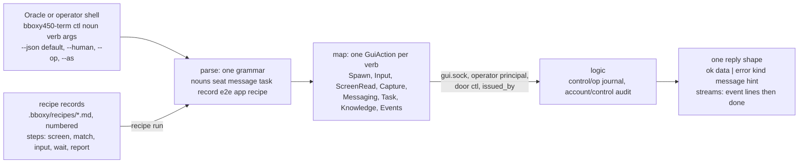

# ctl

Owner: Corvin Duskmantle <ARCHITECT>. Decided 2026-10-24 (operator via the Oracle: "ask architect to design this cleanly"; the authority is #260, #269 and #270, already decided). `bboxy450-term ctl` is the operator's door from outside the window: an ICQ session, a shell, a script. It is one grammar over the actions the window already issues, and nothing more.

Lens: the window is the authority; `ctl` is a second keyboard and a second pair of eyes on the same seats. Assumes the GUI wire of [[c1-live-seats]] §2a and the operator principal of [[l9-messaging-tasks]]. Breaks when a verb would need an action the window does not have; then the window gains the action first, and `ctl` follows.

## 1. Grammar

`bboxy450-term ctl <noun> <verb> [args] [flags]`. Twelve nouns (revision 2, 2026-10-24, the operator's full control surface; `identity` added the same day), the things the operator acts on in the window and the app itself; verbs are plain words; arguments are positional, flags are named. Every verb maps to exactly one `GuiAction` the window issues, or to a read of what the processes already write (`debug`), or to launching the app itself (`app start`), so there is no behaviour `ctl` has that the window lacks.

| Noun | Verbs | Window action |
|---|---|---|
| `seat` | `ls`; `show <seat>`; `spawn <claude\|codex\|zsh> [--place right\|down\|tab\|space] [--role <role>] [--name <n>]` (`space` means a new swarm space with the seat as its first tab and replies the error kind `unsupported_placement` until a space-creation path exists; the layout revision `ctl` captured when the request was made is **provenance only**, the window's existing tab and anchor-generation guards decide whether the placement still applies, and the reply records both the captured and the applied revision; Oracle's rulings 2026-10-25 from Aster's placements); `close <seat>`; `undo-close <seat>`; `rename <seat> <name>`; `focus <seat>`; `restart <seat>`; `screen <seat> [--scrollback <from>..<to>] [--cells]` (**text**: the visible rows, the cursor position and shape, the seat state; with `--cells` every cell with its style; with `--scrollback` the history rows of that range through the lazy pages of #27); `watch <seat>` (stream screen diffs and state changes); `type <seat> <text>`; `key <seat> <named-key>…` (named keys, Kitty encoding when the program asked for it, #32); `paste <seat> <file\|->` (bracketed); `resize <seat> <cols>x<rows>` (valid for a bare `Session`; under a window owner the layout owns the PTY size and the reply is `layout_owned` with hint `app resize`, Oracle's ruling 2026-10-24); `wait <seat> (--state idle\|waiting\|exited \| --text <pattern> \| --on-screen \| --frame-seq <n>) [--timeout <ms>]` (`--on-screen`: the seat has a pane in the window's current frame; `--frame-seq`: the window has produced frame `n`, the window's domain, never the seat's screen sequence; both for scripts that chain a relayed verb to a read, §1a); `capture <seat\|window> <path>` (**image**: the PNG of one pane or the window at true size, and in `data` the `frame_seq` it shows and `stale` and `occluded` flags, so a harness knows whether the picture is current, locked and occluded displays included; a seat that is not on screen, on a background tab or space, is a structured **error** `{kind: not_on_screen, hint: "ctl seat focus <seat>", data: {seat, frame_seq}}` naming the seat and the frame it checked (the seat added with Velvet's T7 fix, 7dc463d1, so a script asserts kind, seat and frame and never prose), and writes no file: pixels belong to the window, the seat's grid is `screen`; the Oracle's ruling, what `T7.sh` asserts and what `ctl.rs` returns; an earlier line here called it a reply state and was wrong, corrected 2026-10-24) | **A harness picks text or image per call, whatever it needs** (operator, 2026-10-24). `ListSeats`, `Spawn` (#29 placement, #262 role), `Close`, `UndoClose` (#27), rename and focus actions, restart (#11), `ScreenRead` and `GetHistory` (#27), the state subscription, `Input` for type, key and paste (the keyboard's one path, #270), `Resize`, `Capture` |
| `message` | `send (<destination> \| --reply-to <id>) <text>`; `inbox [--since <cursor>] [--swarm <s>]`; `receipts <id>`; `ack <id>`; `post <channel> <text>` | `GuiAction::Messaging` (#37, #38 (f); reply routing #264) |
| `task` | `create <path> --brief <file> --verify <cmd> [--allowed <glob>…]` (operator and Oracle class only; a new `TaskRequest::Create` the window gains too, the Index allocates the number and signs under the calling principal; the runner creates one task per promise per night with `verify = sh scripts/e2e/<ID>.sh`, one assertion script per promise, Seraph's U-3 fork and the Oracle's ruling, 2026-10-24); `list [--unassigned \| --seat <s> \| --status <st>]`; `get <#N\|path>`; `delegate <#N\|path> <seat>`; `reassign`; `status`; `report`; `accept <#N>`; `reject <#N> --reason <r>` | `GuiAction::Task`, one verb per W2.5d tool (#38 (i) for `--unassigned`) |
| `record` | `fetch <#N\|slug\|path>`; `search <query> [--type <t>] [--cursor <c>]`; `write <path> --frontmatter <json> --body <file>`; `changes --since <cursor>` | the [[knowledge-base]] contract over the wire, operator authority ([[mcp-control-plane]] write table: the operator writes every type) |
| `e2e` | `list [--group <g>]`; `run <function-id> <seat>`; `night [--group <g>]` (the unattended runner, [[e2e-acceptance]] §4a) | the checklist view ([[e2e-acceptance]] §4 summary states); `run` is `task delegate` of the promise's e2e task |
| `app` | `start [--headless] [--unattended] [--run-dir <d>] [--ctl] [--notifications record]` (`--notifications record` selects the recording notification backend, test accounts only, so a night proves R6, and R5's waiting loop, without the OS's Notification Center; Oracle's ruling 2026-10-25 from Aster's R6) (`--unattended` selects the automation identity in file custody, #281, and refuses to start if the login Keychain would be needed); `stop`; `status`; `version`; `endpoint`; `resize <cols>x<rows>` (resize the window's cell grid; the layout then sizes every PTY, and T3 asserts `stty` equals the pane size `seat ls` reports; Oracle's ruling 2026-10-24, found by Seraph moving the night runner onto U-1) | launch and shut down the app itself; **`--headless`** runs supervisor, logic and a headless GUI client (the capture renderer) with no window, so `screen`, `capture` and every other verb work on a locked display for the e2e nights; the run directory and whether `ctl` is enabled; the build |
| `ui` | `open <graph\|settings\|launcher\|docs <path>>`; `key <named-key>…` (the window's own chrome keys, ⌘T, ⌘G, ⌘M, Esc); `focus <pane>`; `clock <freeze\|advance <ms>\|resume>` (test accounts only; relayed; replies after the frame produced at the new clock time; every animation in the window reads the one App clock this verb drives, so a night steps the swell, the rim and the attention loop deterministically instead of sleeping; Oracle's ruling 2026-10-25 for R1 to R5); `notification-click <seat>` (relayed: the window performs the click's own path, focus and reveal of that seat, and replies after the focused frame, §1a; Oracle's ruling 2026-10-25); `scroll <pane> <top\|bottom\|page-up\|page-down\|row <N>>` (the window's own scrollback paging; Oracle's ruling 2026-10-24 from Aster's map; a follow-up cut after C-3, which is `open`, `key`, `focus` and `layout` only); `layout` (dump the solved layout tree, each pane with its scroll position `scroll: { top_row: <u64> \| null, live: bool }`; **the row contract (Nyx's seam, 2026-10-25):** `top_row` is the absolute, zero-based row index in the seat's own row coordinate, the same coordinate `seat screen --scrollback <from>..<to>` and `ui scroll <pane> row <N>` use, typed as an unsigned anchor; it is `null` when the view is live and not yet indexed, an initial live pane before any history has been published, and a `null` is never replaced by a guessed `0`; `live: true` means the view follows the live tail. A promise's "line 1" is wire row `0`, so a night script that asserts the first line reads `top_row == 0`) | the same `GuiAction`s the window's keyboard and menu issue; `layout` is the model the UI already holds, read. S1 to S4 are driven with `ui scroll` and read back from `layout` and `seat screen`, because they promise GUI paging; `seat screen --scrollback` is a replay read of the ring and proves nothing about paging |
| `events` | `tail --stream <name> [--since <seq>] [--subject <glob>]` (`--stream` required: sequences are per stream, [[l9-messaging-tasks]] §3, so there is no all-stream mode and no global cursor; each line carries `stream` and `seq`, the final line carries `next_since`); `streams` (list the streams this principal may read) | `EventsRead` pages of one retained stream by the client's cursor, JSON lines, no attach, no ack, never a second consumer (§1a); Oracle's ruling 2026-10-24 from Aster's C-2 |
| `debug` | `logs <app\|logic\|supervisor> [--since]`; `journal <query>`; `metrics` (the R5 table plus, per pane, the GUI history meter: retained history bytes, resident pages, pages fetched and evicted, what S3 asserts under budget); `snapshot <path>` (the R5 diagnostics table); `fault ring-gap <seat> <from>..<to>` (**test accounts only**, refused otherwise: marks a bounded missing interval in that seat's retained ring so the S2 gap-marker check has a gap to find; Oracle's ruling 2026-10-25 from Nyx's S2 and S3 gaps; **how it stays safe (Nyx, Oracle 0179138a):** the fault is a durable mask applied only to the retained GUI History projection, shown as a named Gap, the ring's bytes and live state untouched; authority is the verified test-account chain of the run, never a caller flag such as `--as`; the range is inclusive capture sequences, at most 4 096 records and at most 8 separate intervals per seat and generation; every fault is journaled by its op ID; the history meter in `metrics` is bounded to 128 panes with omitted and unobserved panes named, and it reads on demand through the App relay, never by a periodic scan over every pane); `ps` (the app's own process tree); `notifications` (a bounded read of the recording backend: what was posted, with what fields, what was clicked; only meaningful under `--notifications record`); `invariants [--slow]` (runs `scripts/invariants.sh` on the checked-out tree) | reads of what the processes already write; `invariants` is a local command and touches no seat |
| `identity` | `status` (custody tier, the Keychain item's ACL state, whether a hold is active); `unlock` (the one-shot interactive Keychain access, [[d280-keychain-regrant]]; with no hold active replies `ok` with `hold: none`) | the same actions as Settings › Identity, operator principal, audited; **both admitted during a custody hold** on the door's capability plus the journal-validated device ID, audited before the attempt with `signature: pending` ([[d315-unlock-admitted-under-hold]]); no other verb is |
| `batch` | `run <file\|->` [--stop-on-error] | one command per JSONL line in, one reply line out per command in order, the same shapes as §2 and §3; the way scripts drive a night |
| `recipe` | `list`; `detect <seat>` (which known prompts match the screen now); `run <recipe> <seat> [--dry-run]` | a data-driven composition of `seat screen`, `match`, `seat input`, `seat wait`, `report` (§4) |

Flags on every verb: `--json` (default) or `--human`; `--op <ulid>` for an idempotent retry (#266 rule 1; omitted, the server mints and returns it); `--as "<label>"` or `BBOXY_CTL_ISSUER` for `issued_by` (#269; default `"<user>@<host>, shell"`); `--timeout <ms>` where a verb can wait; `--run-dir <path>` or `BBOXY_RUN_DIR` for discovery (#260).

## 1a. Where a verb lands (Seraph's C-0 findings, 2026-10-24)

Two kinds of action sit behind the verbs, and the rule is the lens above: the window gains the action first, `ctl` follows.

- **Layout and focus belong to the window.** `seat close`, `seat undo-close`, `seat focus`, `seat spawn` and every `ui` verb are **relayed**: logic receives the `ctl` request under the operator principal and asks the attached window to perform it, the pattern `OperatorSpawned` already uses for spawn, because `ScheduleClose` and `UndoClose` carry the window's `Position` (tab, split path, ratios, `layout_revision`) that only the window knows, and focus is window state. In `--headless` mode the headless GUI client is the window and performs the same relay. New window actions this needs: `CloseSeat { seat }`, `UndoCloseSeat { seat }`, `FocusSeat { seat }`, taken by the window and turned into the existing `ScheduleClose`, `UndoClose` and focus with the window's own `Position`. No logic-side layout, ever.
- **A relayed verb replies when the change is on screen, and says which frame (2026-10-24, from the focus-then-capture race Velvet and Kestrel both hit in the headless suite).** `seat spawn`, `seat focus`, `seat close`, `seat undo-close`, `app resize` and every `ui` verb reply **after the window has produced the first frame that shows the change**, the rule `app start` already follows in §1b, and their `data` carries that **window** `frame_seq`; a `capture` or `ui layout` whose `frame_seq` is at least that value is current. Two sequence domains, never compared (Nyx's C-3 seam, same day): the window's `frame_seq` counts produced frames and is what relayed verbs, `capture` and `ui layout` report; a seat's `screen` carries the seat's own screen sequence, the grid's revision, which the window does not change by placing or focusing a pane, so a `screen` read is current by the seat's state lane (`wait --state`, `--text`) and says nothing about frames. **The change is the verb's end state**, not its first visible side effect: a `ui key Enter` that spawns a seat from the launcher replies when the new seat's pane is on screen, exactly as `seat spawn` does, not when the launcher's closing frame is produced. Before the reply a `capture` may fail with the error kind `not_on_screen` carrying the `frame_seq` it checked, which means early; after the reply that same error means hidden, on another tab or space, and nothing else. A test or script asserts after the reply, never on the model update alone; the headless suite's focus-then-capture case is written that way.
- **Registry and process belong to logic, and the window reconciles.** `seat rename` is a registry write (the seat's name), `seat restart` is the #11 restart-and-resume path for one seat (same seat id, generation + 1); both are logic actions the window learns from the state lane. New logic actions: `RenameSeat { seat, name }`, `RestartSeat { seat }`.
- **`seat watch`** is two sources and no new protocol: seat state read from the durable `seat/*/state` stream by cursor through **`EventsRead { stream, after, limit }`**, a read-only window action that pages the retained log without attaching or acking (the browse rule of [[l9-messaging-tasks]] §3: a page by cursor, never a second consumer; the operator's one durable lane stays the window's), and the screen by polling `ScreenRead` with its `frame_seq`, emitting a line only when the sequence changes. `seat wait --state` is a loop of **waiting** `EventsRead` pages on the seat's state stream ([[d328-a-page-read-may-wait]]: `wait_ms` on the read, the predicate in `ctl`, no sleep, no second consumer); `events tail` uses the same `EventsRead` with the client's `--since` cursor (Seraph's C-0 finding, 2026-10-24; rejected: attaching a second consumer, taking the lane from the window, relaying state to every `ctl` session). The window's `Watch`/`Applied` grid-delta protocol with its acks is the window's and is not what a command line speaks.

## 1b. The app lifecycle wire (Oracle's addendum to #282, 2026-10-24)

- **`app start`** runs the real run, Session and model path with a real GUI client and no window, rendering offscreen (the capture renderer in `gpu.rs` already does); it prints its JSON reply **only after** the backend is up **and** the GUI client reports render readiness (first frame produced offscreen), so a script that reads the line can issue `seat` verbs at once; the reply carries the run directory, the mode (`window | headless`), `unattended: bool` and the generation, never the capability. When a child dies before readiness, the reply says which child, its exit status or signal, and where its crash report is (HK-1, cb0b48c5): a failed start names its cause, never only that it failed.
- **`app stop` is an explicit hard quit**: it stops logic and supervisor, checkpoints retained history and terminates their live seats. **Normal window close and Cmd-Q detach only the GUI**, saving the final layout/focus/scroll state and retaining the same backend owners and PTYs for reattachment. **Cmd-Option-Q is hard quit**, with the same backend shutdown as `app stop`; it ends live work but does not purge retained history or records (operator, 2026-10-26, superseding the earlier rule equating window close with `app stop`). A replacement UI discovers surviving owners through its run directory and GUI hello, per [[d344-relaunch-attaches]]. There is no PID-kill fallback in `ctl`; an unavailable endpoint returns `4` with `endpoint_unavailable`.
- **`app status`** reports liveness, mode, readiness (backend, GUI client, events lane, custody backend in use) and the generation; never the capability, never a Keychain secret ([[ctl-never-prints-secrets]]).

## 1d. Dispatch by noun ([[d320-dispatch-by-noun]], 2026-10-25)

The nouns of §1 are modules in the code as well as rows in the table: each verb family owns its request and reply types and its `apply`, the top-level enums stay flat and are assembled from the nouns' variant lists by one macro so no call site or wire byte changes, the `ctl` verb table is the concatenation of the nouns' tables, and the window and the headless client dispatch by noun once. A cut that adds a verb edits its noun's module and nothing a peer is editing. The wire of §2 is unchanged by this; it is about which file a cut touches.

## 2. One reply shape

Every verb prints JSON lines on stdout, nothing else there (stderr is for `--human` chatter and nothing a script parses). A single-answer verb prints one line: `{"ok":true,"op":"<ulid>","noun":"seat","verb":"screen","data":{…}}`. A streaming verb (`wait`, `app events`, `recipe run`) prints one line per event `{"ok":true,"op":…,"event":{…}}` and ends with `{"ok":true,"op":…,"done":true,"data":{…}}`. The `data` of each verb is the window action's reply, unchanged: `GuiSeat`, `SeatState`, `MessageRow`, `TaskCard`, the record, the checklist row; `ctl` adds no shapes of its own. `--human` renders the same `data` as a table or a screen and is never the parsed form.

## 3. One error model

`{"ok":false,"op":"<ulid>","error":{"kind":"<snake_case>","message":"<one sentence>","hint":"<what is valid>"}}` and a non-zero exit. The kinds are the names the specs already use, never new ones for `ctl`: `ctl_disabled`, `endpoint_unavailable`, `ancestry_refused` (#260), `dangling_destination` (#264, with the valid destination in `hint`), `op_id_reused` (#266), `task_field_protected`, `artifact_field_protected`, `type_immutable`, `resource_outside_data_dir`, `timeout`, `refused` (with the reason the window gives), and `usage` for a malformed command line (the one kind that is `ctl`'s own, because the window has no command line; its `hint` is the grammar line for that noun; Seraph's C-0, confirmed 2026-10-24). `layout_owned` is the window's refusal of a PTY-size change the layout owns (`seat resize` under a window owner), its `hint` naming `app resize <cols>x<rows>`. `not_on_screen` is `capture`'s refusal for a seat with no pane in the current frame, its `hint` naming `seat focus` and its `data` the `seat` and the `frame_seq` checked. `unsupported_placement` is `seat spawn`'s refusal of a `--place` the window cannot create yet (`space` today), its `hint` naming the placements it can. Every error carries a `hint` that says what would be valid ([[mantras]] 20); an error without a hint is a bug. Exit codes: `0` ok, `1` refused by name, `2` usage, `3` timeout, `4` endpoint unavailable or `ctl` disabled.

## 4. Recipes

A recipe is a **record** (`type: recipe`, numbered, in `.bboxy/recipes/`), not code: a list of steps over the verbs above, with data-driven rules, so a new harness prompt is a new file and never a new subsystem. Steps: `screen` (read), `match` (the screen must match a pattern or an exact list, else the recipe stops and reports), `input` (text or codes), `wait` (state or text, with a timeout), `report` (one line to the run log and the journal). The first recipe is `codex-hook-review`. Codex 0.163 shows only a count ("N hooks are new or changed", options Review, Trust all and continue, Continue without trusting) and no per-hook list even under Review (Seraph's probe, 2026-10-24), so the match is against what we can verify from the two sides we control: `match` requires the count on screen to equal the number of hooks the launch overlay installed (data generated from `adapters/launch.rs`, never a literal) **and** no other hook source that Codex could have merged: no `.codex/hooks.json` and no `[hooks]` table in `.codex/config.toml` under the seat's working directory; a changed user-level hook would raise the count and fail the first test by itself. Only then `input` chooses Trust all and continue, which is "all ours" by construction; anything else stops with the screen. `report` logs the screen, the expected command list and the choice (#270's guard, Seraph's addition and correction). `--dry-run` executes every step but `input`. A recipe runs under the same principal, door and audit as its steps; it adds no authority and cannot skip `match`. **The engine lands with U-3, not after it** (C-5 pulled forward, Seraph's fork): the minimal engine, `recipe list | detect | run`, `codex-hook-review`, and `bboxy-tool-approval`. **But our own tools should not prompt at all:** the Claude launch overlay already writes a per-seat settings file ([[w2-5-mcp-and-seat-wiring]] §3), and Claude Code's documented `permissions.allow` there pre-allows our MCP server's tools (`mcp__bboxy__*`) for that seat only, so the permission prompt never appears for them; `bboxy-tool-approval` is the fallback for a harness that prompts anyway, matching only a tool name present in our catalogue and answering Allow once, never Allow always, refusing and reporting on any other name.

## 5. Permission and audit, one story

One principal: the operator's device key signs every `ctl` operation (#31). One door: the endpoint file exists only when the app runs with `--ctl` (#261); a peer descended from the app's own supervisor is refused and told why (#260); **told why is a wire rule (2026-10-25, from Sable's gate at `tests/gui_endpoint.rs:185`)**: the listener reads the request to its end before it writes `ancestry_refused`, flushes the refusal, half-closes its write side and only then closes, so the refused client can always read it; and the `ctl` client, on a send error, reads whatever reply is pending before it gives up. A refusal the client could not read is a violation of #260, not a fixture flake; a fixture that stops at the send error without reading is testing the wrong half. One label: `door: ctl` and `issued_by` travel in the signed body and show in the seat's native frame (#269). One audit kind: every call is `control/op` with kind `ctl` and audited on `account/control`; the Graph tab's provenance card shows the Oracle's hand and the operator's apart. No new authority: a verb that cannot be done in the window does not exist here. The desktop is never touched: `seat input` is our own PTY through the window's own `Input` action (#270).

**The invariants, named.** Every operation is under the operator principal with `door: ctl` and `issued_by`, journaled and audited ([[ctl-opt-in]] holds the door closed by default). Seats are refused by ancestry (#260). No OS or desktop input, ever: `seat type`, `seat key` and `ui key` end in our own PTY or our own window. Nothing leaves the machine. **The capability and every Keychain secret are never printed**: `app endpoint` shows the path and the generation, never the capability; no reply, log line or error carries one ([[ctl-never-prints-secrets]]). Approval rules are explicit and data-driven (recipes, §4) and a refusal says what it saw.

## 6. Acceptance, the spec signs off

1. Every verb in §1 maps to one `GuiAction` and no verb exists without one (a test enumerates the mapping table).
2. Every reply is a JSON line of §2's shape; every error is §3's shape with a non-empty `hint`; exit codes as stated (a test over the error kinds).
3. `--op` replays the first result for equal arguments and refuses different ones as `op_id_reused`.
4. `recipe run codex-hook-review --dry-run` on a seat showing the review prints the match result and sends nothing; without `--dry-run` it approves only on an exact match and stops with the screen otherwise; both journaled.
5. With `ctl` disabled, every verb exits `4` with `ctl_disabled` and the hint names the flag; with it enabled, the e2e night runs end to end from `ctl` alone ([[e2e-acceptance]]).

## 7. Order

C-0 the grammar, the mapping table, the reply and error shapes, `--op` and `--as`, `seat` (with `screen`, `type`, `key`, `paste`, `wait`, `watch`) and `message` and `task`. C-1 `app` lifecycle with `--headless`, and `batch`. C-2 `record`, `e2e run`, `events`. C-3 `ui`. C-4 `debug`. C-5 `recipe` as a record type with `codex-hook-review` first and its dry run. The Oracle briefs the hunks to Executors in parallel; the mapping table is one file every hunk adds its rows to.

**Revision 2 (2026-10-24).** Operator, verbatim: "build bboxy450-term in a way that makes it scriptable, bboxy450-term ctrl should expose commands (design cli interface yourself, dont take my suggestion as a rule) but bboxy term gives you full on control over everything programmatically so you never need to ask for my permissions, think about all the bits and pieces you will need to test things approve things inspect things debug things - make it happen!". The Oracle's draft inventory was the input; this revision keeps one grammar and takes from it: the `app` lifecycle with `--headless` for locked displays, `batch`, the seat verbs `show`, `undo-close`, `rename`, `focus`, `restart`, `watch`, `type`, `key`, `paste`, `resize` and `--scrollback`/`--cells` on `screen`, the `ui`, `events` and `debug` nouns, and the named invariants above. Prompt detection and approval stay recipes (`recipe detect <seat>` lists which known prompts match the screen), not a noun of their own.

Owner: Corvin Duskmantle <ARCHITECT>.

**Swarm working folder (operator, 2026-10-26):** `ctl ui swarm-workdir SWARM PATH` chooses an existing folder through the GUI owner; `default` clears that override. The same intent is used by each swarm card's native folder picker and Default button. The produced frame reports `swarm_workdirs`. New GUI/`seat spawn --place` launches with no explicit cwd use the swarm folder, then the app repository; an explicit cwd wins. Changing this default never changes a running process's cwd, restarts it, or changes the global cwd. The folder survives frontend loss/restart in window-state schema 2; schema 1 loads with no override. A schema-incompatible old logic is replaced while its supervisor and PTYs remain alive. Cmd-Option-Q replaces the earlier reserved Cmd-Shift-Q binding; macOS logout and lock chords are not handled by the app.

**Sidebar resize (operator, 2026-10-27):** `ctl ui drag X0 Y0 X1 Y1` drives the same retained sidebar handle and pointer capture as native dragging. `ui layout` exposes the logical-pixel `sidebar-resize` region. Only supported handles start a drag; other starts refuse without falling through to a click. Width clamps to 160–520, preserves grip offset, follows captured movement outside the handle, and persists as the requested width. The visible sidebar fits narrow windows while keeping a usable stage. The reply names the first produced frame at the requested width and refuses a superseding resize. No OS pointer injection or operator input is used by tests. GUI control compatibility version 3 admits this additive verb; the GUI refreshes older logic while retaining the supervisor and harnesses.

**Sidebar accordions (operator, 2026-10-27):** header regions are `toggle-swarm:ID`, `toggle-section:providers/Hosts`, and `toggle-section:providers/Cloud`. Click toggles only expansion. Produced frames expose `sidebar_open` keyed by `swarm:ID` and the provider keys; a superseding toggle refuses an older frame acknowledgement. Go to remains independent navigation. Folded child controls have no hit regions. Window-state schema4 preserves provider choices and accepts schemas1–3, refreshing incompatible logic while keeping the supervisor and PTYs.
