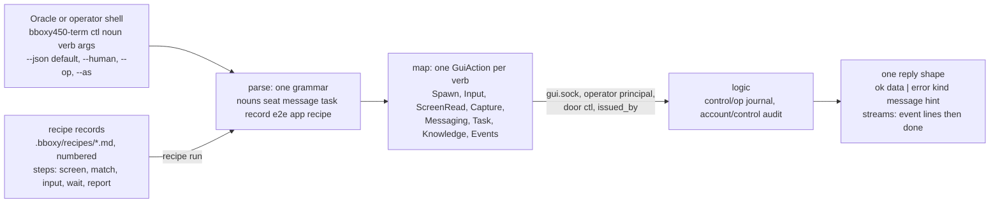

# ctl

Owner: Corvin Duskmantle <ARCHITECT>. Decided 2026-10-24 (operator via the Oracle: "ask architect to design this cleanly"; the authority is #260, #269 and #270, already decided). `bboxy450-term ctl` is the operator's door from outside the window: an ICQ session, a shell, a script. It is one grammar over the actions the window already issues, and nothing more.

Lens: the window is the authority; `ctl` is a second keyboard and a second pair of eyes on the same seats. Assumes the GUI wire of [[c1-live-seats]] §2a and the operator principal of [[l9-messaging-tasks]]. Breaks when a verb would need an action the window does not have; then the window gains the action first, and `ctl` follows.

## 1. Grammar

`bboxy450-term ctl <noun> <verb> [args] [flags]`. Seven nouns, the things the operator acts on in the window; verbs are plain words; arguments are positional, flags are named. Every verb maps to exactly one `GuiAction` the window issues, so there is no behaviour `ctl` has that the window lacks.

| Noun | Verbs | Window action |
|---|---|---|
| `seat` | `list`; `spawn <claude\|codex\|zsh> [--place right\|down\|tab\|space] [--role <role>] [--name <n>]`; `screen <seat>`; `input <seat> <text> [--codes]`; `wait <seat> (--state idle\|waiting\|exited \| --text <pattern>) [--timeout <ms>]`; `close <seat>`; `capture <seat\|window> <path>` | `ListSeats`, `Spawn` (decision #29 placement, #262 role), `ScreenRead`, `Input` (the keyboard's path, #270), state subscription, `Close`, `Capture` |
| `message` | `send (<destination> \| --reply-to <id>) <text>`; `inbox [--since <cursor>] [--swarm <s>]`; `receipts <id>`; `ack <id>`; `post <channel> <text>` | `GuiAction::Messaging` (#37, #38 (f); reply routing #264) |
| `task` | `list [--unassigned \| --seat <s> \| --status <st>]`; `get <#N\|path>`; `delegate <#N\|path> <seat>`; `reassign`; `status`; `report`; `accept <#N>`; `reject <#N> --reason <r>` | `GuiAction::Task`, one verb per W2.5d tool (#38 (i) for `--unassigned`) |
| `record` | `fetch <#N\|slug\|path>`; `search <query> [--type <t>] [--cursor <c>]`; `write <path> --frontmatter <json> --body <file>`; `changes --since <cursor>` | the [[knowledge-base]] contract over the wire, operator authority ([[mcp-control-plane]] write table: the operator writes every type) |
| `e2e` | `list [--group <g>]`; `run <function-id> <seat>` | the checklist view ([[e2e-acceptance]] §4 summary states); `run` is `task delegate` of the promise's e2e task |
| `app` | `endpoint`; `events [--since <seq>] [--subject <glob>]`; `version` | the run directory and whether `ctl` is enabled; the operator's events lane as lines; the build |
| `recipe` | `list`; `run <recipe> <seat> [--dry-run]` | a data-driven composition of `seat screen`, `match`, `seat input`, `seat wait`, `report` (§4) |

Flags on every verb: `--json` (default) or `--human`; `--op <ulid>` for an idempotent retry (#266 rule 1; omitted, the server mints and returns it); `--as "<label>"` or `BBOXY_CTL_ISSUER` for `issued_by` (#269; default `"<user>@<host>, shell"`); `--timeout <ms>` where a verb can wait; `--run-dir <path>` or `BBOXY_RUN_DIR` for discovery (#260).

## 2. One reply shape

Every verb prints JSON lines on stdout, nothing else there (stderr is for `--human` chatter and nothing a script parses). A single-answer verb prints one line: `{"ok":true,"op":"<ulid>","noun":"seat","verb":"screen","data":{…}}`. A streaming verb (`wait`, `app events`, `recipe run`) prints one line per event `{"ok":true,"op":…,"event":{…}}` and ends with `{"ok":true,"op":…,"done":true,"data":{…}}`. The `data` of each verb is the window action's reply, unchanged: `GuiSeat`, `SeatState`, `MessageRow`, `TaskCard`, the record, the checklist row; `ctl` adds no shapes of its own. `--human` renders the same `data` as a table or a screen and is never the parsed form.

## 3. One error model

`{"ok":false,"op":"<ulid>","error":{"kind":"<snake_case>","message":"<one sentence>","hint":"<what is valid>"}}` and a non-zero exit. The kinds are the names the specs already use, never new ones for `ctl`: `ctl_disabled`, `endpoint_unavailable`, `ancestry_refused` (#260), `dangling_destination` (#264, with the valid destination in `hint`), `op_id_reused` (#266), `task_field_protected`, `artifact_field_protected`, `type_immutable`, `resource_outside_data_dir`, `timeout`, `refused` (with the reason the window gives). Every error carries a `hint` that says what would be valid ([[mantras]] 20); an error without a hint is a bug. Exit codes: `0` ok, `1` refused by name, `2` usage, `3` timeout, `4` endpoint unavailable or `ctl` disabled.

## 4. Recipes

A recipe is a **record** (`type: recipe`, numbered, in `.bboxy/recipes/`), not code: a list of steps over the verbs above, with data-driven rules, so a new harness prompt is a new file and never a new subsystem. Steps: `screen` (read), `match` (the screen must match a pattern or an exact list, else the recipe stops and reports), `input` (text or codes), `wait` (state or text, with a timeout), `report` (one line to the run log and the journal). The first recipe is `codex-hook-review`: `screen` → `match` the listed hooks against **exactly** the hooks the launch overlay installed (the list is data generated from `adapters/launch.rs`, not typed into the recipe) → `input` the approval → `report` the approved list (#270's guard, Seraph's addition). `--dry-run` executes every step but `input`. A recipe runs under the same principal, door and audit as its steps; it adds no authority and cannot skip `match`.

## 5. Permission and audit, one story

One principal: the operator's device key signs every `ctl` operation (#31). One door: the endpoint file exists only when the app runs with `--ctl` (#261); a peer descended from the app's own supervisor is refused and told why (#260). One label: `door: ctl` and `issued_by` travel in the signed body and show in the seat's native frame (#269). One audit kind: every call is `control/op` with kind `ctl` and audited on `account/control`; the Graph tab's provenance card shows the Oracle's hand and the operator's apart. No new authority: a verb that cannot be done in the window does not exist here. The desktop is never touched: `seat input` is our own PTY through the window's own `Input` action (#270).

## 6. Acceptance, the spec signs off

1. Every verb in §1 maps to one `GuiAction` and no verb exists without one (a test enumerates the mapping table).
2. Every reply is a JSON line of §2's shape; every error is §3's shape with a non-empty `hint`; exit codes as stated (a test over the error kinds).
3. `--op` replays the first result for equal arguments and refuses different ones as `op_id_reused`.
4. `recipe run codex-hook-review --dry-run` on a seat showing the review prints the match result and sends nothing; without `--dry-run` it approves only on an exact match and stops with the screen otherwise; both journaled.
5. With `ctl` disabled, every verb exits `4` with `ctl_disabled` and the hint names the flag; with it enabled, the e2e night runs end to end from `ctl` alone ([[e2e-acceptance]]).

## 7. Order

C-0 the grammar, the mapping table, the reply and error shapes, `--op` and `--as`, `seat` and `message` and `task` (Seraph's A-1 is this, with `screen`, `input` and `wait` already decided). C-1 `record`, `e2e`, `app`. C-2 `recipe` as a record type with `codex-hook-review` as the first recipe and its dry run. The Oracle briefs; Executors wait for this spec except Seraph's `screen`, `input` and `wait`.

Owner: Corvin Duskmantle <ARCHITECT>.
