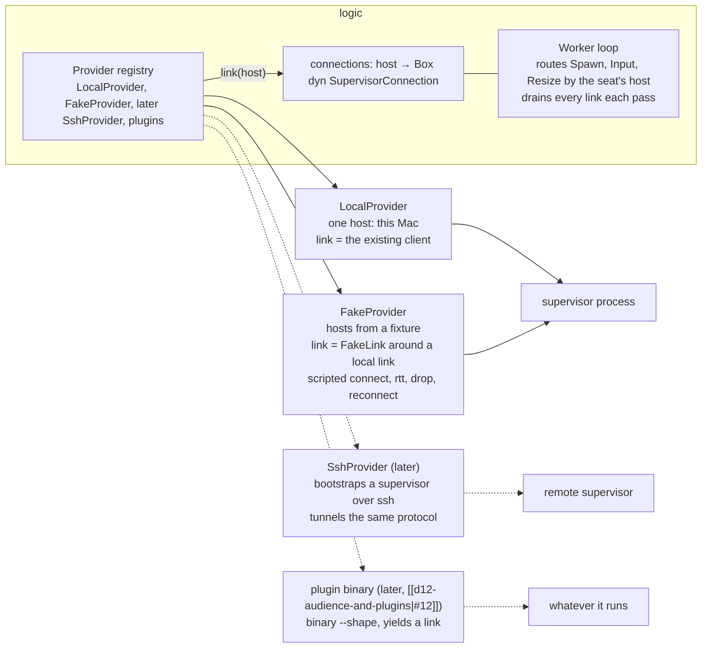

# D1 — providers

Owner: Corvin Duskmantle <ARCHITECT>. Decided 2026-10-22. Binds decision [[d7-provider-supervisor-link|#7]] (a Provider yields a supervisor link) and [[d12-audience-and-plugins|#12]] (the plugin seam, later) of [[2026-10-22-architecture-round-1]]. The operator's sentence ([[vision]] Cockpit first): "dummy ssh support and dummy cloud support, as if it works without it actually working, so we have everything in the UI." **Done means** the launcher lists ssh hosts and cloud regions, a seat spawned on one of them runs as a real local PTY labelled remote, its row carries the where-mark, and connect, latency, drop and reconnect play out in the UI from a fixture, with no network code.

Lens: logic is the only place that knows where a seat runs. Assumes the as-built shape: logic holds one `Box<dyn SupervisorConnection>` (`M/logic.rs:422`), the trait is two methods, `request(Action) -> Reply` and `receive(timeout) -> Option<Event>` (`crates/bbt-supervisor/src/client.rs:11-14`), and `SeatRecord.location` already exists as `Local | Ssh{host} | Cloud{provider, host}` (`M/registry.rs:21-25`; `Where` in bbt-ui-model mirrors it). Breaks when a seat needs a different protocol than the supervisor's; nothing planned does. LESS IS MORE: one trait, one map, one fake, no threads.

## 1. Shape



```rust
// bbt-mux/src/provider/mod.rs
pub enum ProviderKind { Local, Ssh, Cloud { name: String } }
pub struct Host { pub id: HostId, pub provider: ProviderId, pub label: String, pub region: Option<String>, pub state: LinkState }
pub enum LinkState { Offline, Connecting, Connected { rtt_ms: u32 }, Degraded { rtt_ms: u32 }, Disconnected { reason: String } }
pub enum ProviderEvent { HostState { host: HostId, state: LinkState } }
pub trait Provider: Send {
    fn id(&self) -> ProviderId;
    fn kind(&self) -> ProviderKind;
    fn hosts(&self) -> Vec<Host>;
    /// The link for a host. May return a link whose state is Connecting; logic watches events.
    fn link(&mut self, host: HostId) -> Result<Box<dyn SupervisorConnection>>;
    /// Drained by the Worker loop at its 200 ms cadence; no provider owns a thread.
    fn poll(&mut self) -> Vec<ProviderEvent>;
}
```

- **Logic** replaces its single connection with `connections: HashMap<HostId, Box<dyn SupervisorConnection>>`; the local host is the first entry and the default. `Spawn{spec}` carries `location`; the Worker resolves location → host → link, and every later supervisor action for that seat goes to the same link. Each loop pass drains every link: the local one with the current 10 ms wait, the others with a zero timeout. Seat records keep `location`; nothing else in the registry changes.
- **LocalProvider**: one host, "this Mac"; `link()` returns the existing client (socket or in-process). Zero behaviour change for everything built so far.
- **FakeProvider**: hosts from `crates/bbt-mux/fixtures/providers.json`: ssh hosts (label, `user@host`, a state script) and cloud providers (name, regions, hosts per region, a state script). `link()` returns a `FakeLink` wrapping a fresh local link, so the seat behind it is a real local PTY. The link runs a scripted state machine with a clock: `Connecting` for N ms → `Connected{rtt}` → optionally `Disconnected{reason}` at T → `Connecting` → `Connected`. While not connected, `request` fails immediately with the named link-unavailable error and never executes, and `receive` returns `None`. **Decision (2026-10-22, from D1b):** `SupervisorConnection::request` stays synchronous (`crates/bbt-supervisor/src/client.rs:11-14`), so the fake simulates RTT only on queued events and `HostState` transitions through the due-time queue; replies are not delayed. Reason: these are dummy providers, and no protocol change is worth cosmetic latency on the request path. The seat record says `Ssh{host}` or `Cloud{provider, host}`; the ring behind it is real, so output after a reconnect is complete.
- **UI** ([[ux-prototype]]): the launcher gains the sections it already draws, Hosts (ssh) and Cloud (provider → region → host), from a `ListHosts` GUI action and `HostState` replies added to the C1 schema ([[c1-live-seats]] §2a); the settings Cloud providers card binds to provider records; seat rows and strips show the where-mark they already have; a host row shows its `LinkState`; a drop marks the affected seat rows and the reconnect clears them, through the existing signal table (`reconnect`, `restarted`).
- **Later, same seam.** `SshProvider::link` bootstraps `bboxy450-term supervisor` on the host over ssh and carries the control protocol over the channel; `CloudProvider` provisions, then does the same. An out-of-process provider (decision [[d12-audience-and-plugins|#12]]) is a binary in a folder that answers `--shape` and yields a link over its stdio. Credentials live in the keychain, never in config ([[identity]]; the settings card already says so). None of it is built now.

## 2. A fake host, end to end

```mermaid
sequenceDiagram
  participant U as operator
  participant A as app
  participant L as logic
  participant F as FakeLink
  participant S as local supervisor
  U->>A: ⌘T, pick "ssh · build-box"
  A->>L: Spawn{spec, location: Ssh{build-box}}
  L->>F: link(build-box): Connecting
  F-->>L: HostState Connected{rtt 40}
  L->>F: Action::Spawn (synchronous, decision [[d25-fake-provider-latency|#25]])
  F->>S: Action::Spawn
  S-->>F: Reply (immediate), Event::Output …
  F-->>L: events released after rtt 40 ms
  L-->>A: seat record location Ssh, where-mark on the row
  F-->>L: HostState Disconnected{reason} at T
  L-->>A: host row and seat rows marked
  F-->>L: Connecting → Connected
  L-->>A: marks cleared; output continues, nothing lost
```

## 3. Acceptance, the spec signs off

1. **Local unchanged.** With only `LocalProvider`, every existing bbt-mux and app test passes on the `connections` map; no seat record changes.
2. **Fixture hosts in the UI.** With `FakeProvider` enabled, the launcher lists the fixture's ssh hosts and cloud regions; spawning on one yields a seat with the matching `location`, the where-mark on its row, and a real zsh behind it that echoes typed text.
3. **Drop and reconnect.** The fixture's drop at T marks the host and its seat rows; the reconnect clears them; text typed before the drop and output produced during it are both present afterwards (ring replay, no gap marker).
4. **Headless.** A test drives logic with the fixture and no GUI and asserts the `HostState` sequence, the routing of every action for a fake-hosted seat through its link, and `Err(LinkDown)` while disconnected.
5. **No network.** `cargo tree -p bbt-mux` shows no ssh, quinn or cloud SDK crate; the fixture is the only source of hosts.
6. `sh scripts/ci-local.sh` exits 0 in a clean worktree of the handed-off commit.

## 4. Out of scope

Real ssh and cloud providers, credentials and keychain items for them, the quinn transport ([[networking]], W4.1), cross-machine messaging, moving a seat between hosts, the plugin runner.

## 5. Order for briefs (the Oracle's call, one concern each)

D1a the `Provider` trait, `LocalProvider`, the `connections` map and routing in logic, acceptance 1. D1b `FakeProvider`, the fixture, `FakeLink`, the headless test, acceptance 4 and 5. D1c the GUI: `ListHosts` and `HostState` in `bbt-proto`, launcher sections, settings card binding, host and seat row states, acceptance 2 and 3.
