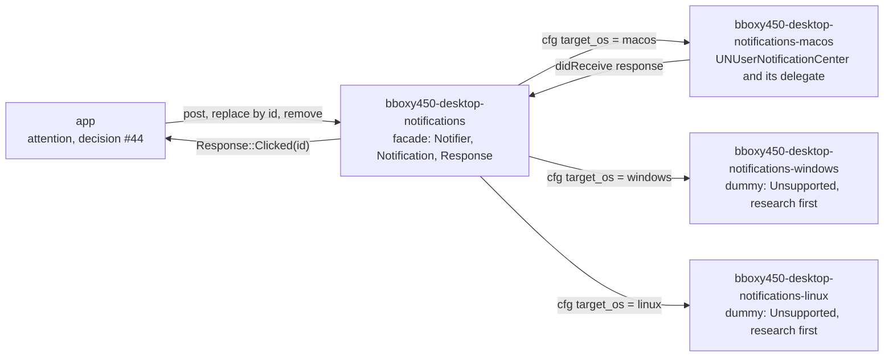

# Desktop notifications

Owner: Corvin Duskmantle <ARCHITECT>. Decided 2026-10-23 (decisions #45 and #46). Operator, via the Oracle (verbatim gist): desktop notifications get their own crate family, an OS-agnostic facade `bboxy450-desktop-notifications` with per-OS sub-crates; macOS first and real; Windows and Linux are dummy crates for now with an explicit "DO RESEARCH BEFORE IMPLEMENTING" marker; as a general rule everything cross-OS is done this way, with an eye on wasm, iPad and Android ("we are a pure GPU rendering library"), unless an existing crate already does it well enough to use.

Lens: the app is a suite of kits (decision #39); the OS is a dependency to be fenced, not a home. Assumes `UNUserNotificationCenter` needs a bundle identifier and a delegate set at launch. Breaks when a target has no per-OS crate: then the facade refuses to compile, by design.



## 1. Shape

- **One facade, one crate per OS.** `bboxy450-desktop-notifications` holds the types and the trait and selects the backend with `[target.'cfg(target_os = "…")'.dependencies]`; `bboxy450-desktop-notifications-macos` is real; `-windows` and `-linux` are dummies; `-ios`, `-android` and `-web` are named here and not created until there is work for them. The suite depends only on the facade; the app never names an OS crate ([[cross-os-facade]]).
- **Layering.** The four crates lead the order in `scripts/layering.sh`, so they can depend on nothing of ours and nothing of ours but the app depends on them; the click never carries a `bbt-*` type, only the facade's `Response`, which the app maps to its own action ([[layering]]).
- **Names and licence.** The names are the operator's; crates.io availability is checked before any publish (the research records what the pages return today). Dual MIT OR Apache-2.0 like every kit ([[licensing]]).

## 2. The facade API

```rust
pub struct NotificationId(pub String);          // stable per episode: attention uses the seat id
pub struct Notification { pub id: NotificationId, pub title: String, pub body: String }
pub enum Response { Clicked(NotificationId), Dismissed(NotificationId) }
pub enum Authorization { Granted, Denied, Undetermined }
pub enum Error {
    Unsupported { os: &'static str, note: &'static str },  // a dummy answered
    NoBundle,                                                // macOS: no bundle identifier, see §3
    Denied,                                                  // the user refused authorization
    Backend(String),                                         // the OS said no, verbatim
}
pub trait Notifier: Send + Sync {
    fn authorize(&self) -> Result<Authorization, Error>;
    fn post(&self, n: &Notification) -> Result<(), Error>;   // the same id replaces, never stacks
    fn remove(&self, id: &NotificationId) -> Result<(), Error>;
}
pub fn open(on_response: Box<dyn Fn(Response) + Send + Sync + 'static>) -> Result<Box<dyn Notifier>, Error>;
```

`open` is called once at launch, before any window shows, because the OS delegate must exist before a notification can be delivered to the process. `on_response` runs on the backend's thread; the caller forwards into its own event loop (the app uses its winit proxy) and the facade knows nothing about windows. No images, no actions beyond the default click, no sounds in v1: attention needs none of them.

## 3. The macOS crate

- `UNUserNotificationCenter.currentNotificationCenter()` with the process as its own `UNUserNotificationCenterDelegate`; `requestAuthorization(options: [.alert, .sound])` on `authorize`; `UNMutableNotificationContent` + `UNNotificationRequest(identifier: id.0)` on `post`, so the identifier carries the replace semantics; `removeDeliveredNotifications(withIdentifiers:)` and `removePendingNotificationRequests(withIdentifiers:)` on `remove`.
- `didReceive response`: `UNNotificationDefaultActionIdentifier` → `Response::Clicked(id)`, `UNNotificationDismissActionIdentifier` → `Dismissed(id)`, the id read from `response.notification.request.identifier`; the completion handler is called after the callback returns.
- **Bundle check first.** `open` reads `NSBundle.mainBundle.bundleIdentifier`; `None` returns `Error::NoBundle` **before** touching the notification centre, which throws without one. The build produces `bboxy450-term.app` with an `Info.plist` for every run, ad-hoc signed; Developer ID stays deferred (decision #24; ad-hoc is not identity signing).
- **Use versus build: build** (decision #45, from [[desktop-notifications-research]]). The macOS crate sits directly on `objc2-user-notifications` 0.3 with `objc2` and `block2`, the family `winit` already links: a `define_class!` delegate implementing `UNUserNotificationCenterDelegate`, `setDelegate` with the delegate kept alive for the process (the property is weak) **before `EventLoop::run`**, since Apple requires the delegate before the app finishes launching for cold-launch delivery. No existing crate met the four requirements with the app owning the click: notify-rust's UN path is a preview feature with blocking handles and a delegate owned by `mac-usernotifications`; `user-notify` is LGPL-3.0, generates UUID identifiers so nothing replaces, and drags tokio onto every target; `mac-notification-sys` is the deprecated `NSUserNotification` behind a bundle-identifier swizzle; `usernotifications-rs` was a day old on bespoke FFI. About 300 lines; the research names a working reference file to read for the mechanism, not to copy.

## 4. The dummies

- `bboxy450-desktop-notifications-windows` and `-linux` compile on their OS with no dependencies and answer `open` with `Err(Error::Unsupported { os, note: "DO RESEARCH BEFORE IMPLEMENTING: .bboxy/research/desktop-notifications-research.md" })`; their `README.md` and crate docs carry the same marker in capitals and the research record's pointers: Windows needs a Start shortcut with `System.AppUserModel.ID` and `ToastActivatorCLSID` plus a `LocalServer32` COM server implementing `INotificationActivationCallback` for launch-on-click (or the Windows App SDK runtime, not Rust-native), `Tag`/`Group` for replace and `ToastNotificationHistory.Remove`; Linux is `org.freedesktop.Notifications` spec 1.3 over `zbus` with `replaces_id`, `CloseNotification`, `ActionInvoked` with the `default` key and `ActivationToken` for raising a Wayland toplevel. iPadOS is the same UserNotifications framework (the macOS delegate code modulo lifecycle); Android is JNI into `NotificationManagerCompat` (`notify` with the same id replaces, `cancel`, `PendingIntent` for the tap, a channel on API 26+, `POST_NOTIFICATIONS` on 33+); web is `web-sys` `Notification` with `tag` for replace and a service worker `notificationclick` for routing.
- A target with no per-OS crate hits `compile_error!` in the facade: an unknown OS fails at build time, a known-but-unbuilt OS fails at run time by name. The app treats `Unsupported` and `NoBundle` the same way: the in-window attention loop runs, nothing is posted, one log line says why.

## 5. Acceptance, the spec signs off

1. `cargo build -p bboxy450-term` on macOS links the facade and the macOS crate only; `cargo metadata` shows no `bbt-*` dependency in any of the four crates; [[layering]] and [[cross-os-facade]] hold.
2. A test double of the delegate delivers a default-action response and the facade's callback receives `Clicked(id)` with the posted id; posting twice with one id yields one delivered notification (identifier replace); `remove` clears it.
3. Run unbundled, `open` returns `NoBundle` without touching the notification centre (no exception, the log line present); run as the bundle, `authorize` prompts once and the state persists across launches.
4. On a Linux or Windows build of the facade (CI cross-check or a local VM), `open` returns `Unsupported` with the marker text.
5. Two Apple behaviours the research found in no Apple document are measured on this machine before the crate is trusted: an ad-hoc-signed `.app` with an `Info.plist` is enough for `currentNotificationCenter()` and delivery; and re-adding a request with a **delivered** notification's identifier replaces it in Notification Center, not only a pending one. Each is a test with its result written here.
6. Cold-launch delivery: with the app not running, clicking a delivered notification launches the bundle and the delegate receives the response, which the app turns into the seat focus; this is the test that proves the delegate is set early enough.

Owner: Corvin Duskmantle <ARCHITECT>.
