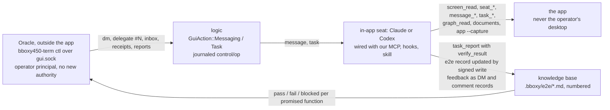

# E2E acceptance

Owner: Corvin Duskmantle <ARCHITECT>. Decided 2026-10-24 ([[d259-overnight-north-star]]). Operator, verbatim, before sleeping: "swarms job is to have working app, with codex and claude inside of it and you from here being able to talk to them and ask for their feedback and doing full ond e2e tests for you (write e2e test docs in our knowledge base) harnesses there basically need to make sure all promised functionality is there, is intuitive is works, thats acceptance cretirea"

Lens: the app is tested by the agents who live in it, and the Oracle judges from outside through the same door the operator uses. Assumes the seat wiring of [[w2-5-mcp-and-seat-wiring]] and the operator principal of [[l9-messaging-tasks]]. Breaks when a seat would need the operator's desktop to test something; then that function is tested by the Oracle's eye and the record says `manual`.



## 1. The acceptance checklist

Every promised user-facing function, one line of expectation each, from [[vision]], the specs and the decisions as of today. **"All promised functionality is there, is intuitive, works" is the acceptance criterion**, and each line below is one promise. 54 promises. A promise with no e2e record is a gap the checklist shows; a promise whose record fails is red until it passes.

### terminal

- **T1** ⌘T on a Claude, Codex or zsh row opens a real PTY seat in a pane within one frame, named from the furry pool, in the chosen placement
- **T2** typing in a focused pane reaches the program; the echo appears within one frame; a 100 kB paste arrives intact
- **T3** resizing a pane or the window resizes the PTY and the program redraws at the new size with no stale cells
- **T4** a pane shows real cells: colours, bold, italics, underline, wide glyphs and emoji align to the grid; the cursor shape follows the program
- **T5** the app is killed and relaunched: every seat is attached to the same PTY, layout, focus and scroll positions are identical, the programs never noticed
- **T6** the supervisor dies: seats survive; the app says so, restarts it, re-attaches, resumes by session id
- **T7** closing a pane shows the grace strip for 60 s, ⌘Z brings it back with the PTY and its position; after grace it is gone and says so
- **T8** OSC 7501 state from a harness shows as reported grade; a harness that stays silent shows idle, never an invented state

### launcher and placement

- **L1** ⌘T opens the centred launcher over the blurred window with harness rows, search, and role presets; Esc closes it with no spawn
- **L2** a new seat lands exactly where the operator picked (split right, split down, new tab, new space), never a guessed slot
- **L3** every launched seat has our MCP server, the hook shim and the bboxy450 skill at launch; the user's own ~/.claude and ~/.codex are byte-identical before and after
- **L4** a fresh Claude seat and a fresh Codex seat each call orient and task_report on their first turn in a fixture task

### scrollback

- **S1** scrolling up shows earlier output byte-identical to the ring, paged lazily; the top row of a 20k-line fixture is line 1; the join with live rows is seamless
- **S2** a gap in the ring shows the gap marker at the right row, never a silent splice
- **S3** 50 watched seats scrolled to the top stay under the retained-heap budget; paging shows no hitch on the meter
- **S4** a pane whose dimensions cannot fit three viewports in the budget refuses history by name, and the live pane is unaffected

### keyboard

- **K1** every key combination reaches the program under the kitty protocol when the program asks for it; ⌘⌥ navigation stays the app's; plain keys are the terminal's
- **K2** ⌘M mutes the focused seat: its row stays, the amber muted mark shows, it works one to one with the operator
- **K3** ⌘G opens the Graph tab; ⌘-click on a .md path or a wikilink opens the document modal

### rim, swell and attention

- **R1** every pane and strip carries the alive rim centred on the border, two counter-moving waves, seat colour, pulse by activity, focused ×1.3; text is never covered
- **R2** Settings › Rim size 2 to 8 moves only the gutter and the stage inset; at 2, 4 and 8 the gaps are 2, 4, 8 and the insets 1, 2, 4
- **R3** focusing a block swells its silk 40 px past the rim and settles in 0.9 s; nothing moves; the old locate ripple is gone
- **R4** seat rows, tabs and cards carry the rim and the swell out of the box; idle rows show no rim at rest
- **R5** a seat waiting on the operator loops the swell in amber on its row and pane until handled; focusing it stops the loop with one swell
- **R6** a waiting seat posts one desktop notification with the question's first line; a repeat replaces it; clicking it raises the window, switches space and tab, focuses the pane; muted seats post nothing

### messaging and tasks

- **M1** a DM, a channel post and a swarm-stream post from the composer each arrive at the right seats with a receipt; the operator principal signs as the device
- **M2** the role chip fans out to the exact seats holding the role, one receipt each, shown as one send; above 32 seats it refuses with a named reason
- **M3** the operator delegates a task by #N or path to a seat; the seat's frontmatter says claimed and its row shows the task; the seat gets one oracle-class message
- **M4** a report with verify_result whose command differs from verify, or whose exit code is non-zero, is refused on accept with the reason named
- **M5** the operator alone lists open unassigned tasks account-wide; a seat asking gets the existing refusal
- **M6** groups stay their own destination; a message to a muted seat waits; priority delays, never deletes

### live feed

- **F1** the stream dock shows one swarm at a time with its channels; arrivals appear within one event-lane delivery; nothing polls
- **F2** unread counts come from the operator's read marks and survive a restart; viewing a stream marks it read
- **F3** killing logic and restarting resumes the events lane at its cursors: no duplicate row, no lost event
- **F4** a filter change while attached migrates the consumer: pending rows for still-granted subjects are delivered, revoked ones dropped unprojected, one audit line on account/control

### settings

- **G1** Settings › Appearance: Rim size 2 to 8 default 4; depth is no longer a setting
- **G2** Settings › Notifications: on by default, per-harness off, only-when-not-frontmost
- **G3** Settings › Plugins lists every discovered plugin with trust state, tier, shape, health and the call-and-hook timeline; a 10 s hook shows the warning
- **G4** Settings › Knowledge lists roots with their provider; swapping to a stub provider and back moves no file
- **G5** theme is data: a token change in design/tokens.toml changes the look without a code change

### documents

- **D1** a .md opens in the modal rendered natively: headings, lists, tables, code, task lists, footnotes; true size, never scaled
- **D2** a mermaid fence renders through our engine: no overlaps, edges on borders, deterministic
- **D3** `[[slug]]`, `[[#N]]` and `[[slug|alias]]` resolve; a bad link shows as broken, never silently skipped; ![[bboxy.png]] renders the image from .bboxy/images
- **D4** the modal opens, scrolls, copies, closes, and feeds the document into the focused harness

### records

- **N1** every record has a unique number; a new record created through the app takes the next free one; a duplicate or invalid number is refused and shown as broken
- **N2** every decision is its own node; the Graph tab shows a decision with its decides, constrains, evidence, answers, amends edges
- **N3** a comment pinned to a digest shows beside the version it was made on; the RFC loop runs in the app: proposal, comments, decision, spec
- **N4** the Graph tab shows agents (seat, role, now, blocked on), the work tree, the provenance card and what each seat listens to

### identity

- **I1** first launch enrols one device key in the Keychain with one prompt under the GPG root; later launches prompt nothing
- **I2** every seat has its own generation key certified by the device key; every message envelope verifies; a seat with a nil seat id and a non-operator role is refused
- **I3** the local-dev issuer path works offline and is marked as such everywhere it shows; pinned receivers refuse local-dev envelopes
- **I4** every record write from the app is signed by the device key with signer device:<id>; git log shows only good signatures on main

### performance

- **P1** the hitch meter shows zero hitches idle at 120 Hz with 1000 sidebar rows and 50 watched panes once R5g lands; the HUD is in our look
- **P2** an Oracle broadcast reaches 1000 seats under the bus budget; 400 idle seats stay under the memory budget

## 2. The e2e record

A new record type, `e2e`, in `.bboxy/e2e/<id>-<slug>.md` (added to the types of [[work-items]]), one per promise, numbered like every record ([[d48-every-record-has-a-number]]):

```yaml
type: e2e
number: 312
title: "T5 restart keeps every seat"
function: T5                      # the checklist id above
group: terminal
status: pass | fail | blocked | untested | manual
steps:                            # what the seat does, in order, with the tool it uses
  - "spawn two zsh seats (seat_spawn), type a marker into each (seat_input)"
  - "kill and relaunch the app (app --restart in the fixture), wait for resume"
  - "screen_read both panes; app --capture the window"
expected: "both markers visible, same panes, same positions, focus unchanged"
last_run: 2026-10-24T03:12:00Z
result: "pass: markers at rows 3 and 3, capture e2e/T5-20261024.png"
run_by: seat:kestrel-voidwing       # the seat that ran it, with its generation key on the signed write
evidence:
  - { to: "[[runs/e2e-T5-20261024]]", rel: evidence }
links:
  - { to: "[[c1-live-seats]]", rel: tests }
```

The record is written and updated **through the app** (the knowledge base's `write`, [[knowledge-base]] §2, so it is signed by the running seat's key and numbered by the Index), never by hand from outside; a hand edit shows as inferred grade. `steps` name the MCP tool or app command for each action, so a second seat can repeat the run. `status: manual` means the Oracle's eye is the test; the record says why.

## 3. The Oracle's channel into the app

The Oracle sits outside the app (its own session, ICQ) and talks to the seats inside through **`bboxy450-term ctl`**, an operator-side CLI over `gui.sock` under the **existing operator principal** (decision #31): the same `GuiAction::Messaging` and `GuiAction::Task` wrappers the GUI uses (decisions #37 and #38), journaled as `control/op`, audited on `account/control`, dispatched through the same functions the MCP tools call. **No new authority**: `ctl` can do exactly what the operator can do in the window, nothing more. Commands: `ctl seats` (the roster with state), `ctl dm <seat> <text>`, `ctl post <channel> <text>`, `ctl inbox [--since]`, `ctl receipts <message-id>`, `ctl delegate <#N|path> <seat>`, `ctl reports [--since]` (task reports with their `verify_result`), `ctl e2e [--group]` (the checklist with each promise's record status), `ctl capture <seat|window> <path>` (the app's own capture; the no-desktop-driving rule of `AGENTS.md`). Output is JSON lines; the Oracle's ICQ session reads it and briefs from it.

## 4. How in-app seats run e2e tests and report

- **Assignment.** The Oracle delegates an e2e task to a Claude or Codex seat (`ctl delegate`); the task names the e2e record(s). The seat orients, reads the record, runs the steps **with our tools only**: `seat_spawn`, `seat_input`, `seat_close`, `screen_read`, `message_*`, `task_*`, `graph_read`, the document tools, the knowledge base's `fetch` and `write`, and `bboxy450-term --capture` for pixels. **Never keystroke injection into the operator's desktop, never `osascript`**, never screencapture of anything but our window (the no-desktop-driving rule of `AGENTS.md`).
- **Judging.** Expected versus observed is the seat's judgement, stated plainly in `result` with the evidence (the screen read, the capture path, the receipt ids). Geometry and pixels the seat cannot judge go to the parity gate, not to a guess.
- **Reporting.** `task_report` with a structured `verify_result` (decision #28): the command is the step that proved it (`screen_read` with its arguments, or the capture), the exit code is 0 on pass; the e2e record's `status`, `last_run`, `result`, `run_by` and `evidence` are updated by a signed `write`. **Feedback** on what is unintuitive or broken goes two ways: a DM to the Oracle for the day, and a `comment` record (kind `suggestion` or `objection`, pinned to the spec's digest) for the record, so it enters the RFC loop ([[work-items]]). A promise that cannot be tested from inside is `blocked` with the reason, or `manual` if only an eye can judge it.
- **Acceptance of the swarm's job.** Every promise in §1 has an e2e record; none is `untested`; every `fail` has an open task; the checklist in `ctl e2e` and in the app's Graph tab reads green or says why not. The Oracle accepts the night's work from that view, not from a report.

## 5. Order (the Oracle's briefs; Executors start in parallel)

A-0 the `e2e` record type in the parser and corpus, the folder, and one record per promise above with `status: untested` (a Codex seat writes them from this checklist). A-1 `bboxy450-term ctl` over `gui.sock` with the commands in §3 and JSON-lines output. A-2 the first e2e run by an in-app Claude seat and an in-app Codex seat on the terminal group, with reports and record updates; the gaps they hit become tasks. A-3 `ctl e2e` and the Graph tab's checklist view. A-4 the remaining groups, in the order of §1.

Owner: Corvin Duskmantle <ARCHITECT>.
