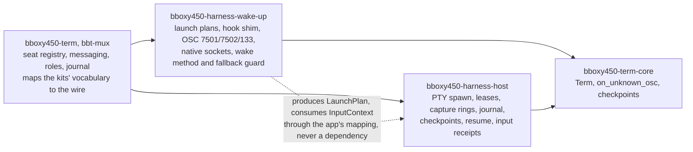

# Harness kits

Owner: Corvin Duskmantle <ARCHITECT>. Decided 2026-10-24 ([[d274-harness-kits]]). Operator, verbatim: "the logic that we have, about waking up harnesses, like running claude with sockets and messaging, then using that socket to deliver messages, or codex and their control sockets, and other harnesses, we should abstract it into bboxy450-harness-wake-up crate, and reuse it down the line! and that crate should tell its user if the harness can be woken up or no then there is fallback, its not a wrapping crate, just shared reusable hacks on how to tap into harnesses, the crate that wraps harness processes and manages them and runs them in pty and shit should be bboxy450-harness-capture, or instead of capture use better name, reusable pieces down the line! lets implement this, architect, look at code, plan those crates, communicate to oracle, seems like we done with big chunk of work here, so time to split everything into reusable crates, make sure it still works and then start publishing crates!"

Lens: the suite is the product (#39); the terminal is the first app that hosts harnesses, not the last. Assumes the code as mapped on 2026-10-24 (a read-only map by a subagent; every line below is from it). Breaks when a kit grows a dependency on the app's wire or registry; the layering gate catches that.

## 1. What exists today, and where it goes

The harness-tapping code is one module, `crates/bbt-mux/src/adapters/` (`mod.rs` 304 lines, `launch.rs` 326, `hook.rs` 430, `native.rs` 588, `observe.rs` 435, `guard.rs` 265, the skill template), with its tests (`bbt-mux/tests/adapters.rs`, `tests/seat_wiring.rs`, the `osc7501-*.bin` fixtures). The process hosting is one crate, `bbt-supervisor` (PTY spawn, leases, capture rings, tick journal, checkpoints, resume, input receipts, the frame transport and client). Everything else that touches a harness is the app's own policy and stays in `bbt-mux`: the seat registry, roles and presets (`adapters/mod.rs:52-73`), the messaging ledger, the control journal, the per-seat sqlite store, the MCP catalogue, and the glue that calls the kits (`logic.rs:2765-2843` attach, `:3005-3060` launch, `:3860-3950` refresh, `:3952-4187` pump and PTY delivery).

| Kit | Takes | Leaves behind in `bbt-mux` |
|---|---|---|
| `bboxy450-harness-wake-up` | `adapters/{mod,launch,hook,native,observe,guard}.rs`, the skill template mechanism, `OscTap`, the hook shim's prepare, parse, project and OSC emit, the Claude socket and Codex app-server protocols, the PTY-fallback readiness guard, the tests and fixtures | role policy (`validate_role`, `role_preset`), the skill text's bboxy content, journaling an input through the store (`guard.rs:118-145`), the seat-socket wire for the shim's socket fallback (`hook.rs:405-430`), every caller |
| `bboxy450-harness-host` | all of `bbt-supervisor`: protocol, supervisor, ring, writer, journal, durability, transport, client, store | nothing; one leak is repaired in place (§3) |

## 2. `bboxy450-harness-wake-up`: the hacks, with an honest answer

Not a process wrapper. A library that knows, per harness, how to launch it wired in, how to read its state, how to deliver a message natively, and whether that is possible at all; and when it is not, what the fallback is.

- **Kinds** are open strings (`HarnessRecord { kind, command, wake_method, state_source, hooks }`, `mod.rs:39-49`); `claude`, `codex` and `zsh` are the built-ins (`mod.rs:83-105`); `pi` and `omp` are UI labels today with no adapter anywhere in `crates/` (verified by the map), so they are future adapters of this crate and nothing else.
- **The answer:** `WakeMethod { ClaudeSocket, CodexRpc, Pty, Operator }` (`mod.rs:23-28`) says whether a harness can be woken natively, and `native_available(binding)` says whether it can be woken **now** (an attachment for the live generation). The fallback ladder is the one [[harness-adapters]] §5 fixed: native `wake()` → on `NativeUnknown` stop and show it → if native is unavailable, the PTY under the readiness guard (`guard.rs:43-85`) → else `OperatorHandoff`. The crate returns the outcome as its own `Evidence { SenderStored, RecipientStored, NativeQueued, NativeWritten, NativeUnknown }`; it never invents a fallback the caller did not ask for (`native.rs:461-473`).
- **Launch:** `plan(LaunchContext) -> LaunchPlan` (`launch.rs:98-141`): per-launch overlay directory 0700, the env (`BBOXY_SEAT_ID, BBOXY_GENERATION, BBOXY_ROLE, BBOXY_SOCK, BBOXY_CAPABILITY, TERM_PROGRAM, TERM_PROGRAM_VERSION`), Claude's `--settings` with hooks and `crossSessionInbound`, `--mcp-config`, `--plugin-dir`, `--session-id` or `--resume` (`:146-221`); Codex's `-c` configuration, `notify`, inline `hooks`, `check_for_update_on_startup=false`, `resume <thread>` (`:223-283`); zsh's `ZDOTDIR` overlay with OSC 133 and OSC 7 (`:285-297, 311-326`); a generic command with the env (`:298-300`). The env variable names and the `TERM_PROGRAM` value are the crate's constants and stay as they are; the skill text is injected by the caller.
- **Observe:** OSC 7501 (`observe.rs:344-379`), the 7502 shim (`hook.rs:118-285`), 133 and 7 for shells, 21337 as a hint (`observe.rs:282-341`); Claude's sessions file (`native.rs:110-203`) and Codex's app-server events (`:205-290`); grade precedence and the dialog latch (`observe.rs:181-249`); the `OscTap` over `Term::on_unknown_osc` (`observe.rs:405-435`, `bbt-core/src/lib.rs:217-222`).
- **Hook shim:** `prepare`, `osc`, `known`, `parse`, `project` (`hook.rs:23-285`) and the CLI body (`:329-430`) travel; the shim writes its OSC to the tty when it has one and otherwise hands the event to a **caller-supplied sink** (a small trait), so the app's seat-socket wire is the app's.
- **Own vocabulary, mapped by the app.** The crate defines its own small `State`, `WaitingKind`, `Grade`, `Evidence`, `LaunchPlan { program, args, cwd, env, overlay, harness_session_id }`, `ArbiterView` and `LiteralInput`. Today the module borrows `bbt_proto::messaging::{State, Evidence}` (`observe.rs:18`, `mod.rs:178`), `bbt_proto::registry::{Role, SeatRecord}` (`launch.rs:11-22`) and `bbt_supervisor::protocol::{LaunchSpec, InputState, InputReceipt, InputContext}` (`launch.rs:32`, `guard.rs:147-170`); after the split `bbt-mux` owns one mapping function per type, tested both ways, and the kit depends on neither the wire crate nor the host. No new "types below both" crate: six enums are not a crate.
- **Dependencies:** `bbt-core` (public, Apache-2.0) for the OSC tap and nothing else of ours; `bbt-rt` optional, for the debug `assert_not_ui_thread` (`launch.rs:99`, `native.rs:33`); `tokio`, `tokio-tungstenite` and `futures-util` for the Codex app-server WebSocket and the Claude socket; `mio` for the shim's socket write; `base64`, `serde`, `serde_json`, `ulid`, `libc`. No `rusqlite`, no `bbt-proto`, no `bbt-supervisor`.

## 3. `bboxy450-harness-host`: run a program in a PTY and keep what it said

`bbt-supervisor` whole, published under the brand name (the earlier `bboxy450-pty, later` in [[licensing]] is replaced): one mio actor owning masters, children and leases, one disk writer for the rings, no tokio (`lib.rs:1-27`); `LaunchSpec` (`protocol.rs:64-127`), spawn through `portable-pty` (`supervisor.rs:1737-1797`), input with dedupe, epochs and the operator draft (`:1883-1946`), `InputContext` (`:1948-1969`), capture to CRC32C-framed rings with checkpoints through `bbt-core`'s `Term` (`ring.rs`), the tick journal and `F_FULLFSYNC` barriers (`journal.rs`, `durability.rs`), grace close and undo, resume by generation (`:1500-1543, 2372-2423`), the length-prefixed frame transport and the client trait (`transport.rs`, `client.rs:21-24`).

- **One leak to repair:** `accept_input` exempts the OSC `7501;?` probe from epoch and draft fencing (`supervisor.rs:1927-1934`); that is harness knowledge inside the host. It becomes a **probe allowlist** the caller passes in `Config` (the app passes the 7501 probe), so the host holds no harness word. A test greps the crate for `claude|codex|7501|7502` and fails on a hit.
- **Dependencies:** `bbt-core` (checkpoints), `bbt-rt` optional, `portable-pty`, `mio`, `libc`, `getrandom`, `sha2`, `zstd`, `serde`, `serde_json`, `ulid`. Already free of the app.
- **Seat and generation** stay in `LaunchSpec`: a host that runs many programs needs a stable identity per program and a generation per restart; that is not bboxy-specific, it is what resume needs.

## 4. Layering, names, licences

- `bboxy450-harness-wake-up` enters `scripts/layering.sh` ORDER right after `bbt-core`, before `bbt-mermaid`; `bbt-supervisor` keeps its place and its internal name until the first release, when it publishes as `bboxy450-harness-host` ([[bboxy450-prefix]] allows an internal name while a crate is internal; the new crate is born with its brand name, as the notification crates were).
- [[licensing]] §1 gains `bboxy450-harness-wake-up` (ours, MIT OR Apache-2.0, nothing vendored: hook event names and socket protocols are facts about other programs) and changes `bbt-supervisor`'s publish name to `bboxy450-harness-host`.
- [[open-source]] §1 gains both rows; the boundary rule there holds: neither names seats, swarms or the app's registry; both build with `cargo package --list` from their own directory.
- [[cross-os-facade]] holds as is: the host's `kqueue` child watch (`supervisor/child_events.rs`) and `tcgetattr` are POSIX through `libc`, not OS bindings, and the host is macOS-first by the vision; a Linux `pidfd` arrives behind the same `Config`.

## 5. Acceptance, the spec signs off

1. `sh scripts/layering.sh`, `sh scripts/brand.sh`, `sh scripts/licenses.sh` held with the new entry and rows; `cargo metadata` shows `bboxy450-harness-wake-up` depending on no `bbt-proto`, `bbt-supervisor` or `bbt-mux`, and `bbt-supervisor` unchanged in its dependencies.
2. `cargo package --list` from each kit's directory lists only files inside it.
3. The adapter tests and the seat-wiring tests travel with the wake-up crate and pass there; `bbt-mux` keeps one mapping test per shared type, both ways.
4. The host contains no harness word (the grep test) and the app passes the 7501 probe through `Config`.
5. The app behaves as before: e2e promises L3 (user config untouched), L4 (first-turn `orient`), M1 (a DM arrives), T5 (restart keeps every seat) read green after the move, with the full parity gate at 0 mismatches.
6. Rustdoc on both crates meets [[open-source]] §2: a crate-level page an agent can read cold, every public item documented, the capability matrix of [[harness-adapters]] §2 reproduced as a table in the wake-up crate's docs.

## 6. Order (the Oracle's briefs), then publishing

HK-0 the wake-up crate: move the six files, the skill mechanism, the tests and fixtures; define the crate's own vocabulary; the shim's sink trait; the mapping functions in `bbt-mux`; ORDER and the licensing rows in the same commit. HK-1 the host: the probe allowlist in `Config`, the grep test, the publish name. HK-2 docs on both, `cargo package --list` dry runs, the two rows in [[open-source]]. Then the operator's "start publishing crates": the release order follows the layering order, leaves first, each by the checklist in `AGENTS.md` (package, detached signature, signed tag, `cargo publish` as bboxy450, release with the `.asc`, the announcement on `#bboxy450-crates`), the Oracle publishing and an Executor preparing ([[open-source]] §3): `bboxy450-yarn-macros`, `bboxy450-yarn`, `bboxy450-rt`, `bboxy450-term-core`, `bboxy450-harness-wake-up`, `bboxy450-mermaid`, then the GUI kit after the O2 split (`bboxy450-ui-core`, `bboxy450-render`, `bboxy450-ui`, `bboxy450-doc`, `bboxy450-book`, with `bboxy450-frontmatter` as the umbrella), `bboxy450-plugin`, the `bboxy450-desktop-notifications` family, `bboxy450-harness-host`. `bbt-proto` and `bbt-mux` stay private until their plateau (#8). A crate publishes only when its docs pass §5.6 and its `cargo package` reads nothing outside it; nothing publishes from the build loop.

Owner: Corvin Duskmantle <ARCHITECT>.
