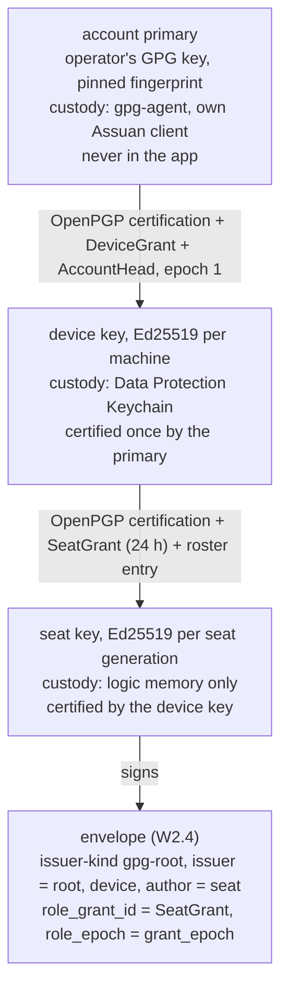
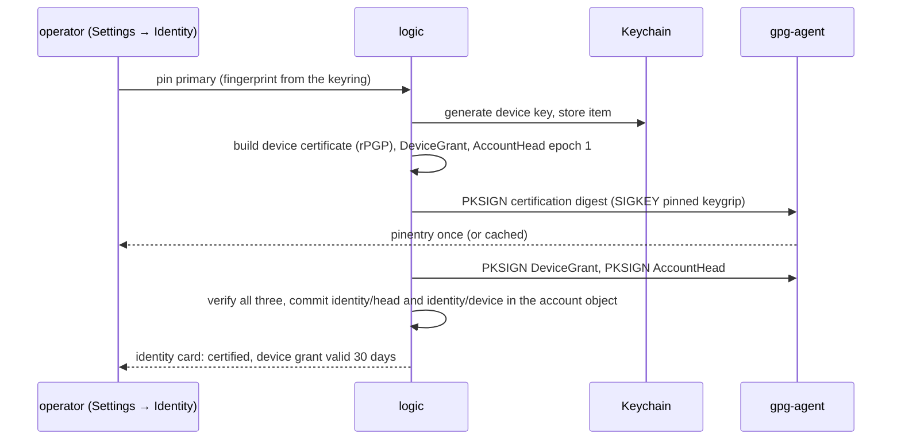

# ID1 — the GPG seat chain

Owner: Corvin Duskmantle <ARCHITECT>. Decided 2026-10-22. Binds decision #4 of [[2026-10-22-architecture-round-1]]: the full chain in v0.1, root in gpg-agent, device key in the Keychain, seat keys in memory. [[identity]] stays the authority on formats, custody rules, enrollment, epochs and revocation; this spec is the v0.1 cut and the seam. **Done means** an envelope from a seat on this Mac carries `issuer-kind: gpg-root`, verifies through seat → device → the operator's pinned primary, and `gpg --check-sigs` on the exported device certificate shows the primary's certification.

Lens: one machine that holds the primary online in gpg-agent (this one: `844ECC0587DE7AB0`, keygrip `A7B0…6233`, no signing subkey). Assumes GnuPG 2.5.x and macOS 14+. Breaks when the primary lives elsewhere; that is enrollment ([[identity]] New-device), cloud phase. LESS IS MORE: one new trait impl, one bootstrap flow, three signatures from the root, no secret ever on disk outside gpg-agent and the Keychain.

## 1. The chain and who holds what

- **Root.** Selected and pinned in Settings → Identity (the 7.9 card already says "primary held by gpg-agent · pinned from your keyring · never exported"). Public metadata from the keyring; signing through our own Assuan client exactly as [[identity]] Root custody describes: `SIGKEY <pinned keygrip>`, `SETHASH --inquire`, `PKSIGN`, strict 64-byte result verified before commit; pinentry and cache are the agent's. Three root signatures at bootstrap, none afterwards until the device grant renews.
- **Device.** Generated with the OS RNG, read by logic only; its OpenPGP certificate carries the primary's third-party certification; its `DeviceGrant` is 30 days. **Custody has three tiers behind one `DeviceKeyStore` trait** (decision #17, after ID1a found `errSecMissingEntitlement` -34018 on unsigned binaries): (1) the Data Protection Keychain (service `bboxy450-term`, account = device ULID, `kSecUseDataProtectionKeychain`, non-synchronising), which needs the `keychain-access-groups` entitlement on a signed app identity, so it is the shipped app's tier and lands with packaging; (2) the login keychain item with the same attributes minus data protection, for ad-hoc and dev builds, which the identity card labels **dev custody**; (3) memory, tests only. Logic tries tier 1 and falls to tier 2 on -34018; never a plaintext file. The device record stores `custody: data-protection | login-keychain | memory` locally; the signed formats do not change.
- **Seat.** Generated per seat generation in logic memory, never persisted; the device certifies it and signs a 24-hour `SeatGrant` (swarm, role, class, destinations from the communication graph, `grant_epoch`), renewed by the device without any prompt. A restart is a new generation and a new seat key; the roster keeps the old entry, so attribution survives. This is the v0.1 reading of [[identity]]'s "restart does not imply a new leaf key": the chain allows a persistent seat key, nothing in v0.1 needs one (per-seat Git signing stays off).

## 2. The seam

`SeatKeys` (`M/messaging/keys.rs:10-14`) stays as it is: `issuer()`, `leaf(seat, generation)`, `verify(envelope)`. `ChainSeatKeys` replaces `LocalSeatKeys` at `M/logic.rs:576-578`; nothing else in messaging changes. Envelope fields map as the diagram shows; `IssuerKind::GpgRoot` (`M/messaging/wire.rs:16`) gets its first constructor.

`verify` walks: pinned root fingerprint → device certificate carries a valid third-party certification by that root (rPGP `verify_third_party_certification`) → seat certificate carries one by that device → `DeviceGrant` raw signature by the root, `SeatGrant` by the device, both inside validity and at or above the stored epochs → envelope signature by the seat key. Verified chains are cached in memory by (seat, key_epoch, grant_epoch). Revocation lists come from the latest `AccountHead`.

**Local-dev stays as the explicit no-primary state.** With no primary pinned, logic keeps `LocalSeatKeys` and the identity card shows "unsigned, local only"; a receiver with a pinned root refuses `local-dev` envelopes. Nothing silently downgrades: the issuer kind is in every envelope.

## 3. Bootstrap, the first device

Pending states are states, not errors: agent unavailable, pinentry cancelled, fingerprint mismatch each leave bootstrap pending with its reason on the card, and no grant installed. The authority journal lives in the account object kv (`identity/head`, `identity/device/{id}`, `identity/roster`), written before activation.

## 4. Renewal and failure

- `SeatGrant` renews from the device at half-life with no prompt. `DeviceGrant` renewal needs one root signature; the card asks a week before expiry; an expired device grant leaves seats running and holds message signing with the reason, as [[identity]] requires (no plaintext-file fallback).
- A locked or unavailable Keychain holds signing work the same way. Signing never blocks the UI thread ([[runtime]]); it runs on the IO runtime, and the card shows the hold.
- Revoking the device (root) or a seat (device) advances the epoch and refuses older envelopes on next verify; not globally instant, as the spec says.

## 5. Dependencies and placement

`pgp` (rPGP 0.21, MIT OR Apache-2.0) for certificates and third-party certifications; our own Assuan client (the probe in [[identity]] already signed raw Ed25519 through the agent); `security-framework` for the Keychain. All inside `bbt-mux` as `src/identity/`; a crate of its own at a plateau, not now ([[layering]] order unchanged). No LGPL in the tree.

## 6. Acceptance, the spec signs off

1. **External check.** Export the public device certificate; in a temporary `GNUPGHOME` holding only the primary's public key, `gpg --check-sigs <device fingerprint>` shows a good certification from `844ECC0587DE7AB0`. The user's own keyring and trustdb are byte-identical before and after.
2. **Chain verify with negatives.** A launched seat's envelope passes `ChainSeatKeys::verify`; a tampered body, an expired `SeatGrant`, a stale `grant_epoch`, a device not certified by the pinned root, and a `local-dev` envelope at a receiver with a pinned root each fail with their named reason.
3. **Seam.** The W2.4 messaging tests pass unchanged with `ChainSeatKeys` in place of `LocalSeatKeys`.
4. **Custody.** The device and seat secrets appear nowhere in argv, the seat's environment, logs or the run dir; a keychain item exists with the stated attributes for the tier in use and the device record says which tier; `pubring.kbx` and `trustdb.gpg` are unchanged. Tier 1 is verified by the packaging item (PKG1: signed bundle with `keychain-access-groups`), not by ID1a.
5. **No-primary state.** With nothing pinned, envelopes are `local-dev`, the card says so, and a pinned receiver refuses them.
6. `sh scripts/ci-local.sh` exits 0 in a clean worktree of the handed-off commit.

## 7. Out of scope

Operator action pending: an Apple Developer team identity for the signed app, which tier 1 custody and later notarised distribution both need; until then dev custody is the tier on this machine.

Second-device enrollment tickets and the offline-primary request flow (cloud phase), Google binding, per-seat Git signing (default off, operator decision later), roster export and publication beyond the local account object, hardware tokens.

## 8. Order for briefs (the Oracle's call, one concern each)

ID1a root and device: Assuan client, rPGP certification, Keychain device key, bootstrap, acceptance 1 and 4. ID1b seats: `ChainSeatKeys`, `SeatGrant`, roster, verify with negatives, acceptance 2 and 3. ID1c the identity card states, renewal, the local-dev state, acceptance 5.
