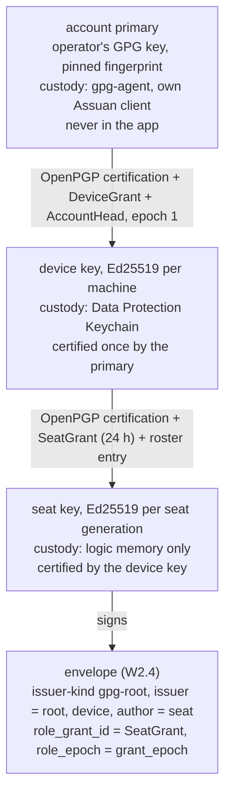
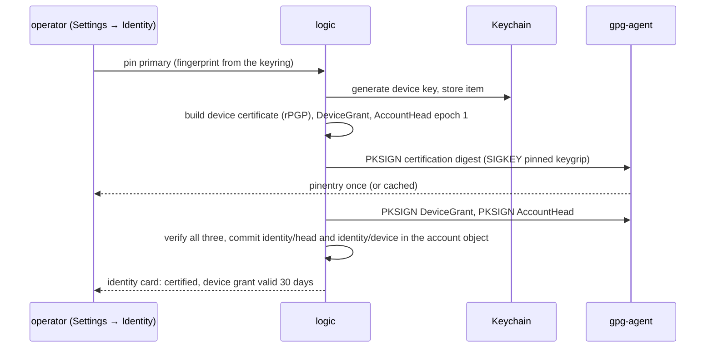

# ID1 — the GPG seat chain

Owner: Corvin Duskmantle <ARCHITECT>. Decided 2026-10-22. Binds decision [[d4-seat-identity|#4]] of [[2026-10-22-architecture-round-1]]: the full chain in v0.1, root in gpg-agent, device key in the Keychain, seat keys in memory. [[identity]] stays the authority on formats, custody rules, enrollment, epochs and revocation; this spec is the v0.1 cut and the seam. **Done means** an envelope from a seat on this Mac carries `issuer-kind: gpg-root`, verifies through seat → device → the operator's pinned primary, and `gpg --check-sigs` on the exported device certificate shows the primary's certification.

Lens: one machine that holds the primary online in gpg-agent (this one: `844ECC0587DE7AB0`, keygrip `A7B0…6233`, no signing subkey). Assumes GnuPG 2.5.x and macOS 14+. Breaks when the primary lives elsewhere; that is enrollment ([[identity]] New-device), cloud phase. LESS IS MORE: one new trait impl, one bootstrap flow, three signatures from the root, no secret ever on disk outside gpg-agent and the Keychain.

## 1. The chain and who holds what

- **Root.** Selected and pinned in Settings → Identity (the 7.9 card already says "primary held by gpg-agent · pinned from your keyring · never exported"). Public metadata from the keyring; signing through our own Assuan client exactly as [[identity]] Root custody describes: `SIGKEY <pinned keygrip>`, `SETHASH --inquire`, `PKSIGN`, strict 64-byte result verified before commit; pinentry and cache are the agent's. Three root signatures at bootstrap, none afterwards until the device grant renews.
- **Device.** Born at first launch, not at enrollment (the rule; as built until L8 D the ULID was minted at enrollment, `identity/journal.rs:327`, and the custody record had no device id, so L8 D mints it once at first create, persists it in the custody record and upgrades legacy records once, key id unchanged): the key and its device ULID are created into custody and recorded in the account journal (`identity/device/{id}`) before any root certification, so the device id exists for every issuer kind, LocalDev and Pending included, and is what `Operator { device_id }` (decision [[d31-device-bound-operator-journal|#31]]) and `identity/status` use; only a custody hold has none. Generated with the OS RNG, read by logic only; its OpenPGP certificate carries the primary's third-party certification; its `DeviceGrant` is 30 days. **Custody has three tiers behind one `DeviceKeyStore` trait** (decision [[d17-device-key-custody|#17]], after ID1a found `errSecMissingEntitlement` -34018 on unsigned binaries): (1) the Data Protection Keychain (service `bboxy450-term`, account = device ULID, `kSecUseDataProtectionKeychain`, non-synchronising), which needs the `keychain-access-groups` entitlement on a signed app identity, so it is the shipped app's tier and lands with packaging; (2) the login keychain item with the same attributes minus data protection, for ad-hoc and dev builds, which the identity card labels **dev custody**; (3) memory: tests, and debug builds **only when selected explicitly** (an env or flag at launch, never the default even in debug), compiled out of release builds, shown on the identity card as "memory custody (debug)", with a fresh device per process so nothing it signs outlives the run (ID1e, 2026-10-22). Custody startup is non-interactive and bounded: it never blocks the launch on a keychain prompt and reaches `held` with the reason within a stated timeout. Logic tries tier 1 and falls to tier 2 on -34018; never a plaintext file. The device record stores `custody: data-protection | login-keychain | memory` locally; the signed formats do not change. **No code signing until distribution (operator, 2026-10-22, decision [[d24-defer-code-signing|#24]]).** PKG0's cargo runner was removed the same day it landed (`scripts/sign-run.sh` kept for later) and PKG1 is deferred with it; nothing may depend on a signed build or a keychain prompt. Until distribution, tier 2 with non-interactive, bounded keychain access (ID1e) is the custody tier on every developer machine, and tier 1 returns with the signed bundle.
- **Seat.** Generated per seat generation in logic memory, never persisted; the device certifies it and signs a 24-hour `SeatGrant` (swarm, role, class, destinations from the communication graph, `grant_epoch`), renewed by the device without any prompt. A restart is a new generation and a new seat key; the roster keeps the old entry, so attribution survives. This is the v0.1 reading of [[identity]]'s "restart does not imply a new leaf key": the chain allows a persistent seat key, nothing in v0.1 needs one (per-seat Git signing stays off).

## 2. The seam

`SeatKeys` (`M/messaging/keys.rs:10-14`) stays as it is: `issuer()`, `leaf(seat, generation)`, `verify(envelope)`. `ChainSeatKeys` replaces `LocalSeatKeys` at `M/logic.rs:576-578`; nothing else in messaging changes. Envelope fields map as the diagram shows; `IssuerKind::GpgRoot` (`M/messaging/wire.rs:16`) gets its first constructor.

`verify` walks: pinned root fingerprint → device certificate carries a valid third-party certification by that root (rPGP `verify_third_party_certification`) → seat certificate carries one by that device → `DeviceGrant` raw signature by the root, `SeatGrant` by the device, both inside validity and at or above the stored epochs → envelope signature by the seat key. Verified chains are cached in memory by (seat, key_epoch, grant_epoch). Revocation lists come from the latest `AccountHead`.

**Local-dev stays as the explicit no-primary state.** With no primary pinned, logic keeps `LocalSeatKeys` and the identity card shows "unsigned, local only"; a receiver with a pinned root refuses `local-dev` envelopes. Nothing silently downgrades: the issuer kind is in every envelope. **The local-dev issuer key is created once per machine and lives as long as the local-dev epoch** (ID1d, 2026-10-22, after C1a's relaunch test found a per-launch random broker key refused by the pinned issuer): it is held in `DeviceKeyStore` custody under the same tiers as the device key (decision [[d17-device-key-custody|#17]]: login keychain in dev, memory in tests, Data Protection with PKG1), never a file; a launch whose store is unavailable holds messaging with the reason named and never mints a fresh issuer; the journal records the key with its epoch so historical `local-dev` envelopes verify after the cutover (§2b); only an explicit identity reset (§2b step 5) replaces it.

## 2b. The issuer transition (2026-10-22, from ID1b)

`messaging/issuer` pins one issuer and refuses a change; today's seats sign `local-dev`. The cutover is **one way, one time, journaled**:

1. When bootstrap (§3) verifies and commits, logic writes `identity/issuer` = `{kind: gpg-root, key: <root>, cutover_epoch: <account_epoch>, at: <ts>}` to the account object in the same transaction as the head. Before that line exists, the issuer is `local-dev`.
2. **Nothing is rewritten.** Every stored envelope keeps its issuer kind and verifies forever against the issuer state that was current at its sequence; a mixed thread shows each message's issuer, and the UI marks `local-dev` ones as unsigned-identity.
3. **Seats keep their generation's key.** A seat running at the cutover keeps signing `local-dev` until its next generation; the identity card says "N seats still local-dev, restart to sign with the chain". Seats launched after the cutover sign `gpg-root`. No re-keying mid-turn.
4. **Receivers.** Verification is historical (step 2); acceptance for delivery is current policy: a receiver with a pinned root admits a `local-dev` envelope only if its sender sequence precedes that sender's cutover, and refuses newer ones with the reason named. Local-only receivers with no pinned root keep admitting `local-dev`.
5. **Reverse is an identity reset**, never automatic: unpinning the root is an explicit operator action that starts a new `local-dev` epoch in the journal; old `gpg-root` envelopes stay verifiable. The journal never goes backwards.

`SeatKeys::finalize` (no-op default, approved by the Oracle) lets the chain set `device` and the `SeatGrant` reference in `mint` with wire fields unchanged.

## 3. Bootstrap, the first device

Pending states are states, not errors: agent unavailable, pinentry cancelled, fingerprint mismatch each leave bootstrap pending with its reason on the card, and no grant installed. The authority journal lives in the account object kv (`identity/head`, `identity/device/{id}`, `identity/roster`), written before activation.

## 4. Renewal and failure

- `SeatGrant` renews from the device at half-life with no prompt. `DeviceGrant` renewal needs one root signature; the card asks a week before expiry; an expired device grant leaves seats running and holds message signing with the reason, as [[identity]] requires (no plaintext-file fallback).
- A locked or unavailable Keychain holds signing work the same way. Signing never blocks the UI thread ([[runtime]]); it runs on the IO runtime, and the card shows the hold.
- **A custody hold does not stop the terminal and does not break the event chain** (ID1d, 2026-10-22). When the key store is unavailable at start, seats still run. Logic signs its internal bus events with an **ephemeral run key**: generated from the OS RNG per process run, never persisted, never a messaging issuer, never pinned. Each event signed during the hold carries its signer public key, and the journal records that key as `ephemeral-hold` with the run (process generation and boot id) and the window start. On recovery the device key signs a **hold closure** record naming the ephemeral key and the hash range it covered, so the persisted chain stays verifiable throughout and the hold is attributed to this device after the fact; a hold that never closes stays visibly ephemeral. Messaging sends during the hold queue as `Held` and release in order on recovery with current authority revalidated. The identity card shows "custody held since …" and the stream marks hold-signed events. Rejected: no signing until recovery (an unsigned gap in a chain whose purpose is attribution); queuing events (the UI goes blind while terminals run).
- Revoking the device (root) or a seat (device) advances the epoch and refuses older envelopes on next verify; not globally instant, as the spec says.

## 5. Dependencies and placement

`pgp` (rPGP 0.21, MIT OR Apache-2.0) for certificates and third-party certifications; our own Assuan client (the probe in [[identity]] already signed raw Ed25519 through the agent); `security-framework` for the Keychain. All inside `bbt-mux` as `src/identity/`; a crate of its own at a plateau, not now ([[layering]] order unchanged). No LGPL in the tree.

## 6. Acceptance, the spec signs off

1. **External check.** Export the public device certificate; in a temporary `GNUPGHOME` holding only the primary's public key, `gpg --check-sigs <device fingerprint>` shows a good certification from `844ECC0587DE7AB0`. The user's own keyring and trustdb are byte-identical before and after.
2. **Chain verify with negatives.** A launched seat's envelope passes `ChainSeatKeys::verify`; a tampered body, an expired `SeatGrant`, a stale `grant_epoch`, a device not certified by the pinned root, and a `local-dev` envelope at a receiver with a pinned root each fail with their named reason.
3. **Seam.** The W2.4 messaging tests pass unchanged with `ChainSeatKeys` in place of `LocalSeatKeys`.
4. **Custody.** The device and seat secrets appear nowhere in argv, the seat's environment, logs or the run dir; a keychain item exists with the stated attributes for the tier in use and the device record says which tier; `pubring.kbx` and `trustdb.gpg` are unchanged. Tier 1 is verified by the packaging item (PKG1: signed bundle with `keychain-access-groups`), not by ID1a.
5. **No-primary state.** With nothing pinned, envelopes are `local-dev`, the card says so, and a pinned receiver refuses them.
6. `sh scripts/ci-local.sh` exits 0 in a clean worktree of the handed-off commit.

## 7. Out of scope

Apple team (operator, 2026-10-22): Wild Honey on the Porch, LLC, team UQB3368A84. This Mac holds its Apple Development and Apple Distribution certificates and no Developer ID Application certificate yet. Tier 1 custody is verified when the signed bundle exists (PKG1, deferred with all code signing until distribution, decision [[d24-defer-code-signing|#24]]); it needs `keychain-access-groups` (`UQB3368A84.*`) and, for notarised distribution outside the App Store, the Developer ID Application certificate still pending. Until then dev custody is the tier everywhere.

Second-device enrollment tickets and the offline-primary request flow (cloud phase), Google binding, per-seat Git signing (default off, operator decision later), roster export and publication beyond the local account object, hardware tokens.

## 8. Order for briefs (the Oracle's call, one concern each)

ID1a root and device: Assuan client, rPGP certification, Keychain device key, bootstrap, acceptance 1 and 4. ID1b seats: `ChainSeatKeys`, `SeatGrant`, roster, verify with negatives, acceptance 2 and 3. ID1c the identity card states, renewal, the local-dev state, acceptance 5.
