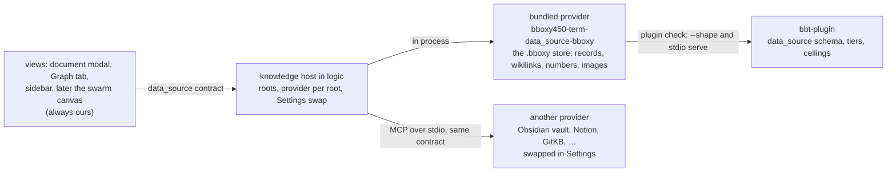

# Knowledge base

Owner: Corvin Duskmantle <ARCHITECT>. Decided 2026-10-24 ([[d257-knowledge-base-first-plugin]]). Operator, verbatim: "so with plugin systems - start designing our document base or knowledge base or knowledge/document graph system as a bundled plugin as is, if you do it well we can then build others and swap them in settings, only that for now, later more will be added!"

Lens: the seam is the contract, not the crate. Assumes the `.bboxy` store as built (records with frontmatter, wikilinks, numbers, the index in logic). Breaks when a provider cannot hold a record losslessly; then it says so and the app shows it.

## 1. What it is

The knowledge base is the **document graph the app already has**: records as nodes (one file, one object, with `type`, `number`, `id`, `title`, frontmatter), wikilinks as edges (`[[slug]]`, `[[#N]]`, `[[slug|rel|w]]`, typed and weighted as [[work-items]] defines them), images in `.bboxy/images/`, and search over all of it. Today it lives in the logic process's index (`crates/bbt-mux/src/index.rs`: scan, signed `write`, `current`, `by_number`, `rebuild_graphs`) with `bbt-doc` parsing the Markdown. This spec puts that behind the `data_source` contract of [[plugins]] as the **bundled provider**, `bboxy450-term-data_source-bboxy`, so that a second provider can be built against the same contract and swapped in Settings. Visualization stays ours in every case ([[d255-visualization-is-ours]]): a provider returns records, edges and resources; the document modal, the Graph tab, the sidebar and later the swarm canvas draw them.

## 2. The `data_source` contract, concretely

One JSON Schema document in `bbt-plugin` ([[plugins]] §1); the bundled provider is its reference implementation. Every method takes and returns the app's shapes; a provider that cannot represent one says so, never silently.

- `resolve(locator)` → `ref`: `#N`, slug, id, or path to one record reference `{ id, number, slug, path, digest }`; ambiguity is an error naming the candidates, never the first hit.
- `fetch(ref)` → `record`: frontmatter as JSON, body as Markdown, `digest`, `number`, `etag`; images referenced by `![[name.ext]]` come back as resource links (the resource-link rules of [[plugins]] §1 apply).
- `search(query, cursor?, limit)` → `page`: hits `{ ref, title, type, number, snippet, score }` and `next`; the query is plain text plus optional filters (`type:`, `status:`, `since:`); ranking is the provider's, the bundled one ranks frontmatter matches above body matches and boosts by wikilink degree with the [[work-items]] weights; **semantic lookup** (the operator's 2026-10-21 ask in [[storage]]) is a later minor version, additive.
- `list(filter, cursor?, limit)` → `page` of refs by `type`, `status`, `assignee`, `since`.
- `links(ref)` → `{ outgoing: [edge], incoming: [edge] }`, an edge `{ from, to, rel, weight }`; this is the graph the Graph tab and the canvas draw.
- `graph(scope, cursor?)` → a page of `{ nodes, edges }` for a scope (a type, a swarm, a record and its neighbourhood to depth d); the bundled provider serves the seven graphs of [[work-items]] that are documents (markdown, task, artifact); execution, channel and messaging graphs stay the app's.
- `write(ref?, path?, frontmatter, body, etag?)` → `record` with `lossy: bool`: create or update one record; **`path` is required on create** and is a relative Markdown path under the root, checked by the Index's path and etag guard (a path outside the root, or one that exists, is a command error by name); on update `ref` names the record and `path` is absent; the number is allocated by the app's Index under decision #48 for the bundled provider, and a foreign provider returns its own `external_id` beside the app's number; an `etag` mismatch is a command error; a write that the provider cannot hold losslessly returns `lossy: true` and the app shows it.
- `changes_since(cursor)` → `{ changed: [ref], next }`: what moved since the cursor, by poll; the bundled provider answers from the index's activity log.
- Tier: **export** for the contract ([[plugins]] §1a), because `write` sends content out; the bundled provider is local and shows `local` in the registry beside the tier.

## 3. Bundled

- **In process, same contract.** The bundled provider implements the contract as a Rust trait inside logic over the existing index; no MCP hop for the default path. **Its data directory is the root itself:** a resource link from the bundled provider is a realpath-confined, symlink-refusing read of a real file under the root (`.bboxy/images/` first), 64 MiB cap, no copies; that is the [[plugins]] §1 resource-link rule applied to the bundled case, and the whole of Seraph's #250 point for it. The same code serves the contract over stdio when invoked as `bboxy450-term plugin serve data_source-bboxy`, so `plugin check` proves the contract from both sides and a second app of the suite can run it as an ordinary plugin.
- **Registry.** Settings › Plugins lists it as `bboxy450-term-data_source-bboxy (bundled)` with its shape, tier `export (local)`, timings and health like any plugin; it cannot be disabled while it is the provider of a root.
- **Roots and the swap.** A knowledge **root** is a place records live: the repository's `.bboxy/` first; later an Obsidian vault, a Notion workspace. Settings › Knowledge lists roots, and each root names its **provider**: the bundled one by default, swappable to any trusted plugin that implements `data_source`. Several roots mount at once; `#N` and slugs resolve per root, with the repository's `.bboxy` first in the order; a locator may be qualified by root. Swapping a provider never moves data: the records stay where they are and the new provider reads them, or refuses with a reason the app shows.
- **Opinionated default.** The bundled provider is the one the app ships with and the one every acceptance in this repository runs against; a second provider must pass the same `plugin check` and the contract's conformance fixtures before Settings offers it.

## 4. What a second provider owes

An Obsidian vault is the same Markdown with frontmatter; `[[wikilinks]]` resolve by file name; numbers are absent, so the provider reports `number: null` and `resolve('#N')` fails by name in that root, which the app shows; `write` is lossless. Notion or Linear convert ([[plugins]] §1 Contracts: `lossy: true`, cursors, `retry_after_ms`, one instance per workspace, `etag`). GitKB holds Markdown records with its own frontmatter and ids; its `external_id` maps to the app's `id`. None of them draws anything.

## 5. Layering and names

The contract schema and the conformance fixtures live in `bbt-plugin`. The bundled provider's code lives today in `bbt-mux`'s index module behind the trait; when the first release splits kits (decision #8's plateau), it moves to a kit crate named now and not created, `bboxy450-knowledge`, so any suite app can embed the document graph (decision #39). Plugin name `bboxy450-term-data_source-bboxy`; the Settings page is "Knowledge".

## 6. Acceptance, the spec signs off

1. The trait exists in logic with the eight methods above, implemented by the index; the document modal, the Graph tab and the sidebar read through it and nothing else (a test fails any direct index call from a view path).
2. `bboxy450-term plugin check` passes the bundled provider served over stdio: `--shape` valid, every method answers the conformance fixtures (resolve by `#N`, slug, id and path; fetch with an image resource link; a search page with `next`; links both ways with weights; a graph page; a write that allocates a number under decision #48; `changes_since` after that write), unknown fields ignored.
3. Settings › Knowledge shows the `.bboxy` root with the bundled provider; swapping to a stub provider that implements the contract over stdio and back changes which process answers and moves no file (digest of every record identical).
4. Frame and lane: a search over the 208-record corpus answers within the frame budget's IO rules ([[ui-never-waits]]), paged; the 1000-record fixture from the number sweep pages without a stall.
5. [[frontmatter-parses]], [[images-resolve]], [[parity-geometry]] hold; no view changes pixels (the provider seam is invisible on screen).

## 7. Order (the Oracle's briefs, when the operator says go)

K-0 the `data_source` schema and conformance fixtures in `bbt-plugin` (`bbt-plugin` enters the layering order below `bbt-proto` and the licensing map as `bboxy450-plugin` in the same commit), with the trait in logic and the index behind it (acceptance 1). K-1 the stdio serve and `plugin check` against it (acceptance 2). K-2 Settings › Knowledge, roots and the swap, with the stub provider (acceptance 3). K-3 the first foreign provider, an Obsidian vault read-only, as the proof the swap is real. "Only that for now, later more will be added."

Owner: Corvin Duskmantle <ARCHITECT>.
