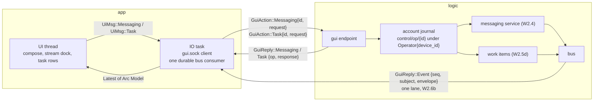

# L9-M — messaging and tasks in the app

Owner: Corvin Duskmantle <ARCHITECT>. Decided 2026-10-23 (decision #37). The cockpit sentence ([[2026-10-22-c-cockpit]]) still lacks two of its clauses in the app: "message between seats" and "delegate a task and get the report back". The bus (W2.4), the thirty-one tools (W2.5) and local provenance (W2.6a) exist; the GUI socket carries none of it. This spec puts messaging and tasks on the GUI wire by **reusing the request types and the dispatch that already exist**, under the operator principal of decision #31, journaled like spawns, and pushes everything to the app through **one events lane**, Kestrel's W2.6b.

Lens: the app is one more client of logic, with the operator's authority. Assumes the as-built GUI wire (`crates/bbt-proto/src/gui.rs`: `GuiAction::{ListHosts, ListSeats, Watch, Unwatch, Applied, Input, Resize, Spawn, ScheduleClose, UndoClose, GetHistory}`, no message, task or event variant yet), `Principal::Operator { device_id }` in logic (`M/logic.rs:3123`), and the lab pages `compose.html`, `message-row.html`, `stream.html`. Breaks when the GUI is remote; then the same wire runs over the provider link, nothing here changes. LESS IS MORE: two wrapper variants, one lane, zero new semantics.

## 1. Shape

## 2. Wire: two wrappers, not twenty variants

- **Types move down.** `messaging::api::{Request, Response}` and the wire structs they carry (`SendRequest`, `Body`, `MessageKind`, `StoredMessage`, `Receipt`, `Node`, the `Envelope`) move from `bbt-mux` to `bbt-proto::messaging`; `bbt-mux::messaging` keeps service, ledger, tree and keys. Same move decision #6 made for the stream types; the seat socket's `Action::Messaging` uses the moved types unchanged.
- **Messaging.** `GuiAction::Messaging { id: Ulid, request: messaging::Request }` wraps the whole W2.4 API: send (DM, channel, swarm stream with kind), list (inbox page by cursor), receipts, ack, ls, subscribe, unsubscribe, link, pause, grant, mute. Reply `GuiReply::Messaging { op: Ulid, response: messaging::Response }` or `Error { op, reason }`.
- **Tasks.** `GuiAction::Task { id: Ulid, request: TaskRequest }` with `TaskRequest::{ List { swarm, status?, assignee? }, Get { task }, Delegate { task_path, seat | spawn_spec, role? }, Reassign { task_path, seat }, Accept { task_path }, Reject { task_path, reason }, Report { task_path, verify_result } }`: the W2.5d tool arguments, field for field. Reply `GuiReply::Task { op, response: TaskResponse }` with `TaskResponse::{ Items(Vec<TaskCard>), Item(TaskDoc), Applied }`; `TaskCard` is the sidebar row's data (id, path, title, status, assignee, delegated_by, updated).
- **Authority.** Every one of these is an operation under the operator principal (#31): journaled in the account object as `control/op/{id}`, audited on `account/control`, replayed by id. Logic dispatches through **the same functions the MCP tools call** (`mcp/messaging.rs`, `mcp/work_items.rs`) with `Actor::Operator`, so the rules apply identically: oracle-class destinations and grants, decision #28's `verify_result` check on accept, the scope rule, never a second validation path. The GUI gets no tool the operator could not call through MCP, and no tool is weaker because the caller is the GUI.

## 3. One events lane

Pushes to the app, all of them, travel on **Kestrel's W2.6b lane**: `GuiReply::Event { seq, subject, envelope }` from **one durable bus consumer per device** (`gui-{device_id}`), so the cursor survives GUI reconnects and logic restarts and unread counts are derived, never stored twice. Subjects the app subscribes to: `seat/*/state`, `inbox/operator/*` (messages addressed to the operator and receipts for the operator's sends), `swarm/*/ch/*` for the stream dock's subchannels within the operator's grants, `task/*/status`, `artifact/*`, `account/control` (the audit the swarm stream shows). Messaging **requests** are request/reply; messaging **arrivals** are events on this lane; there is no second stream, no second socket, no polling loop in the app. An `Event` never mutates layout or focus (decision #29's rule extends to every push).

## 4. The UI, from the lab

- **Compose** (`compose.html`): a DM to a seat, a post to a channel or the swarm stream with `kind`, routed through the messaging tree; decision #26 keyboard rules apply (the composer is a text field).
- **Stream dock** (`stream.html`, `message-row.html`): rows from `List` pages plus live `Event`s, each showing its issuer kind (decision #4, §2b: `local-dev` marked), subchannel tabs with unread from the consumer cursor, receipts on the operator's own sends.
- **Task rows** under seats ([[ux-prototype]] task rows): from `TaskRequest::List` plus `task/*/status` events; delegate from a seat row or the launcher; report arrives as an event and a notice on the delegating seat; accept and reject from the row.
- Unread badges per seat row (`Seat.unread` in the ui-model) come from the lane, not from a second query.

## 5. Acceptance, the spec signs off

1. A DM composed in the GUI to a seat returns `Messaging { Stored }`, is delivered through W2.4 (receipt visible), is journaled under `Operator { device_id }`, and a replay of the same `id` returns the same `Stored` without a second send.
2. A post to the swarm stream with `kind: decision` appears in the stream dock through the events lane within one pump; a plain progress note from a worker-class seat to the stream is refused with the hint ([[messaging]] attention budget).
3. `List` with a cursor pages the operator's inbox; each row shows its issuer kind; unread equals messages past the durable consumer's cursor and survives an app restart.
4. Delegating a task from the GUI rewrites its frontmatter, delivers `Body::Task { event: delegate }` to the seat with a receipt, and the task row appears under that seat.
5. A report from the seat through MCP produces a `task/*/status` event the GUI row reflects; `Accept` from the GUI is refused without a `verify_result` at exit 0 and accepted with one (decision #28).
6. The app holds exactly one bus consumer; killing logic and restarting resumes it at its cursor with no duplicate rows and no lost event.
7. `sh scripts/ci-local.sh` exit 0 in a clean worktree of the handed-off commit; the UI-never-waits lint unchanged.

## 6. Order for briefs (the Oracle's call)

L9-M-a (Nyx): the type move to `bbt-proto::messaging`, the two wrapper variants and their replies, logic dispatch through the existing MCP functions under the operator principal, journaled; acceptance 1 and 5's refusal. L9-M-b (with Kestrel's W2.6b): the lane binding in the IO task, one durable consumer, the subjects, acceptance 3 and 6. L9-M-c (Nyx, lab-paired with Wren): compose, stream dock rows, task rows, unread; acceptance 2 and 4.

## 7. Out of scope

Remote GUIs, operator-to-operator messaging across machines (cloud phase), new message kinds, a second validation path for GUI callers, storing unread anywhere but the consumer cursor.
