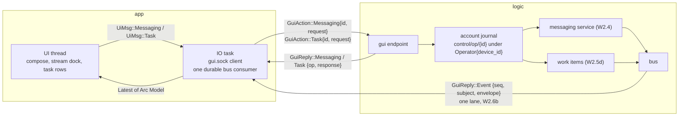

# L9-M — messaging and tasks in the app

Owner: Corvin Duskmantle <ARCHITECT>. Decided 2026-10-23 (decision [[d37-gui-messaging-tasks|#37]]). The cockpit sentence ([[2026-10-22-c-cockpit]]) still lacks two of its clauses in the app: "message between seats" and "delegate a task and get the report back". The bus (W2.4), the thirty-one tools (W2.5) and local provenance (W2.6a) exist; the GUI socket carries none of it. This spec puts messaging and tasks on the GUI wire by **reusing the request types and the dispatch that already exist**, under the operator principal of decision [[d31-device-bound-operator-journal|#31]], journaled like spawns, and pushes everything to the app through **one events lane**, Kestrel's W2.6b.

Lens: the app is one more client of logic, with the operator's authority. Assumes the as-built GUI wire (`crates/bbt-proto/src/gui.rs`: `GuiAction::{ListHosts, ListSeats, Watch, Unwatch, Applied, Input, Resize, Spawn, ScheduleClose, UndoClose, GetHistory}`, no message, task or event variant yet), `Principal::Operator { device_id }` in logic (`M/logic.rs:3123`), and the lab pages `compose.html`, `message-row.html`, `stream.html`. Breaks when the GUI is remote; then the same wire runs over the provider link, nothing here changes. LESS IS MORE: two wrapper variants, one lane, zero new semantics.

## 1. Shape

## 2. Wire: two wrappers, not twenty variants

- **Types move down.** `messaging::api::{Request, Response}` and the wire structs they carry (`SendRequest`, `Body`, `MessageKind`, `StoredMessage`, `Receipt`, `Node`, the `Envelope`) move from `bbt-mux` to `bbt-proto::messaging`; `bbt-mux::messaging` keeps service, ledger, tree and keys. Same move decision [[d6-shared-protocol|#6]] made for the stream types; the seat socket's `Action::Messaging` uses the moved types unchanged.
- **Messaging.** `GuiAction::Messaging { id: Ulid, swarm_id: SwarmId, request: messaging::Request }` wraps the whole W2.4 API **with an explicit swarm scope** (decision [[d38-messaging-task-rulings|#38]] (f), 2026-10-23, from Nyx: the W2.4 requests carry no swarm, the ledger's `after` cursor is per swarm object, and the operator has no caller swarm): every operator request names one swarm; `Send` and `Receipts` must agree with the swarm inferred from the destination or the message id and are refused on mismatch; `List`, `Ls`, `Subscribe` and the rest page or act within that one swarm. There is no account-wide union on the wire: the stream dock shows one swarm at a time, the sidebar issues one `List` per swarm it displays, and unread per swarm comes from the read-marks of §3, so no cross-swarm cursor exists to invent. It wraps: send (DM, channel, swarm stream with kind), list (inbox page by cursor), receipts, ack, ls, subscribe, unsubscribe, link, pause, grant, mute. Reply `GuiReply::Messaging { op: Ulid, response: messaging::Response }` or `Error { op, reason }`.
- **Tasks.** `GuiAction::Task { id: Ulid, request: TaskRequest }` with `TaskRequest` **equal to the W2.5d tool arguments as built** (`M/mcp/work_items.rs`, corrected 2026-10-23 from Nyx's map): `List { swarm_id?, status?, assignee?, after?, limit? }` (pages of at most 128 with `next`), `Status { task_path | task_id }` (exactly one), `Delegate { task_path, seat_id, role? }`, `Reassign { task_path, seat_id }`, `Accept { task_path }`, `Reject { task_path, reason }`, `Report { task_path, summary, commit?, verify_result? }` (summary required, as today; decision [[d28-structured-task-verification|#28]]'s check runs at `Accept`). **No `spawn_spec` on the GUI wire:** spawn-then-delegate is two operations, `Spawn` then `Delegate`, until the tool itself gains it ([[mcp-control-plane]]); a delta between wire and tool is a change to the tool first. Reply `GuiReply::Task { op, response: TaskResponse }` with `TaskResponse::{ Items { items: Vec<TaskCard>, next: Option<String> }, Item(TaskDoc), Applied }`; `TaskDoc` is today's `task_status` projection (id, path, metadata, body clipped at 16 KiB, `body_truncated`), `TaskCard` the row projection of §4. **Open unassigned tasks (decision [[d38-messaging-task-rulings|#38]] (i), Oracle ruling for L9-M-c, 2026-10-23):** the operator principal alone may list them read-only and account-wide, `TaskRequest::List { unassigned: true }` returning path, title and status with no swarm, paged at 128; seats keep the existing refusal; `Delegate` scopes by the chosen assignee as before. Reason: an unassigned task has no swarm scope under decision [[d28-structured-task-verification|#28]], and the operator is the account principal.
- **Authority.** Every one of these is an operation under the operator principal ([[d31-device-bound-operator-journal|#31]]): journaled in the account object as `control/op/{id}`, audited on `account/control`, replayed by id. Logic dispatches through **the same functions the MCP tools call** (`mcp/messaging.rs`, `mcp/work_items.rs`) with `Actor::Operator`, so the rules apply identically: oracle-class destinations and grants, decision [[d28-structured-task-verification|#28]]'s `verify_result` check on accept, the scope rule, never a second validation path. The GUI gets no tool the operator could not call through MCP, and no tool is weaker because the caller is the GUI.

### 2a. Operator-originated messages and tasks: signed by the device, no synthetic seat

The operator principal ([[d31-device-bound-operator-journal|#31]]) acts **as the device**. A message or task operation from the GUI is signed by the **device key** (certified by the root under ID1; in local-dev the device key is the stable local-dev issuer key of ID1d), and its envelope carries `author = device public key`, `device = device public key`, `account = root` (or the local-dev issuer), `seat = Ulid::nil()` (the reserved "no seat"), `process_generation = 0`, `role = { name: "operator", class: Oracle }`, `issuer_kind` as current, **`door` (`gui | ctl`) and `issued_by` (an actor label such as "Vesper, Oracle", attribution and never authority; [[d269-ctl-door-and-issuer]])** inside the signed body and shown in the native frame, and the grant reference by issuer kind: under **gpg-root**, `role_grant_id = the DeviceGrant id` and `role_epoch = the device grant epoch`; under **local-dev**, where no DeviceGrant exists, `role_grant_id = the SHA-256 digest (64 hex) of the persisted first-launch record` **`identity/local-issuer`** (account kv, `M/identity/local.rs:97, 433`: epoch, public key, device id; corrected 2026-10-23 from `identity/issuer`, which `transition.rs` writes only at a cutover or reset, so a fresh account has none) and `role_epoch = that record's epoch` (≥ 1): a real persisted artifact, never a minted value, and no IssuerState is created for it. Receivers verify the DeviceGrant under gpg-root and, under local-dev, the digest and the record's public key against their own `identity/local-issuer` (local receivers only; pinned receivers refuse local-dev envelopes anyway, ID1 §2b). Receivers verify the device chain and read the Oracle class; a receiver that sees `seat = nil` with a non-operator role refuses. Seat envelopes carry no `door`; they carry `issued_by` only under a test account (#282) and only when it exactly equals the label `test-account:<run>` the receiver derives from the verified root context, never from the field itself ([[d313-test-account-label-derived]]). `messaging_operator(seat, generation, …)` (`M/logic.rs:290`) becomes `messaging_operator(principal, …)` with `Principal::Operator { device_id }`, and `mcp::Actor` (`M/mcp/mod.rs:53`, seat-only today) gains the operator variant so the work-item functions take either. Frontmatter written by the operator is DSSE-signed by the device key with `signer: device:<id>`; `delegated_by: operator:<device_id>` is a reference kind beside `seat:<id>`. **The operator as a destination:** every swarm tree carries a root-level sink `operator/inbox` beside the seats' `seats/<id>/inbox` sinks (installed with the default grants), whose delivery is the retained publication `operator/inbox/message` rather than a seat's native delivery; the recipient in receipts and ledger rows is the reference `operator:<device_id>`, and replies to an operator message address `operator/inbox`. The continuity key of the sink, its GUI consumer and local deliveries is the account-local logical operator reference, not the device: on a first-ever held startup the device is `none`, typed, and when it enrols the reference stays and the completion binds the device to it; existing accounts derive the reference from their device ID and keep it ([[d285-no-gated-communications]], continuity). One operator per account in v0.1; when the cloud phase brings several devices, `operator/inbox` fans out to the account's active devices and the reference already carries the device. Scope under decision [[d28-structured-task-verification|#28]] is then anchored by the assignee, which `Delegate` always carries since `spawn_spec` is off the wire.

## 3. One events lane

Pushes to the app, all of them, travel on **Kestrel's W2.6b lane**: `GuiReply::Event { seq, subject, envelope }` from **one durable bus consumer per device** (`gui-{device_id}`), so the cursor survives GUI reconnects and logic restarts and unread counts are derived, never stored twice. Subjects the app subscribes to: `seat/*/state`; **`operator/inbox/*`, a new retained namespace** for messages addressed to the operator and receipts of the operator's sends (`inbox/>` stays fanout-only with `seq 0`, `M/bus.rs:55-59`, so it cannot feed a durable cursor and is not changed); `<context>/message` for the stream dock's channels and subchannels within the operator's grants (the existing W2.4 publication, `M/messaging/ledger.rs`); `task/*/status`; `artifact/*`; `account/control` (the audit the swarm stream shows). Messaging **requests** are request/reply; messaging **arrivals** are events on this lane; there is no second stream, no second socket, no polling loop in the app. An `Event` never mutates layout or focus (decision [[d29-explicit-seat-placement|#29]]'s rule extends to every push).

**Five rulings, from Kestrel's W2.6b reading of the bus (2026-10-23, decision [[d38-messaging-task-rulings|#38]]):**

1. **Stream identity.** One consumer name per device with the bus's own per-stream cursor vector; `GuiReply::Event { stream, seq, subject, envelope }` names its stream, `GuiAction::EventAck { stream, seq }` acknowledges one, `GuiReply::Gap { stream, first, last }` is named, never hidden. No global sequence, no second ledger.
2. **Two watermarks, two meanings.** The consumer is `Ack::Explicit`, and the IO task sends `EventAck` **after** the event is applied and published to the model, never because bytes were enqueued or written (the `Applied` rule of [[c1-live-seats]] §2a, applied to events); pending rows are retained until that ack, and a row that reaches `max_deliver` without a publish is a bug: it is logged on `account/control` as undeliverable with its `{stream, seq}`, never silently dropped. **Unread is operator-read, not app-admitted**: a durable read-mark per stream in the account object (`read/{stream}` = the last bus `seq` the operator has viewed), advanced when the operator views a stream or marks it read, surviving restarts; unread = retained rows after the mark, filtered to message subjects. App memory never proves read state. This rule binds L9-M-c. **Message id to bus position:** every `List` row (ledger sequence domain) carries `bus: Option<{ stream, seq }>` recorded at publication (Nyx writes it in M-a, Kestrel reads it in M-b); ledger and bus sequences are never compared as integers.
3. **Subjects and durability** as the list above says: `operator/inbox/*` retained, produced by the messaging service when the recipient is the operator (M-a); `inbox/>` untouched.
4. **Exactly one.** One active draining GUI attachment per device; a second active attachment under the same consumer name is refused by name; disconnect detaches and never deletes the consumer or its pending rows; recreation never erases the cursor (`subscribe` with an equal configuration returns the same id, `M/bus.rs:459-465`); a **filter change is a new versioned name** `gui-{device_id}-v{n}`, the old consumer unsubscribed only after the new one is live (`M/bus.rs:181` refuses a changed configuration under the same name, which is right). **The new version inherits, it does not restart** (decision [[d38-messaging-task-rulings|#38]] (g), 2026-10-23, from Kestrel): it is created first, takes over the old version's per-stream admitted and ack anchors and its pending rows, and only then is the old version removed; the next bounded `gui_poll` admits the tail and drops pending rows whose subjects are no longer granted **without projecting them**; subjects newly granted begin at head and their backlog is read-through pages like every other history. Nothing becomes `Start::All`, no still-authorized row is lost, and the change is one audited line on `account/control` naming the old and new version, the subjects added and removed, and the count of pending rows dropped: the grant or mute that caused it is already its own `control/op`, so there is no separate policy-change record type. The ephemeral state consumer of `gui_session` (`M/seat_socket.rs:363, 465`) folds into this lane.
5. **Bootstrap bounds.** The GUI consumer is created with `Start::New`, never `Start::All` (`Stream::subscribe` scans every retained row and creates pending eagerly, `M/bus.rs:211-246`); history and the stream dock's backlog are read-through pages, and the unread backlog comes from read-marks against the retained high-water, not from replay. Delivery to the app runs in quanta of 128 records or 256 KiB with command and pane work between batches: approved as a narrow bounded-poll seam on the GUI consumer only, no change to other consumers, no pruning.

**Two bounds, from the bus as built** (2026-10-23, after Kestrel's W2.6b reading of `M/bus.rs:167, 459`: the router attaches every consumer to every stream, one persisted cursor row per stream): (1) the GUI consumer's **filter is narrow**, exactly the subjects listed above, never a wildcard over seat output or every subchannel; (2) **browsing** a selected stream or subchannel in the stream dock is a read-through **page** of the retained log by cursor (request/reply, like `GetHistory` for terminals), never a second consumer; **a page read may wait** ([[d328-a-page-read-may-wait]]): `EventsRead` takes an optional `wait_ms`, at most 60 000, and blocks until an event exists after the cursor or the deadline passes, holding no cursor row, lock or bus slot, woken by one broadcast notify per append; waiting is not consuming. The per-stream cost of the one consumer (a subscription and a cursor row per stream) is measured in the 1000-seat bus gate ([[seats-1000-bus]]) when W2.6b lands; if it fails the budget, the consumer's streams are limited to the operator's own swarms and the account, not the design changed.

## 4. The UI, from the lab

- **Compose** (`compose.html`): a DM to a seat, a post to a channel or the swarm stream with `kind`, routed through the messaging tree; decision [[d26-terminal-key-ownership|#26]] keyboard rules apply (the composer is a text field). **The role chip fans out at send time** (decision [[d38-messaging-task-rulings|#38]] (h), Oracle ruling for L9-M-c, 2026-10-23): the W2.4 tree has no role sink, so a send to a role resolves to the exact seats holding that role in the current registry membership and issues one `Messaging` request per seat, each with its own id, receipt and ledger row; the UI shows one role send with N receipts. Above 32 seats the send is refused with a named reason. No invented role path, no new tree sink; groups stay their own destination, as `Ls` lists them.
- **Stream dock** (`stream.html`, `message-row.html`): rows from `List` pages plus live `Event`s, each showing its issuer kind (decision [[d4-seat-identity|#4]], §2b: `local-dev` marked), subchannel tabs with unread from the consumer cursor, receipts on the operator's own sends.
- **Task rows** under seats ([[ux-prototype]] task rows): from `TaskRequest::List` plus `task/*/status` events; delegate from a seat row or the launcher; report arrives as an event and a notice on the delegating seat; accept and reject from the row.
- Unread badges per seat row (`Seat.unread` in the ui-model) come from the lane, not from a second query.

**Projections (decision [[d38-messaging-task-rulings|#38]], for the lab and native alike; defined in `bbt-proto`):**
- `MessageRow { id, bus: Option<(stream, seq)>, author: AuthorRef { kind: Seat | Operator | Observer, id, name }, issuer_kind, kind: MessageKind, priority_class: Class, priority: u8, text, ts, receipts: ReceiptSummary { delivered, acked, held } }`. The lab's `p0 / p1 / p2` chips are a projection of `(priority_class, priority)`: `p0` = oracle-class, `p1` = worker-class with `priority ≥ 7` on the W2.4 scale of 0 to 9, `p2` otherwise; the chip never feeds back into delivery order.
- `TaskCard { id, path, title, status, assignee: Option<Ref>, delegated_by: Ref, updated, verify: Option<{ exit_code }> }` with **the work-items status set as canonical** (`open, claimed, running, reported, accepted, rejected, blocked, done`); the lab's `assigned` and `done` labels (`lab/web/compose.html:34, 38`) change to the canonical names in L9-M-c (Wren), so native carries no label mapping table.
- `TaskReport { summary, commit: Option<String>, verify_result: Option<VerifyResult> }`: today's report fields, shown on the delegating seat's row and in the task doc.

## 5. Acceptance, the spec signs off

1. A DM composed in the GUI to a seat returns `Messaging { Stored }`, is signed by the device key with `seat = nil` and the operator role (§2a) and verified by the receiving seat, is delivered through W2.4 (receipt visible on `operator/inbox/receipt`), is journaled under `Operator { device_id }`, and a replay of the same `id` returns the same `Stored` without a second send.
2. A post to the swarm stream with `kind: decision` appears in the stream dock through the events lane within one pump; a plain progress note from a worker-class seat to the stream is refused with the hint ([[messaging]] attention budget).
3. `List` with a cursor pages the operator's inbox; each row shows its issuer kind and carries its bus position; unread equals retained message rows past the operator's durable read-mark, survives an app restart, and is unchanged by the app merely receiving events.
4. Delegating a task from the GUI rewrites its frontmatter, delivers `Body::Task { event: delegate }` to the seat with a receipt, and the task row appears under that seat.
5. A report from the seat through MCP produces a `task/*/status` event the GUI row reflects; `Accept` from the GUI is refused without a `verify_result` at exit 0 and accepted with one (decision [[d28-structured-task-verification|#28]]).
6. The app holds exactly one bus consumer per device, created with `Start::New`; killing logic and restarting resumes it at its per-stream cursors with no duplicate rows and no lost event; a second attachment under the same name is refused; a pending row is acked only after publish.
7. `sh scripts/ci-local.sh` exit 0 in a clean worktree of the handed-off commit; the UI-never-waits lint unchanged.

## 6. Order for briefs (the Oracle's call)

L9-M-a (Nyx): the type move to `bbt-proto::messaging`, the two wrapper variants and their replies, logic dispatch through the existing MCP functions under the operator principal, journaled; acceptance 1 and 5's refusal. L9-M-b (with Kestrel's W2.6b): the lane binding in the IO task, one durable consumer, the subjects, acceptance 3 and 6. L9-M-c (Nyx, lab-paired with Wren): compose, stream dock rows, task rows, unread; acceptance 2 and 4.

## 7. Out of scope

Remote GUIs, operator-to-operator messaging across machines (cloud phase), new message kinds, a second validation path for GUI callers, storing unread anywhere but the consumer cursor.

## 5. A custody hold never holds delivery ([[d285-no-gated-communications]], 2026-10-24)

**Delivery and wake are separate** ([[messaging-attention]]): a stored message becomes a model turn only by the receiver's wake policy per destination and class (`wake`, `inbox`, `digest`), events never wake under default policy, and the policy times the wake without ever holding the message. Signing can be held; delivery cannot. While custody is unavailable, local delivery continues with `signature: pending` and the hold's reason on the envelope, shown as pending in receipts and the native frame, journaled in order and signed in order when custody returns, with the recipients' grade upgraded then; nothing is dropped, nothing carries a placeholder signature; an envelope for a pinned remote receiver waits and says so. On a first-ever held startup with no public author at all, the pending row is a logical intent (sender as known, request, hold reason, admission order) with no author claim; on custody return its signed envelope is materialised and appended as a grade-upgrade event bound to the intent's id and digest, bytes preserved, no second delivery ([[d285-no-gated-communications]], first-ever held startup). `GuiEventsHeld` as a lane-wide stop is retired: the hold is a per-row grade. Invariant [[messaging-never-held]].
