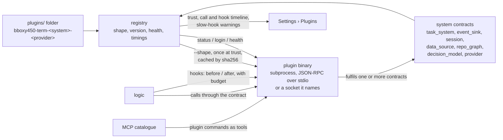

# Plugins

Owner: Corvin Duskmantle <ARCHITECT>. **Status: draft, logged for later** (operator, 2026-10-23: "i dont want this to derail our work, but lets start planning plugin system … spec it out … then we will talk about it later … for now we have built in shit, and opinionated built in shit"). Nothing here is briefed until the operator and the Architect have talked. Decision [[d41-plugins|#41]] records the direction; [[plugins-sota]] is the research behind it.

## 0. The operator's design, verbatim and in order

"there is a folder of binaries for bboxy450-term, called plugins, each plugin is named <app name, bboxy450-term in this case>-<system it plugs in, eg knowledge_base>-<provider name, notion, linear, gitkb>, this binary has shape, so if we run just binary it outputs json shape, saying here is how i talk to the world, for each system bboxy450-term has contract, that needs to be fulfilled by plugin, shape says here are my commands, we dont care what happens inside binary, can work locally, can have login system, not up for us, login is a step on setup of plugin, and then term can ask, hey dear plugin are you logged in -> no then we will run login command, but basically its deterministic way of dealing with plugins, we can tap into decision models like Jev in that implementation, so then we can use any external system to plug into, we write adapters for NATS messaging lets say, or for Notion, or for Obsidian, you name it, we have a guide people feed into their harness saying i want X to work as a plugin in system Y for bboxy450-term and done!" … "task system can be plug in, event system can have sink plugin for external messaging system as well, external sessions, external data sources" … "we can have plugins for repo management, mono repo, weavie repo based on nix, meta cli by my friend matt, meta repo he calls them, whatever people want to use to structure their codegraph, documentgraph, workgraph, executiongraph … we just render harnesses and plug them in, and we expose plugins via our MCP and via our hooks as well, they can tap into that and say in shape, hey i want to be run on this hook before or after, please run me! we have this hot sexy registry of all the plugins, and we have flamegraphs and timings and we can tell users hey this is taking 10s on each hook, its not ok" … "beauty of plugins we have very fixed contract of how we talk to them, and that way we can iterate on plugins very very very fast, without having them monolithically bundled with us".

**"Decision models like Jev", corrected by the operator (2026-10-23):** Jev is TypeSafe's hosted decision primitive (`POST /v1/systemone`, bearer auth; a `choice` question carrying `instructions` and a map of named `criteria`, answered with one `choice`, a `confidence` and `probabilities`; pinned model `jev-1.13.0`), already used by kittens (`McpSelect`, shell branching) and by paperhands autoresearch, with a key in the kittens harness configuration on this machine. It decides which single named choice applies; it never executes, plans or keeps state. Here it is a plugin **system**, `decision_model`, with Jev its first provider: the places where the app picks among named options may ask the plugin, and the built-in rules decide when none is present. Optional, never load-bearing ("we want to use it if it makes sense or we don't have to use it").

## 1. Shape of the system

- **Discovery and trust.** A folder, not PATH: `plugins/` under the app's support directory, and `.bboxy/plugins/` in a repository for repo-local ones, **off by default**: repo-local candidates are listed, never run, until the operator trusts them. A plugin is one executable named `<app>-<system>-<provider>` (the operator's call, 2026-10-23: the prefix is the app's own name, so a second suite app has its own folder and prefix while the contracts in `bbt-plugin` are shared); the name is data, the shape is truth. **No plugin binary runs, not even for its shape, before a trust record exists** that pins its path and sha256; trust records live only in the operator's own store (the account object, `plugins/trust/<sha256>`), never in a repository and never read from one, so a repository that ships a binary with a pre-made record gains nothing; a changed digest drops trust and asks again; a `provider` plugin asks every time its digest changes. The trust record states what the operator is agreeing to: **a plugin is code you run as yourself**; the app confines nothing on macOS until the research on confinement says what is possible (open, [[plugins-sota]] addendum).
- **Shape.** `binary --shape` prints one JSON document (decision [[d12-audience-and-plugins|#12]]'s flag stands; a bare run **should** print the same shape as a courtesy to a human, and the app never relies on it: Docker uses a dedicated subcommand and go-plugin's bare run refuses, [[plugins-sota]] §1). The shape is read **once, when the operator trusts the binary**, cached under its sha256, and re-read only when the digest changes; launch spawns nothing until a contract is first called. The document: `{ name, version, shape_version, systems: [{ contract, contract_version, commands: [{ name, args schema, result schema, timeout_ms }] }], hooks: [{ event, phase: before | after, budget_ms }], auth: { status_command, login_command }, transport: stdio | socket, health_command, trace: bool }`. The app validates the shape against each named contract's schema before the plugin is callable; an unknown contract or version is refused by name.
- **Contracts.** One per system, versioned, owned by the app, each a small JSON-RPC method set the plugin must implement. **Each contract carries a trust tier** (`read < write < export < transport`), shown at trust time and in the registry, and **fixes the role class of every method**; the shape can change neither. **Acceptance never crosses a contract:** the app evaluates decision [[d28-structured-task-verification|#28]] and signs the record, the plugin stores the signed record opaquely and returns it byte for byte, so `task_system.accept` and `reject` carry an app-signed record, never a bare state change. An `event_sink` declares the subjects it receives and the app filters to that list. The contracts: `task_system` (list, get, delegate, report, accept, reject: the same shapes as [[work-items]] and the W2.5d tools), `event_sink` (deliver envelopes to an external bus such as NATS; acknowledge), `session` (open, attach, detach an external session), `data_source` (search, fetch, write for knowledge bases such as Notion, Linear, Obsidian, GitKB), `repo_graph` (describe a repository's structure for monorepos, Nix-based weavie, a "meta repo" CLI, feeding the code, document, work and execution graphs), `decision_model` (one primitive, as kittens uses Jev: given a state, instructions and named criteria, return one `choice` with `confidence` and `probabilities`; never executes, plans or keeps state; built-in rules decide when no plugin is present), `provider` (a supervisor link for ssh and cloud, the out-of-process form of [[d1-providers]], decision [[d12-audience-and-plugins|#12]]). Contracts change by version, never by surprise.
- **Protocol.** Deterministic, the same every time: trust → shape → setup (`auth.status_command`; if not logged in, run `auth.login_command` in a **bare login seat**: a plain PTY with no MCP, no hooks, no skills and a scrubbed environment, closed when the command exits, its exit code recorded as the setup result) → health → calls. **Framing is newline-delimited JSON-RPC 2.0, exactly as MCP stdio**, which the suite already speaks, over the plugin's stdio by default or a Unix socket it names in its shape; call ids multiplex, one in flight per connection unless the shape declares `concurrent`; every call carries a deadline from the contract's `timeout_ms` and can be cancelled. **Versions are MAJOR.MINOR:** MAJOR must match, MINOR is additive, the app accepts any minor at or above the one it needs, and a refusal names the plugin, the contract and both versions. Stdout is protocol only, stderr is the plugin's log, captured into its registry entry. The plugin runs with a **scrubbed environment**, an allowlist that never carries a seat's tokens or capabilities. The app never reads the plugin's files, config or credentials.
- **Hooks.** A plugin's shape may ask to run `before` or `after` a named hook event ([[harness-adapters]] hooks, the app's own lifecycle events) within a `budget_ms`. Semantics are fixed per phase. `before` observes by default and may **block with a reason** only when the operator granted the `block` capability at trust time; it never mutates the input. `after` observes only. Both are **fail-open**: an error or a timeout is recorded and the action proceeds, except a granted block, which stops it. Plugins on one event run in parallel and unordered; a block from any one stops the action while the others still complete and are recorded. Three overruns of `budget_ms` in a row skip the plugin on that event until the operator re-enables it or its digest changes. The app records every hook run's wall time.
- **MCP.** A plugin's commands appear in the MCP catalogue as tools named `plugin_<system>_<provider>_<command>`; the **contract** fixes each method's role class and the shape cannot change it ([[w2-5-mcp-and-seat-wiring]]); a name claimed by two plugins or two discovery roots is listed and **refused**, never resolved by order; the shape's result schema is the tool's result schema.
- **Registry.** Settings › Plugins lists every discovered plugin with its trust state and tiers, shape, version, contract compliance, auth status, health, and a **call and hook timeline** with wall time per call and per hook. A plugin whose shape declares `trace: true` emits spans with ids and parents over the protocol, the host merges them under its own call span, and for those plugins the timeline is a real flame graph. And the warning the operator asked for: "this plugin takes 10 s on every hook". Enable, disable, re-run setup from there.
- **Where the host lives.** The host (discovery, trust records, spawn, protocol, registry, timings) is a module of the **logic process**. The shape and contract schemas and the trust-record type live in a kit crate, **`bbt-plugin`**, placed below `bbt-proto` in the layering order so any suite app can depend on it (decision [[d39-suite-is-the-product|#39]]). Settings reads the registry over the GUI wire like every other view; no UI crate ever spawns or talks to a plugin ([[ui-never-waits]], [[layering]]).
- **Isolation.** A plugin is a subprocess; its crash is its own and surfaces as a named error in the registry, never the app's crash. No in-process loading, no dynamic libraries, no WebAssembly in v1: [[plugins-sota]] §8 weighs them (a Rust dynamic library has no stable ABI and takes the host down with it; WebAssembly buys sandboxing and language freedom at the price of host-mediated IO and login), and the operator's shape chose binaries. The gaps §9 of the research lists are design obligations here: version negotiation on the shape, per-call deadlines with cancellation, stdout as protocol only, child cleanup on exit, multiplexed call ids, streamed large payloads, and a two-level error taxonomy (protocol error versus command error).
- **The guide.** One document, fed to any harness: "I want X to work as a plugin in system Y for bboxy450-term": it names the contract, the shape, the naming rule, the protocol, the test the app runs against a plugin (`bboxy450-term plugin check <binary>`), and ships as the `bboxy450` skill's plugin chapter.

## 2. Built-in versus plugin, and the task system

The built-ins stay built in and opinionated for the cockpit (operator: "for now we have built in shit, and opinionated built in shit"). The seam is still drawn now: **every system that can have a plugin gets its contract defined, and the built-in implementation is the reference implementation of that contract**, called in-process without the subprocess boundary. So the built-in task system is the `task_system` contract fulfilled by `.bboxy/` Markdown; a Linear or Jira plugin fulfils the same contract later and the UI, the tools and the lane do not change. The Architect's answer to "maybe we already should have our task system as a plugin": not as a subprocess yet, but as the first contract, because the contract is what makes a plugin possible and the built-in is where we learn whether the contract is right.

## 3. Order, when the operator says go

P-0 the contract schemas, the shape schema, the trust-record type and the framing and version rules in `bbt-plugin`, with `bboxy450-term plugin check`, plus the first measurement: a Rust host spawning a trivial plugin and completing one JSON-RPC round trip, cold and warm, on this Mac (replaces the latency judgements in [[plugins-sota]] §8); P-1 the registry and discovery, Settings › Plugins; P-2 the first contract behind the built-in (`task_system`) and the first real plugin against it; P-3 hooks with budgets and timings; P-4 `provider` as the out-of-process form of D1. Acceptance is written when the order is agreed.

## 4. Out of scope now

Everything above is logged; nothing is briefed. The research is [[plugins-sota]].

**Revision 2 (2026-10-23)** folds in Wren's red-team review of 16b4c98 (`.bboxy/comments/2026-10-23-plugins-*.md`, each answered by a `-reply` comment pinned to this revision's digest): host placement and the `bbt-plugin` kit crate, acceptance never crossing a contract, `--shape`, the system in tool names, the honest timeline with opt-in trace spans, MCP-style framing and MAJOR.MINOR versions, hook semantics per phase, the bare login seat, the trust model and scrubbed environment, trust records before any run, shape caching, trust tiers per contract, Jev as a probable reading. **Revision 3 (2026-10-23):** the operator closed the prefix (per app) and corrected the Jev reading, which becomes the `decision_model` contract; Wren's two follow-ups at a817a9d close (trust records only in the operator's store; the diagram matches the text); the research addendum landed.
