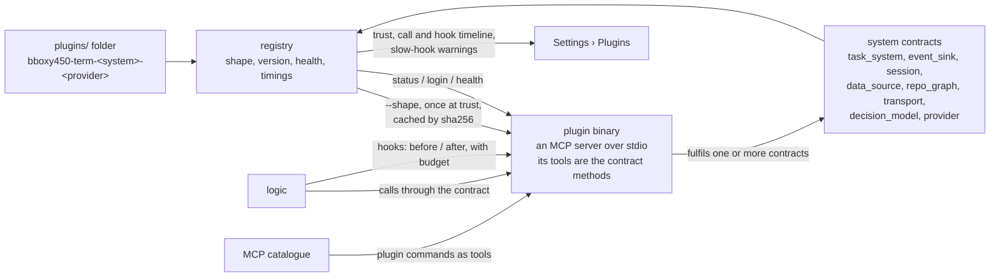

# Plugins

## Harmony GitKB implementation scope (operator, 2026-10-28)

The operator authorized the binary/Shape plugin system's first real GitKB
provider. Discover global binaries in `~/.bboxy/plugins` and local binaries in
`<workspace>/.bboxy/plugins`; preserve explicit trust, digest pinning and
collision refusals. A local binary and its provider selection belong to that
workspace. Installing it in Harmony must not select GitKB for another swarm.

`bboxy450-term-data_source-gitkb` supplies documents and their task records from
Harmony's actual GitKB source. Its Shape identifies its human name, description
and optional icon. Existing descriptors remain valid. The built-in provider
retains the same document contract and learns from GitKB's typed document,
stable identity, links and explicit task intent semantics.

The host owns admission, signing, delegation and acceptance. A provider stores
the admitted document mutation; it does not become a second swarm supervisor.
Document reads, writes and task transitions use the selected source together.
Verification uses a private GitKB fixture for mutations and real Harmony for
read-only evidence; no fixture records enter Harmony's knowledge base.

Owner: Corvin Duskmantle <ARCHITECT>. **Status: draft, logged for later** (operator, 2026-10-23: "i dont want this to derail our work, but lets start planning plugin system … spec it out … then we will talk about it later … for now we have built in shit, and opinionated built in shit"). Nothing here is briefed until the operator and the Architect have talked. Decision [[d41-plugins|#41]] records the direction; [[plugins-sota]] is the research behind it.

## 0. The operator's design, verbatim and in order

"there is a folder of binaries for bboxy450-term, called plugins, each plugin is named <app name, bboxy450-term in this case>-<system it plugs in, eg knowledge_base>-<provider name, notion, linear, gitkb>, this binary has shape, so if we run just binary it outputs json shape, saying here is how i talk to the world, for each system bboxy450-term has contract, that needs to be fulfilled by plugin, shape says here are my commands, we dont care what happens inside binary, can work locally, can have login system, not up for us, login is a step on setup of plugin, and then term can ask, hey dear plugin are you logged in -> no then we will run login command, but basically its deterministic way of dealing with plugins, we can tap into decision models like Jev in that implementation, so then we can use any external system to plug into, we write adapters for NATS messaging lets say, or for Notion, or for Obsidian, you name it, we have a guide people feed into their harness saying i want X to work as a plugin in system Y for bboxy450-term and done!" … "task system can be plug in, event system can have sink plugin for external messaging system as well, external sessions, external data sources" … "we can have plugins for repo management, mono repo, weavie repo based on nix, meta cli by my friend matt, meta repo he calls them, whatever people want to use to structure their codegraph, documentgraph, workgraph, executiongraph … we just render harnesses and plug them in, and we expose plugins via our MCP and via our hooks as well, they can tap into that and say in shape, hey i want to be run on this hook before or after, please run me! we have this hot sexy registry of all the plugins, and we have flamegraphs and timings and we can tell users hey this is taking 10s on each hook, its not ok" … "beauty of plugins we have very fixed contract of how we talk to them, and that way we can iterate on plugins very very very fast, without having them monolithically bundled with us".

**"Decision models like Jev", corrected by the operator (2026-10-23):** Jev is TypeSafe's hosted decision primitive (`POST /v1/systemone`, bearer auth; a `choice` question carrying `instructions` and a map of named `criteria`, answered with one `choice`, a `confidence` and `probabilities`; pinned model `jev-1.13.0`), already used by kittens (`McpSelect`, shell branching) and by paperhands autoresearch, with a key in the kittens harness configuration on this machine. It decides which single named choice applies; it never executes, plans or keeps state. Here it is a plugin **system**, `decision_model`, with Jev its first provider: the places where the app picks among named options may ask the plugin, and the built-in rules decide when none is present. Optional, never load-bearing ("we want to use it if it makes sense or we don't have to use it").

The native `task_import`, `task_import_context` and `task_reconcile` tools are
exactly three host-local historical maintenance operations on the selected
Markdown Index root. They are outside the portable `task_system` 1.0 contract:
external task backends acquire no new required methods or local source-path
read authority. All seven ordinary native task methods retain strict schema
parity; any unclassified `task_*` tool remains a parity failure.

## 1. Shape of the system

**Contracts first; MCP is only the wire ([[d255-visualization-is-ours]], operator 2026-10-24, verbatim: "I WANT VIZUALIZATION TO ALWAYS BE OURS, and we plug into data sourcse! like document bases, code hosting, git or what not, everything pluggable and with opionated defaults!").** A plugin is a **data source or an effect**: a document base, a task system, code hosting, git, an event bus, a decision model, a session or a supervisor link. It returns records, resources and results in our shapes, and **never pixels or UI**: the GPU kit draws everything a plugin returns through the app's own views (the document modal, the Graph tab, the sidebar, later the swarm canvas), and the messaging tree, roles, priority and signing stay the app's. The built-ins are the **opinionated defaults**, the first providers of their own contracts; a plugin replaces where the data comes from and where it goes, never how the cockpit looks. An existing MCP server is not a plugin by existing; it is one when it implements a contract and answers `--shape`. Named for later, not written: `code_host` (pull requests, reviews, CI status from GitHub, GitLab, Forgejo) and `event_source`.

- **Discovery and trust.** A folder, not PATH: `plugins/` under the app's support directory, and `.bboxy/plugins/` in a repository for repo-local ones, **off by default**: repo-local candidates are listed, never run, until the operator trusts them. A plugin is one executable named `<app>-<system>-<provider>` (the operator's call, 2026-10-23: the prefix is the app's own name, so a second suite app has its own folder and prefix while the contracts in `bbt-plugin` are shared); the name is data, the shape is truth. **No plugin binary runs, not even for its shape, before a trust record exists** that pins its path and sha256; trust records live only in the operator's own store (the account object, `plugins/trust/<sha256>`), never in a repository and never read from one, so a repository that ships a binary with a pre-made record gains nothing; **at trust time the binary is copied into the store content-addressed, `plugins/bin/<sha256>`, read-only, and the app always executes that copy, never the discovered path**, so nothing can be swapped between the digest check and the exec (macOS has no `fexecve`); the trust prompt says plainly that only that one file is pinned, and in v1 a plugin is one executable file: a directory plugin is refused by name; a changed digest drops trust and asks again; a `provider` plugin asks every time its digest changes. The trust record states what the operator is agreeing to: **a plugin is code you run as yourself**; the app confines nothing on macOS until the research on confinement says what is possible (open, [[plugins-sota]] addendum).
- **Shape.** `binary --shape` prints one JSON document (decision #12's flag stands; a bare run **should** print the same shape as a courtesy to a human, and the app never relies on it). The shape is read **once, when the operator trusts the binary**, cached under its sha256, and re-read only when the digest changes; launch spawns nothing until a contract is first called, except a resident `event_sink`. The document: `{ name, version, shape_version, systems: [{ contract, contract_version, commands: [{ name, args schema, result schema, timeout_ms }] }], hooks: [{ event, phase: before | after, budget_ms }], auth: { status_command, login_command }, health_command, trace: bool }`. The app validates the shape against each named contract's schema before the plugin is callable; an unknown contract, an unknown version, a hook budget above the ceiling (§1b) or a tool name over the limit (below) is refused **at trust**, by name, never at the first call. **Names.** `bboxy450-term-<system>-<provider>`: the parse strips the known app prefix, matches the longest known system token, and the rest is the provider, charset `[a-z0-9-]`; the **host-qualified** tool name `plugin_<system>_<provider>_<command>`, which is the name a harness sees in the MCP catalogue, is `[a-z0-9_-]` and at most **64** characters (Anthropic's documented tool-name pattern; Codex allows 128, verified in P-0 at `tools.rs:226` of `rust-v0.163.0`, `MAX_TOOL_NAME_LENGTH`), with `-` in the provider kept as is; the plugin-side name `<contract>_<method>` is shorter by construction, and a shape whose qualified names would exceed 64 is refused at trust, not at the first catalogue (Kestrel's P-0 verification, 2026-10-24).
- **Contracts.** One per system, versioned, owned by the app, each a **JSON Schema document in `bbt-plugin`** with no Rust type from `bbt-proto` (a test in `bbt-proto` proves `Envelope` and `TaskVerification` serialise to those schemas; the kit stays tiny and nothing is defined twice; Seraph's layering comment). **Each contract carries a trust tier** (§1a), fixes the role class of every method, and the shape can change neither. **Acceptance never crosses a contract:** the app evaluates decision #28 and signs the record, the plugin stores the signed record opaquely and returns it byte for byte. The contracts: `task_system` (**derived from the W2.5d tool schemas, one method per tool, with the tools' names**: `list`, `status` (the read of one task; there is no separate `get`, one name per thing, Kestrel's P-0 reading), `delegate`, `reassign`, `report`, `accept`, `reject`, with `task_path` addressing and `#N`; **every mutating request and its result carries `signed_record: string`, required, the app-signed record stored opaquely by the plugin and returned byte for byte**, so "acceptance never crosses a contract" is a field and not a sentence (Kestrel's P-0 seam, 2026-10-24); the app performs every transition, decision #28 and the signing, and a plugin that alters or omits the field fails the conformance fixtures; plus `changes_since(cursor)` so an edit made outside the app reaches the lane by poll, an `external_id` beside the record id and number, and an `etag` on every write; the built-in is the reference implementation), `event_sink` (deliver envelopes to an external bus such as NATS: **at-least-once, envelope id as the dedupe key, ordered per subject; a bounded queue per sink with a drop counter and a registry alert, the events lane never waits; resident, started at launch when enabled, kept warm, reconnected with backoff; subject mapping is a prefix in the plugin's own config, app subjects pass through under it; inbound is out of scope for v1 and is named `event_source` for later**), `session` **0.1, describe-only in v1** (`describe()` → what the provider would open; `open`, `attach` and `detach` are named and not callable until the contract reaches 1.0, and the app refuses to trust a shape claiming `session` 1.0 before that), `data_source` (search, fetch, write for knowledge bases such as Notion, Linear, Obsidian, GitKB: **the document model is the app's, Markdown with frontmatter, the plugin converts; `write` is lossless or returns `lossy: true` and the app says so; cursors on search and fetch; a retryable command error carries `retry_after_ms` and the app backs off; one plugin instance per external workspace, chosen at setup; `etag` on write**), `repo_graph` 1.0 (two methods: `describe(root)` → `{ repos: [{ path, kind: cargo | npm | nix | git | other, name }], edges: [{ from, to, rel: depends | contains | workspace }] }` for monorepos, Nix-based weavie and a "meta repo" CLI, feeding the code, document, work and execution graphs; and `changes_since(cursor)`; tier read), `decision_model` (one primitive, as kittens uses Jev: given a state, instructions and named criteria, return one `choice` with `confidence` and `probabilities`; never executes, plans or keeps state. **First and only call site in v1: the assignee suggestion in `Delegate`**, where the built-in rule is the Oracle's or operator's own pick; per call 800 ms, then the built-in decides and the record says so; a confidence gate owned by the call site, threshold a setting with default 0.6; the task's history records `choice`, `confidence`, `probabilities` and the provider's model id such as `jev-1.13.0`, so a replay explains the route), `provider` **0.1, describe-only in v1** (`describe()` → the hosts and clouds it would offer; the supervisor link of [[d1-providers]] is written when P-4 is briefed, decision #12). **Wire names on the plugin's MCP server:** a tool is `<contract>_<method>` (`data_source_fetch`, `task_system_status`), so a server that implements several contracts has no `list`/`get` collisions; the host-side catalogue name stays `plugin_<system>_<provider>_<method>`. `Envelope` and `TaskVerification` stay the strict, opaque shapes the app has; additive-field tolerance is tested at the plugin boundary only (Kestrel's P-0 reading, 2026-10-24). Contracts change by version, never by surprise. **Method tables pinned for P-0 (Kestrel's proposal, 2026-10-24):** `event_sink` 1.0 is host-driven, not a seat tool: `deliver { subject, envelope: <the app's opaque Envelope> } → { id: <the envelope id, the dedupe key>, accepted: bool, reason? }`; `decision_model` 1.0, Oracle class and operator only (its one v1 call site is `Delegate`): `choose { state: JSON, instructions: string, criteria: { <name>: <description> } } → { choice: <one of the criteria names, else a command error>, confidence: 0..1, probabilities: { <name>: 0..1 }, model: string }`, the app records the four with the decision and measures latency itself; `session` 0.1, read class: `describe {} → { sessions: [{ id, name, harness, cwd? }] }`; `provider` 0.1, read class: `describe {} → { hosts: [{ id, name, kind: ssh | cloud, address }] }`, no launch effects. `repo_graph` and `task_system` as above, `data_source` as [[knowledge-base]] §2.
- **Transport** ([[launch-defaults]] §4): a plugin fulfilling `transport` (`bboxy450-term-transport-<name>`) declares its spawn-parameter fields and a `wrap(fields, inner command) -> argv`; built-ins are ssh, mosh and et.
- **Protocol.** Deterministic, the same every time: trust → shape → setup (`auth.status_command`; if not logged in, run `auth.login_command` — each one lowercase argument word for the trusted pinned copy itself, never another program; the agreement and the remaining visible-row gap are in the plugin-host interface, #57, 2026-10-31 — in a **bare login seat**: a plain PTY with **no adapter at all**, so no OSC 7501, 7502 or 21337 observation, OSC 52 clipboard writes, title and notification escapes disabled, no MCP, hooks or skills, a scrubbed environment, its row visibly marked as a plugin login and never a harness seat, closed when the command exits, its exit code recorded as the setup result) → health → calls. **A plugin is an MCP server** (Seraph's suggestion, taken whole): stdio, newline-delimited JSON-RPC 2.0 exactly as [[mcp-control-plane]] already speaks, MCP's `initialize` carrying `shape_version`, the contract versions and the capabilities (`concurrent`, `trace`) under `capabilities.experimental.bboxy450`, its tools **are** the contract methods, `tools/call` with `structuredContent`, a JSON-RPC error is a protocol error and `isError` a command error, `notifications/cancelled` is cancellation, and shutdown is MCP's: close stdin, then `SIGTERM`, then `SIGKILL`. Every language's MCP SDK is a plugin SDK; the guide shrinks to "an MCP server with these tools, plus `--shape`". **Versions are MAJOR.MINOR:** MAJOR must match, MINOR is additive, and **both sides ignore unknown fields**, which `plugin check` tests by sending one. **Large results:** lists page by MCP cursor; a single large result is an MCP resource link to a file in the plugin's data directory, **the one kind of plugin file the app reads, under rules**: the link's `realpath` must resolve inside that plugin's data directory, the file is opened with `O_NOFOLLOW`, it is capped at 64 MiB (the provenance detector's own cap), and anything else is a command error named `resource_outside_data_dir`; never a chunk stream of our own. Hooks run on **their own connection**, so a long contract call never makes a hook overrun. Stdout is protocol only, stderr is the plugin's log, captured into its registry entry. **Spawn:** a scrubbed environment as data in `bbt-plugin`, the allowlist `PATH HOME LANG LC_* TMPDIR TERM` and nothing matching `*TOKEN*`, `*KEY*`, `*SECRET*`, `BBOXY_*`, `ICQ_*`; the working directory is the plugin's own data directory under the operator's store; a repository path reaches a plugin only as an explicit call argument, never through cwd or env. Beyond that one resource-link read, the app never reads the plugin's files, config or credentials.
- **Hooks.** A plugin's shape may ask to run `before` or `after` a named hook event ([[harness-adapters]] hooks, the app's own lifecycle events) within a `budget_ms` **under the app's ceiling** (§1b). Events are classed by the data they carry: **lifecycle** (session start and end, seat state) or **payload** (prompts, tool inputs and outputs); a payload event needs its own grant at trust, like `block`, and a plugin's **effective tier is the higher of its contract tier and its hook events** (§1a). `before` observes by default and may block with a reason only under the `block` grant, which **carries the operator's failure choice, fail-open or fail-closed**, chosen at trust; `after` observes only. Errors and timeouts are recorded and the action proceeds, except a fail-closed blocker. Plugins on one event run in parallel and unordered; a block from any one stops the action while the others complete and are recorded. Three overruns of `budget_ms` in a row skip the plugin on that event **with a registry alert and one `account/control` line, never quietly**, until the operator re-enables it or its digest changes. The app records every hook run's wall time.
- **MCP.** A plugin's commands appear in the MCP catalogue as tools named `plugin_<system>_<provider>_<command>`; the **contract** fixes each method's role class and the shape cannot change it ([[w2-5-mcp-and-seat-wiring]]); a name claimed by two plugins or two discovery roots is listed and **refused**, never resolved by order; the shape's result schema is the tool's result schema.
- **Seat tools (G2, 2026-10-30).** Every plugin of the seat's knowledge root that is enabled and whose conformance result matches its activation pin contributes seat tools; selection does not matter. A contract method becomes `plugin_<contract>_<provider>_<method>` for the role class `Contract::role` gives it (worker seats see worker methods, oracle seats worker and oracle methods), except host-only methods (`event_sink`), `data_source` `write`/`commit`, and any method whose request requires a host-owned field (`root`, `signed_record`, `author`, `signer`, `device`, `account`): signing stays with the host, so the signed `task_system` transitions and `repo_graph` `describe` are not seat tools. The optional shape field `tools: [{ name, description, input_schema, output_schema, role: worker | oracle, timeout_ms }]` adds arbitrary tools, seen as `plugin_tool_<provider>_<name>` (at most 64 bytes and colliding names refused at trust) and served by the plugin as MCP tool `tool_<name>`. inputSchema and outputSchema come from the plugin's declared schemas (the result is `{ result }`), and calls are validated against them and against the contract. Contract reads are journaled reads; every other method and every declared tool is an effect admitted once per `op_id`. A seat argument carrying a host-owned field is refused. Calls take the per-root read permit and run on the root's live plugin connection, which rechecks the plugin's authority before and after the call. The catalogue is a per-root snapshot refreshed at mount and after every plugin control mutation; `listChanged` stays `false`, so a harness that caches its list sees a newly enabled plugin in its next session, and a stale entry is refused, never served.
- **Registry.** Settings › Plugins lists every discovered plugin with its trust state and effective tier, shape, version, contract compliance, auth status, health, and a **call and hook timeline** with wall time per call and per hook, plus alerts: a skipped blocker, a sink dropping, a budget at its ceiling. A plugin whose shape declares `trace: true` emits spans over the protocol, the host merges them under its own call span, and for those the timeline is a real flame graph. And the warning the operator asked for: "this plugin takes 10 s on every hook". Enable, disable, re-run setup from there.
- **Where the host lives.** The host (discovery, trust records, spawn, protocol, registry, timings) is a module of the **logic process**. The shape and contract schemas and the trust-record type live in a kit crate, **`bbt-plugin`**, placed below `bbt-proto` in the layering order so any suite app can depend on it (decision [[d39-suite-is-the-product|#39]]). Settings reads the registry over the GUI wire like every other view; no UI crate ever spawns or talks to a plugin ([[ui-never-waits]], [[layering]]).
- **Isolation.** A plugin is a subprocess; its crash is its own and surfaces as a named error in the registry, never the app's crash. No in-process loading, no dynamic libraries, no WebAssembly in v1: [[plugins-sota]] §8 weighs them (a Rust dynamic library has no stable ABI and takes the host down with it; WebAssembly buys sandboxing and language freedom at the price of host-mediated IO and login), and the operator's shape chose binaries. The gaps §9 of the research lists are design obligations here: version negotiation on the shape, per-call deadlines with cancellation, stdout as protocol only, child cleanup on exit, multiplexed call ids, resource links and cursor pages for large results, and a two-level error taxonomy (protocol error versus command error).
- **The guide.** One document, fed to any harness: "I want X to work as a plugin in system Y for bboxy450-term": it names the contract, the shape, the naming rule, the protocol, the test the app runs against a plugin (`bboxy450-term plugin check <binary>`), and ships as the `bboxy450` skill's plugin chapter.

## 1a. Trust tiers, one row per contract

The tier is the data that leaves the machine; a contract's tier is the highest of its methods, and the trust prompt shows it with the reason. `read < write < export < transport`.

| Contract | Tier | What leaves the machine |
|---|---|---|
| `repo_graph` | read | nothing; the plugin reads a worktree it is handed and answers |
| `task_system` | export | task records, reports and signed acceptances are stored in an external system |
| `data_source` | export | `search` and `fetch` are read; `write` sends the app's content out, so the contract is export |
| `event_sink` | export | every envelope on the subjects it declares |
| `decision_model` | export | the state, instructions and criteria of every decision go to a hosted model |
| `session` | transport | keystrokes and output of an external session |
| `provider` | transport | a supervisor link: every byte of every seat it hosts |

Hook events raise the effective tier: a `read` plugin subscribed to a payload event is `export` in practice and is shown so ([[plugins]] §1 Hooks). P-0's trust-record type takes this table as data.

## 1b. Hook ceilings, as data in `bbt-plugin`

| Event class | `before` ceiling | `after` ceiling |
|---|---|---|
| tool events (`PreToolUse`, `PostToolUse`, permission) | 2 000 ms | 5 000 ms |
| session end, interrupt | 1 000 ms | 1 000 ms |
| other lifecycle (session start, prompt submit, seat state) | 5 000 ms | 5 000 ms |

A shape budget above the ceiling is refused at trust; longer only by an operator grant at trust time; a plugin hook always fits inside the harness hook timeout that carries it (Codex clamps session end to 1 to 3 s, Claude Code gives it 1.5 s, [[plugins-sota]] §6). The operator's words: "we can tell users hey this is taking 10s on each hook, its not ok".

## 2. Built-in versus plugin, and the task system

The built-ins stay built in and opinionated for the cockpit (operator: "for now we have built in shit, and opinionated built in shit"). The seam is still drawn now: **every system that can have a plugin gets its contract defined, and the built-in implementation is the reference implementation of that contract**, called in-process without the subprocess boundary. So the built-in task system is the `task_system` contract fulfilled by `.bboxy/` Markdown; a Linear or Jira plugin fulfils the same contract later and the UI, the tools and the lane do not change. The Architect's answer to "maybe we already should have our task system as a plugin": not as a subprocess yet, but as the first contract, because the contract is what makes a plugin possible and the built-in is where we learn whether the contract is right.

## 3. Order, when the operator says go

P-0 `bbt-plugin` holds the shape schema, the seven contract schemas as JSON Schema (`data_source`, `task_system`, `event_sink`, `decision_model` and `repo_graph` at 1.0; `session` and `provider` at 0.1, describe-only), the tier table (§1a), the hook ceilings (§1b), the environment allowlist and the trust-record type; **`plugin check` never touches the production trust store**: it runs as a short-lived headless logic mode (library calls into the host code in `bbt-mux`, no UI, no supervisor, no PTY), creates an isolated fixture account under a temporary root with a preseeded trust record and content-addressed copy of the binary under test, and refuses an untrusted production file by name; production trust bootstrap is P-1's operator-only verb (`ctl plugin trust <path>`, [[ctl-cli]]), never a flag on the checker; `bboxy450-term plugin check <binary>` passes a reference trivial plugin (an MCP server with one contract) and refuses, by name, an unknown contract, a MAJOR mismatch, a stdout write that is not protocol, an over-ceiling budget, a tool name over the limit and a deserialiser that rejects an unknown field; the first measurement records cold and warm p50 and p99 over at least 100 round trips with the load average (replaces the latency judgements in [[plugins-sota]] §8). **Acceptance for P-0 is this paragraph** (Seraph's p0-blockers); P-1 the registry and discovery, Settings › Plugins; P-2 the first contract behind the built-in (`task_system`) and the first real plugin against it; P-3 hooks with budgets and timings; P-4 `provider` as the out-of-process form of D1. P-0's acceptance is the paragraph above; P-1 to P-4 get theirs when the order is agreed.

## 3a. Integration skills — operator cut, 2026-10-29 (#63)

An integration is **a binary + MCP + a skill**: the binary implements a system contract, MCP carries its calls, and the skill explains the workflow. The package has one canonical instruction source. [[plugins-sota]] §B records the current upstream evidence; [[plugin-host]] fixes the host boundary and [[harness-kits]] the launch fallback.

- **Additive shape.** `Shape.skills` is optional; absence means an empty catalog. Each entry is `{ name, description, content }`, where `content` is the canonical embedded `SKILL.md` text. Limit a shape to 16 skills, 64 KiB of UTF-8 content per skill, and 256 KiB for the serialized `skills` array. Invalid or over-limit descriptors are refused. These are bboxy's bounded compatibility fields, not the native MCP skill-entry schema.
- **One resolver.** Fixed native `skill_list` and `skill_read` tools and legacy `resources/list` and `resources/read` use the same catalog, selectors and bytes. The initial built-in workflows use the existing `crates/bbt-mux/src/adapters/skills/bboxy450/SKILL.md` and the bundled KB guide. Resource publication and tool publication must agree; neither maintains a second instruction copy.
- **Every enabled plugin (G4, 2026-10-30).** The external catalog is the union of the descriptor skills of every plugin the captured workspace root discovers that is enabled and whose conformance result matches its activation pin, whether or not it is the root's selected knowledge provider. Disabled, unchecked, refused or stale-pinned plugins contribute nothing. Each skill keeps `origin` = candidate id and pin = trusted SHA-256, so selecting or resetting a provider never changes its URI. Listing and reading recheck the live enable state, conformance, trust and pinned binary digest; no plugin process runs. Disable or a changed pin refuses the old read, including a cached reply; a read is never redirected to the newly focused root. `provider_error` is `null`, or an array with one `{origin, plugin_sha256, code, message}` per plugin whose guidance is unavailable, while host guides and other plugins remain. Embedded skill content participates in the trusted binary's digest binding. Instructions cannot widen the caller's role, signing or custody authority.
- **Load on request.** Existing harness filesystem/developer-prompt fallbacks reuse the canonical built-in source, with the existing explicit role rendering. External provider instructions are discoverable and readable but are not automatically appended to a launch prompt. The provider's KB workflow describes its selected backend through the host contract; the host still owns signatures, delegation and acceptance.
- **Migration.** The official `io.modelcontextprotocol/skills` extension is Beta at pinned revision `ff224337`, against base protocol `2026-07-28`. This cut does not implement or advertise its `server/discover`, `skills/list` or `skills/get` interface. Future support maps the shared model to per-file URI/digest/size manifests, preserving server origin, canonical bytes and trust checks; supporting files arrive with that extension rather than an invented archive format. Harness support is negotiated or explicitly configured, never inferred from its name.

Verification covers legacy shapes with no skills, descriptor bounds, agreement between tools and resources, exact content reads, enabled-and-checked plugin admission (unchecked and disabled plugins contribute nothing), selection-independent identity, per-plugin `provider_error`, stale generation/enable/trust/digest refusal, and unchanged role authority. The Rust GitKB plugin (`plugins/gitkb`, on `bboxy450-term-plugin-sdk`) embeds its skill and resource content from the same source bytes at compile time; its compile-time backend pin remains part of that integration's validation.

## 3b. Hooks delivered to plugins (G3, 2026-10-30)

A plugin whose trusted shape declares `hooks` receives matching events from its root's `PluginHost` (`crates/bbt-mux/src/plugins/hooks.rs`); the wire is in [[plugin-host]] § Hooks.

- **Two sources.** Harness hook events (every `Command::Hook` the seat socket admits, matched by event name in any spelling: `PreToolUse` = `pre_tool_use`) and bus events. A bus hook is `{event: "bus", phase: "after", subject: <pattern>}`; the pattern uses the bus's `*` (one token) and `>` (the tail) and must start with a public literal namespace, never `inbox` or `plugin`, so private mail and hook activity are never observed.
- **Payload by grant.** Subscribing exposes the event name, phase, seat and (bus) subject. The payload goes only to a plugin whose trust record's `payload_events` contains the hook's event (`bus` for bus hooks). Payload-carrying harness events still need that grant at trust (§1a), and a bus payload grant needs the export tier.
- **Never stalls logic.** Delivery is queued per root (64 items), dropped and counted when full, and drained by one worker on the plugin's own hook connection, separate from its call connection. Each call is bounded by `min(budget_ms, ceiling_ms)` (§1b).
- **Generation.** A queued item carries the activation generation it was offered under. A disabled plugin, or one re-enabled or re-trusted since, receives nothing; the item is recorded `stale` or `failed`.
- **Blocking.** `PluginHost::decide` waits only for a `before` subscriber whose trust record holds a `block` grant, within its ceiling; its `deny` vetoes, and a timeout, transport failure or superseded activation follows the grant's `FailurePolicy` (fail-open allows, fail-closed denies). Every other reply is recorded and ignored.
- **Production veto (2026-10-30).** The root's `PluginHost` keeps a gate file, `<run>/seat-<seat>/hook-gate.json`, for every seat whose hook it has observed: each harness spelling of an event a block-granted `before` subscription decides, with the strictest failure policy and the smallest ceiling. Nothing blocks → no file, and the shim keeps its unchanged 50 ms fire-and-forget path (OSC or seat socket). A listed event that the harness can veto makes the shim send `HookDecide {event, wait_ms}` on the seat socket and wait for the reply, at most the ceiling minus 250 ms; the host observes the hook as before and runs `decide` off the logic thread, deciding 100 ms before the shim stops waiting. A deny becomes the harness's documented veto, exit code 2 with the reason on stderr: Claude Code `PreToolUse`, `UserPromptSubmit` and `PermissionRequest`; Codex `PreToolUse` and `UserPromptSubmit`. Codex's notify program and every other event have no deny mechanism and never wait. If the reply does not arrive (timeout, socket failure, refusal), the shim applies the gate's policy. A closed root removes its gates. Modelled by `PluginHookGate`/`BrokenPluginHookGate`.
- **Outcomes.** Each delivery publishes `plugin/<candidate>/hook/<allowed|denied|ignored|failed_open|failed_closed|failed|stale|dropped>` on the account stream, with `dropped_total`.
- **Conformance.** The production conformance fixture carries the record's grants, so a plugin with a granted payload hook can pass its check. The standalone `plugin check <binary>` uses no grants unless asked: `plugin check <binary> --declared-grants` checks with every grant the shape requests (its payload events and host API methods; never block or message destinations).
- **Operator grants (Oracle decision, 2026-10-30).** Grants are given through the product path, never only in tests: `PluginRequest::Trust {path, sha256?, grants?, tier?}`; `bboxy450-term ctl plugin trust <path> [--tier T] [--grant payload_events[:<event>]] [--grant block:<fail_open|fail_closed>] [--grant host_api:<method>] [--grant messages_to:<destination>]`; and the Settings plugin card, which lists every grant the trusted shape can be given (each payload event, host API method, and a block policy when it declares a `before` hook) as requested or granted, with a grant/revoke button each. Changing grants re-trusts the same digest, a new trust generation, so open connections are fenced as for any re-trust. Without an explicit tier the approval is the contract minimum raised by the grants (payload or `records.*` → export, write methods or destinations → write). Grants are only ever a subset of the request: inspection refuses any other as `grant_not_requested`. `payload_events` alone (`*`) grants every payload event the shape declares.
- **Veto payload.** With the payload grant a hook sees the harness's tool input (a Bash `command`, a path, new file text): the shim keeps every tool-input field, each beyond 1 KiB truncated with an explicit `…[bboxy truncated N of M bytes]` marker (or `{"bboxy_truncated_bytes": M}`), at most 16 fields (`bboxy_truncated_fields` counts the rest), inside the unchanged 2 MiB ingress and 64 KiB frame bounds. Tool output stays stripped. Without the grant no payload is sent.

Modelled by `PluginHook`/`BrokenPluginHook` (verification/contracts.toml); `tests/plugin_host.rs` holds the API witnesses.

## 3c. Host API for plugins (G7, 2026-10-30)

A plugin may send JSON-RPC requests `host/<method>` on its own stdio, including while it is serving a host call; the wire is in [[plugin-host]] § Host API.

- **Methods.** `records.search` and `records.fetch` read the plugin's own knowledge root through that root's selected source, with the data_source 1.0 `search`/`fetch` request and result (export tier). `events.publish {subject, payload?}` publishes on the account stream as `plugin/<candidate>/<subject>`, source `plugin:<candidate>`, payload an object up to 64 KiB (write tier). The subject is always a suffix under the plugin's prefix.
- **Grants.** A method must appear in the shape's additive `host_api` list (unknown names are refused at trust, and each raises the tier as above) **and** in the operator's `Grants.host_api` at trust. Otherwise the request is refused with `data.code` `host_api_not_granted`.
- **Fencing and bounds.** Each request rechecks the connection's authority: enabled, checked and the same activation and trust record it opened under, else `provider_changed`. The host serves at most 4 requests per connection at once (more get `host_api_busy`), each within 2 s, with frame and page caps. The reader hands each request to its own task and keeps reading, so a request made during a host call cannot deadlock the connection.
- **`messages.send` (Oracle decision, 2026-10-30).** `{destination, text, id?, priority?}` posts one plain text message (no thread reply, supersession, mention or attachment) to a destination listed exactly in the operator's `Grants.messages_to` (`seats/<seat>/…` or a `swarms/<swarm>/…` channel), else `destination_not_granted`. The plugin is its own sender kind, `plugin:<candidate>` with the shape's display name: `Recipient::Plugin(<derived id>)` in the ledger, tree `Actor::Plugin` (may post, never read or administer), `AuthorKind::Plugin` in message rows. The **host** signs the envelope on the plugin's behalf with its own key (the run's bus/host key, recorded in the account so later reads verify), `IssuerKind::Host`, `issued_by` = `plugin:<candidate>`, seat = the plugin's derived ID at process generation 0, role `plugin`, worker class, no door. A seat or operator key never signs it, and a seat or operator envelope can never carry it: verification refuses a host envelope with a nil or seat ID, a relabelled attribution or an unrecorded host key. Write tier. Returns `{id, destination}`.

Modelled by `PluginHostApi`/`BrokenPluginHostApi`.

## 4. Out of scope now

The historical P-0–P-4 order above remains its original planning record. The operator has now briefed the limited integration-skills cut in §3a. Generic forwarding of arbitrary plugin tools, a standalone bundled stdio export of the built-in integration, supporting-file delivery and native Beta protocol support remain outside this cut. The research is [[plugins-sota]].

**Revision 2 (2026-10-23)** folds in Wren's red-team review of 16b4c98 (`.bboxy/comments/2026-10-23-plugins-*.md`, each answered by a `-reply` comment pinned to this revision's digest): host placement and the `bbt-plugin` kit crate, acceptance never crossing a contract, `--shape`, the system in tool names, the honest timeline with opt-in trace spans, MCP-style framing and MAJOR.MINOR versions, hook semantics per phase, the bare login seat, the trust model and scrubbed environment, trust records before any run, shape caching, trust tiers per contract, Jev as a probable reading. **Revision 3 (2026-10-23):** the operator closed the prefix (per app) and corrected the Jev reading, which becomes the `decision_model` contract; Wren's two follow-ups at a817a9d close (trust records only in the operator's store; the diagram matches the text); the research addendum landed.

**Revision 4 (2026-10-24):** Seraph's review of revision 3 (18 comments, #213 to #230) folds in: a plugin is an MCP server; contracts as JSON Schema in `bbt-plugin` with a serialisation test in `bbt-proto`; `task_system` derived from the W2.5d tool schemas with `changes_since`, `external_id` and `etag`; the tier table (§1a) and hook ceilings (§1b); payload hook events as their own grant and the effective tier; the `block` grant's failure choice and audible skips; hooks on their own connection; the content-addressed binary copy at trust; the adapter-less login seat; the environment allowlist and data-directory cwd; ignore-unknown-fields and resource links for large results; `event_sink`, `data_source` and `decision_model` answered; the name parse and tool-name limit; P-0 acceptance written. Each comment has a `-reply`. Seraph's follow-up #250 closed four inconsistencies the revision introduced: the resource-link read is scoped (realpath inside the data directory, `O_NOFOLLOW`, 64 MiB cap), the diagram and §1 Isolation say MCP over stdio and resource links, and P-0's acceptance is the only one written.
