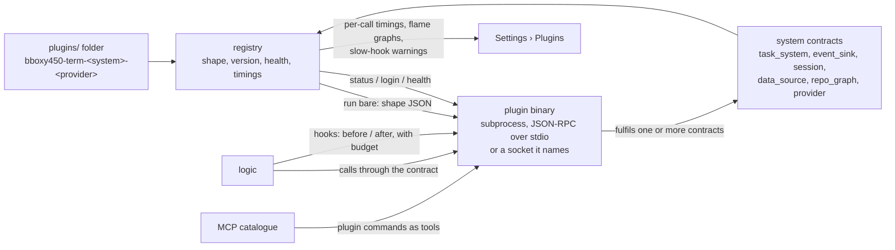

# Plugins

Owner: Corvin Duskmantle <ARCHITECT>. **Status: draft, logged for later** (operator, 2026-10-23: "i dont want this to derail our work, but lets start planning plugin system … spec it out … then we will talk about it later … for now we have built in shit, and opinionated built in shit"). Nothing here is briefed until the operator and the Architect have talked. Decision #41 records the direction; [[plugins-sota]] is the research behind it.

## 0. The operator's design, verbatim and in order

"there is a folder of binaries for bboxy450-term, called plugins, each plugin is named <app name, bboxy450-term in this case>-<system it plugs in, eg knowledge_base>-<provider name, notion, linear, gitkb>, this binary has shape, so if we run just binary it outputs json shape, saying here is how i talk to the world, for each system bboxy450-term has contract, that needs to be fulfilled by plugin, shape says here are my commands, we dont care what happens inside binary, can work locally, can have login system, not up for us, login is a step on setup of plugin, and then term can ask, hey dear plugin are you logged in -> no then we will run login command, but basically its deterministic way of dealing with plugins, we can tap into decision models like Jev in that implementation, so then we can use any external system to plug into, we write adapters for NATS messaging lets say, or for Notion, or for Obsidian, you name it, we have a guide people feed into their harness saying i want X to work as a plugin in system Y for bboxy450-term and done!" … "task system can be plug in, event system can have sink plugin for external messaging system as well, external sessions, external data sources" … "we can have plugins for repo management, mono repo, weavie repo based on nix, meta cli by my friend matt, meta repo he calls them, whatever people want to use to structure their codegraph, documentgraph, workgraph, executiongraph … we just render harnesses and plug them in, and we expose plugins via our MCP and via our hooks as well, they can tap into that and say in shape, hey i want to be run on this hook before or after, please run me! we have this hot sexy registry of all the plugins, and we have flamegraphs and timings and we can tell users hey this is taking 10s on each hook, its not ok" … "beauty of plugins we have very fixed contract of how we talk to them, and that way we can iterate on plugins very very very fast, without having them monolithically bundled with us".

**"Decision models like Jev", resolved by [[plugins-sota]] §10:** Jev is TypeSafe's decision model, a typed judge that answers choices, binary judgments and scores without generating text, used elsewhere for tool and skill selection. In this design that means **selection and routing among plugins may be delegated to a decision model** (which provider fulfils this request, which hook plugin is relevant), fed with the typed shapes the registry already holds, while the contract, the protocol and the authority checks stay deterministic and never depend on a model's answer. The shape's typed commands and result schemas are exactly what such a model consumes.

## 1. Shape of the system

- **Discovery.** A folder, not PATH: `plugins/` under the app's support directory and `.bboxy/plugins/` in a repository for repo-local ones. A plugin is one executable named `<app>-<system>-<provider>`; the name is data, the shape is truth.
- **Shape.** Running the binary with no arguments prints one JSON document: `{ name, version, shape_version, systems: [{ contract, contract_version, commands: [{ name, args schema, result schema, timeout_ms }] }], hooks: [{ event, phase: before | after, budget_ms }], auth: { status_command, login_command }, transport: stdio | socket, health_command }`. The app validates the shape against each named contract's schema before the plugin is callable; an unknown contract or version is refused by name.
- **Contracts.** One per system, versioned, owned by the app, each a small JSON-RPC method set the plugin must implement: `task_system` (list, get, delegate, report, accept, reject: the same shapes as [[work-items]] and the W2.5d tools), `event_sink` (deliver envelopes to an external bus such as NATS; acknowledge), `session` (open, attach, detach an external session), `data_source` (search, fetch, write for knowledge bases such as Notion, Linear, Obsidian, GitKB), `repo_graph` (describe a repository's structure for monorepos, Nix-based weavie, a "meta repo" CLI, feeding the code, document, work and execution graphs), `provider` (a supervisor link for ssh and cloud, the out-of-process form of [[d1-providers]], decision #12). Contracts change by version, never by surprise.
- **Protocol.** Deterministic, the same every time: shape → setup (`auth.status_command`; if not logged in, run `auth.login_command` in a seat so the operator sees it) → health → calls. JSON-RPC over the plugin's stdio by default, or a Unix socket it names in its shape; one request at a time per connection unless the shape declares `concurrent`; every call carries a deadline from the contract's `timeout_ms`; stdout is protocol only, stderr is the plugin's log, captured into its registry entry. The app never reads the plugin's files, config or credentials.
- **Hooks.** A plugin's shape may ask to run `before` or `after` a named hook event ([[harness-adapters]] hooks, the app's own lifecycle events) within a `budget_ms`; the app runs it with that budget and records the time; a plugin that exceeds its budget is reported, then skipped after repeated overruns, never allowed to stall a hook silently.
- **MCP.** A plugin's commands appear in the MCP catalogue as tools named `plugin_<provider>_<command>`, gated by the same role classes as every other tool ([[w2-5-mcp-and-seat-wiring]]); the shape's result schema is the tool's result schema.
- **Registry.** Settings › Plugins lists every discovered plugin with its shape, version, contract compliance, auth status, health, per-call and per-hook timings and a flame graph, and the warning the operator asked for: "this plugin takes 10 s on every hook". Enable, disable, re-run setup from there.
- **Isolation.** A plugin is a subprocess; its crash is its own and surfaces as a named error in the registry, never the app's crash. No in-process loading, no dynamic libraries, no WebAssembly in v1: [[plugins-sota]] §8 weighs them (a Rust dynamic library has no stable ABI and takes the host down with it; WebAssembly buys sandboxing and language freedom at the price of host-mediated IO and login), and the operator's shape chose binaries. The gaps §9 of the research lists are design obligations here: version negotiation on the shape, per-call deadlines with cancellation, stdout as protocol only, child cleanup on exit, multiplexed call ids, streamed large payloads, and a two-level error taxonomy (protocol error versus command error).
- **The guide.** One document, fed to any harness: "I want X to work as a plugin in system Y for bboxy450-term": it names the contract, the shape, the naming rule, the protocol, the test the app runs against a plugin (`bboxy450-term plugin check <binary>`), and ships as the `bboxy450` skill's plugin chapter.

## 2. Built-in versus plugin, and the task system

The built-ins stay built in and opinionated for the cockpit (operator: "for now we have built in shit, and opinionated built in shit"). The seam is still drawn now: **every system that can have a plugin gets its contract defined, and the built-in implementation is the reference implementation of that contract**, called in-process without the subprocess boundary. So the built-in task system is the `task_system` contract fulfilled by `.bboxy/` Markdown; a Linear or Jira plugin fulfils the same contract later and the UI, the tools and the lane do not change. The Architect's answer to "maybe we already should have our task system as a plugin": not as a subprocess yet, but as the first contract, because the contract is what makes a plugin possible and the built-in is where we learn whether the contract is right.

## 3. Order, when the operator says go

P-0 the contract schemas and the shape schema as JSON, with `bboxy450-term plugin check`; P-1 the registry and discovery, Settings › Plugins; P-2 the first contract behind the built-in (`task_system`) and the first real plugin against it; P-3 hooks with budgets and timings; P-4 `provider` as the out-of-process form of D1. Acceptance is written when the order is agreed.

## 4. Out of scope now

Everything above is logged; nothing is briefed. The research is [[plugins-sota]].
