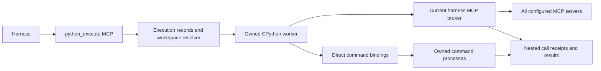

# python_execute: harness MCP and command runtime

Operator decision, 2026-11-05: expose the runtime as **`python_execute` MCP**, permit calls to every MCP server/tool configured in the current harness, provide direct bindings for the shell commands harnesses commonly use, execute in the active provisioned workspace, and make orientation discover the setup/workflows. All authored Markdown belongs in the canonical `.bboxy` KB. This supersedes the original SDK-first decision. Implementation is required; the acceptance matrix below defines completion.

## 1. Decision

Build a Python execution MCP endpoint as the common entry point for Codex, Claude and other harnesses. The model submits Python, invokes its current MCP tools and local command bindings, processes intermediate results and emits a bounded useful result. A small client/broker is internal plumbing, not a package every harness must install. Preserve ordinary direct MCP calls and native JavaScript Code Mode.

Use an owned **CPython worker process**, off the supervisor/control loop, for first delivery. The runtime supports standard Python imports, filesystem and subprocess work because those are substantial observed workloads and explicitly requested by the operator. This is the configured harness execution environment, not a claim of a tool-only Python sandbox. Do not choose a limited Python interpreter while silently promising existing `pathlib`/`subprocess` heredoc compatibility. A restricted or remote runtime can be a later explicit profile with truthful advertised capabilities.

Reuse current harness execution policy, identity, source/KB bindings and MCP configuration. Do not add an operator escalation path, global MCP configuration mutation, extra approval ritual or a second permission system. Every nested MCP call still goes through its server's current authorization and trust rules. A direct process binding has ordinary process authority; it is not made read-only by a friendly name.

Research: [[programmatic-execution-patterns]], [[programmatic-execution-implementations]], [[programmatic-execution-openai-protocol]]. Existing lifecycle contract: [[workspace-provisioning]].

## 2. What was inspected

Frozen event window: **2026-10-29T20:23:41Z through 2026-11-05T20:23:41Z**. Native `~/.codex/sessions` and `~/.claude/projects` JSONL traces; 40 recent files per provider, stratified toward main and child traces (target 24/16, with unused slots filled from remaining recent files), at most the last 4 MiB of complete rows per file. Included subagent files: Codex 16, Claude 20. They are **80 trace files, not 80 independent users or sessions**.

Only recorded tool inputs/results were analyzed. User conversations, reasoning blocks and private prompts were excluded from the analysis. Scripts were parsed, never executed. Source manifests retain file/line/call identifiers and snapshot hashes privately. Three files from the researcher's prior task history or direct children were excluded after matching the actual trace; the ATC-reported current provider id alone did not identify that history.

Launch-directory bias: all 40 selected Codex files launch in Harmony; Claude includes 34 Harmony and 6 bboxy files. A launch directory is not necessarily the target repository of every command. The newest selected Claude native logs are Nov 3; this sample does not establish behavior of later Claude ACP profiles or other homes. Tails, dynamic JS arguments, branches and loops limit coverage. These are descriptive counts, not population estimates or runtime benchmarks.

| Observable | Codex | Claude |
|---|---:|---:|
| Top-level logged tool requests | 1,031 | 3,272 |
| Code Mode `exec` cells | 969 | 0 |
| Statically reconstructed `cmd`/`command` strings | 911 | 2,375 |
| Commands containing Python heredocs | 202 | 146 |
| Python heredoc bodies | 203 | 146 |
| Bodies parsed successfully as Python AST | 203 | 146 |
| Files containing a Python heredoc | 18 | 18 |
| Quoted heredoc delimiters | 203 | 143 |
| Median heredoc lines | 8 | 18 |
| Bodies with JSON processing | 132 | 20 |
| Bodies with file-mutation syntax | 76 | 128 |
| Bodies with subprocess orchestration | 62 | 9 |
| Bodies with validation/inspection syntax | 56 | 87 |
| Logged result rows over 16 KiB | 305 / 1,036 | 37 / 3,274 |

Categories overlap. Mutation includes generated reports and fixture files, not only source edits; static syntax does not prove every branch ran or succeeded. Result encodings differ between providers, so their byte counts are not comparable model-token counts. The three unquoted heredocs show why recipes should use files or `<<'PY'`, but do not establish that quoting caused a failure.

Codex JS contains static references to `exec_command` (869), `knowledge_fetch` (196), `knowledge_write` (92), `task_status` (42), `operation_status` (30), `knowledge_commit` (26), `knowledge_orient` (25) and `knowledge_search` (23). These count **source call sites in submitted cells**, not confirmed nested runtime calls. Claude directly logs Bash (2,350), Edit (443), `message_send` (54), ToolSearch (42), `knowledge_write` (29), `message_ack` (26), `knowledge_fetch` (21) and `task_delegate` (17). Direct requests and JS source references must not be combined into one invocation frequency.

### Actual MCP payloads and failures

A separate pass over the same Claude rows inspected MCP argument **key names and document types**, and paired error flags with their originating tool requests. All 29 `knowledge_write` requests supplied frontmatter/body: 24 tasks and 5 reports; 14 supplied `path`; `ref` and `etag` each appeared in 15 requests. Fourteen included an `authorship` field. `knowledge_fetch` used `locator` in all 21 requests, with `body_offset` in 2 and `etag` in 1.

Paired error objects include `invalid_report` (4), `task_field_protected` (2), `workspace_pending` (4), `provider_busy` (3), and `conflict` (1). These are historical requests/results, not a claim that those bugs remain in the installed version. The design consequence is concrete: preserve refs/etags and paging, distinguish editable frontmatter from returned custody metadata, and return the complete structured correction/recovery result. Do not claim that changing programming language fixes validation or provider admission. Audit: `mcp-shapes.json`.

### Observed work and design consequence

| Evidence | Recorded work | Consequence |
|---|---|---|
| H0102, Codex | Runs several code-intelligence CLI queries, parses JSON, compares indexed files to Git's tracked files, and writes coverage/stale reports. | Keep local Python/Git/rg workflows; provide structured tool data where available. Do not add a bboxy analytics wrapper or automatically retry empty analytics. |
| H0154, Codex | A helper wraps a CLI with stdin, cwd, environment, timeout, stdout/stderr and exit status; then prepares document-source writes with a generation precondition. | Preserve request arguments and preconditions exactly. Avoid parsing human CLI output. Diagnostics must not copy the full environment as this historical helper does. |
| H0098 and H0147, Codex | Reads verification JSON, checks exit codes/source hashes, gathers Git evidence, and writes a compact handoff. | Structured results, small final output and file artifacts matter. A tool response is evidence only for the operation it actually confirms. |
| H0009, Codex; H0251 and H0236, Claude | Rewrites source files; Claude examples assert a unique match before replacing text. | Ordinary Python remains useful for local editing. Do not build a second bboxy filesystem/edit API to replace Python or the harness's existing edit tools. |
| H0118, Codex | Starts a private preview, waits for HTTP readiness, collects responses, and terminates the exact child in cleanup. | Existing process/session handles, cancellation and cleanup remain the execution harness's responsibility. The SDK does not restart or kill unrelated processes. |
| H0209, Claude | Restores seats in a loop, calling a CLI, parsing the first stdout line as JSON and keeping an old-to-new id map. | Seat/role controls are useful to scripts, but must use current admitted tools and permissions. Do not reproduce historical operator-CLI access in an Executor SDK. |
| H0233, Claude | Loops through records, invokes GitKB operations and writes per-item outcomes. | Support ordinary loops over structured tool calls and individual receipts. No opaque batch success or implicit remote publication. |

Private evidence: `~/.local/state/bboxy450-term/programmatic-tools-study-20261105/{summary,manifest,python-evidence,reviewed-cases}.json`; reproducible analyzer: `analyze.py`. Sensitive examples, including credential-inspection scripts, are not published as recipes. Case pointers are listed in section 10.

## 3. Public tools and user workflow

The canonical entry point is **`python_execute`**, with `source`, optional JSON `inputs`, bounded `timeout_ms` and optional recoverable `op_id`. The language is Python; no redundant language selector or separate `code_execute` alias. Accept real Python code with top-level `await`, regular imports, helpers, loops and exceptions. Supply `inputs`, `emit(value)` and current execution/context information without forcing a custom DSL.

Short runs return bounded stdout/stderr, emitted JSON, exit/outcome, execution ID and nested-call references. Long runs promptly return a durable execution handle before the current bridge's ten-second deadline. Add `python_execution_get(execution_id, cursor?)` for state/output paging and `python_execution_cancel(op_id?, execution_id)` for exact-owned-child cancellation when existing generic APIs cannot supply those capabilities. `operation_status` remains authoritative for existing native mutations; execution status is a different object.

`python_execute_orient` is read-only. It returns runtime readiness, resolved interpreter/version, source cwd or execution target, active workspace ID/revision, canonical KB binding, Python and binding examples, available MCP servers/discovery operations, resource/output limits and precise setup failures. A ready installation requires no per-harness `pip install`. Missing interpreter/configuration has an actionable named error; do not silently install packages or change global PATH/configuration.

Example shape, with real schemas obtained from discovery before invoking unfamiliar tools:

```python
import json

# The exact server name is discovered, not hardcoded by the runtime.
page = await mcp.call("bboxy", "knowledge_search", {"query": "type:task status:open"})
hits = await commands.rg("--json", "python_execute", "crates")
emit({"search_result": page.structured, "rg_exit": hits.exit_code})
```



The example preserves structured data; real scripts should emit only the fields they need. Tool errors retain full machine-readable correction/recovery data instead of becoming a generic Python traceback. Failed/unknown nested calls must not disappear behind a successful final print.

## 4. All harness MCPs, one current-context broker

Expose every server/tool in the harness's **effective selected MCP configuration**, including profile, launcher and ACP-provided sources, with the same precedence and authority as ordinary calls. Do not limit this to `bboxy.*`, copy a fixed subset of tool names or read an unrelated user's global configuration as a fallback. Reuse existing live MCP connections where supported; when a scoped client must be created, use the captured effective descriptor and normal credential resolution. Do not start duplicate singleton servers blindly.

Runtime bindings:

| Binding | Contract |
|---|---|
| `await mcp.servers()` | Bounded/pageable current server inventory and readiness, without commands, secret values or private configuration dumps. |
| `await mcp.tools(server, cursor=None)` | Actual current tool descriptions, exact names, input/output schemas and annotations. Large catalogs are paged, not silently reduced to a display/tool-count cap. |
| `await mcp.call(server, tool, arguments, op_id=None)` | Invoke that original registered server/tool with exact JSON data and current admission. Preserve complete MCP content, structuredContent, isError, metadata and hints. |
| Schema-derived `tools.<server>.<tool>(...)` | Optional convenience layer over the same broker. Detect normalized-name collisions and retain the exact generic address as an escape hatch. |
| `await mcp.status(...)` where supported | Query the original server's advertised recovery tool; do not fabricate a universal external-server operation journal. |

The broker dispatches using the existing MCP session/client machinery and its environment/transport support, including all transports actually supported by the current harness. A server disconnect or changed tool generation is a structured error; do not switch to another server with the same convenient name. Real configured MCPs must be reachable end to end; a mocked binding or bboxy-only implementation does not meet this requirement. Host-native tools that are not MCP servers require an explicit adapter, never an invented private client endpoint.

Retain the original MCP result envelope. `ToolError` carries server/tool, child request identity, `isError`, error code, full structured result and correction hints. Transport uncertainty is distinct. Do not classify an ordinary document's nested `error` field as an outer failure. Preserve source refs, etags, cursors, content/media and resources unchanged; unsupported media remains an explicit resource/reference, not silently discarded JSON.

## 5. Direct command bindings and ordinary Python

The trace study's predefined CLI mentions include Git 759, Cargo 281, git-kb 209, gh 193, ATC 186, Make 132, bboxy450-term 131 and rg 120. These count matching command strings in the sampled logs, not confirmed executions, independent workloads or a complete shell-command census. Literal subprocess argv in Python includes Git, Docker, df, ps and lsof. Retain the raw metadata privately as JSON; never execute logged commands while analyzing them.

Provide **generic argv execution plus direct executable bindings**, so every available command can be used without building a hand-maintained wrapper class per binary:

| Binding | Behavior |
|---|---|
| `await commands.run([executable, *args], cwd=None, input=None, timeout_ms=None, check=False)` | Exact argv execution in the captured workspace environment; structured stdout, stderr, exit/signal, duration, output cursor/resource and child identity. No implicit shell interpolation. |
| `await commands.rg(*args)` and `commands.git`, `commands.make`, `commands.cargo`, `commands.gh`, `commands.ls`, `commands.cat`, `commands.sed`, `commands.head`, `commands.tail`, `commands.wc`, `commands.find`, `commands.jq`, `commands.curl` | Direct thin bindings through the same execution/custody path. Other installed commands remain available via `run` or dynamic executable lookup. Preserve native arguments and exit semantics. |
| `await commands.shell(source, ...)` | Explicit shell execution for pipelines, redirects and compound commands; same execution policy, cwd, cancellation and output bounds. Plain argv calls never silently become shell calls. |
| `commands.available(name)` / orientation capabilities | Report availability without dumping the inherited environment. A missing binary returns `command_unavailable`, not fake empty output. |

`rg --json` must be directly usable. Exit 1 means no matches and must remain distinguishable from executable failure/exit 2. Git/read tools and mutating commands retain their real effect; `commands.git("push", ...)` is not classified as a read merely because Git can also inspect. Historical GitKB/ATC usage does not override this repository's retired-workflow instructions. The generic runtime can invoke installed binaries; orientation still teaches the current project/provider workflow.

MCP JSON is available as ordinary Python objects for filtering, projection, joins, sorting and aggregation; no subprocess or CLI text parsing is required just to consume tool data. Preload a documented JSON helper/module alongside `mcp`/`tools`, `commands`, workspace context and `emit`. The jq binding accepts Python JSON through explicit stdin and preserves exact jq expression semantics by invoking the real executable. Provide parsed-output convenience only with explicit JSON decoding errors; do not build a partial jq language or require jq for normal Python comprehensions.

Use stdlib Python (`pathlib`, `json`, `ast`, `tomllib`, `hashlib`, `subprocess`, etc.) rather than reimplementing those modules. Preserve bytes/text distinctions and Unicode. Package installation and arbitrary network/filesystem access follow the selected execution profile; do not describe a subprocess as a security sandbox. Convenience bindings enforce their budgets and retain child receipts, while arbitrary stdlib side effects are not falsely claimed to be fully journaled.

## 6. Workspace, execution and process custody

By default execute in the caller's active managed implementation workspace from [[workspace-provisioning]], not the UI's currently selected directory, repository main or the canonical KB directory. Capture workspace ID/revision, actual local/remote target, holder seat/generation, role/grant and canonical KB/provider identity. A worker must own the writing binding; an authorized provisioning role uses the explicit target workspace/reference under its actual authority. Unmanaged existing seats use their captured source cwd and are clearly labeled unmanaged.

The same provisioned workspace supports ordinary worker execution and `python_execute`. Reuse the workspace resolver rather than creating a Python-only checkout mapping. A stale/released/replaced workspace, moved root, revoked grant or changed holder is refused before execution/new nested dispatch. Existing in-flight effects remain recoverable under their original identities. A remote target must execute on that authenticated host or return an explicit unsupported-target error; never quietly run remote work on the laptop.

Use owned worker processes and bounded IO tasks outside the supervisor owner loop and UI thread. No global Python GIL/interpreter or process mutex shared across seats. A stuck program, slow MCP server, build or huge pipe must not block orientation, messaging or another seat. The current serial bridge cannot hold an outer request while requiring callbacks through that same blocked stream: return a handle and use an independent current-context callback path.

Use separate framed callback/control IO from user stdout/stderr. User `print`, binary output, malformed data or a traceback cannot corrupt MCP framing. Bound request/source bytes, wall time, retained output, number/concurrency of nested calls and process lifetimes explicitly. Drain stdout and stderr together; apply backpressure/bounded retention and page large output. Never cut recovery JSON/hints into an invalid fragment to meet a presentation limit.

Cancellation prevents new nested calls and stops/reaps only exact recorded worker/process groups. UI detach does not kill the execution; explicit cancel or owning-session retirement follows the existing lifecycle contract. Backend restart reconciles saved execution/child identities and marks uncertainty honestly. A PID number alone is not proof of ownership after reuse. Do not retry or restore a closed seat automatically.

## 7. Durable effects, errors and interrupted runs

Persist execution/source/inputs identity and each nested operation identity before sending an effect. Native bboxy calls reuse `_meta["bboxy450/op_id"]` and matching advertised `arguments.op_id`; conflicting IDs fail before send. External servers get only metadata/arguments their schemas support. A broker receipt correlates their calls, but does not invent server-side idempotency or exactly-once semantics.

Same outer `op_id` plus identical arguments returns the original execution or its recovery state. Different source/inputs/context under the same ID is a conflict. Output loss, timeout, interpreter exit, cancellation or a post-tool hook rejection is **never permission to rerun the entire script**. Earlier writes/process effects may have completed. Reconcile native calls using their journal; external uncertainty stays explicit with original server/call evidence.

Record parent/child relationships and expose the nested call trace in the harness UI/evidence even when only selected output reaches model context. Command bindings retain process outcome/uncertainty; arbitrary Python file/network operations are not a transaction and cannot be rolled back by the broker. Host Codex/Claude hooks are not automatically inherited by private server-side calls; preserve bboxy's actual configured policy/audit instead of claiming those hooks ran.

## 8. Orientation, setup and knowledge workflow

General `orient` returns structured, compatible-text hints to:

1. **`knowledge_orient`** for the current knowledge provider's workflow/skills and document guidance.
2. **`workspace_orient`** for Oracle class **or any current role/grant that can set up workspaces**. Derive eligibility from real capabilities/tool availability, not display-name equality.
3. **`python_execute_orient`** for runtime setup, context, MCP discovery, command bindings, examples and recovery guidance.

Expose each endpoint in the current role-filtered catalogue. Hints include exact tool names and valid arguments; keep the payload in structured results and compatible text. The Python orientation explains how to provision/select a workspace when authorized, confirms readiness, and gives copyable Python examples. Merely calling orientation inside Python and discarding it does not prove the model read the workflow.

Keep existing document semantics: only editable fields are written, refs/etags retained, `task_*` owns task lifecycle, and `knowledge_commit` is a deliberate checkpoint for substantial edits/sharing/acceptance rather than every write. Never auto-execute hints, publish, switch providers or forge author/ownership metadata to make a script succeed.

All human Markdown specs, research notes and handoffs created for this work live as valid numbered records under canonical `.bboxy/`. JSON, source analyzers, bounded raw command logs and binary runtime artifacts may use private runtime/state storage. `.bboxy` remains Git-ignored and must not be committed or force-added to source repositories. Use readable Markdown tables, links and Mermaid for humans; machine results retain exact structured data separately.

## 9. Acceptance, verification and delivery

| Case | Required implementation evidence |
|---|---|
| Real MCP entry point | Installed/current catalogue exposes `python_execute` and `python_execute_orient`; Codex/Claude-shaped real MCP clients execute Python without installing a per-harness SDK. |
| Full current MCP inventory | Two or more configured servers, namespaced duplicate tool names, large/paged catalogues, exact schemas and inherited credentials/context; actual fixture calls traverse the normal MCP client, not just a Python mock or bboxy-only dispatcher. |
| Standard Python and direct commands | `json`, `pathlib`, file editing and `subprocess`; direct rg/git plus generic command and explicit pipeline; quotes, Unicode, `$()` and backticks preserve argv data; rg no-match is not process failure. |
| Workspace integration | A provisioned fresh worktree is actual cwd/source target while KB calls reach canonical KB; stale holder/revision/released workspace refuses. Test unmanaged compatibility and unavailable remote targets explicitly. |
| Orientation | `orient` links the three workflow orientations with capability-based workspace eligibility; Python orientation provides working setup/binding examples and names missing runtime/binary/server state. |
| Framing/output | Python stdout/stderr, large/binary command output, MCP error objects and media cannot corrupt callback framing; final output/pages and all corrective hints remain recoverable. |
| Nonblocking/cancellation | A deliberately stuck Python program or MCP callback leaves messaging/status/another seat responsive. Cancel reaps exact children, handles grandchild pipes and completion races, never kills a peer. |
| Lost output/restart | Successful nested write followed by lost outer reply, duplicate requests, process crash and server restart do not repeat mutations. Native statuses and external unknown effects remain distinguishable. |
| Authority | Wrong/stale generation, revoked grant, changed KB/provider/credentials/server generation fail through original admission; no operator-CLI fallback or forged seat identity. |
| Distribution | Python helper and runtime server launch path are included in Make build/install/package workflows; no secret-bearing configs or new Markdown outside `.bboxy`. |

Add focused canonical Make targets `test-python-execute`, `test-python-execute-boundaries` and relevant formal contract targets. Use private homes/sockets, temporary Git repositories, real local Python/commands and fake stdio/available-transport MCP servers; no paid model or cloud account. Run only necessary affected checks plus required signing/license/formal/landing gates.

Finite lifecycle models name execution/child state, generation/grant, workspace/root revision, source identity, cancellation and recorded effect results. Check no duplicate dispatch, no stale completion publication, responsive independent owners, and no kill/release of another generation. Explore delayed, duplicate and reordered callbacks, cancel/finish, unknown effects and A → B → A; broken controls remove the deduplication/identity/custody guards. Link the model to real process/MCP tests and record OS/resource abstractions honestly. No exactly-once claim for arbitrary Python/external effects or unbounded OS liveness.

Deliver local CPython, actual configured MCP/command bindings, orientation and managed workspace integration as one usable feature. Cloud execution, alternative restricted runtimes and optional JS bindings are separate future profiles. Do not call this implementation complete with a spec-only change, a stub MCP catalogue, fixed fake tools or a happy-path subprocess test.

## 10. Evidence and current code

The following are private local pointers, not transcript copies. Cases are requests visible in logs; their summaries describe code behavior without asserting all historical effects succeeded.

- **H0102 (codex)** — [rollout-2026-11-05T08-49-00-01a1ac9d-1eaf-7012-804a-771afa2eb8cb.jsonl:105](/Users/feral/.codex/sessions/2026/11/05/rollout-2026-11-05T08-49-00-01a1ac9d-1eaf-7012-804a-771afa2eb8cb.jsonl:105), call `call_a38ad968eac043418f69401f26ca8c09`; 20-line heredoc, logged-source SHA256 `e0de75fe791ea00b51a0a457879872dab5ae3ff6fa18e74e6e4f4e64aa970ef4`.
- **H0154 (codex)** — [rollout-2026-11-05T06-11-26-01a1ac0c-db47-75f1-a815-dd144a18ab4a.jsonl:143](/Users/feral/.codex/sessions/2026/11/05/rollout-2026-11-05T06-11-26-01a1ac0c-db47-75f1-a815-dd144a18ab4a.jsonl:143), call `call_842afe630e5f474494389381ead3de57`; 20-line heredoc, logged-source SHA256 `053c89079bb6f1322ea5651845d8d9a4261090460fb30a66ea9c4c7b384b6340`.
- **H0098 (codex)** — [rollout-2026-11-05T08-56-33-01a1aca4-07c9-7802-8969-450803eb74b1.jsonl:1076](/Users/feral/.codex/sessions/2026/11/05/rollout-2026-11-05T08-56-33-01a1aca4-07c9-7802-8969-450803eb74b1.jsonl:1076), call `call_9ae16a87d38e41b3a69dfa6b8bdec66d`; 20-line heredoc, logged-source SHA256 `43c2a4ce72608fb8c4180f1baa0af32d668e809648b4984a8370dee69e5063ad`.
- **H0147 (codex)** — [rollout-2026-11-05T07-30-17-01a1ac55-0d09-7450-977d-ac24d819eae9.jsonl:228](/Users/feral/.codex/sessions/2026/11/05/rollout-2026-11-05T07-30-17-01a1ac55-0d09-7450-977d-ac24d819eae9.jsonl:228), call `call_bf4496722a1944f193002ea69fd149a4`; 19-line heredoc, logged-source SHA256 `278de76d8d5f511600a883bf5c5ed3b60062fc8d680a1a806862d574708b8408`.
- **H0009 (codex)** — [rollout-2026-11-05T12-01-16-01a1ad4d-22f5-78a0-94b3-5274a0014cc9.jsonl:203](/Users/feral/.codex/sessions/2026/11/05/rollout-2026-11-05T12-01-16-01a1ad4d-22f5-78a0-94b3-5274a0014cc9.jsonl:203), call `call_6b0654456f3f4475affd212a264567cb`; 19-line heredoc, logged-source SHA256 `0b4c74a1d75336bcdb5cac1e22c965bbc337de1f7750772e8bbdd52c8b2015cf`.
- **H0251 (claude)** — [3dac58c8-f6a4-4fe6-9863-8c72a5216d5e.jsonl:14305](/Users/feral/.claude/projects/-Users-feral-work-gitkb-harmony/3dac58c8-f6a4-4fe6-9863-8c72a5216d5e.jsonl:14305), call `toolu_01RUttLR28VugX5QmoG3d758`; 20-line heredoc, logged-source SHA256 `df5acc4273313dc1d3ba26b8d361cce4cd1420146fb34c0e4bbd16298d7971e7`.
- **H0236 (claude)** — [01a19d77-a87b-4ddd-81a6-6989b3fca0a3.jsonl:1133](/Users/feral/.claude/projects/-Users-feral-mydev-bboxy450-term/01a19d77-a87b-4ddd-81a6-6989b3fca0a3.jsonl:1133), call `toolu_013Se2b4oKfhDK9a2FSkUdwj`; 19-line heredoc, logged-source SHA256 `91c57ea60533a05767359770c4cf590c26869d8329e3ba72f9449f684ea4d16d`.
- **H0118 (codex)** — [rollout-2026-11-05T07-30-28-01a1ac55-3666-7940-ba47-5a7ae779ba9b.jsonl:386](/Users/feral/.codex/sessions/2026/11/05/rollout-2026-11-05T07-30-28-01a1ac55-3666-7940-ba47-5a7ae779ba9b.jsonl:386), call `call_7e98fdda7aaa43afa6cd44719d0b6d31`; 27-line heredoc, logged-source SHA256 `1c5d15e2e2647e9e586b8dea2d5308c9499bf5f4047acb478ac8351e3fc3efed`.
- **H0209 (claude)** — [ca834125-1093-481d-9d44-564d73793874.jsonl:9199](/Users/feral/.claude/projects/-Users-feral-mydev-bboxy450-term/ca834125-1093-481d-9d44-564d73793874.jsonl:9199), call `toolu_012qS3JS65FAUZfRE9isG4bP`; 23-line heredoc, logged-source SHA256 `bfd2197797d0893a5ac30c9cb83e5f6f62f198ffd30ecf0af5cf953635105295`.
- **H0233 (claude)** — [01a19d74-755a-40e6-b96f-a2b06e3cfe22.jsonl:437](/Users/feral/.claude/projects/-Users-feral-work-gitkb-harmony/01a19d74-755a-40e6-b96f-a2b06e3cfe22.jsonl:437), call `toolu_01M4RHmm81VKVa6WVj5K4msM`; 15-line heredoc, logged-source SHA256 `b8329a8c728044a9087c545f6a9b68092b0d7aeae3e07302196ef529b94da738`.

- **M1 (knowledge_write, invalid_report)** — request [01a19d77-a87b-4ddd-81a6-6989b3fca0a3.jsonl:569](/Users/feral/.claude/projects/-Users-feral-mydev-bboxy450-term/01a19d77-a87b-4ddd-81a6-6989b3fca0a3.jsonl:569), paired error result at line 571, call `toolu_0139SH7tSRbbiBm3AX23ckXT`.
- **M2 (knowledge_write, task_field_protected)** — request [01a19e35-0e56-44b8-b80d-87384df9e387.jsonl:5396](/Users/feral/.claude/projects/-Users-feral-work-gitkb-harmony/01a19e35-0e56-44b8-b80d-87384df9e387.jsonl:5396), paired error result at line 5405, call `toolu_013UirE5kHXULUB6CvdgeC6A`.

Current implementation anchors:

- `crates/bbt-mux/src/mcp/bridge.rs:43` — admitted bridge configuration from the inherited seat context.
- `crates/bbt-mux/src/mcp/bridge.rs:182` — per-request native socket forwarding and transport deadlines.
- `crates/bbt-mux/src/mcp/bridge.rs:357` — structured tool arguments and explicit operation-id metadata/argument agreement.
- `crates/bbt-mux/src/mcp/bridge.rs:443` — synchronous stdio request loop.
- `crates/bbt-mux/src/mcp/mod.rs:64` — logic-resolved seat actor; `journal.rs:115` — operation status and existing outcome authority.
- `crates/bboxy450-term/src/ctl/records.rs:149` and `ctl.rs:920` — the operator CLI record writer is intentionally e2e-only, not a general seat SDK. Do not widen it for this design.
- `crates/bbt-mux/src/mcp/hints.rs` and `knowledge/types.rs:34` — current structured hint graph and the spec/knowledge workflow dictionary.

Protocol context checked earlier in this discussion: [OpenAI nested Code Mode hooks](https://learn.chatgpt.com/docs/hooks#tool-calls-from-code-mode), [Anthropic programmatic Python tool calling](https://platform.claude.com/docs/en/agents-and-tools/tool-use/programmatic-tool-calling), and [Cloudflare's MCP-to-TypeScript approach](https://blog.cloudflare.com/code-mode/). They establish the pattern and possible failure boundaries, not measured bboxy performance or a guarantee that native harness hooks cover this SDK.
