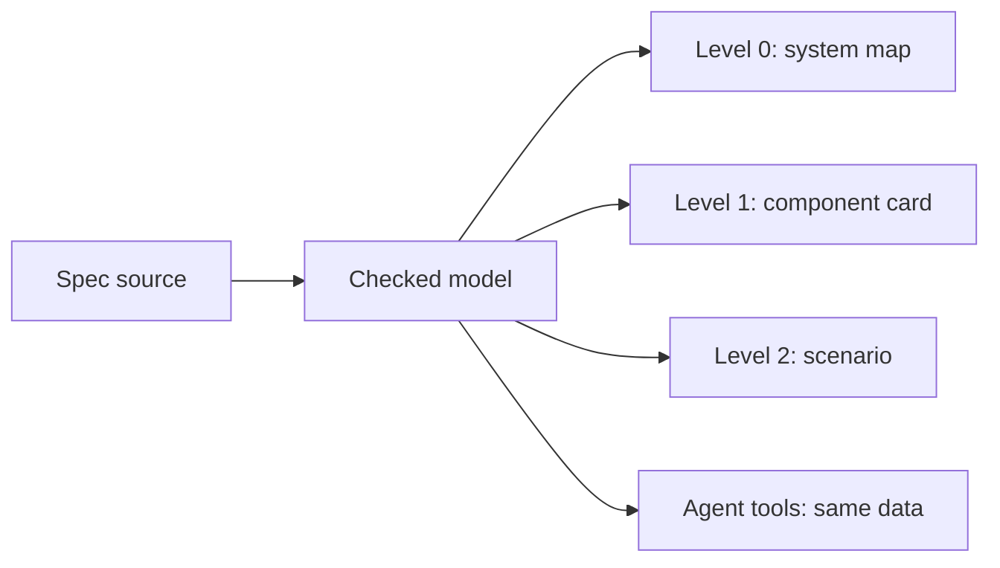

# Spec-first bboxy450

Source: the operator's agent brief of 2026-11-09, corrected against `bboxy450-term`
`3da65fd56` and harness `fd2917aa`. The stand it answers to is [[philosophy]].

## Purpose

Make the bboxy450 spec system strong enough that a swarm of agents can build a Linux-based
OS around bboxy450-term from specs alone, with no human in the loop during the run.

We are not building the OS yet. We are building what makes it buildable: a spec format
every agent can check its own work against, cheaply and locally. The Fermat run finished in
30 hours because Lean gave every agent a cheap, trusted, local check. Our suite has to be
for an OS what Lean was for that proof.

- **One-shot** is an unattended multi-day run that ends in a booting image, not one pass.
- **Linux-based** keeps the kernel. Specs cover userland: init, session, the term as shell,
  networking, updates. Per [[philosophy]], the kernel is hardware with a contract;
  the userland above it must stay readable by one agent.
- **Spec** is a declaration that generates or binds the running code and feeds the model
  checker. A model beside the code is evidence, not a spec.

## The agent-access rule

Every artifact of this programme is data an agent can read at any time through its tools:
spec source, the checked model, its reachable graph, each verdict, each waiver, each view,
each approval. A view the operator sees is generated from that data and never drawn by
hand. This is rule 1 of [[philosophy]] applied to specs, and it is the reason views
are projections: the agent and the operator look at the same thing at different zoom.

## Where the code stands (measured 2026-11-09)

| Piece | Exists | Gap |
|---|---|---|
| State, invariants, liveness | `protocol!` in `crates/bbt-yarn` yields reducer, finite model, invariants, fair leads-to | Production use: `delivery.rs` and `resume_model.rs` in `bboxy450-term-remote`; harness `src/engine/turn_loop.rs` |
| Scheduling | `reactor!`, `reactor_model!` with compile-time ordering, starvation and drain checks | 45 files outside yarn still hand-write `tokio::select!` |
| Checkers | `bboxy450-tlc` native vs Java TLC; Kani on the reducer; Loom/Shuttle on adapters | Explicit-state only; tiny domains; valuation cap |
| Contracts | 185 entries in `verification/contracts.toml`; 12,739 lines in `crates/bboxy450-term/tests/formal_contracts` | Models sit beside code; no refinement proof |
| Binding | `tests/delivery_witness.rs` drives runtime and model through one scripted trace | One trace, not every edge; no runtime-side broken control |
| Effects | `protocol!` emits typed effects | Effect execution is unchecked |
| Interfaces | 15 Markdown files in `.bboxy/interfaces` | Not machine-checked; models do not compose |
| Views | `bbt-mermaid` lays out flowchart, sequence, state; the document viewer renders Markdown | Nothing is generated from specs; `ProtocolMetadata` and the model graph are unused for views |
| Harness | Own `verification/` (contracts, coverage, corpus) | Same layout as the term; survey before each harness task |

## Rules

1. **One artifact.** The spec is the implementation or is mechanically bound to it. Porting
   a hand-written model to `protocol!` deletes the hand-written model in the same change.
2. **Checks are local and cheap.** A component is verified against its neighbors' interface
   specs, never their code.
3. **Proven and measured stay separate.** Never present a measured budget as a proof, or a
   bounded model as covering production sizes.
4. **Every weakening is visible.** Assumptions, fairness, bounds and waivers are declared,
   counted and shown.
5. **Humans read projections; agents read everything.** Both come from the same model.
6. **Subtract first.** Each workstream names what it retires.

## Workstreams

W1 and W2 unblock the rest.

| # | Workstream | Done when | Retires |
|---|---|---|---|
| W1 | Bind specs to running code | Every edge of the checked model is taken by the real runtime and agrees; a seeded runtime divergence fails | The "not a refinement proof" caveat per bound component |
| W2 | Composable interface contracts | Two components verify against each other's interface spec, neither reading the other's code | Markdown-only interface files |
| W3 | Larger spec language | Bounded integers, maps, sequences; symmetry reduction; one unbounded backend | Two-element stand-in domains |
| W4 | Effects and environment | An effect is a declared `reactor!` source with a completion; Linux-boundary models; deterministic fault simulator | "Effect execution outside checked scope" |
| W5 | Adoption | Hand-written models ported to `protocol!`; select loops ported to `reactor!` | `formal_contracts`; hand-written select loops |
| W6 | Workload declarations | Load driver and gate generated from a typed declaration | Shell-variable gates |
| W7 | Gate hardening | Implementers cannot edit specs or checks; controls generated by mutation; waivers budgeted | Hand-written broken controls |
| W8 | Cached verdicts and ledger | Per-component verdicts keyed by spec+code hash; "obligations discharged" is one number | Whole-workspace reruns; prose status |

### W1 has two forms

- **Conformance walk** (pure components): for each edge of the model's reachable graph,
  replay its path on a fresh real runtime, apply the event, and compare decision, effects
  and projected state. Exhaustive over the bounded model, deterministic, seconds to run.
- **Trace replay** (components with real I/O): production logs the events the spec names;
  a replayer maps real identifiers onto the model domain and feeds the generated step.

Where production calls the generated step directly, neither is needed. Each component
states which case it is. The state mapping is written explicitly and reviewed.

## Views

| Level | View | Content |
|---|---|---|
| 0 | System map, flowchart | Components, contracts as edges, colored verified / failing / unspecified |
| 1 | Component card, Markdown + state diagram | Intent, invariants as sentences, states collapsed to named predicates |
| 2 | Scenario, sequence diagram | One trace: a counterexample or a witness |
| 3 | Spec source | For agents and checkers |

- A deterministic generator draws every view from the model the checker explored.
- At most twelve nodes per diagram; larger graphs are collapsed by named predicates.
- Every card has a generated **Does not promise** section: bounds, fairness, missing
  liveness, waivers, and the contract's recorded assumptions.
- A card is stored beside its spec and a test fails when it is stale.
- Approval is recorded against the spec hash; a later change voids it.
- The authoring agent asks the operator questions as concrete scenarios with a diagram.

## Guardrails

- Do not weaken a spec, bound, domain or check to get green. Report the counterexample.
- No new assumption, fairness annotation or waiver without a decision record.
- Do not claim more than was checked: bounded contract, implementation evidence, measured.
- A build failure, timeout or empty test selection is not a passing broken control.
- Do not raise a budget because a run missed it.

## Staffing

Operator, 2026-11-09: at most three agents on this programme; one patient Executor is the
target. The Oracle seat writes specs and verifies; a bboxy450-harness seat on Codex executes.

## Milestones

1. [[tasks/2026-11-09-remote-delivery-conformance-and-card]]: W1 conformance walk and the
   level-1 card on `RemoteDelivery`.
2. W2 on `bbt-supervisor`, the candidate for PID 1.

## Open questions for the operator

- Which userland components make up the first image, beyond the term and the supervisor?
- Which unbounded backend for W3: extend the Kani inductive checks, or a second prover?
- Who may author and amend specs during a swarm run, and how is that enforced?
- What waiver budget applies per component for W7?
