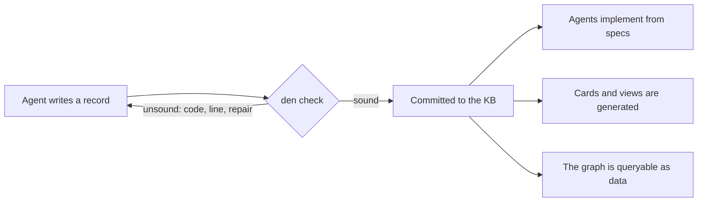

# Den: the knowledge-graph language of mux 2.0

Part of [[spec-first-os]]; answers to [[philosophy]]. The language is **Den** (files `*.den`, crate `crates/bboxy450-den`): a den is where a
fox keeps what it knows. The name was Den in the previous revision. Supersedes the first draft of this record (`bspec`, fenced
blocks inside Markdown), kept in Git at `2d4731440`.

## Purpose

Operator, 2026-11-09: "we are moving to our Haskell/Scala inspired GADT enabled language
for knowledge graphs! all of things becomes this language, except notes, research, skills
and other natural language".

Today a knowledge record is Markdown with a YAML header. Nothing checks that a report
points at a task, that a link resolves, that an invariant has a command, or that a spec
means one thing. Den makes every structured record a **typed declaration** in one
language, and the knowledge base a **typed graph**: links are imports, the kind of a link
is a type, and a record that does not check is refused at commit.



No compiler. Den is checked, never executed: agents compile specs to Rust by inference
and the macro system judges the result ([[spec-first-os]]).

## What moves and what stays

| Kind | Form in mux 2.0 |
|---|---|
| spec, interface, epic, loop, invariant, task, report, e2e | Den, fully typed and checked |
| decision, proposal, bug, recipe | Den header (status, dates, typed links) with a Markdown body |
| note, research, skill, vision, philosophy, comment | Markdown, as today; Den records may link to them |

## Design rules

The reader and the writer are language models; the syntax is Scala 3 with Haskell's types.

1. **One way to say each thing.** No synonyms, no optional syntax.
2. **Regular.** Every declaration starts with a keyword; blocks use braces; one statement
   per line; indentation never matters.
3. **Typed links.** `Ref[Task]` can only point at a task. A wrong link is a type error.
4. **Local.** A record names everything it depends on in its `import` lines.
5. **Says why.** Intent, invariant text and scenario names are required prose.
6. **Examples are checked.** A `scenario` is a trace with expected outcomes.
7. **Errors are repair instructions**: stable code, position, one sentence.
8. **Small.** The reference fits in one prompt.

## One model, many engines

Operator, 2026-11-10: "if we are able to load den files into objects, having our data
model in Rust we can do anything we want".

The centre of Den is not the syntax. It is the **typed model in Rust** that a `.den` file
loads into. Everything else is an engine that reads that model:

| Layer | What it is | State |
|---|---|---|
| Front end | text → syntax tree → resolved, typed, checked model | `spec` kind landing; other kinds next |
| Model | Rust types for records, fields, links, machines and graphs; the one public, stable interface of `bboxy450-den` | to be made public (next task) |
| Check engine | soundness: the X-code table | with the front end |
| View engine | graph operations → Mermaid | planned |
| Lowering engine | model → Markdown | planned; the first engine that writes |
| Query engine | the knowledge base as a typed graph, through MCP | planned |
| Execution engine | the host runs an epic's work graph and loop | later |
| Compilation engine | a spec → the `protocol!` declaration and the conformance check | later; today agents do this by inference |

Rules that keep this open:

- **Load once.** `load(source) -> Result<Model, Diagnostics>` is the only way in. No engine
  parses Den text for itself, so every engine sees the same meaning.
- **Engines only read the model.** A new engine is a new consumer; it needs no change to
  the language or to the other engines.
- **The model is additive.** New record kinds, fields and constructs are added; existing
  ones are not renamed, removed or retyped (the same rule as the bboxy log IR). A file
  that was sound stays sound and means the same thing.
- **Unknown is explicit.** An engine that meets a construct it does not handle says so
  (lowering lists it under `not_lowered:`; the checker reports `X190`). Nothing is skipped
  silently.

This is why Den is checked today and not compiled or executed: those are later engines
over the same model, added when there is a use for them, without redesigning the format.

## Modules and links

A file is one module holding one record. Its module path is its KB path:
`specs/delivery/outbox.den` is `specs.delivery.Outbox`. A link is an import:

```scala
module specs.delivery.Delivery

import specs.delivery.Outbox
import specs.delivery.Inbox
import decisions.D220SignedMain
```

An imported record is a value whose type is its kind: `Outbox: Doc[Spec]`. Imports must
resolve, and may form cycles only through `Ref` fields, never through `include`.

## Types

```scala
Bool   Int[0..3]   Text   Markdown   Path   Sha   Time   Command
Set[T]   List[T]   Option[T]   (A, B)
Ref[K]            // a link to a record of kind K
enum Msg { A, B }                       // a finite domain: also the model-checking bound
record Run { command: Command, exit: Int }
```

Algebraic data types are Scala 3 enums whose cases may fix the type index: GADTs.

```scala
enum Kind { Spec, Interface, Epic, Loop, Invariant, Task, Report, E2e, Decision, Prose }

enum Link[From <: Kind, To <: Kind] {
  case Realizes    extends Link[Epic, Spec]
  case PartOf      extends Link[Task, Epic]
  case Runs        extends Link[Epic, Loop]
  case Serves      extends Link[Task, Spec]
  case Constrains  extends Link[Invariant, Spec]
  case Evidence    extends Link[Report, Task]
  case Supersedes[K <: Kind] extends Link[K, K]
  case Amends      extends Link[Decision, Decision]
  case Decides     extends Link[Decision, Spec]
  case BuildsOn[K <: Kind] extends Link[K, K]
}
```

`Link` is why the language needs GADTs: each relation carries the kinds it may join, so
"a report supersedes a task" does not type-check. The record kinds and `Link` are declared
in Den itself, in `kb/prelude.den`; the knowledge base's schema is a record in the
knowledge base.

## GADTs: the index carries the fact

Operator, 2026-11-10: "GADT is big inspiration for us for .den design".

A generalized algebraic data type lets each constructor fix the type it returns. Den uses
that everywhere a rule can be turned into a type: the **index** of a type records a fact,
and a record that breaks the rule cannot be written down, so there is nothing left to
check at run time. `Link[From, To]` above is the first case. The others:

```scala
// 1. A record knows its kind.
enum Doc[K <: Kind] {
  case Spec(intent: Text, machine: Machine)            extends Doc[Kind.Spec]
  case Task(serves: List[Ref[Kind.Spec]], verify: Command) extends Doc[Kind.Task]
  case Report(task: Ref[Kind.Task], verify: Run)       extends Doc[Kind.Report]
}

// 2. A lifecycle step knows where it starts and ends.
enum Step[From <: Stage, To <: Stage] {
  case Delegate(to: Seat)                 extends Step[Open, Claimed]
  case Report(r: Ref[Kind.Report])        extends Step[Claimed, Reported]
  case Accept(r: Evidence[Passed])        extends Step[Reported, Accepted]
  case Reject(why: Text)                  extends Step[Reported, Claimed]
  case Close                              extends Step[Accepted, Done]
}

// 3. A piece of work knows what it needs and what it must produce
//    (see "Category theory" for how these compose).
enum Work[In, Out] {
  case Research(brief: Markdown)  extends Work[Unit, Kind.Prose]
  case Design(brief: Markdown)    extends Work[Kind.Prose, Kind.Spec]
  case Build(verify: Command)     extends Work[Kind.Spec, Kind.Report]
}

// 4. A channel knows who may speak and what it carries.
enum Channel[From <: Role, To <: Role, Payload <: Kind] {
  case Brief   extends Channel[Oracle, Executor, Kind.Task]
  case Blocked extends Channel[Executor, Oracle, Kind.Blocker]
  case Report  extends Channel[Executor, Oracle, Kind.Report]
}

// 5. Evidence knows how it was obtained.
enum Evidence[How <: Basis] {
  case Model(states: Int, bound: Text)      extends Evidence[Proven]
  case Run(command: Command, exit: Int)     extends Evidence[Passed]
  case Benchmark(value: Int, budget: Int)   extends Evidence[Measured]
}

// 6. An expression knows its type.
enum Expr[T] {
  case Lit(b: Bool)                          extends Expr[Bool]
  case Member[D](s: Expr[Set[D]], x: Expr[D]) extends Expr[Bool]
  case And(a: Expr[Bool], b: Expr[Bool])     extends Expr[Bool]
  case Plus(a: Expr[Int], b: Expr[Int])      extends Expr[Int]
}
```

What each index buys:

| Index | The rule it makes unwritable |
|---|---|
| `Doc[K]`, `Ref[K]` | a link to the wrong kind of record |
| `Step[From, To]` | an illegal lifecycle move: accepting an unreported task, closing an unaccepted one |
| `Work[In, Out]` | a research item that "produces" a report, a build with no verification, a step fed the wrong input |
| `Channel[From, To, Payload]` | a message from a role that may not send it, or carrying the wrong thing |
| `Evidence[How]` | presenting a measurement where a proof is required ([[spec-first-os]], rule 3) |
| `Expr[T]` | an ill-typed guard, update or invariant |

Three consequences for the implementation:

- **Elaboration.** The front end turns surface syntax into this typed core. The check
  groups Names, Types, Graph and Swarm are what elaboration reports when it cannot build
  the core. Whatever loads is well-typed by construction; the engines never re-check it.
- **In Rust.** Rust has no GADTs. The model encodes the index with marker types and
  sealed traits (`Step<Open, Claimed>`, `Expr<Bool>`), so an engine written in Rust gets
  the same guarantees from the Rust compiler.
- **User-defined.** A record may declare its own indexed `enum` with the syntax above;
  the prelude's types are not special.

A lifecycle is then stated twice on purpose, and the checker proves the two agree: the
`Step` type says which moves exist, and the lifecycle `spec` or `loop` says when each is
allowed. A move the machine takes that has no `Step` constructor, or a constructor the
machine can never take, is unsound.

## Category theory: the laws the format must obey

Operator, 2026-11-10: "category theory and that would also be great to have!"

GADTs say what a single record may be. Category theory says how records, specs, graphs
and engines **compose**, and gives each composition a law. Den takes it for the laws, not
the vocabulary: every statement below is a check the tooling runs.

### The categories Den has

| Category | Objects | Arrows | Composition means |
|---|---|---|---|
| Schema | record kinds | link relations (`Link[From, To]`) | a path of links is a derived relation with a known type |
| Knowledge base | records | typed links | following links; the neighborhood and chain views are paths |
| Specs | specs | refinements: "every step of A is a step of B" | refinement is transitive: code refines a detailed spec refines an abstract one |
| Graphs | graphs | structure-preserving maps | a view of a view is a view |
| Work | record kinds (inputs and outputs) | work items `Work[In, Out]` | one item's output is the next one's input |

```scala
// A work item is an arrow from what it needs to what it produces.
enum Work[In, Out] {
  case Research(brief: Markdown)           extends Work[Unit, Kind.Prose]
  case Design(brief: Markdown)             extends Work[Kind.Prose, Kind.Spec]
  case Build(verify: Command)              extends Work[Kind.Spec, Kind.Report]
  case Review                              extends Work[Kind.Report, Kind.Verdict]
}

// Sequential composition: the types must meet.
val pipeline = KbSurvey >> LinkTypes >> Graph        // Work[Unit, Kind.Report]

// Parallel composition: independent work, side by side.
val both = CommitGate || Converter                    // Work[(Spec, Spec), (Report, Report)]
```

`>>` and `||` are what the arrows and the `&` of a `graph { }` literal mean. An epic's
work graph is therefore a diagram in a monoidal category: a Mermaid flowchart of it is a
string diagram, and the engine may run in parallel exactly the items composed with `||`.

### The laws, as checks

| Law | Statement in Den | Check |
|---|---|---|
| Composition is typed | `a >> b` needs `a`'s output kind to be `b`'s input kind | X381: a work edge joins items whose kinds do not meet |
| Identity | every record has the trivial link to itself and every spec refines itself | holds by construction; the refinement checker is tested on it |
| Associativity | grouping a chain of links, refinements or work differently changes nothing | holds by construction: chains are stored flat |
| Refinement composes | if A refines B and B refines C, then A refines C under the composed mapping | X611: a composed mapping is not a refinement although each half is (a broken mapping) |
| A view is a homomorphism | every state maps to exactly one node, every transition to an edge or to staying put | X751, X752, and the edge rule of `shape` (X364) |
| An engine is a functor | lowering, rendering and conversion preserve links and composition | lowering a record keeps every link (round-trip); lowering an `include` contains the lowering of its parts |
| Interfaces glue | two specs that each refine a shared contract compose to a spec that satisfies it | the soundness test of interface composition, with a broken control ([[spec-first-os]], W2) |

### Three constructions Den uses by name

- **Product: `include`.** A spec built from parts is their product, with `do` and `expose`
  choosing which joint steps exist. Each part is recovered by projection, which is why a
  part's invariants must still hold in the whole (X604).
- **Gluing along a contract: `interface`.** Two specs and the contract between them form
  a span, `A ← Contract → B`. The composed system is the two glued along the contract
  (a pushout). This is the precise sense in which each side is checked "against the
  contract, never the other side's code".
- **Schema maps: migration.** Converting today's Markdown records to Den, and lowering
  Den to Markdown, are maps between two schemas. The round-trip check says they are
  inverse up to a stated normalization. A future change to Den's schema is another such
  map, which is how the additive rule is enforced mechanically and not by review.

### What this does not mean

No monads, no functors and no arrows appear in the surface language. An agent writing a
spec never needs the words. The category theory lives in two places: the composition
operators (`include`, `interface`, `>>`, `||`, link paths) and the laws the checker and
the engines' tests hold them to.

## Records

Every record has a keyword, a name, typed fields, and at most one `managed` block that
only the host writes (identity, lifecycle state, signatures).

### spec

A state machine: what exists, what can happen, what each event does, what always holds.

```scala
module specs.delivery.Outbox

spec Outbox {
  intent "The local side keeps every accepted message until the remote confirms it was applied."

  enum Msg { A, B }

  state {
    up: Bool = true
    unacked: Set[Msg] = Set()
    inflight: Set[Msg] = Set()
    acked: Set[Msg] = Set()
  }

  event Submit(m: Msg)
  event Send(m: Msg)
  event Applied(m: Msg)
  event Drop
  event Reconnect

  on Submit(m) {
    case accept if !unacked(m) && !acked(m) => { unacked += m }
    case known otherwise => reject AlreadySubmitted
  }
  on Send(m) {
    case send if up && unacked(m) && !inflight(m) => { inflight += m }
    case hold otherwise => ignore NotSendable
  }
  on Applied(m) {
    case retire if up && inflight(m) => { unacked -= m; inflight -= m; acked += m }
    case stale otherwise => ignore NoAck
  }
  on Drop {
    case drop if up => { up = false; inflight = Set() }
    case down otherwise => ignore AlreadyDown
  }
  on Reconnect {
    case restore if !up => { up = true }
    case live otherwise => ignore AlreadyUp
  }

  invariant OUTBOX_001 "an acknowledged message has left the outbox" =
    forall m: Msg. acked(m) ==> !unacked(m)
  invariant OUTBOX_002 "only unacknowledged messages are in flight" =
    forall m: Msg. inflight(m) ==> unacked(m)

  assume OUTBOX_A1 "an Applied frame is sent only by a remote that applied the message"

  scenario "a dropped link makes the message sendable again" {
    Submit(Msg.A)  ~> accepted
    Send(Msg.A)    ~> accepted
    Drop           ~> accepted
    Reconnect      ~> accepted
    Send(Msg.A)    ~> accepted
    Applied(Msg.A) ~> accepted
    Submit(Msg.A)  ~> rejected AlreadySubmitted
    expect acked(Msg.A)
  }
}
```

Meaning. An event instance is handled by exactly one `case`: the one whose guard is true;
`otherwise` is true exactly when no other guard in the block is. An accepting case applies
all its updates at once, each reading the state before the step; an unmentioned variable
keeps its value. `reject` (caller error) and `ignore` (harmless) change nothing. `emit`
names an effect the implementation must perform. `Set` application is membership. An
`assume` is taken from the environment, cannot be checked here, and shows on every card.

### spec composition: `include`

A bigger spec is built from parts. This is `#include`, typed.

```scala
module specs.delivery.Delivery

import specs.delivery.Outbox
import specs.delivery.Inbox

spec Delivery {
  intent "Across a link that drops, duplicates and replays, each submitted message is applied once and acknowledged only after it was applied."

  enum Msg { A, B }

  include Outbox as out with { Msg = Msg }
  include Inbox  as inb with { Msg = Msg }

  event Deliver(m: Msg)
  event Confirm(m: Msg)
  event RemoteCrash

  expose out.Submit, out.Send, out.Drop, out.Reconnect

  on Deliver(m) {
    case cross if out.up && out.inflight(m) => { do inb.Arrive(m) }
    case lost otherwise => ignore NotInFlight
  }
  on Confirm(m) {
    case cross if out.up && out.inflight(m) && inb.applied(m) => { do out.Applied(m) }
    case none otherwise => ignore NoAck
  }
  on RemoteCrash {
    case crash if out.up => { do out.Drop }
    case already otherwise => ignore AlreadyDown
  }

  invariant DELIVERY_001 "acknowledged implies applied" =
    forall m: Msg. out.acked(m) ==> inb.applied(m)

  discharge out.OUTBOX_A1 "Confirm is the only way an Applied frame reaches the outbox, and it requires the inbox to have applied the message"

  scenario "a crash before confirmation does not apply twice" {
    out.Submit(Msg.A) ~> accepted
    out.Send(Msg.A)   ~> accepted
    Deliver(Msg.A)    ~> accepted emits inb.Apply(Msg.A), inb.SendApplied(Msg.A)
    RemoteCrash       ~> accepted
    Confirm(Msg.A)    ~> ignored NoAck
    out.Reconnect     ~> accepted
    out.Send(Msg.A)   ~> accepted
    Deliver(Msg.A)    ~> accepted emits inb.SendApplied(Msg.A)
    Confirm(Msg.A)    ~> accepted
    expect out.acked(Msg.A) && !inb.doubled
  }
}
```

`include P as p with { D = D }` makes `P` a part: its state is `p.field`, its domain is
bound to the parent's. `do p.Event(args)` fires a part's event inside one parent step and
must be accepted. `expose` lists the part events the outside may still fire; the rest
happen only through the parent. `discharge` closes a part's `assume`; one that is not
discharged carries up. A part must be sound alone, and its invariants must still hold in
the whole.

### epic

Spec, then epic, then tasks. A spec says **what must be true**. An epic says **how a swarm
gets there**: who is on it, how the work is split, which channels carry what, who verifies,
and the loop every piece of work goes around. A task is one unit of that split.

```scala
module epics.DenChecker

import specs.SpecLanguage
import specs.SpecFirstOs
import loops.DelegateVerifyLand

epic DenChecker {
  intent   "A record that does not check cannot be committed to the knowledge base."
  realizes SpecLanguage, SpecFirstOs

  staff {
    Oracle     x 1     owns "briefs, rulings, verification, that the work lands"
    Architect  x 1     owns "SpecLanguage and every boundary between tasks"
    Executor   x 1..1  owns "one task at a time, in its own worktree"
    Researcher x 0..1  owns "evidence as file:line, never conclusions"
  }

  channel brief    : Oracle    -> Executor   carries Task
  channel blocked  : Executor  -> Oracle     carries Blocker
  channel report   : Executor  -> Oracle     carries Report
  channel ruling   : Oracle    -> Executor   carries Amendment
  channel question : Oracle    -> Architect  carries SpecQuestion
  channel law      : Architect -> Oracle     carries SpecChange
  channel finding  : Researcher -> Oracle    carries Research

  work {
    task Parser     by Executor  serves SpecLanguage
    task Graph      by Executor  needs Parser
    task CommitGate by Executor  needs Graph
    task Converter  by Executor  needs Graph
    task Migration  by Executor  needs Converter, CommitGate
    research KbSurvey by Researcher feeds Converter
  }

  loop DelegateVerifyLand for each task

  gate verify { check task.verify ~> exit 0   by Oracle   reads diff, log }
  gate land   { check $ make land ~> exit 0   by Executor }

  budget { agents <= 3; fullSuite <= 1 at a time }

  done when all work Done && SpecLanguage.acceptance
}
```

- `staff` gives each role a head count and one sentence of ownership. `x 1..1` is the
  operator's "one executor at a time", as a checked bound.
- `channel` declares every path a message may take: who sends, who receives, what kind of
  record it carries. A message outside a declared channel is not part of the epic.
- `work` is the split: a graph of tasks and research items with `needs` and `feeds` edges,
  each owned by a staffed role. The host creates one task record per `task` line; each
  carries `partOf` back to the epic.
- `gate` names a check, who runs it, and what they must read.
- `done when` is the epic's acceptance, over the work items and the specs it realizes.

### Work items carry their instructions and their outputs

Den is the swarm's orchestration language: an operator prompt becomes an epic, and the
epic is the execution graph the host runs. So each work item says what to do, who does it,
what it needs, and **which record it must produce**:

```scala
  work {
    research KbSurvey by Researcher {
      brief    """Read every record kind under .bboxy. For each: its fields, its links,
                  how many exist, and what a checker would reject today. Evidence as file:line."""
      produces research.KbRecordSurvey
    }
    design LinkTypes by Architect needs KbSurvey {
      brief    """From the survey, decide the Link relations and their kinds. Record every
                  relation you drop and why."""
      produces specs.kb.Links, decisions.LinkRelations
    }
    task Graph by Executor needs LinkTypes {
      serves   SpecLanguage
      verify   $ cargo nextest run -p bboxy450-den && make check-kb
      produces reports.DenGraph
    }
  }
```

- The verbs are fixed: `research` (evidence), `design` (specs, interfaces, decisions),
  `task` (code), `review` (a verdict on another item's output).
- `produces` names the record the item must write, by module path. Its kind must fit the
  verb: `research` produces research, `design` produces specs, interfaces or decisions,
  `task` produces a report. An item is done when that record exists and is sound.
- `needs` makes the producer's output an input: the host hands `LinkTypes` the survey
  record, not a summary of it.
- The host runs the graph: it starts every item whose `needs` are done, on a seat of the
  item's role, within `staff` and `budget`, and takes each one around the epic's loop.

### loop

The responsibility loop is not prose. It is a spec whose events are owned by roles and
travel on channels, so the checker can ask the swarm's questions: who acts next, can this
get stuck, can someone approve their own work.

```scala
module loops.DelegateVerifyLand

loop DelegateVerifyLand {
  intent "One task goes from brief to landed with exactly one role responsible at every moment."
  roles  Oracle, Executor

  enum Stage { Briefed, Working, Blocked, Reported, Verified, Landed, Closed }

  state {
    stage: Stage = Stage.Briefed
    failedLandings: Int[0..3] = 0
  }

  event Start     by Executor
  event Block     by Executor  on blocked
  event Rule      by Oracle    on ruling
  event Report    by Executor  on report
  event Accept    by Oracle
  event Reject    by Oracle    on ruling
  event Land      by Executor
  event LandFails by Executor  on blocked
  event TakeOver  by Oracle
  event Close     by Oracle

  on Start     { case go if stage == Stage.Briefed => { stage = Stage.Working }
                 case no otherwise => reject NotBriefed }
  on Block     { case stop if stage == Stage.Working => { stage = Stage.Blocked }
                 case no otherwise => reject NotWorking }
  on Rule      { case unblock if stage == Stage.Blocked => { stage = Stage.Working }
                 case no otherwise => reject NothingToRule }
  on Report    { case hand if stage == Stage.Working => { stage = Stage.Reported }
                 case no otherwise => reject NotWorking }
  on Accept    { case ok if stage == Stage.Reported => { stage = Stage.Verified }
                 case no otherwise => reject NothingReported }
  on Reject    { case back if stage == Stage.Reported => { stage = Stage.Working }
                 case no otherwise => reject NothingReported }
  on Land      { case landed if stage == Stage.Verified => { stage = Stage.Landed }
                 case no otherwise => reject NotVerified }
  on LandFails { case again if stage == Stage.Verified && failedLandings < 3 => { failedLandings = failedLandings + 1 }
                 case no otherwise => reject NotLanding }
  on TakeOver  { case seize if stage == Stage.Verified && failedLandings == 3 => { stage = Stage.Landed }
                 case no otherwise => reject NotYet }
  on Close     { case close if stage == Stage.Landed => { stage = Stage.Closed }
                 case no otherwise => reject NotLanded }

  waits {
    Briefed  -> Executor
    Working  -> Executor
    Blocked  -> Oracle
    Reported -> Oracle
    Verified -> Executor unless failedLandings == 3 then Oracle
    Landed   -> Oracle
  }

  invariant LOOP_001 "only verified work can fail to land" =
    failedLandings > 0 ==> (stage == Stage.Verified || stage == Stage.Landed || stage == Stage.Closed)

  scenario "the Oracle takes over a landing that keeps failing" {
    Start ~> accepted
    Report ~> accepted
    Accept ~> accepted
    LandFails ~> accepted
    LandFails ~> accepted
    LandFails ~> accepted
    TakeOver ~> accepted
    Close ~> accepted
    expect stage == Stage.Closed
  }
}
```

A loop adds three things to a spec:

- `by Role` on every event: who is allowed to cause it. `Accept by Oracle` and
  `Report by Executor` is how "nobody verifies their own work" becomes a type.
- `on channel`: the event is a message, and the channel must exist in the epic with that
  sender.
- `waits`: for each non-final stage, the one role that must act next. This is **never
  block the swarm** as a check: a stage nobody waits on, or a stage whose waiting role has
  no accepted event there, is unsound.

### interface

A contract between exactly two specs: a `spec` with a `between` line. It is what each side
is checked against instead of the other side's code.

```scala
interface SupervisorLogicLease {
  between specs.Supervisor, specs.Logic
  intent "Exactly one logic process may change supervisor state; a replaced one is fenced."
  // state, events, cases, invariants, scenarios: as in spec
}
```

### invariant

```scala
module invariants.SignedMain

import specs.Provenance
import specs.Identity

invariant SignedMain {
  holds      "every commit on main carries a pinned verified signature"
  check      $ python3 -I scripts/verify-signatures.py "${SIGNED_RANGE:-HEAD}"
  passes     exit 0
  cost       "an unsigned commit breaks the chain from artifact to key; releases inherit the gap"
  constrains Provenance, Identity
  status     Active
}
```

### task

```scala
module tasks.`2026-11-09-den-checker-crate`

import specs.SpecLanguage
import specs.SpecFirstOs

task DenCheckerCrate {
  title  "Den v1: the checker crate and make check-kb"
  serves SpecLanguage, SpecFirstOs
  role   Executor
  paths  "crates/bboxy450-den/", "Cargo.toml", "Makefile", "verification/coverage.toml"
  verify $ cargo nextest run -p bboxy450-den && make check-kb
  brief  """
    Build the parser and soundness checker defined in SpecLanguage.
    ...Markdown...
  """

  managed {
    id        = id"01M71JZAEJPC72B5QT15N0E09Q"
    status    = Open
    delegator = seat"01M71GNVXV7ZHXMGM50M5SB2RA"
  }
}
```

A task's legal status changes are not prose: they are `specs.kb.TaskLifecycle`, a `spec`
in this language (delegate, report, amend, accept, reject, close), and the host refuses a
transition that spec rejects. The same holds for every kind with a lifecycle.

### report

```scala
module reports.`2026-11-09-remote-delivery-landed`

import tasks.`2026-11-09-remote-delivery-conformance-and-card`
import reports.`2026-11-09-remote-delivery-refinement-and-card`

report RemoteDeliveryLanded {
  task       `2026-11-09-remote-delivery-conformance-and-card`
  author     seat"01M71H0S7MDHJ0QTCQFPQYXJHW"
  commits    sha"cd1f193b9...", sha"ae541605f..."
  verify     $ cargo nextest run -p bboxy450-term-remote ~> exit 0
  supersedes `2026-11-09-remote-delivery-refinement-and-card`
  body       """ ...Markdown: mechanisms, what was removed, gaps... """
}
```

### e2e

```scala
e2e WorkspacePythonDeployment {
  function "Managed workspace/Python MCP installation and retained-session GUI refresh"
  group    Deployment
  steps    """ ...Markdown... """
  expected "Both latest signed apps, ready current-source GUI/logic, retained identities"
  result   Passed "source, signature, installed hash, readiness and owner checks"
  coverage Full
  lastRun  time"2026-11-06T05:11:11Z" by Operator
  evidence path"~/.local/state/bboxy450-term/python-execute-20261105/deployment/installed-verification.json"
}
```

### decision and the other header kinds

```scala
decision D365MandatoryFormalVerification {
  status  Decided on date"2026-10-29" by Operator
  decides specs.TestPolicy
  amends  decisions.D220SignedMain
  body    """ ...Markdown: alternatives, choice, reason... """
}
```

### Markdown records

Notes, research, skills and comments stay `.md`. A Den record links to one with an
import; its type is `Doc[Prose]`. A Markdown record links to a Den record with `[[path]]`
as today.

## What "sound" means

Checks run in order; a later group runs only when the earlier ones are clean.

| Group | Code | Unsound when |
|---|---|---|
| Syntax | X101 | the text does not parse |
| Module | X151 | the module path does not match the file path, or the file holds more than one record |
| Names | X201 | a name is used but not declared or imported |
| | X202 | a name is declared twice in one scope |
| | X203 | a declaration or import is never used |
| | X204 | an event has no `on` block, or an `on` block names no event |
| Types | X301 | an expression or field has the wrong type |
| | X302 | an initial value is outside its type |
| | X303 | a call has the wrong number or type of arguments |
| Graph | X351 | an import does not resolve to a record |
| | X352 | a link points at a record of the wrong kind |
| | X353 | `include` forms a cycle |
| | X354 | a required field of the record's kind is missing, or a field is not of that kind |
| | X355 | a `managed` block was written by anything but the host |
| Swarm | X371 | a work item, event or channel names a role that is not in `staff` |
| | X372 | `needs` or `feeds` forms a cycle, or names no work item |
| | X373 | a loop event travels on a channel the epic does not declare, or against its direction |
| | X374 | a stage has no waiting role, more than one, or a waiting role with no accepted event there |
| | X375 | a role both produces and accepts the same work in one loop |
| | X376 | a spec in `realizes` is served by no work item |
| | X377 | head counts in `staff` exceed `budget` |
| | X378 | a work item has no `produces`, or produces a record kind its verb may not write |
| | X379 | a work item is done but its produced record is missing or unsound |
| Totality | X401 | two cases of one `on` block can both be true |
| | X402 | no case is true for some state and arguments |
| Steps | X501 | a case assigns one variable twice |
| | X502 | a `reject` or `ignore` case updates state or emits |
| | X503 | an accepting case, in some state and for some arguments that select it, changes nothing and emits nothing |
| | X504 | `do` fires a part's event in a state where the part does not accept it |
| Model | X601 | an invariant is false in a reachable state (shortest trace reported) |
| | X602 | an update can leave a variable's range |
| | X603 | the state space exceeds the limit |
| | X604 | a part's invariant is false in the whole |
| Vacuity | X701 | a case is never taken from any reachable state |
| | X702 | an invariant cannot be false in any state of the types |
| Scenarios | X801 | a step has a different outcome than written |
| | X802 | an `expect` is false at that point |
| Completeness | X901 | `intent` is missing or empty |
| | X902 | a spec has no invariant |
| | X903 | a spec has no scenario |
| | X904 | an `assume` of a part is neither discharged nor restated |

Totality is checked over every value of the types, not only reachable states. Model,
vacuity and scenario checks use the reachable states, explored by the existing
`bboxy450-tlc` checker: one model checker in the suite.

Sound does not mean: what the operator wants (cards and scenarios are for that); true
beyond its bound; implemented by any code (the macro judge is for that); making progress
(v1 is safety only; `leads to` and fairness come from `protocol!` next).

## In mux 2.0

- **Commit is the gate.** `knowledge_commit` checks every Den record it is asked to
  commit, and every record that imports one of them, and refuses on any diagnostic.
  Drafts are never refused.
- **The graph is data.** Every record, field and link is readable through the tool
  catalogue as typed values, not scraped text ([[philosophy]], open to agents).
- **Lifecycles are specs.** Task, report and decision state changes are checked against
  their lifecycle spec by the host.
- **The viewer renders Den.** Prose fields render as Markdown; a spec renders as its card.

## Graphs are data: everything is a tree or a graph

Operator, 2026-11-10: "think mermaid to use visualization for humans but also showing and
encoding some graph type of relationships, everything is a tree or a graph".

Almost everything a record says is a graph: the knowledge base is a graph of records, a
module path is a tree, an epic's work is a dependency graph, channels are a graph over
roles, a composed spec is a tree of parts, a state machine is a graph of states, a
scenario is one path through it, provenance is a chain. Den makes that literal. A graph
is a typed value, **written in Mermaid's own edge syntax**, so the text an agent writes is
at once the data the checker checks and the picture a person sees.

### Graph types and literals

```scala
Graph[N, E]   // nodes of type N, edges labeled with E
Dag[N, E]     // a Graph the checker proves has no cycle
Tree[N]       // a Dag with one root and one parent per node

work: Dag[Work, Needs] = graph {
  subgraph Researcher { KbSurvey }
  subgraph Architect  { LinkTypes }
  subgraph Executor   { Parser; Graph; CommitGate; Converter; Migration }

  KbSurvey --> LinkTypes --> Graph
  Parser --> Graph
  Graph --> CommitGate & Converter
  CommitGate & Converter --> Migration
}

channels: Graph[Role, Carries] = graph {
  Oracle   -->|brief: Task|        Executor
  Executor -->|blocked: Blocker|   Oracle
  Executor -->|report: Report|     Oracle
  Oracle   -->|ruling: Amendment|  Executor
  Oracle   -->|question: SpecQuestion| Architect
  Architect -->|law: SpecChange|   Oracle
}
```

- Inside `graph { }` the syntax is the Mermaid flowchart subset: `A --> B`, chains
  `A --> B --> C`, fan `A & B --> C`, labeled edges `A -->|label| B`, and
  `subgraph Name { … }` for grouping. Nothing else of Mermaid is accepted there: no
  styling, no shapes, no direction. Those belong to rendering.
- Node names are declared names of type `N`. An edge label is a value of type `E`. A
  subgraph name is a declared grouping (here, a role). So a graph literal is checked like
  any other value: an undeclared node, a wrongly typed label or a cycle in a `Dag` is a
  diagnostic at that edge.
- The earlier `work { task A by Executor needs B }` and `channel x : A -> B carries T`
  forms are the same data written longhand. A record uses one form per graph; the graph
  literal is preferred where the shape matters more than the per-node detail.

### Declared shape, checked against the computed one

For a graph the checker **computes** (the stages of a loop, the states of a spec under a
view), the record may draw the shape it expects. The checker proves the two are equal:

```scala
  shape "task loop" over stage = graph {
    Briefed --> Working --> Reported --> Verified --> Landed --> Closed
    Working --> Blocked --> Working
    Reported --> Working
  }
```

A person approves a picture; the machine holds the spec to it. An edge in the drawing the
machine cannot take, or a move the machine can make that the drawing lacks, is unsound.

### Graph operations

Expressions over graphs are few and total: `g.roots`, `g.leaves`, `g.parents(n)`,
`g.children(n)`, `g.reaches(a, b)`, `g.path(a, b)`, `g.acyclic`. They let an invariant
talk about structure, for example `forall t: Work. work.reaches(Parser, t) || t == KbSurvey`.

### Views are graph operations

Every view in the next section is one of four operations on a graph the record already
holds, which is why diagrams need no drawing code per kind:

| Operation | Meaning | Used for |
|---|---|---|
| quotient | merge nodes by a predicate | a spec's states under a `view` |
| ego | a node and its neighbors within n links | a record's neighborhood |
| path | one walk through the graph | a scenario; a provenance chain |
| restrict | keep nodes and edges matching a filter | work still open; one role's lane |

### Lowering and reading back

A graph literal lowers to a Mermaid block with the same edges in the same order, plus
styling. Because the edge syntax is shared, the reverse also works: a Mermaid flowchart
found in an existing Markdown record can be read as a graph candidate by the converter,
typed against the record's declared names, and checked.

New diagnostics: `X361` a graph names an undeclared node or group; `X362` an edge label
has the wrong type; `X363` a `Dag` has a cycle or a `Tree` has a second root or parent;
`X364` a declared `shape` differs from the computed graph (reports the missing and the
extra edges).

## Views: every record draws itself

Operator, 2026-11-10: "mermaid and visualization should be a big part of the .den format
and lowering". A Den record is read by people at a glance and by agents in full. So each
kind has **generated diagrams**, drawn by the checker's renderer from the checked record,
never by hand and never by a model ([[spec-first-os]], Views). They appear in the native
viewer, in every lowered Markdown record, and as data through MCP.

| Kind | View | Mermaid form | Shows |
|---|---|---|---|
| spec, interface | states | state diagram | Reachable states collapsed by the record's `view`; edges are events; a failing invariant's state is marked |
| spec, interface | scenario | sequence diagram | One diagram per `scenario`: who sends which event, the outcome, effects emitted |
| spec with `include` | parts | flowchart | Each part as a node, `do` calls as edges, exposed events on the boundary, discharged and open assumptions |
| loop | lanes | sequence diagram | Roles as participants, events as messages on their channels, in the order of a scenario |
| loop | stages | state diagram | Stages colored by the role in `waits`; a stage nobody waits on is drawn as an error |
| epic | work | flowchart | Work items grouped by role, `needs` and `feeds` as edges, colored open, working, done, blocked |
| epic | channels | flowchart | Roles as nodes, channels as labeled edges with what they carry |
| task, report | chain | flowchart | Spec, epic, task, report, commits: the provenance chain of this record |
| any record | neighborhood | flowchart | The record and everything one typed link away, edges labeled with the relation |
| the knowledge base | map | flowchart | Specs as nodes, interfaces as edges, colored sound, unsound, unspecified |

### `view`: the record says how to be drawn

A reachable graph is too large to read. The record names the picture it wants, and the
renderer computes it from the checked model:

```scala
  view "one message" {
    node "new"          if !unacked(Msg.A) && !acked(Msg.A)
    node "queued"       if unacked(Msg.A) && !inflight(Msg.A)
    node "in flight"    if inflight(Msg.A) && !applied(Msg.A)
    node "applied"      if applied(Msg.A) && !acked(Msg.A)
    node "acknowledged" if acked(Msg.A)
  }
```

- Each reachable state belongs to the first `node` whose predicate is true. Edges between
  nodes are the events that move a state from one to the other; self-loops are dropped.
- A spec may have several views; the first is the default on its card.
- With no `view`, the renderer uses one node per value of the first `enum`-typed state
  variable, or the raw states when there are at most twelve.

### Rules for every diagram

- **Data or derived, never decoration.** A diagram is either a graph the record declares
  as a typed value (a `graph { }` literal, drawn as written) or one the renderer computes
  from the checked record. There is no way to place an unchecked picture in a Den record.
- **At most twelve nodes.** A larger diagram is a diagnostic asking for a `view`, never a
  truncated picture.
- **Valid by construction.** Every generated diagram is parsed and laid out with
  `bbt-mermaid` when it is rendered; a diagram the native viewer cannot draw is a renderer
  bug that fails the render.
- **Status is color, with a legend.** Sound, unsound, unspecified, and for work: open,
  working, done, blocked. The same colors everywhere.
- **Link nodes.** A node that stands for a record is a link to it, so a map opens a card
  and a card opens its neighbors.

New diagnostics: `X751` a reachable state matches no `node` of a `view`; `X752` a `node`
matches no reachable state; `X753` a diagram needs more than twelve nodes.

## Lowering to Markdown

Not every consumer reads Den. The GitKB knowledge provider, used by another project on
another machine, stores and serves Markdown records only. So Den lowers to Markdown:
`bboxy450-den render --markdown PATH` turns one sound `.den` record into one Markdown
record in today's format, a YAML header followed by a body.

| Den | Markdown |
|---|---|
| record keyword and name | `type:` and `title:` (from `title` or `intent`) |
| typed fields (`status`, `verify`, `paths`, `check`, `commits`, …) | the same header keys the kind uses today |
| `import` and typed link fields | `links:` entries `{ to: "[[path]]", rel: <relation> }`, and `[[path]]` in the body |
| `managed { }` | the host-stamped header keys (`id`, `number`, `created`, signatures) |
| prose fields (`brief`, `body`, `steps`) | the Markdown body, verbatim |
| `spec`, `loop`, `interface` machine | a generated section: intent, a state table, events and cases, invariants and assumptions as sentences, scenarios as numbered steps, and the Den source in a fenced block |
| `epic` | staff and channels as tables, the work graph as a list with `needs`, gates and budget |

Rules:

- **One direction.** Den is the source; the Markdown is a projection. A lowered file says
  so in its header (`generated_from:` with the module path and a hash of the Den source)
  and is never edited by hand. A consumer that edits it has forked the record.
- **Deterministic.** The same Den text gives the same Markdown bytes. No timestamps, no
  ordering that depends on the machine.
- **Only sound records lower.** `render` runs the check first and refuses an unsound
  record with its diagnostics.
- **Nothing is dropped silently.** A Den construct with no Markdown form is rendered as
  its source in a fenced block and listed under a `not_lowered:` header key.
- **Diagrams are part of the record.** A lowered record carries its views as Mermaid
  blocks, default view first, under a "Views" heading: the states and scenarios of a
  spec, the work graph and channels of an epic, the chain of a task or report. GitHub,
  GitKB viewers and the native viewer all render them. `--no-mermaid` drops them for
  consumers that cannot.

### As MCP tools

Agents reach the checker and the lowering through the bboxy tool catalogue, the same way
they reach everything else ([[philosophy]]):

| Tool | Input | Effect |
|---|---|---|
| `den_check` | `path`: a `.den` file or a KB locator | Read-only. Returns sound or the diagnostics (code, line, repair) and the summary. |
| `den_view` | `path`, optional `view` name | Read-only. Returns the named view (or all) as Mermaid text plus the nodes and edges as data. |
| `den_render` | `source`: a `.den` file or KB locator; `output`: a path ending `.md`; optional `no_mermaid`, `overwrite` | Checks the record, lowers it, and writes the Markdown file. Returns the output path, the source hash and the output digest. |

`den_render` rules:

- It writes exactly one file, the `output` path, and creates missing parent directories.
- `output` may be anywhere on disk the calling seat may write: its own workspace, the
  knowledge root, or a directory the operator has configured as an export root (for
  example another project's GitKB checkout). Anything else is refused with the reason.
- It refuses to replace an existing file unless that file is a previous lowering of the
  same record (its `generated_from:` names the same module), or `overwrite` is set. It
  never replaces a hand-written record by accident.
- An unsound source writes nothing and returns the diagnostics.
- It takes an `op_id` like every mutating tool; a retry with the same arguments returns
  the first result.

### In a Markdown-only provider: GitKB

When a swarm's knowledge provider is GitKB (`crates/bboxy450-term-data_source-gitkb`), the
store holds Markdown and nothing else. Den still works there, because the host lowers at
the provider boundary:

- **Write.** `knowledge_write` of a Den record checks it, lowers it, and hands GitKB the
  Markdown. Drafts of unsound records are stored as their Den source in a fenced block
  under a header that says `den_state: draft-unsound`, so work in progress is never lost.
- **Commit.** `knowledge_commit` refuses an unsound record exactly as with the built-in
  provider, then uses GitKB's native commit on the lowered Markdown.
- **Read.** Every lowered record carries its full Den source in a fenced `den` block at
  the end of the body, plus `generated_from:` with the source hash. `knowledge_fetch`
  returns the Den source recovered from that block and verifies the hash; a mismatch
  means the Markdown was edited outside the host and is reported as `den_state: forked`,
  never silently accepted or overwritten.
- **Links.** Typed Den links become GitKB's native relationships (`references`,
  `depends_on`, `blocks`, `parent`) where one fits, and `links:` header entries otherwise,
  so `git-kb` on the other machine sees the graph.
- **Capability, not special case.** The provider declares whether it stores Den natively.
  The host lowers for any provider that does not; GitKB is the first, not a hard-coded
  exception.

So a project that only has GitKB gets readable Markdown records, and the Den source
travels inside them. Nothing in that project needs to understand Den to store, show or
sync the records.

Lowering is also the second half of the migration's round-trip check: converting a
Markdown record to Den and lowering it again must give back the original header keys,
links and body, up to a stated normalization.

## Migration

One step at a time; the knowledge base stays usable at every step.

1. `crates/bboxy450-den`: parser and checker for `spec` (Syntax through Completeness,
   without Graph). Anchor: `RemoteDelivery` in Den reaches the same states as its
   `protocol!` declaration.
2. Modules, imports, `Ref`, the prelude, and the remaining record kinds: the Graph group.
   `make check-kb`.
3. Views: `view`, the generated diagrams for every record kind, validated with `bbt-mermaid`.
   Lowering: `render --markdown` for every record kind, with its views, so Markdown-only providers such
   as GitKB keep working.
4. The MCP tools `den_check` and `den_render`, and lowering at the provider boundary for
   GitKB.
5. A converter from today's Markdown records to Den, with a round-trip check against the
   lowering: every field and link of the original comes back, and nothing is invented. Run it on a
   copy first; report every record it cannot convert.
6. The host reads both forms; new strong-fit records are written in Den.
7. Convert the strong-fit kinds in place, one kind per change, reports first (pure
   evidence, frozen), tasks last (live).
8. The host stops reading YAML headers for the converted kinds. Markdown remains for prose.

## Checked examples

The machines this record shows are real files, checked by `make check-den` on every
landing. Where the text above and a file differ, the file is right.

| File | Spec | Reachable states | Transitions |
|---|---|---:|---:|
| `specs/delivery/outbox.den` | `Outbox` | 25 | 200 |
| `specs/delivery/inbox.den` | `Inbox` | 4 | 8 |
| `specs/delivery/remote_delivery.den` | `RemoteDelivery` | 52 | 572 |
| `specs/kb/task_lifecycle.den` | `TaskLifecycle` | 11 | 77 |
| `specs/kb/delegate_verify_land.den` | `DelegateVerifyLand`, as a plain spec without roles, channels or `waits` | 16 | 160 |

First dogfood result, 2026-11-10: the three specs written by hand before any checker
existed (`Inbox`, `TaskLifecycle`, `DelegateVerifyLand`) were sound on the first run. The
one hand-written spec the checker did reject was `RemoteDelivery`: its `RemoteCrash` case
accepted a crash that changes nothing when the link is already down (X503). The file
carries the corrected guard.

## Out of scope for v1

Compilation; progress and fairness; maps and sequences in spec state; parametric bounds;
user-defined type classes; any evaluation beyond expressions in specs.
