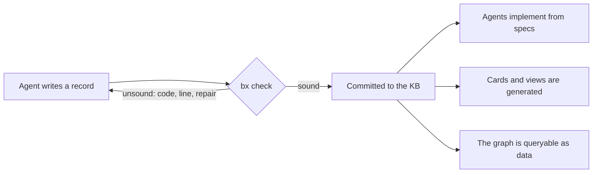

# bx: the knowledge-graph language of mux 2.0

Part of [[spec-first-os]]; answers to [[philosophy]]. Working name `bx` (files `*.bx`,
crate `crates/bboxy450-bx`). Supersedes the first draft of this record (`bspec`, fenced
blocks inside Markdown), kept in Git at `2d4731440`.

## Purpose

Operator, 2026-11-09: "we are moving to our Haskell/Scala inspired GADT enabled language
for knowledge graphs! all of things becomes this language, except notes, research, skills
and other natural language".

Today a knowledge record is Markdown with a YAML header. Nothing checks that a report
points at a task, that a link resolves, that an invariant has a command, or that a spec
means one thing. `bx` makes every structured record a **typed declaration** in one
language, and the knowledge base a **typed graph**: links are imports, the kind of a link
is a type, and a record that does not check is refused at commit.



No compiler. `bx` is checked, never executed: agents compile specs to Rust by inference
and the macro system judges the result ([[spec-first-os]]).

## What moves and what stays

| Kind | Form in mux 2.0 |
|---|---|
| spec, interface, invariant, task, report, e2e | `bx`, fully typed and checked |
| decision, proposal, epic, bug, recipe | `bx` header (status, dates, typed links) with a Markdown body |
| note, research, skill, vision, philosophy, comment | Markdown, as today; `bx` records may link to them |

## Design rules

The reader and the writer are language models; the syntax is Scala 3 with Haskell's types.

1. **One way to say each thing.** No synonyms, no optional syntax.
2. **Regular.** Every declaration starts with a keyword; blocks use braces; one statement
   per line; indentation never matters.
3. **Typed links.** `Ref[Task]` can only point at a task. A wrong link is a type error.
4. **Local.** A record names everything it depends on in its `import` lines.
5. **Says why.** Intent, invariant text and scenario names are required prose.
6. **Examples are checked.** A `scenario` is a trace with expected outcomes.
7. **Errors are repair instructions**: stable code, position, one sentence.
8. **Small.** The reference fits in one prompt.

## Modules and links

A file is one module holding one record. Its module path is its KB path:
`specs/delivery/outbox.bx` is `specs.delivery.Outbox`. A link is an import:

```scala
module specs.delivery.Delivery

import specs.delivery.Outbox
import specs.delivery.Inbox
import decisions.D220SignedMain
```

An imported record is a value whose type is its kind: `Outbox: Doc[Spec]`. Imports must
resolve, and may form cycles only through `Ref` fields, never through `include`.

## Types

```scala
Bool   Int[0..3]   Text   Markdown   Path   Sha   Time   Command
Set[T]   List[T]   Option[T]   (A, B)
Ref[K]            // a link to a record of kind K
enum Msg { A, B }                       // a finite domain: also the model-checking bound
record Run { command: Command, exit: Int }
```

Algebraic data types are Scala 3 enums whose cases may fix the type index: GADTs.

```scala
enum Kind { Spec, Interface, Invariant, Task, Report, E2e, Decision, Prose }

enum Link[From <: Kind, To <: Kind] {
  case Serves      extends Link[Task, Spec]
  case Constrains  extends Link[Invariant, Spec]
  case Evidence    extends Link[Report, Task]
  case Supersedes[K <: Kind] extends Link[K, K]
  case Amends      extends Link[Decision, Decision]
  case Decides     extends Link[Decision, Spec]
  case BuildsOn[K <: Kind] extends Link[K, K]
}
```

`Link` is why the language needs GADTs: each relation carries the kinds it may join, so
"a report supersedes a task" does not type-check. The record kinds and `Link` are declared
in `bx` itself, in `kb/prelude.bx`; the knowledge base's schema is a record in the
knowledge base.

## Records

Every record has a keyword, a name, typed fields, and at most one `managed` block that
only the host writes (identity, lifecycle state, signatures).

### spec

A state machine: what exists, what can happen, what each event does, what always holds.

```scala
module specs.delivery.Outbox

spec Outbox {
  intent "The local side keeps every accepted message until the remote confirms it was applied."

  enum Msg { A, B }

  state {
    up: Bool = true
    unacked: Set[Msg] = Set()
    inflight: Set[Msg] = Set()
    acked: Set[Msg] = Set()
  }

  event Submit(m: Msg)
  event Send(m: Msg)
  event Applied(m: Msg)
  event Drop
  event Reconnect

  on Submit(m) {
    case accept if !unacked(m) && !acked(m) => { unacked += m }
    case known otherwise => reject AlreadySubmitted
  }
  on Send(m) {
    case send if up && unacked(m) && !inflight(m) => { inflight += m }
    case hold otherwise => ignore NotSendable
  }
  on Applied(m) {
    case retire if up && inflight(m) => { unacked -= m; inflight -= m; acked += m }
    case stale otherwise => ignore NoAck
  }
  on Drop {
    case drop if up => { up = false; inflight = Set() }
    case down otherwise => ignore AlreadyDown
  }
  on Reconnect {
    case restore if !up => { up = true }
    case live otherwise => ignore AlreadyUp
  }

  invariant OUTBOX_001 "an acknowledged message has left the outbox" =
    forall m: Msg. acked(m) ==> !unacked(m)
  invariant OUTBOX_002 "only unacknowledged messages are in flight" =
    forall m: Msg. inflight(m) ==> unacked(m)

  assume OUTBOX_A1 "an Applied frame is sent only by a remote that applied the message"

  scenario "a dropped link makes the message sendable again" {
    Submit(Msg.A)  ~> accepted
    Send(Msg.A)    ~> accepted
    Drop           ~> accepted
    Reconnect      ~> accepted
    Send(Msg.A)    ~> accepted
    Applied(Msg.A) ~> accepted
    Submit(Msg.A)  ~> rejected AlreadySubmitted
    expect acked(Msg.A)
  }
}
```

Meaning. An event instance is handled by exactly one `case`: the one whose guard is true;
`otherwise` is true exactly when no other guard in the block is. An accepting case applies
all its updates at once, each reading the state before the step; an unmentioned variable
keeps its value. `reject` (caller error) and `ignore` (harmless) change nothing. `emit`
names an effect the implementation must perform. `Set` application is membership. An
`assume` is taken from the environment, cannot be checked here, and shows on every card.

### spec composition: `include`

A bigger spec is built from parts. This is `#include`, typed.

```scala
module specs.delivery.Delivery

import specs.delivery.Outbox
import specs.delivery.Inbox

spec Delivery {
  intent "Across a link that drops, duplicates and replays, each submitted message is applied once and acknowledged only after it was applied."

  enum Msg { A, B }

  include Outbox as out with { Msg = Msg }
  include Inbox  as inb with { Msg = Msg }

  event Deliver(m: Msg)
  event Confirm(m: Msg)
  event RemoteCrash

  expose out.Submit, out.Send, out.Drop, out.Reconnect

  on Deliver(m) {
    case cross if out.up && out.inflight(m) => { do inb.Arrive(m) }
    case lost otherwise => ignore NotInFlight
  }
  on Confirm(m) {
    case cross if out.up && out.inflight(m) && inb.applied(m) => { do out.Applied(m) }
    case none otherwise => ignore NoAck
  }
  on RemoteCrash {
    case crash if out.up => { do out.Drop }
    case already otherwise => ignore AlreadyDown
  }

  invariant DELIVERY_001 "acknowledged implies applied" =
    forall m: Msg. out.acked(m) ==> inb.applied(m)

  discharge out.OUTBOX_A1 "Confirm is the only way an Applied frame reaches the outbox, and it requires the inbox to have applied the message"

  scenario "a crash before confirmation does not apply twice" {
    out.Submit(Msg.A) ~> accepted
    out.Send(Msg.A)   ~> accepted
    Deliver(Msg.A)    ~> accepted emits inb.Apply(Msg.A), inb.SendApplied(Msg.A)
    RemoteCrash       ~> accepted
    Confirm(Msg.A)    ~> ignored NoAck
    out.Reconnect     ~> accepted
    out.Send(Msg.A)   ~> accepted
    Deliver(Msg.A)    ~> accepted emits inb.SendApplied(Msg.A)
    Confirm(Msg.A)    ~> accepted
    expect out.acked(Msg.A) && !inb.doubled
  }
}
```

`include P as p with { D = D }` makes `P` a part: its state is `p.field`, its domain is
bound to the parent's. `do p.Event(args)` fires a part's event inside one parent step and
must be accepted. `expose` lists the part events the outside may still fire; the rest
happen only through the parent. `discharge` closes a part's `assume`; one that is not
discharged carries up. A part must be sound alone, and its invariants must still hold in
the whole.

### interface

A contract between exactly two specs: a `spec` with a `between` line. It is what each side
is checked against instead of the other side's code.

```scala
interface SupervisorLogicLease {
  between specs.Supervisor, specs.Logic
  intent "Exactly one logic process may change supervisor state; a replaced one is fenced."
  // state, events, cases, invariants, scenarios: as in spec
}
```

### invariant

```scala
module invariants.SignedMain

import specs.Provenance
import specs.Identity

invariant SignedMain {
  holds      "every commit on main carries a pinned verified signature"
  check      $ python3 -I scripts/verify-signatures.py "${SIGNED_RANGE:-HEAD}"
  passes     exit 0
  cost       "an unsigned commit breaks the chain from artifact to key; releases inherit the gap"
  constrains Provenance, Identity
  status     Active
}
```

### task

```scala
module tasks.`2026-11-09-bx-checker-crate`

import specs.SpecLanguage
import specs.SpecFirstOs

task BxCheckerCrate {
  title  "bx v1: the checker crate and make check-kb"
  serves SpecLanguage, SpecFirstOs
  role   Executor
  paths  "crates/bboxy450-bx/", "Cargo.toml", "Makefile", "verification/coverage.toml"
  verify $ cargo nextest run -p bboxy450-bx && make check-kb
  brief  """
    Build the parser and soundness checker defined in SpecLanguage.
    ...Markdown...
  """

  managed {
    id        = id"01M71JZAEJPC72B5QT15N0E09Q"
    status    = Open
    delegator = seat"01M71GNVXV7ZHXMGM50M5SB2RA"
  }
}
```

A task's legal status changes are not prose: they are `specs.kb.TaskLifecycle`, a `spec`
in this language (delegate, report, amend, accept, reject, close), and the host refuses a
transition that spec rejects. The same holds for every kind with a lifecycle.

### report

```scala
module reports.`2026-11-09-remote-delivery-landed`

import tasks.`2026-11-09-remote-delivery-conformance-and-card`
import reports.`2026-11-09-remote-delivery-refinement-and-card`

report RemoteDeliveryLanded {
  task       `2026-11-09-remote-delivery-conformance-and-card`
  author     seat"01M71H0S7MDHJ0QTCQFPQYXJHW"
  commits    sha"cd1f193b9...", sha"ae541605f..."
  verify     $ cargo nextest run -p bboxy450-term-remote ~> exit 0
  supersedes `2026-11-09-remote-delivery-refinement-and-card`
  body       """ ...Markdown: mechanisms, what was removed, gaps... """
}
```

### e2e

```scala
e2e WorkspacePythonDeployment {
  function "Managed workspace/Python MCP installation and retained-session GUI refresh"
  group    Deployment
  steps    """ ...Markdown... """
  expected "Both latest signed apps, ready current-source GUI/logic, retained identities"
  result   Passed "source, signature, installed hash, readiness and owner checks"
  coverage Full
  lastRun  time"2026-11-06T05:11:11Z" by Operator
  evidence path"~/.local/state/bboxy450-term/python-execute-20261105/deployment/installed-verification.json"
}
```

### decision and the other header kinds

```scala
decision D365MandatoryFormalVerification {
  status  Decided on date"2026-10-29" by Operator
  decides specs.TestPolicy
  amends  decisions.D220SignedMain
  body    """ ...Markdown: alternatives, choice, reason... """
}
```

### Markdown records

Notes, research, skills and comments stay `.md`. A `bx` record links to one with an
import; its type is `Doc[Prose]`. A Markdown record links to a `bx` record with `[[path]]`
as today.

## What "sound" means

Checks run in order; a later group runs only when the earlier ones are clean.

| Group | Code | Unsound when |
|---|---|---|
| Syntax | X101 | the text does not parse |
| Module | X151 | the module path does not match the file path, or the file holds more than one record |
| Names | X201 | a name is used but not declared or imported |
| | X202 | a name is declared twice in one scope |
| | X203 | a declaration or import is never used |
| | X204 | an event has no `on` block, or an `on` block names no event |
| Types | X301 | an expression or field has the wrong type |
| | X302 | an initial value is outside its type |
| | X303 | a call has the wrong number or type of arguments |
| Graph | X351 | an import does not resolve to a record |
| | X352 | a link points at a record of the wrong kind |
| | X353 | `include` forms a cycle |
| | X354 | a required field of the record's kind is missing, or a field is not of that kind |
| | X355 | a `managed` block was written by anything but the host |
| Totality | X401 | two cases of one `on` block can both be true |
| | X402 | no case is true for some state and arguments |
| Steps | X501 | a case assigns one variable twice |
| | X502 | a `reject` or `ignore` case updates state or emits |
| | X503 | an accepting case changes nothing and emits nothing |
| | X504 | `do` fires a part's event in a state where the part does not accept it |
| Model | X601 | an invariant is false in a reachable state (shortest trace reported) |
| | X602 | an update can leave a variable's range |
| | X603 | the state space exceeds the limit |
| | X604 | a part's invariant is false in the whole |
| Vacuity | X701 | a case is never taken from any reachable state |
| | X702 | an invariant cannot be false in any state of the types |
| Scenarios | X801 | a step has a different outcome than written |
| | X802 | an `expect` is false at that point |
| Completeness | X901 | `intent` is missing or empty |
| | X902 | a spec has no invariant |
| | X903 | a spec has no scenario |
| | X904 | an `assume` of a part is neither discharged nor restated |

Totality is checked over every value of the types, not only reachable states. Model,
vacuity and scenario checks use the reachable states, explored by the existing
`bboxy450-tlc` checker: one model checker in the suite.

Sound does not mean: what the operator wants (cards and scenarios are for that); true
beyond its bound; implemented by any code (the macro judge is for that); making progress
(v1 is safety only; `leads to` and fairness come from `protocol!` next).

## In mux 2.0

- **Commit is the gate.** `knowledge_commit` checks every `bx` record it is asked to
  commit, and every record that imports one of them, and refuses on any diagnostic.
  Drafts are never refused.
- **The graph is data.** Every record, field and link is readable through the tool
  catalogue as typed values, not scraped text ([[philosophy]], open to agents).
- **Lifecycles are specs.** Task, report and decision state changes are checked against
  their lifecycle spec by the host.
- **The viewer renders `bx`.** Prose fields render as Markdown; a spec renders as its card.

## Migration

One step at a time; the knowledge base stays usable at every step.

1. `crates/bboxy450-bx`: parser and checker for `spec` (Syntax through Completeness,
   without Graph). Anchor: `RemoteDelivery` in `bx` reaches the same states as its
   `protocol!` declaration.
2. Modules, imports, `Ref`, the prelude, and the remaining record kinds: the Graph group.
   `make check-kb`.
3. A converter from today's Markdown records to `bx`, with a round-trip check: every
   field and link of the original is in the result, and nothing is invented. Run it on a
   copy first; report every record it cannot convert.
4. The host reads both forms; new strong-fit records are written in `bx`.
5. Convert the strong-fit kinds in place, one kind per change, reports first (pure
   evidence, frozen), tasks last (live).
6. The host stops reading YAML headers for the converted kinds. Markdown remains for prose.

## Out of scope for v1

Compilation; progress and fairness; maps and sequences in spec state; parametric bounds;
user-defined type classes; any evaluation beyond expressions in specs.
