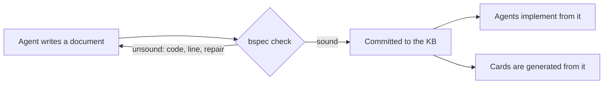

# bspec: the spec language

Part of [[spec-first-os]]; answers to [[philosophy]]. Working name `bspec`; renaming it is
one search-and-replace and does not change this design.

## Purpose

Markdown says what we mean. Nothing checks it. `bspec` is a small language for the part of
a spec that must be exact: states, events, what each event does, what must always hold.
It lives **inside** KB documents, as a fenced code block tagged `bspec`, beside the prose
that explains it. The document stays Markdown; the block is the part a machine holds us to.

A checker in Rust (`crates/bboxy450-spec`) rules on every block. Like a Haskell program
that type-checks, a `bspec` that checks is **sound**: it is complete, consistent and
means exactly one thing. Sound does not mean compiled. No compiler exists and none is
needed yet: agents compile specs to Rust by inference, and the macro system judges the
result ([[spec-first-os]]). The checker's job is earlier and simpler: **never let an
unsound spec into the knowledge base.**



## Design rules

The reader and the writer are language models. The language is shaped for them.

1. **One way to say each thing.** No synonyms, no optional syntax, no shorthand.
2. **Regular.** Every declaration starts with a keyword. Blocks use braces, statements end
   with `;`. Whitespace never matters.
3. **Local.** A spec is one self-contained block. Reading it needs nothing else.
4. **Says why.** `intent`, invariant text and scenario names are required prose, in the
   block, next to what they describe.
5. **Examples are checked.** A `scenario` is a concrete trace with expected outcomes. It
   is how the operator answers questions and how a model learns the spec by example.
6. **Errors are repair instructions.** Each diagnostic has a stable code, a position and
   one sentence saying what to change.
7. **Small.** The whole reference fits in one prompt, under 200 lines.

## The language

```
file      = spec+
spec      = "spec" NAME "{" item* "}"
item      = intent | domain | state | event | effect | on | invariant | assume | scenario
intent    = "intent" STRING ";"
domain    = "domain" NAME "=" "{" NAME ("," NAME)* "}" ";"
state     = "state" "{" (NAME ":" type "=" expr ";")* "}"
type      = "Bool" | "Int" "[" INT ".." INT "]" | NAME | "Set" "<" NAME ">"
event     = "event" NAME params? ";"
effect    = "effect" NAME params? ";"
params    = "(" NAME ":" NAME ("," NAME ":" NAME)* ")"
on        = "on" NAME ("(" NAME ("," NAME)* ")")? "{" case+ "}"
case      = "case" NAME ("when" expr | "otherwise") "{" stmt* end? "}"
stmt      = NAME "=" expr ";" | NAME "+=" expr ";" | NAME "-=" expr ";"
          | "emit" NAME ("(" expr ("," expr)* ")")? ";"
end       = ("reject" | "ignore") NAME ";"
invariant = "invariant" ID STRING ":" expr ";"
assume    = "assume" ID STRING ";"
scenario  = "scenario" STRING "{" (step | expect)* "}"
step      = call "->" ("accepted" ("emits" call ("," call)*)? | "rejected" NAME | "ignored" NAME) ";"
expect    = "expect" expr ";"
call      = NAME ("(" expr ("," expr)* ")")?
expr      = quantified | implication
quantified= ("forall" | "exists") NAME ":" NAME "." expr
implication, then or, and, not, comparison (== != < <=), in, + -, primary
primary   = "true" | "false" | INT | NAME | NAME "." NAME | "{" (expr ("," expr)*)? "}"
          | "if" expr "then" expr "else" expr | "(" expr ")"
```

Operators are words where a word exists: `and`, `or`, `not`, `in`, `=>`.
`Msg.A` names a domain member. `{}` is the empty set. `//` starts a comment.
`ID` is a stable claim id such as `REMOTE-DELIVERY-001`.

### Meaning

- A spec is one state machine. Its state is the `state` block; it starts at the given
  initial values.
- An event instance (an event with a value for each parameter) is handled by exactly one
  `case` of its `on` block: the one whose guard is true. `otherwise` is true exactly when
  no other guard in the block is.
- A case with no `end` **accepts**: all its updates apply at once, each right-hand side
  reading the state before the step. A variable the case does not mention keeps its value.
- A case ending in `reject X` or `ignore X` changes nothing and emits nothing. `reject`
  means the caller made an error; `ignore` means the event was harmless and had no effect.
- `emit` names an effect the implementation must perform when the case is taken.
- An `invariant` must hold in every reachable state.
- An `assume` is something the spec takes from its environment and cannot check. It is
  counted and shown on every card.
- `n <= 3` would not be accepted as an invariant in the example below: the type `Int[0..3]` already
  says it, so the claim is empty (B702). An invariant must be able to fail.
- Domains are the **bound**: a spec with `domain Msg = { A, B }` is checked for two
  messages, and says so.

### Example

```bspec
spec Counter {
  intent "A counter that never passes its limit and can be reset by its owner.";

  domain Who = { Owner, Guest };

  state {
    n: Int[0..3] = 0;
    locked: Bool = false;
  }

  event Bump;
  event Reset(by: Who);
  effect Notify;

  on Bump {
    case count when n < 3 and not locked { n = n + 1; }
    case full when n == 3 and not locked { locked = true; emit Notify; }
    case held otherwise { ignore Locked; }
  }

  on Reset(by) {
    case owner when by == Who.Owner { n = 0; locked = false; }
    case guest otherwise { reject NotOwner; }
  }

  invariant COUNTER-001 "locked only when full": locked => n == 3;

  scenario "a guest cannot reset" {
    Bump -> accepted;
    Reset(Who.Guest) -> rejected NotOwner;
    expect n == 1;
  }
}
```

## What "sound" means

A spec is sound when every check below passes. Checks run in order; a later group runs
only if the earlier ones are clean.

| Group | Code | The spec is unsound when |
|---|---|---|
| Syntax | B101 | the text does not parse |
| Names | B201 | a name is used but not declared |
| | B202 | a name is declared twice in one scope |
| | B203 | a domain, state variable, event or effect is declared and never used |
| | B204 | an event has no `on` block, or an `on` block names no declared event |
| Types | B301 | an expression has the wrong type for its place |
| | B302 | an initial value is outside its type |
| | B303 | an event, effect or scenario call has the wrong number or type of arguments |
| Totality | B401 | two cases of one `on` block can both be true (reports the state and arguments) |
| | B402 | no case of an `on` block is true for some state and arguments |
| Steps | B501 | a case assigns one variable twice |
| | B502 | a `reject` or `ignore` case updates state or emits |
| | B503 | an accepting case changes nothing and emits nothing |
| Model | B601 | an invariant is false in a reachable state (reports the shortest trace) |
| | B602 | an update can leave a variable's range in a reachable state (reports the trace) |
| | B603 | the reachable state space exceeds the limit |
| Vacuity | B701 | a case is never taken from any reachable state |
| | B702 | an invariant is true in every state of the type universe, reachable or not |
| Scenarios | B801 | a scenario step has a different outcome than written (reports actual) |
| | B802 | an `expect` is false at that point |
| Completeness | B901 | `intent` is missing or empty |
| | B902 | the spec has no invariant |
| | B903 | the spec has no scenario |

Totality (B401, B402) is checked over **every** value of the state types and arguments,
not only reachable ones: a spec must mean one thing even in states it believes it cannot
reach. Model, vacuity and scenario checks use the reachable states, explored exhaustively
by the existing `bboxy450-tlc` checker. There is one model checker in the suite, not two.

A sound verdict also reports what was checked, so a card can say it: domain sizes,
reachable states, transitions, and the list of `assume` lines.

## What sound does not mean

- Not that the spec is what the operator wants. Cards and scenarios are for that.
- Not that it holds beyond its bound.
- Not that any code implements it. The macro judge is for that.
- Not that it terminates or makes progress: v1 has safety only. Progress (`leads to`,
  fairness) is the first planned extension, taken from `protocol!`.

## In the knowledge base

- A `bspec` block may appear in any KB document; spec and interface documents are
  expected to have one once this lands.
- **Commit is the gate.** `knowledge_commit` checks every `bspec` block in the documents
  it is asked to commit and refuses the commit when any is unsound, returning the
  diagnostics. Drafts (`knowledge_write`) are never refused: an agent can save unsound
  work in progress, it cannot checkpoint it.
- `make check-specs` runs the same check over every Markdown file under `.bboxy`, for
  records that reach the repository by Git.
- Diagnostics use the document's own line numbers.

## Relation to `protocol!`

`protocol!` is the same idea embedded in Rust, and it stays: it is how Rust code binds to
a spec. `bspec` is the source of truth an agent reads; a `protocol!` declaration is what
that agent (by inference) writes for it. The anchor between them is mechanical: the
`bspec` text of `RemoteDelivery` and the existing `protocol!` declaration must explore to
the same reachable graph. Later, `protocol!` can read a `bspec` block directly, and one
of the two syntaxes goes.

## Out of scope for v1

Compilation; references between specs and interface contracts (`uses`); progress and
fairness; maps and sequences; parametric bounds; durability markers. Each is a named
extension, added only with a check that holds it.

## Acceptance

- [ ] `crates/bboxy450-spec` exists with no dependency beyond `bboxy450-tlc`.
- [ ] Every code in the table has a fixture that produces exactly that code.
- [ ] The `Counter` example above and `RemoteDelivery` are sound.
- [ ] `RemoteDelivery` in `bspec` and in `protocol!` reach the same number of states and
      transitions.
- [ ] `make check-specs` exits 0 on the repository and 1 on a seeded unsound block.
- [ ] `knowledge_commit` refuses a document with an unsound block and commits a sound one
      (second task).
