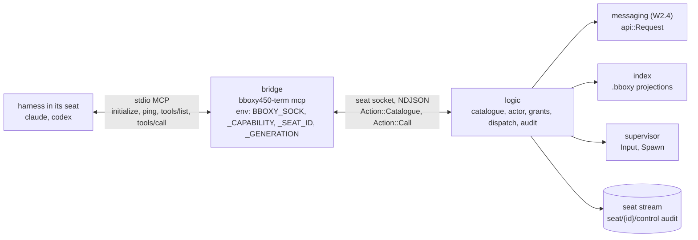
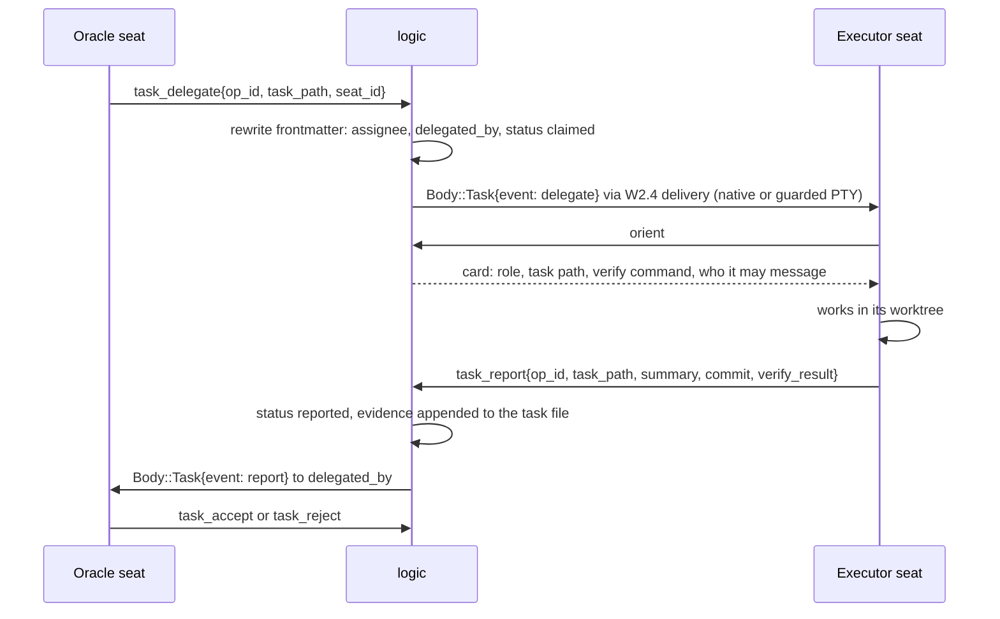

# W2.5 MCP server and W2.5b seat wiring kit

Owner: Corvin Duskmantle <ARCHITECT>. Decided 2026-10-22. Binds decision [[d3-mcp-server|#3]] of [[2026-10-22-architecture-round-1]] (MCP inside logic, a per-seat stdio bridge with a capability token) and [[d13-document-types|#13]] (tasks are Markdown). The operator's sentence: "terminal with MCP, tasks, hooks, skills all should be there." **Done means** a seat launched by the app can, on its first turn, call `orient`, take its task, message within its grants, report, and claim an artifact, with no user configuration touched. [[mcp-control-plane]] stays the full catalogue and semantics; this spec is the first cut that gets built, in the shape the code already has.

Lens: one machine; logic is the only authority; the bridge is dumb. Assumes the installed clients as verified on 2026-10-22: Claude Code 2.1.304 (`--mcp-config`, `--plugin-dir`, `--append-system-prompt`, `--settings`) and Codex 0.163 (`-c mcp_servers.<name>.…`). Breaks when a harness has no per-launch MCP flag: it gets the PTY path only. LESS IS MORE: three MCP methods, one new socket action pair, one overlay directory.

## 1. Shape

- **The bridge** is a private entry point of the one binary, `bboxy450-term mcp`, like `hook` (specs/README S5). It reads `BBOXY_SOCK`, `BBOXY_CAPABILITY`, `BBOXY_SEAT_ID`, `BBOXY_GENERATION` from the environment the launch overlay already exports (`M/adapters/launch.rs:87-94`). It implements MCP over stdio with exactly `initialize`, `ping`, `tools/list`, `tools/call`; no resources, prompts or sampling in W2.5. `tools/list` forwards to `Action::Catalogue`; `tools/call` forwards to `Action::Call{op_id, tool, args}` and returns logic's JSON result verbatim as the tool result. Stdout carries only MCP frames; stderr is bounded diagnostics; the capability is never printed. Hand-written JSON-RPC, three methods; the `rmcp` SDK only if acceptance test 1 fails on protocol negotiation.
- **Logic owns the catalogue**: names, schemas, role filter, dispatch. Actor per call: the seat socket's admission (`M/seat_socket.rs:213`: version, capability, seat, generation, then the supervisor-confirmed generation) → the seat record's role and grant epoch → `Actor` (`M/messaging/tree.rs:15`). Oracle-class and worker-class filter both `tools/list` and `tools/call`; a hidden name called directly is refused the same way. As built at 983386a (W2.5c): discovery adds `ch_link`, `ch_pause`, `ch_grant` only when `actor.role.class == Oracle` (`M/mcp/messaging.rs:93`; `catalogue(actor)` reads the class, `M/mcp/tools.rs:14-15`), and dispatch enforces it independently (`M/mcp/messaging.rs:245-249`, "tool requires oracle-class authority"). Every call writes one audit event `seat/{id}/control` to the seat stream: `{op_id, tool, actor, outcome, args_digest}`, never payloads.
- **Idempotency.** `op_id` is a caller ULID. Logic journals `control/op/{op_id}` → result in the principal's object kv: the seat object for seat actors, the **account object for the operator principal** (the GUI acting on this device; decision [[d31-device-bound-operator-journal|#31]]); a repeated `op_id` returns the stored result and audits a replay on `seat/{id}/control` or `account/control` respectively.

## 2. Catalogue, first cut

| Tool | Maps to | Roles |
|---|---|---|
| `orient` | index execution projection + own task docs + `Ls` of own tree + unread count, one card | O E C |
| `self_status` | registry record, adapter state and grade, mute, generation | O E C |
| `seat_list`, `seat_get` | registry; own swarm by default, account scope for Oracle | O E C; cross-swarm O |
| `screen_read`, `history_read` | logic snapshot `Screen` (`M/streams.rs:30`) and `GetHistory` pages | O; E C own seat |
| `seat_input_text` | `guard::check` then `submit_pty` (`M/adapters/guard.rs:36-136`, first production caller); operator keystrokes never pass here ([[c1-live-seats]] §2) | O |
| `seat_spawn` | `Worker::launch` (`M/logic.rs:785`) with role and cwd; no layout arguments in W2.5, the app places the seat when it sees `mux/seat_spawned` | O |
| `message_send`, `message_list`, `message_receipts`, `message_ack` | `messaging::api::Request::{Send, List, Receipts, Acknowledge}` | O E C within grants |
| `ch_ls`, `ch_subscribe`, `ch_unsubscribe`, `ch_link`, `ch_pause`, `ch_grant` | `Request::{Ls, Subscribe, Unsubscribe, Link, Pause, Grant}` | O; E C for ls, subscribe, unsubscribe |
| `seat_mute`, `seat_unmute` | `Request::Mute`; **deferred from W2.5c to W2.5e by Oracle ruling (2026-10-23), operator-side controls** | O |
| `task_delegate`, `task_reassign`, `task_accept`, `task_reject` | frontmatter rewrite in the task file, then a `Body::Task{event}` message to the seat (`M/messaging/wire.rs:46`) so W2.4 delivery evidence applies. `task_accept` is refused unless the recorded `verify_result = {command, exit_code, evidence}` has `command` equal to the task's `verify`, `exit_code` 0, and one evidence entry per listed acceptance criterion; swarm scope: every present seat reference among `assignee` and `delegated_by` resolves to the caller's registry swarm; one anchors, two must match, none refuses; never from a path (decision [[d28-structured-task-verification\|#28]]) | O |
| `task_status`, `task_list` | index | O; E C own tasks |
| `task_report` | frontmatter `status: reported`, `verify_result {command, exit_code, evidence: [{criterion, reference}]}` recorded, `Body::Task{event: report}` to `delegated_by` | E C own task; O |
| `artifact_claim` | write `.bboxy/artifacts/<ulid>.md`, link from the task | O E C |
| `graph_read` | execution, communication, task, markdown from the index projections (`M/index.rs:320-392`) | O; E C task and markdown, own items |

Thirty tools, plus `seat_interrupt` (specs/README S16, Oracle-only native Now/steer with `op_id` and audit) added in W2.5e: thirty-one. **All five parts landed 2026-10-22/23** (W2.5a bridge and read-only tools, b wiring kit 15f9f4e, c messaging and channels 983386a, d tasks and artifacts eed082d, e guarded input, spawn, mute and interrupt e49e4cb). Task events are the strings `delegate`, `release`, `accept`, `reject`, `report` in `Body::Task.event`, kind `Task`; the task file is the record, the message is the wake. Frontmatter fields per [[work-items]]: `assignee`, `delegated_by`, `status`, `updated`. **Deferred, still specified in [[mcp-control-plane]]:** split, focus, move, update, space and tab create, swarm templates, `audit_read`, `find`, `how`, `code_search`, `code_graph`, `artifact_release/list/get`, `graph_set_edge`, `seat_input_key`, `seat_set_role`, `seat_set_permissions` (`ch_grant` covers may-send-to for now).

## 3. W2.5b: the wiring kit, per launch, never user config

Everything lives in the per-launch overlay directory (`launch-{ulid}`, mode 0700, `M/adapters/launch.rs:66-100`) and in launch flags. User files are read, never written.

| Harness | Already there | Added by W2.5b |
|---|---|---|
| Claude | `--settings <overlay>/claude-settings.json` (hooks, crossSessionInbound), `--append-system-prompt <role prompt>`, `--name`, `--session-id` or `--resume` | `--mcp-config <overlay>/mcp.json` with `{"mcpServers":{"bboxy":{"command":"<exe>","args":["mcp"]}}}`; `--plugin-dir <overlay>/bboxy450` carrying `skills/bboxy450/SKILL.md`. Not `--strict-mcp-config`: the user's own servers stay. |
| Codex | `-c developer_instructions=<role prompt>`, `-c notify=…`, `-c hooks={…}`, `resume <id>` | `-c mcp_servers.bboxy.command="<exe>"`, `-c mcp_servers.bboxy.args=["mcp"]`. Skill text appended to `developer_instructions` until a per-launch skill path is verified; **Gap:** Codex per-session skill injection without writing `~/.codex`. |
| zsh, generic | ZDOTDIR overlay exports `BBOXY_*` | nothing; `bboxy450-term mcp` works by hand in that shell |

The skill is one `SKILL.md` generated from a template in the binary (`include_str!`), parameterised by role: the tool order `orient → task_* → message_* → artifact_claim`, DM by default and what the channel is for ([[messaging]]), and the report shape (files changed and mechanism, commands and exit status, evidence per criterion, gaps, worktree state). The role prompt stays what settings say.

**Role defaults ([[d262-seat-role-defaults]], 2026-10-24, from Aster's launch audit).** The launcher's default role label follows the harness rule of `AGENTS.md`: a **Claude** seat defaults to `oracle`; a **Codex** seat defaults to `executor` and cannot be given an oracle-class role (the rule says Codex implements; an override would make an Executor an Oracle); a **zsh or generic** seat has the role **`shell`**: a new `Role` variant of `Class::Worker`, issued as an ordinary grant at spawn like every seat, with no role prompt (there is no harness to prompt), shown in the row without a role chip. **Shape ruling (Nyx's question, 2026-10-24):** `SeatRecord.role` and `HarnessRecord.default_role` stay non-optional and `Class` stays `{Oracle, Worker}`; `shell` is one more variant, so nothing changes shape in the proto, the registry or grant signing, and a shell that later runs `bboxy450-term mcp` by hand sends as a worker-class `shell`, which is the truth. The operator may promote a shell seat through the role chip like any seat (a new epoch; the chip appears once the role is not `shell`). Rejected: `Option<Role>` through proto, registry and signing (a migration for one case); `Class::None` (a seat that can send messages has a class). The operator overrides a Claude seat **per seat**: at spawn through the launcher's role presets (`oracle`, `architect`, `creativity`, `executor`, the last by decision #18), and later through the seat row's role chip, which issues a **new role grant epoch** ([[messaging]]: role changes are new epochs) and tells the harness in one oracle-class message carrying the new role prompt. The row's label is the grant's role, never free text, so it cannot lie. When the swarm already has an Oracle seat, the launcher still defaults a new Claude seat to `oracle` and says so beside the preset ("this swarm already has an Oracle: <name>"), information rather than a block. The current default of `executor` for a Claude seat is a bug against this paragraph.

**Trust, stated plainly.** The capability sits in the environment of the whole harness process tree ([[architecture]] §6); accepted for v0.1. The bridge binds to (seat, generation): a resumed seat has a new generation and a new overlay, and the old bridge is refused. Decision [[d4-seat-identity|#4]] changes who signs envelopes, not this admission.

## 4. A task, end to end

## 5. Acceptance, the spec signs off

1. **Interop.** `bboxy450-term mcp` under a fixture environment serves `initialize`, `tools/list`, `tools/call` to both installed clients. Test: drive `claude -p` and `codex exec` with the prompt "call orient and say your role"; evidence is the audit event `seat/{id}/control` with `tool: orient` from the right seat and generation.
2. **First-turn contract.** A fresh Claude seat and a fresh Codex seat, launched by the test harness with a fixture task delegated to them, each call `orient` then `task_report` on their first turn; the task file reaches `status: reported`; the delegating seat holds the Task message with W2.4 receipt evidence.
3. **No user config touched.** Before and after, these are byte-identical: `~/.claude/settings.json`, `~/.claude/settings.local.json`, `~/.claude/plugins/`, `~/.claude/skills/`, any `.mcp.json` in the cwd, `~/.codex/config.toml`, `~/.codex/hooks.json`. Session and transcript files the harnesses write for themselves are out of the comparison and listed by name in the test.
4. **Grants.** A worker-class seat calling `seat_input_text` or `task_delegate` gets a permission error and an audit entry, and its `tools/list` omits them.
5. **Idempotency.** The same `op_id` twice returns the first result with one replay audit entry.
6. `sh scripts/ci-local.sh` exits 0 in a clean worktree of the handed-off commit.

## 6. Out of scope

Everything in the deferred list of §2; the GUI's own use of these tools (the app is a client of logic through [[c1-live-seats]], not through MCP); seat roles from settings UI (7.9); the GPG chain (ID1); remote seats (D1).

## 7. Order for briefs (the Oracle's call, one concern each)

W2.5a the bridge, `Catalogue` and `Call`, and the read-only tools (`orient`, `self_status`, `seat_list`, `seat_get`, `graph_read`), with acceptance 1. W2.5b the wiring kit: overlay flags, `SKILL.md`, acceptance 2 and 3. W2.5c messaging and channel tools over the W2.4 API, with acceptance 4. W2.5d task and artifact tools: the frontmatter writer, acceptance 2 again end to end, 5. W2.5e guarded input, spawn, and the operator-side controls `seat_mute` and `seat_unmute`.
