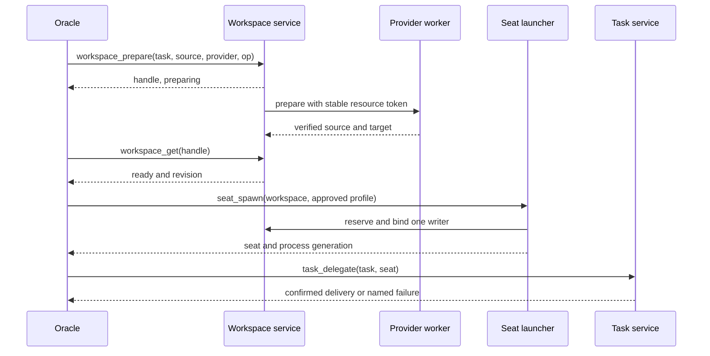
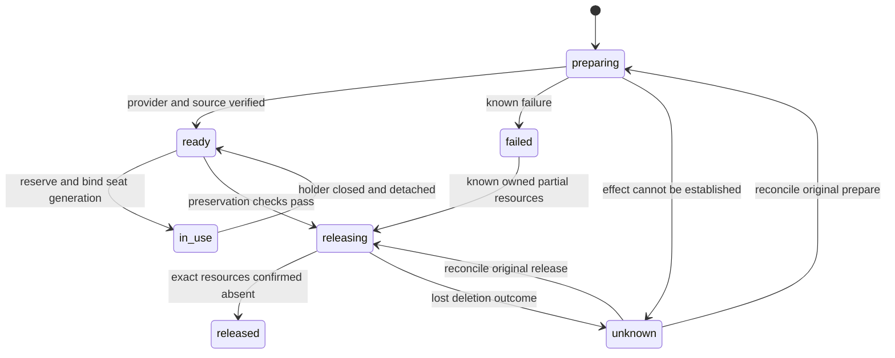

# Managed implementation workspaces

Proposed behavioral contract, requested by the operator on 2026-11-05. This is a specification for implementation, not a claim that the tools below exist today.

## 1. Decision and scope

Give Oracles one supported way to prepare an isolated implementation workspace and pass its handle to a worker seat. Implement a **Git worktree provider on the current machine first**. Keep the contract usable by a remote host, container or cloud provider without making a local pathname the workspace's identity. Add an actual remote provider only when its launch and recovery contract is implemented and verified.

The tool owns repeatable provisioning, identity, readiness and safe disposal. The Oracle chooses the task, base revision, provider and worker, then reviews the result. Existing task tools own assignment and acceptance; existing seat tools own harness processes. No second task scheduler, automatic merge policy, provider marketplace or general shell-execution endpoint.

The first success case is small: an Oracle prepares a workspace for one task, launches an Executor using the returned handle, delegates the brief and later releases that exact workspace after the task's work is preserved. A crash at any step leaves discoverable state rather than a second worktree or a deleted change.

## 2. Current boundaries and the problem

Current source inspected at `17eabaf2d8e6df2bdc91a67949a489066aafd38e`:

| Evidence | Existing mechanism | Required change |
|---|---|---|
| `scripts/dispatch-codex.sh:15–20` | Derives a path/branch, fetches main and runs `git worktree add` if the directory does not exist. | Readiness must verify repository/worktree identity and revision; directory existence alone cannot authorize reuse. |
| `crates/bbt-mux/src/mcp/seats.rs:82–83,388` | Oracle `seat_spawn`/`seat_split` accept an explicit absolute `cwd` and an approved profile. | Add a managed workspace reference, retaining the current admitted seat launcher and role checks. |
| `crates/bbt-mux/src/mcp/work_items.rs:970` | `task_delegate` resolves a task and authorized target seat. | Verify the implementation workspace binding when a task requires one; do not replace delegation with a workspace-local assignment. |
| `crates/bbt-proto/src/registry.rs:18,48,96` | Swarm working directory/revision, local/SSH/cloud location, seat generation and close lifecycle already exist. | Bind workspace use to those identities instead of inferring ownership from a path or visible tab. |
| `crates/bbt-mux/src/knowledge/workspaces.rs:48,323` | Knowledge mounts capture a root binding and derive a `.bboxy` root from a repository directory. | Keep the canonical knowledge binding distinct from an implementation checkout. A fresh worktree must not silently create a separate empty KB. |
| [[networking]] §5–6 | Existing proposed cloud/SSH interfaces describe machines and transports. | An implementation workspace composes those services; it is not another VM/SSH abstraction. These older proposals do not prove a current remote execution capability. |

Read these with [[work-items]], [[mcp-control-plane]], [[mux-daemon]], [[knowledge-base]], [[resource-ledger]], [[kill-only-own-pids]] and [[programmatic-tool-access]]. This spec supplies the missing implementation workspace lifecycle; unrelated earlier contracts remain authoritative.

Today each Oracle has to reproduce Git setup and cleanup conventions in commands. Those commands mix source selection, machine placement, task ownership and filesystem paths. That becomes especially fragile after retries, restarts, stale directories and changes to the swarm's selected KB. Centralize the lifecycle while leaving repository-specific build/test commands in the repository's existing Make interface.

## 3. What a workspace is

An **implementation workspace** is a durable record describing one isolated writable source checkout and its execution target. A **knowledge workspace** is the selected KB/provider root. A **host** is a machine or runtime that can execute a harness. They are different objects, even when they happen to share one directory on one laptop.

| Field | Contract |
|---|---|
| `workspace_id`, `revision` | Opaque durable ULID and monotonic lifecycle revision. Paths, branch names and VM IDs are attributes, never the identity. |
| `swarm_id`, `task_ref` | Captured authorized swarm and stable task/provider identity. A task etag and knowledge root/provider revision are checked at preparation admission and binding. |
| `source` | Configured repository reference, immutable resolved base commit and provider-specific source identity. A branch such as `origin/main` is resolved once, and the resolved commit is returned. |
| `provider`, `profile` | Installed approved provider and operator-configured resource/setup profile. Version and relevant configuration digest are recorded. |
| `target` | Tagged execution target: local device/path or authenticated remote device/runtime/workspace reference. A local path is optional. A raw SSH hostname is insufficient identity. |
| `knowledge_binding` | Canonical KB root/provider identity and captured revision, separate from the source checkout. It is not a symlink escape or a grant of additional authority. |
| `state`, `operation_id` | Durable lifecycle and existing journal operation identity, with recoverable per-step receipts. |
| `holder` | At most one writing seat, its process generation and a monotonic binding revision. Read-only review does not obtain a writing lease. |
| `evidence` | Resolved source/branch, provider resource IDs, readiness checks, created resources and last verified cleanup/recovery facts. Credentials and raw environment values are excluded. |

A first local response can contain `target: {kind: "local", device_id, cwd}`. A future remote response can contain `target: {kind: "remote", device_id, runtime_id, workspace_ref}`. Both launch through the same handle. Remote paths are interpreted on their authenticated host, never as laptop paths.

Readiness includes the repository's required submodules, source availability and configured setup result. Toolchain/OS/capability requirements are explicit, for example Linux compilation versus macOS GUI capture and signing. A cloud Linux checkout cannot claim it can run the macOS app's acceptance tests. No provider is selected automatically because it happens to be cheaper or available.

## 4. Minimal public interface

All names and JSON shapes here are proposed additions to the existing MCP catalogue, not current executable recipes. Publish exact schemas and structured results using the existing hints/error envelope. Workspace mutators are available to the operator and authorized Oracle class; an Executor can inspect its own binding but cannot provision peers or release their work.

| Operation | Input and behavior |
|---|---|
| `workspace_prepare` | `op_id`, `task_path`, configured `repository`, `base`, `provider`, optional configured `profile` and positive `attempt` (default 1). Capture source/task/KB identity, allocate an owned workspace and start preparation. Return a handle and `preparing` promptly; bounded synchronous completion may return `ready`. |
| `workspace_orient` | Read-only current setup/provider readiness, exact preparation/launch/delegation/recovery workflow, and source-versus-KB binding guidance. General `orient` hints here for Oracle class or any actual role/grant authorized to provision workspaces. |
| `workspace_get` | `workspace_id`, or no ID for the caller's bound workspace. Return authoritative state, revision, source, readiness, binding, recoverable operation and actionable failure. |
| `workspace_list` | Optional state/task filters plus bounded `cursor`/`limit`; only authorized scope. Expose failed, unknown and unbound workspaces for recovery without scanning the filesystem. |
| `workspace_release` | `op_id`, `workspace_id`, `expected_revision`. Request release of resources created for this workspace after the preservation and ownership checks in §7. No `force` flag. |
| Existing `operation_status` | Query the same mutation ID after a lost response. Its completed result contains the workspace handle. An indeterminate effect is not permission to start a replacement. |

Do not add `workspace_shell`, `workspace_merge` or `workspace_publish`. Source commits and tests still use the harness's normal execution tools and the repository's canonical workflows. Writes through the proposed Python client use the same MCP contracts, not a separate provisioning API.

Add `workspace: {id, expected_revision}` to existing `seat_spawn` and `seat_split`. Exactly one of `workspace` or legacy `cwd` is supplied. A managed launch resolves the target internally and checks the same approved harness profile, role, task scope and current authority as any launch. Mismatched explicit location/cwd arguments are rejected rather than silently ignored. Local Git support ships first; asking for an unavailable remote adapter returns `workspace_provider_unavailable`, never a local substitute.

The launcher reserves the writing binding before process creation, then commits it against the returned seat ID/generation. Failure before creating a process releases only that reservation. An unknown spawn outcome keeps it reserved until the launcher reconciles the exact operation. `task_delegate` checks the resulting binding and does not report success merely because the seat started.

### Normal Oracle workflow

1. Create/read the native task with its allowed paths and verification command; choose source repository, base and approved workspace profile.
2. Call `workspace_prepare` once. Use bounded status/event updates until it is ready; do not create a second workspace on a timeout.
3. Launch the approved worker profile with the returned workspace ID and revision. Delegate the task through `task_delegate` and verify its receipt. A launch or delivery failure remains visible at its own operation.
4. Worker orientation returns its workspace/source/target and canonical KB binding alongside the task. The worker edits and tests in that workspace and reports source commits and actual evidence.
5. Review and land using existing policy. Close the writing seat, preserve the resulting source/private work, then release the workspace through the guarded tool.

### Python execution in a managed workspace

`python_execute` and `python_execute_orient` from [[programmatic-tool-access]] use this workspace service's current execution-context resolver. The resolver returns workspace ID/revision, source target/cwd, current writing holder and generation, and canonical knowledge/provider binding. Resolve at admission and recheck before new nested effects and completion publication. The managed worktree is where code and command bindings execute; knowledge MCP calls retain the canonical KB. Released/replaced/stale/foreign holders refuse. Unmanaged seats retain their captured source cwd explicitly. No separate workgraph engine is requested: the operator clarified that “workgraph” referred to this workspace-provisioning feature.

General `orient` links `knowledge_orient`, capability-eligible `workspace_orient`, and `python_execute_orient` through the existing structured hint graph, with compatible text and exact valid call arguments. Python setup/orchestration belongs to its own orientation endpoint rather than bloating the initial identity result.

## 5. Provider contract: Git now, cloud without a rewrite

The small provider seam has `prepare(request, resource_token)`, `inspect(resource_ref)` and `release(resource_ref, ownership_evidence)`. Work runs on bounded IO workers. Each provider supplies readiness, source preservation checks and reconciliation for its resources. The service owns policy, journaling, task/seat binding and lifecycle; plugins do not independently decide assignments or trust levels. Do not build a generic plugin-extension ABI before the second provider requires it. Start with an internal trait and versioned request/result types.

### Git worktree provider, first delivery

- Resolve the configured repository to its Git common directory and canonical filesystem identity. Fetch only under explicit repository policy; resolve the requested base once. Return an actionable `source_unavailable` when offline or absent, with no implicit switch to another branch.
- Create a unique branch and worktree under the configured owned workspace parent. Derive resource names from the durable workspace ID, not a human title alone. Use Git argv APIs without shell interpolation. Never reset, stash or change the operator's shared checkout.
- Before reuse, verify `git worktree list --porcelain`, the common directory, checkout identity, branch/base and recorded resource token. A preexisting arbitrary directory, symlink, branch or checkout is a collision, not proof of readiness. Default policy creates a new isolated workspace; resuming an existing handle is a distinct reconciliation path.
- Honor repository-owned setup/toolchain/submodule requirements. In bboxy that means the pinned harness revision, project instructions, Make workflows and resource limits. Do not unconditionally pull the harness submodule to latest or copy a shared dirty checkout. Do not share writable `target/` directories unless the repository explicitly supplies a safe cache interface.
- Setup uses a named approved profile and bounded subprocesses, never arbitrary shell text from MCP arguments. Credentials stay in existing operator-approved stores. A failed setup retains its owned workspace with diagnostics for repair; no half-prepared worker launches.
- Canonical knowledge reads/writes route to the task's captured KB binding. The implementation checkout's absent or stale ignored `.bboxy` directory cannot silently substitute an empty root. Remote knowledge must use the authenticated admitted provider path; a read-only exported brief is not a live writable KB.

### Future providers

An SSH host, container service or cloud workspace may create a clone/volume rather than a Git linked worktree. It must satisfy the same isolation, source identity, durable recovery, knowledge access, process admission and preservation rules. A provider creates infrastructure only under its configured policy/resource budget and returns opaque owned resource identifiers, never secrets.

Compose an existing host/transport provider where available. Do not store an operator's cloud token, private signing key or device key in the task, launch argv, image or workspace record. Remote seats use their own enrolled identity. Repository hooks/setup and code run on the chosen host under its declared execution policy; tool-name filtering is not a sandbox for arbitrary nested programs.

The minimum remote conformance demonstration is: prepare the requested source, launch an authenticated admitted worker, access the correct KB/task, report actual verification and preserve the resulting commits/artifacts back to an authorized destination. If remote changes are not locally reachable or otherwise durably preserved, release must refuse. No automatic Git push, VM deletion or cloud spend is implied by choosing a provider name. Profiles with existing authorization run autonomously within that policy; unsupported placement or budget is a structured refusal, not a new approval ritual on each call.

## 6. Ownership, retries and restarts

These are projected workspace states. Existing operation status separately records whether an individual call is pending, succeeded, rejected or indeterminate. Do not mark a workspace ready merely because an operation was accepted. An unknown release reconciles the original release, rather than entering preparation or creating a replacement.

Persist the operation intent and stable provider resource token before any external effect. Same operation ID and identical arguments return/reconcile the same workspace. Reusing an operation ID with different arguments is a conflict. Serial admission for the same task/source/provider/attempt also returns `workspace_already_exists` with the existing handle for an active workspace; distinct operation IDs must not accidentally create two default writers. A deliberate additional task attempt supplies an incremented `attempt` after the old writing binding is relinquished. The previous workspace remains available for preservation/review; a new attempt cannot clear its dirty/unknown state.

A provider without idempotent creation or a reliable lookup by token cannot promise automatic recovery after an unknown outcome; hold it in `unknown` with evidence and a concrete reconciliation action. Never retry a cloud create, destructive cleanup or whole setup script merely because a socket closed. Setup steps need declared repeatability/checkpoints; otherwise inspect the partial result before rerunning them.

One writing holder per workspace and one managed implementation workspace per worker seat. The binding records workspace revision, task identity, seat generation and grant epoch. Every late completion checks its operation, lifecycle revision, binding and provider/configuration revision before publication; root/host changes A → B → A do not make an old result current again. A task brief/allowed-path change before binding requires revalidation. An in-use task/KB change fences new affected actions and exposes the mismatch instead of retargeting the worker's writes.

UI detach/reopen keeps workspace and writer state. Supervisor restart reconciles recorded provider resources and process ownership before enabling a new writer; it does not assume a heartbeat timeout proves the old remote process is dead. A closed seat stays closed. Reopening work requires an explicit new seat generation after fencing the old holder. This follows existing user intent for seat close/resume rather than inventing automatic restoration.

Provisioning, Git operations, setup, resource inspection and cleanup run off the supervisor owner loop. Use short state transitions plus bounded IO jobs; no process-wide lock while fetching, compiling, waiting on a provider or scanning Git history. Independent workspaces progress independently; only genuinely shared Git administrative changes need their repository's short admission lock. Status and messaging must remain responsive while one provider is slow. Use completion events and bounded backoff; do not walk every workspace on each filesystem/build event.

## 7. Release and preservation

Closing a seat, accepting a task and releasing its implementation workspace are separate effects. A close never deletes a checkout, and removing a checkout never claims a task is accepted. Release is authorized only for exact resources that this service recorded as creating or explicitly adopting under operator policy. Ordinary path arguments never expand that ownership.

Before Git removal, confirm all of the following from fresh evidence:

1. No live or uncertain writer/reservation holds the workspace; the current revision matches. Check recorded process ownership and generation, not process-name searches.
2. Worktree/common-directory/resource identity still matches the owned record. Refuse symlink swaps, replaced paths and mismatched provider resource tags.
3. Every source commit is reachable from the declared integration/preservation target, or verified as the authorized rebased equivalent with recorded evidence. A successful task report alone is insufficient. Preserve the human branch/ref unless repository policy explicitly authorizes its separate removal.
4. There are no unpreserved tracked edits, untracked files or private ignored data. Exempt only explicitly declared regenerable output directories created by this workspace; never treat all ignored files, `.bboxy`, logs or credentials as disposable build output. No external process has the local directory open; remote providers supply equivalent process/volume evidence or refuse safely.

Return `workspace_dirty`, `workspace_unpublished_commits`, `workspace_in_use`, `workspace_identity_changed` or `workspace_preservation_unproven` with bounded evidence and the next safe action. Do not run `git clean`, force-remove, stash or delete uncertain work to make the gate pass. An empty failed preparation may be released after proving its exact partial resources, without pretending there are source changes to land.

Cloud release follows the same contract plus provider ownership/preservation verification. Stopping compute and destroying source storage are distinct resource effects; do not discard a volume because a VM stopped. A provider TTL may stop billable compute only if explicitly configured, and must retain source storage and a recoverable record. No automatic age-based deletion of active, dirty or unknown workspaces. Surface unused resources and age for an authorized release sweep.

Provenance remains checkpoint-based: a writable checkout is work in progress. Record preparation/lifecycle receipts as control evidence; compute document/artifact provenance for explicit source/knowledge commits and accepted checkpoints, not every build output or filesystem notification. Cross-machine sharing requires a deliberate preserved/committed artifact. `workspace_release` does not invent a knowledge commit or publication step.

## 8. Structured feedback and human presentation

Orientation includes the workspace handle, source base, writing holder, execution target, canonical KB/task references, current state and exact available next operations. A managed worker must know where to edit without reconstructing a local path on a remote host. Tools advertise precise role/scope restrictions and terminal versus recoverable failures.

Keep tool data and recovery hints together in the structured result and compatible text representation, using the current bboxy response contract. Name invalid fields with expected/actual values where safe. `provider_busy` means the request was not admitted and states whether retry is safe; it is not a generic label for an unknown external effect. Preserve operation IDs and underlying provider error codes without leaking credentials.

The UI shows source, provider/host, task and state in one workspace detail view, linking to current logs, operation status and source evidence. It exposes release refusals and unknown outcomes rather than just a red seat exit code. Reports remain readable Markdown with useful tables/diagrams and clickable source links; runtime JSON is not a substitute for an understandable handoff.

## 9. Acceptance and delivery

| Check | Required evidence |
|---|---|
| Two workers, one repository | Distinct tasks prepare distinct branches/worktrees; edits and generated output are isolated; canonical KB remains shared through the captured binding. |
| Repeat prepare / lost response | Same operation creates one resource. Another operation for the same active task attempt returns its existing handle. Crash after creation/before reply reconciles that resource. |
| Source correctness | Returned immutable base equals the actual checkout; submodules obey the requested revision; stale directories/branches and unavailable bases refuse without modifying the main checkout. |
| Launch and delegation | One writer reservation, approved profile/current role, exact seat generation and KB/task binding. Delayed/failed/unknown launch or delegation does not fabricate assignment success or permit a second writer. |
| Restart and authority | UI detach preserves work. Backend restart reconciles ownership. Old callbacks after task/provider/root A → B → A, grant revocation or close cannot bind, publish or delete current work. |
| Release | Clean preserved workspace releases only owned resources. Dirty/untracked/private data, unpublished commits, uncertain processes and replaced identities refuse without data loss. Late release cannot remove a reused path/resource. |
| Responsiveness | Hold one fake provider/Git job indefinitely; unrelated orientation, messaging, status and another repository's preparation still finish. No repeated all-workspace scan on build/pull events. |
| Remote conformance | Fake remote provider exercises a nonlocal execution descriptor, credential redaction, idempotent resource token, lost create/delete response and preserved output. Real cloud validation is separate opt-in evidence, not a requirement to spend money in unattended tests. |
| Workflow adoption | Oracle orientation/help and repository dispatch entry points use the managed API for managed workers; existing open unmanaged seats are neither moved nor deleted. Legacy raw-cwd launch stays explicitly unmanaged during migration. |

Formal implementation work must model finite workspaces/tasks/seats, state/revision, holder/generation, operation/resource identity and provider completion. Safety: at most one writer; no stale completion changes the current binding; no unpreserved or unowned resource is deleted; retries cannot duplicate one creation. Liveness assumes a fair bounded IO scheduler and an eventually responsive provider: known operations reach ready/failed/released; persistent provider ambiguity remains visible as unknown, never false success. Explore reorder, duplication, cancellation, restart and A → B → A. Add broken controls removing the generation, deduplication and preservation guards. Bind those invariants to real process/Git tests and the existing formal contracts/coverage manifests.

Delivery order:

1. Native durable lifecycle, local Git provider, prepare/get/list/release, targeted process/Git tests and formal witnesses. No remote provider claimed.
2. Seat launch/task binding, separate canonical knowledge context, orientation and migration of the canonical dispatch path. Test source/KB separation with a fresh worktree before enabling worker launches.
3. One real remote provider using existing host/transport support, with its own conformance evidence. Add broader provider extension support only when this exposes a concrete missing boundary.

For this spec change, validate record metadata, unique numbering, links, Markdown/code fences and native KB read-back. Runtime/build/formal acceptance above belongs to the implementation, not a claim that writing the spec ran those checks.
