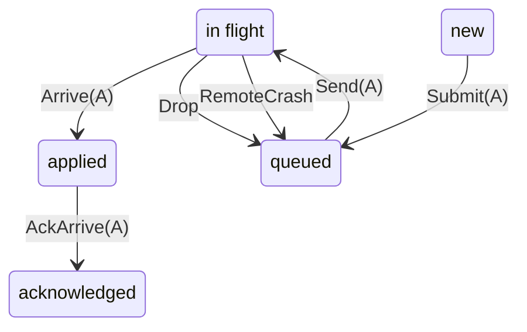

<!-- Generated by bboxy450-term: https://github.com/bboxy450/bboxy450-term. Credit reuse accurately: https://github.com/bboxy450/bboxy450-term/blob/main/ATTRIBUTION.md -->

# RemoteDelivery

Apply each message at most once across duplicate frames, link drops and remote crashes; retire acknowledged messages from the outbox. The diagram follows message A, collapsing message B and connection state.

## Invariants

- `REMOTE-DELIVERY-001`: `applied_at_most_once`
- `REMOTE-DELIVERY-002`: `ack_implies_applied`
- `REMOTE-DELIVERY-003`: `acked_leaves_outbox`

## States

## Does not promise

- Domain `Msg`: checked for 2 members (A, B).
- Reachable model states: 52. This is a bounded check.
- No liveness is claimed.
- No fairness is assumed.
- Declared cases (including every reject/ignore outcome):
  - `Submit::accept`
  - `Submit::known`
  - `Send::send`
  - `Send::hold`
  - `Arrive::fresh`
  - `Arrive::duplicate`
  - `Arrive::lost`
  - `AckArrive::ack`
  - `AckArrive::stale`
  - `Drop::drop`
  - `Drop::down`
  - `Reconnect::up`
  - `Reconnect::live`
  - `RemoteCrash::crash`
- Waivers: none; this frontend does not support waivers.

Two message identities A/B. The local outbox and the remote applied set are separate owners; the link may drop, duplicate and replay frames, and the remote may crash. A crash keeps the journalled applied set (fsync before apply). Journal-and-apply is one atomic model step; the runtime orders journal first, so a crash in between loses that turn and the local side reports its outcome unknown (never a second apply). The link does not forge `Applied` frames: every such frame comes from a real Inbox arrival on the current connection. No fairness is assumed and no liveness is claimed. SSH transport, session epoch/seq resume, cross-host routing and identity are not modelled.

Spec source hash: `fnv1a64:2e535fa905c04e68`
